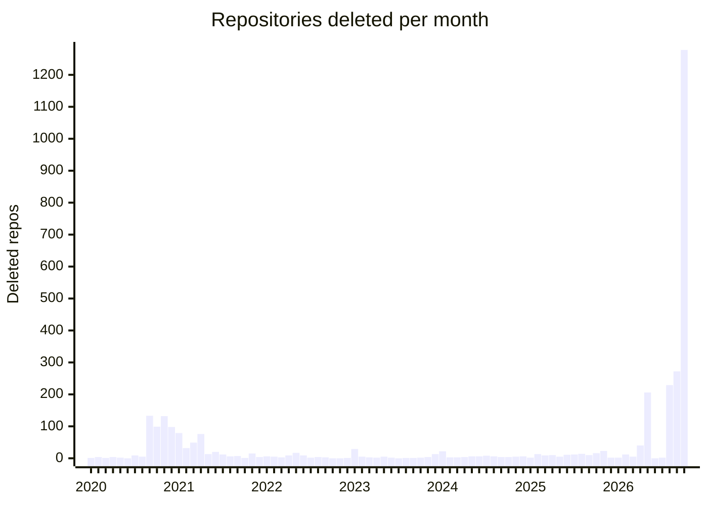

# Deleted UK Government code repositories

Total deleted repositories: **3226**
Organisations affected: **90**

See [RECENTLY_DELETED.md](RECENTLY_DELETED.md) for the most recently deleted repositories.

Deleted dates with a \* are approximate, inferred from the last commit or archive.org snapshot. This is the last date we know it was available.

| Organisation | Deleted Repos | % Deleted |
| --- | ---: | ---: |
| [ONSdigital](https://github.com/ONSdigital) | [**974**](https://github.com/orgs/uk-gov-mirror/repositories?q=mirror%3Afalse+fork%3Afalse+archived%3Afalse+%22ONSdigital.%22) | 78.4% |
| [ministryofjustice](https://github.com/ministryofjustice) | [**419**](https://github.com/orgs/uk-gov-mirror/repositories?q=mirror%3Afalse+fork%3Afalse+archived%3Afalse+%22ministryofjustice.%22) | 15.8% |
| [nhsdigital](https://github.com/nhsdigital) | [**272**](https://github.com/orgs/uk-gov-mirror/repositories?q=mirror%3Afalse+fork%3Afalse+archived%3Afalse+%22nhsdigital.%22) | 61.8% |
| [hmrc](https://github.com/hmrc) | [**218**](https://github.com/orgs/uk-gov-mirror/repositories?q=mirror%3Afalse+fork%3Afalse+archived%3Afalse+%22hmrc.%22) | 10.7% |
| [SkillsFundingAgency](https://github.com/SkillsFundingAgency) | [**155**](https://github.com/orgs/uk-gov-mirror/repositories?q=mirror%3Afalse+fork%3Afalse+archived%3Afalse+%22SkillsFundingAgency.%22) | 22.7% |
| [informatics-lab](https://github.com/informatics-lab) | [**154**](https://github.com/orgs/uk-gov-mirror/repositories?q=mirror%3Afalse+fork%3Afalse+archived%3Afalse+%22informatics-lab.%22) | 100.0% |
| [UKHomeOffice](https://github.com/UKHomeOffice) | [**116**](https://github.com/orgs/uk-gov-mirror/repositories?q=mirror%3Afalse+fork%3Afalse+archived%3Afalse+%22UKHomeOffice.%22) | 8.6% |
| [defra](https://github.com/defra) | [**71**](https://github.com/orgs/uk-gov-mirror/repositories?q=mirror%3Afalse+fork%3Afalse+archived%3Afalse+%22defra.%22) | 3.4% |
| [moj-analytical-services](https://github.com/moj-analytical-services) | [**65**](https://github.com/orgs/uk-gov-mirror/repositories?q=mirror%3Afalse+fork%3Afalse+archived%3Afalse+%22moj-analytical-services.%22) | 75.6% |
| [DFE-Digital](https://github.com/DFE-Digital) | [**55**](https://github.com/orgs/uk-gov-mirror/repositories?q=mirror%3Afalse+fork%3Afalse+archived%3Afalse+%22DFE-Digital.%22) | 5.9% |
| [ukwa](https://github.com/ukwa) | [**47**](https://github.com/orgs/uk-gov-mirror/repositories?q=mirror%3Afalse+fork%3Afalse+archived%3Afalse+%22ukwa.%22) | 46.1% |
| [companieshouse](https://github.com/companieshouse) | [**45**](https://github.com/orgs/uk-gov-mirror/repositories?q=mirror%3Afalse+fork%3Afalse+archived%3Afalse+%22companieshouse.%22) | 6.4% |
| [dwp](https://github.com/dwp) | [**45**](https://github.com/orgs/uk-gov-mirror/repositories?q=mirror%3Afalse+fork%3Afalse+archived%3Afalse+%22dwp.%22) | 6.3% |
| [nhsconnect](https://github.com/nhsconnect) | [**45**](https://github.com/orgs/uk-gov-mirror/repositories?q=mirror%3Afalse+fork%3Afalse+archived%3Afalse+%22nhsconnect.%22) | 26.2% |
| [ONS-Innovation](https://github.com/ONS-Innovation) | [**44**](https://github.com/orgs/uk-gov-mirror/repositories?q=mirror%3Afalse+fork%3Afalse+archived%3Afalse+%22ONS-Innovation.%22) | 38.3% |
| [UKGovernmentBEIS](https://github.com/UKGovernmentBEIS) | [**43**](https://github.com/orgs/uk-gov-mirror/repositories?q=mirror%3Afalse+fork%3Afalse+archived%3Afalse+%22UKGovernmentBEIS.%22) | 27.2% |
| [Planning-Inspectorate](https://github.com/Planning-Inspectorate) | [**40**](https://github.com/orgs/uk-gov-mirror/repositories?q=mirror%3Afalse+fork%3Afalse+archived%3Afalse+%22Planning-Inspectorate.%22) | 43.0% |
| [dvla](https://github.com/dvla) | [**30**](https://github.com/orgs/uk-gov-mirror/repositories?q=mirror%3Afalse+fork%3Afalse+archived%3Afalse+%22dvla.%22) | 42.3% |
| [nhsd-a2si](https://github.com/nhsd-a2si) | [**30**](https://github.com/orgs/uk-gov-mirror/repositories?q=mirror%3Afalse+fork%3Afalse+archived%3Afalse+%22nhsd-a2si.%22) | 93.8% |
| [datasciencecampus](https://github.com/datasciencecampus) | [**28**](https://github.com/orgs/uk-gov-mirror/repositories?q=mirror%3Afalse+fork%3Afalse+archived%3Afalse+%22datasciencecampus.%22) | 46.7% |
| [hmcts](https://github.com/hmcts) | [**28**](https://github.com/orgs/uk-gov-mirror/repositories?q=mirror%3Afalse+fork%3Afalse+archived%3Afalse+%22hmcts.%22) | 1.4% |
| [ukforeignoffice](https://github.com/ukforeignoffice) | [**23**](https://github.com/orgs/uk-gov-mirror/repositories?q=mirror%3Afalse+fork%3Afalse+archived%3Afalse+%22ukforeignoffice.%22) | 63.9% |
| [nationalarchives](https://github.com/nationalarchives) | [**21**](https://github.com/orgs/uk-gov-mirror/repositories?q=mirror%3Afalse+fork%3Afalse+archived%3Afalse+%22nationalarchives.%22) | 3.2% |
| [insolvencyservice](https://github.com/insolvencyservice) | [**17**](https://github.com/orgs/uk-gov-mirror/repositories?q=mirror%3Afalse+fork%3Afalse+archived%3Afalse+%22insolvencyservice.%22) | 54.8% |
| [nhsengland](https://github.com/nhsengland) | [**16**](https://github.com/orgs/uk-gov-mirror/repositories?q=mirror%3Afalse+fork%3Afalse+archived%3Afalse+%22nhsengland.%22) | 6.6% |
| [dvsa](https://github.com/dvsa) | [**15**](https://github.com/orgs/uk-gov-mirror/repositories?q=mirror%3Afalse+fork%3Afalse+archived%3Afalse+%22dvsa.%22) | 5.1% |
| [CPS-Innovation](https://github.com/CPS-Innovation) | [**13**](https://github.com/orgs/uk-gov-mirror/repositories?q=mirror%3Afalse+fork%3Afalse+archived%3Afalse+%22CPS-Innovation.%22) | 23.6% |
| [intellectual-property-office](https://github.com/intellectual-property-office) | [**13**](https://github.com/orgs/uk-gov-mirror/repositories?q=mirror%3Afalse+fork%3Afalse+archived%3Afalse+%22intellectual-property-office.%22) | 46.4% |
| [111online](https://github.com/111online) | [**12**](https://github.com/orgs/uk-gov-mirror/repositories?q=mirror%3Afalse+fork%3Afalse+archived%3Afalse+%22111online.%22) | 92.3% |
| [nhsuk](https://github.com/nhsuk) | [**12**](https://github.com/orgs/uk-gov-mirror/repositories?q=mirror%3Afalse+fork%3Afalse+archived%3Afalse+%22nhsuk.%22) | 54.5% |
| [nhsd-exeter](https://github.com/nhsd-exeter) | [**10**](https://github.com/orgs/uk-gov-mirror/repositories?q=mirror%3Afalse+fork%3Afalse+archived%3Afalse+%22nhsd-exeter.%22) | 100.0% |
| [UK-Export-Finance](https://github.com/UK-Export-Finance) | [**9**](https://github.com/orgs/uk-gov-mirror/repositories?q=mirror%3Afalse+fork%3Afalse+archived%3Afalse+%22UK-Export-Finance.%22) | 64.3% |
| [NHSX](https://github.com/NHSX) | [**7**](https://github.com/orgs/uk-gov-mirror/repositories?q=mirror%3Afalse+fork%3Afalse+archived%3Afalse+%22NHSX.%22) | 6.4% |
| [ONS-OpenData](https://github.com/ONS-OpenData) | [**7**](https://github.com/orgs/uk-gov-mirror/repositories?q=mirror%3Afalse+fork%3Afalse+archived%3Afalse+%22ONS-OpenData.%22) | 14.6% |
| [digital-land](https://github.com/digital-land) | [**7**](https://github.com/orgs/uk-gov-mirror/repositories?q=mirror%3Afalse+fork%3Afalse+archived%3Afalse+%22digital-land.%22) | 2.5% |
| [jncc](https://github.com/jncc) | [**7**](https://github.com/orgs/uk-gov-mirror/repositories?q=mirror%3Afalse+fork%3Afalse+archived%3Afalse+%22jncc.%22) | 8.1% |
| [ukncsc](https://github.com/ukncsc) | [**7**](https://github.com/orgs/uk-gov-mirror/repositories?q=mirror%3Afalse+fork%3Afalse+archived%3Afalse+%22ukncsc.%22) | 25.9% |
| [OfqualGovUK](https://github.com/OfqualGovUK) | [**6**](https://github.com/orgs/uk-gov-mirror/repositories?q=mirror%3Afalse+fork%3Afalse+archived%3Afalse+%22OfqualGovUK.%22) | 40.0% |
| [ScotGovAnalysis](https://github.com/ScotGovAnalysis) | [**6**](https://github.com/orgs/uk-gov-mirror/repositories?q=mirror%3Afalse+fork%3Afalse+archived%3Afalse+%22ScotGovAnalysis.%22) | 4.6% |
| [WMRGL](https://github.com/WMRGL) | [**6**](https://github.com/orgs/uk-gov-mirror/repositories?q=mirror%3Afalse+fork%3Afalse+archived%3Afalse+%22WMRGL.%22) | 60.0% |
| [homesengland](https://github.com/homesengland) | [**6**](https://github.com/orgs/uk-gov-mirror/repositories?q=mirror%3Afalse+fork%3Afalse+archived%3Afalse+%22homesengland.%22) | 100.0% |
| [nhs-england-tools](https://github.com/nhs-england-tools) | [**6**](https://github.com/orgs/uk-gov-mirror/repositories?q=mirror%3Afalse+fork%3Afalse+archived%3Afalse+%22nhs-england-tools.%22) | 27.3% |
| [Digital-Intelligence-Unit](https://github.com/Digital-Intelligence-Unit) | [**5**](https://github.com/orgs/uk-gov-mirror/repositories?q=mirror%3Afalse+fork%3Afalse+archived%3Afalse+%22Digital-Intelligence-Unit.%22) | 50.0% |
| [ONS-Health-modelling-hub](https://github.com/ONS-Health-modelling-hub) | [**5**](https://github.com/orgs/uk-gov-mirror/repositories?q=mirror%3Afalse+fork%3Afalse+archived%3Afalse+%22ONS-Health-modelling-hub.%22) | 19.2% |
| [communitiesuk](https://github.com/communitiesuk) | [**5**](https://github.com/orgs/uk-gov-mirror/repositories?q=mirror%3Afalse+fork%3Afalse+archived%3Afalse+%22communitiesuk.%22) | 2.4% |
| [alphagov](https://github.com/alphagov) | [**4**](https://github.com/orgs/uk-gov-mirror/repositories?q=mirror%3Afalse+fork%3Afalse+archived%3Afalse+%22alphagov.%22) | 0.3% |
| [nhsbsa-data-analytics](https://github.com/nhsbsa-data-analytics) | [**4**](https://github.com/orgs/uk-gov-mirror/repositories?q=mirror%3Afalse+fork%3Afalse+archived%3Afalse+%22nhsbsa-data-analytics.%22) | 9.5% |
| [nhsuk-archive](https://github.com/nhsuk-archive) | [**3**](https://github.com/orgs/uk-gov-mirror/repositories?q=mirror%3Afalse+fork%3Afalse+archived%3Afalse+%22nhsuk-archive.%22) | 1.6% |
| [FoodStandardsAgency](https://github.com/FoodStandardsAgency) | [**2**](https://github.com/orgs/uk-gov-mirror/repositories?q=mirror%3Afalse+fork%3Afalse+archived%3Afalse+%22FoodStandardsAgency.%22) | 18.2% |
| [GSS-Cogs](https://github.com/GSS-Cogs) | [**2**](https://github.com/orgs/uk-gov-mirror/repositories?q=mirror%3Afalse+fork%3Afalse+archived%3Afalse+%22GSS-Cogs.%22) | 1.0% |
| [LandRegistry](https://github.com/LandRegistry) | [**2**](https://github.com/orgs/uk-gov-mirror/repositories?q=mirror%3Afalse+fork%3Afalse+archived%3Afalse+%22LandRegistry.%22) | 0.7% |
| [MetOffice](https://github.com/MetOffice) | [**2**](https://github.com/orgs/uk-gov-mirror/repositories?q=mirror%3Afalse+fork%3Afalse+archived%3Afalse+%22MetOffice.%22) | 1.7% |
| [NHSLeadership](https://github.com/NHSLeadership) | [**2**](https://github.com/orgs/uk-gov-mirror/repositories?q=mirror%3Afalse+fork%3Afalse+archived%3Afalse+%22NHSLeadership.%22) | 7.4% |
| [dstl](https://github.com/dstl) | [**2**](https://github.com/orgs/uk-gov-mirror/repositories?q=mirror%3Afalse+fork%3Afalse+archived%3Afalse+%22dstl.%22) | 5.9% |
| [nw-gmsa](https://github.com/nw-gmsa) | [**2**](https://github.com/orgs/uk-gov-mirror/repositories?q=mirror%3Afalse+fork%3Afalse+archived%3Afalse+%22nw-gmsa.%22) | 22.2% |
| [ukhsa-collaboration](https://github.com/ukhsa-collaboration) | [**2**](https://github.com/orgs/uk-gov-mirror/repositories?q=mirror%3Afalse+fork%3Afalse+archived%3Afalse+%22ukhsa-collaboration.%22) | 1.2% |
| [Birmingham-and-Solihull-ICS](https://github.com/Birmingham-and-Solihull-ICS) | [**1**](https://github.com/orgs/uk-gov-mirror/repositories?q=mirror%3Afalse+fork%3Afalse+archived%3Afalse+%22Birmingham-and-Solihull-ICS.%22) | 100.0% |
| [CefasRepRes](https://github.com/CefasRepRes) | [**1**](https://github.com/orgs/uk-gov-mirror/repositories?q=mirror%3Afalse+fork%3Afalse+archived%3Afalse+%22CefasRepRes.%22) | 1.3% |
| [Civil-Service-Human-Resources](https://github.com/Civil-Service-Human-Resources) | [**1**](https://github.com/orgs/uk-gov-mirror/repositories?q=mirror%3Afalse+fork%3Afalse+archived%3Afalse+%22Civil-Service-Human-Resources.%22) | 2.1% |
| [Crown-Commercial-Service](https://github.com/Crown-Commercial-Service) | [**1**](https://github.com/orgs/uk-gov-mirror/repositories?q=mirror%3Afalse+fork%3Afalse+archived%3Afalse+%22Crown-Commercial-Service.%22) | 0.5% |
| [Defra-Data-Science-Centre-of-Excellence](https://github.com/Defra-Data-Science-Centre-of-Excellence) | [**1**](https://github.com/orgs/uk-gov-mirror/repositories?q=mirror%3Afalse+fork%3Afalse+archived%3Afalse+%22Defra-Data-Science-Centre-of-Excellence.%22) | 2.3% |
| [HistoricEngland](https://github.com/HistoricEngland) | [**1**](https://github.com/orgs/uk-gov-mirror/repositories?q=mirror%3Afalse+fork%3Afalse+archived%3Afalse+%22HistoricEngland.%22) | 4.3% |
| [LocalGovDigital](https://github.com/LocalGovDigital) | [**1**](https://github.com/orgs/uk-gov-mirror/repositories?q=mirror%3Afalse+fork%3Afalse+archived%3Afalse+%22LocalGovDigital.%22) | 7.1% |
| [NHS-Blood-and-Transplant](https://github.com/NHS-Blood-and-Transplant) | [**1**](https://github.com/orgs/uk-gov-mirror/repositories?q=mirror%3Afalse+fork%3Afalse+archived%3Afalse+%22NHS-Blood-and-Transplant.%22) | 100.0% |
| [NHS-Wales-CTeS](https://github.com/NHS-Wales-CTeS) | [**1**](https://github.com/orgs/uk-gov-mirror/repositories?q=mirror%3Afalse+fork%3Afalse+archived%3Afalse+%22NHS-Wales-CTeS.%22) | 100.0% |
| [NHSE-NDRS](https://github.com/NHSE-NDRS) | [**1**](https://github.com/orgs/uk-gov-mirror/repositories?q=mirror%3Afalse+fork%3Afalse+archived%3Afalse+%22NHSE-NDRS.%22) | 8.3% |
| [NHSISL](https://github.com/NHSISL) | [**1**](https://github.com/orgs/uk-gov-mirror/repositories?q=mirror%3Afalse+fork%3Afalse+archived%3Afalse+%22NHSISL.%22) | 7.7% |
| [NISRA-Tech-Lab](https://github.com/NISRA-Tech-Lab) | [**1**](https://github.com/orgs/uk-gov-mirror/repositories?q=mirror%3Afalse+fork%3Afalse+archived%3Afalse+%22NISRA-Tech-Lab.%22) | 2.4% |
| [Network-Rail-Business-Systems](https://github.com/Network-Rail-Business-Systems) | [**1**](https://github.com/orgs/uk-gov-mirror/repositories?q=mirror%3Afalse+fork%3Afalse+archived%3Afalse+%22Network-Rail-Business-Systems.%22) | 5.3% |
| [ONSBigData](https://github.com/ONSBigData) | [**1**](https://github.com/orgs/uk-gov-mirror/repositories?q=mirror%3Afalse+fork%3Afalse+archived%3Afalse+%22ONSBigData.%22) | 2.6% |
| [The-Strategy-Unit](https://github.com/The-Strategy-Unit) | [**1**](https://github.com/orgs/uk-gov-mirror/repositories?q=mirror%3Afalse+fork%3Afalse+archived%3Afalse+%22The-Strategy-Unit.%22) | 0.7% |
| [TransportForLondon](https://github.com/TransportForLondon) | [**1**](https://github.com/orgs/uk-gov-mirror/repositories?q=mirror%3Afalse+fork%3Afalse+archived%3Afalse+%22TransportForLondon.%22) | 7.7% |
| [UKHO](https://github.com/UKHO) | [**1**](https://github.com/orgs/uk-gov-mirror/repositories?q=mirror%3Afalse+fork%3Afalse+archived%3Afalse+%22UKHO.%22) | 0.8% |
| [UKHomeOfficeForms](https://github.com/UKHomeOfficeForms) | [**1**](https://github.com/orgs/uk-gov-mirror/repositories?q=mirror%3Afalse+fork%3Afalse+archived%3Afalse+%22UKHomeOfficeForms.%22) | 2.3% |
| [VMDDTE](https://github.com/VMDDTE) | [**1**](https://github.com/orgs/uk-gov-mirror/repositories?q=mirror%3Afalse+fork%3Afalse+archived%3Afalse+%22VMDDTE.%22) | 16.7% |
| [best-practice-and-impact](https://github.com/best-practice-and-impact) | [**1**](https://github.com/orgs/uk-gov-mirror/repositories?q=mirror%3Afalse+fork%3Afalse+archived%3Afalse+%22best-practice-and-impact.%22) | 3.0% |
| [britishcouncil](https://github.com/britishcouncil) | [**1**](https://github.com/orgs/uk-gov-mirror/repositories?q=mirror%3Afalse+fork%3Afalse+archived%3Afalse+%22britishcouncil.%22) | 6.7% |
| [cabinetoffice](https://github.com/cabinetoffice) | [**1**](https://github.com/orgs/uk-gov-mirror/repositories?q=mirror%3Afalse+fork%3Afalse+archived%3Afalse+%22cabinetoffice.%22) | 0.8% |
| [co-cddo](https://github.com/co-cddo) | [**1**](https://github.com/orgs/uk-gov-mirror/repositories?q=mirror%3Afalse+fork%3Afalse+archived%3Afalse+%22co-cddo.%22) | 0.7% |
| [defencedigital](https://github.com/defencedigital) | [**1**](https://github.com/orgs/uk-gov-mirror/repositories?q=mirror%3Afalse+fork%3Afalse+archived%3Afalse+%22defencedigital.%22) | 1.5% |
| [department-for-transport-BODS](https://github.com/department-for-transport-BODS) | [**1**](https://github.com/orgs/uk-gov-mirror/repositories?q=mirror%3Afalse+fork%3Afalse+archived%3Afalse+%22department-for-transport-BODS.%22) | 6.2% |
| [dfid](https://github.com/dfid) | [**1**](https://github.com/orgs/uk-gov-mirror/repositories?q=mirror%3Afalse+fork%3Afalse+archived%3Afalse+%22dfid.%22) | 6.2% |
| [forestresearch](https://github.com/forestresearch) | [**1**](https://github.com/orgs/uk-gov-mirror/repositories?q=mirror%3Afalse+fork%3Afalse+archived%3Afalse+%22forestresearch.%22) | 25.0% |
| [govuk-one-login](https://github.com/govuk-one-login) | [**1**](https://github.com/orgs/uk-gov-mirror/repositories?q=mirror%3Afalse+fork%3Afalse+archived%3Afalse+%22govuk-one-login.%22) | 0.5% |
| [govuk-pay](https://github.com/govuk-pay) | [**1**](https://github.com/orgs/uk-gov-mirror/repositories?q=mirror%3Afalse+fork%3Afalse+archived%3Afalse+%22govuk-pay.%22) | 1.1% |
| [nhs-oa-community](https://github.com/nhs-oa-community) | [**1**](https://github.com/orgs/uk-gov-mirror/repositories?q=mirror%3Afalse+fork%3Afalse+archived%3Afalse+%22nhs-oa-community.%22) | 3.6% |
| [nottmhospitals](https://github.com/nottmhospitals) | [**1**](https://github.com/orgs/uk-gov-mirror/repositories?q=mirror%3Afalse+fork%3Afalse+archived%3Afalse+%22nottmhospitals.%22) | 12.5% |
| [ukhsa-flusurvey](https://github.com/ukhsa-flusurvey) | [**1**](https://github.com/orgs/uk-gov-mirror/repositories?q=mirror%3Afalse+fork%3Afalse+archived%3Afalse+%22ukhsa-flusurvey.%22) | 50.0% |
| [ukparliament](https://github.com/ukparliament) | [**1**](https://github.com/orgs/uk-gov-mirror/repositories?q=mirror%3Afalse+fork%3Afalse+archived%3Afalse+%22ukparliament.%22) | 0.6% |
| [uktrade](https://github.com/uktrade) | [**1**](https://github.com/orgs/uk-gov-mirror/repositories?q=mirror%3Afalse+fork%3Afalse+archived%3Afalse+%22uktrade.%22) | 2.3% |

## [ONSdigital](https://github.com/ONSdigital) (974)

| Repository | Description | Deleted On |
| --- | --- | --- |
| [`Data-Sci-Eng-agenda`](https://github.com/uk-gov-mirror/ONSdigital.Data-Sci-Eng-agenda) |  | 2026-10-30 |
| [`address-toolkit`](https://github.com/uk-gov-mirror/ONSdigital.address-toolkit) | A package for cleaning, validating, extracting and contextualising addresses with PySpark. | 2026-10-30 |
| [`census31-fwmt-gateway-version-tracker`](https://github.com/uk-gov-mirror/ONSdigital.census31-fwmt-gateway-version-tracker) | Census 2031 FWMT: census31-fwmt-gateway-version-tracker (seeded from 2021, FMT-4) | 2026-10-28 |
| [`sml-public`](https://github.com/uk-gov-mirror/ONSdigital.sml-public) | User documentation for the ONS Statistical Methods Library | 2026-10-28 |
| [`ANDAwayDay-Group1`](https://github.com/uk-gov-mirror/ONSdigital.ANDAwayDay-Group1) |  | 2026-10-27 |
| [`ARCHIVED-admin-data-api`](https://github.com/uk-gov-mirror/ONSdigital.ARCHIVED-admin-data-api) | Companies House Data retrieval API | 2026-10-27 |
| [`CD_Test_T531`](https://github.com/uk-gov-mirror/ONSdigital.CD_Test_T531) |  | 2026-10-27 |
| [`CIS_MRP_PUBLIC`](https://github.com/uk-gov-mirror/ONSdigital.CIS_MRP_PUBLIC) | Public version of the CIS_MRP repository | 2026-10-27 |
| [`Capstock_package`](https://github.com/uk-gov-mirror/ONSdigital.Capstock_package) | Package used for processing capstocks estimates using the PIM | 2026-10-27 |
| [`Dylan`](https://github.com/uk-gov-mirror/ONSdigital.Dylan) | Scp data transfer component | 2026-10-27 |
| [`EQ-UI-Protos`](https://github.com/uk-gov-mirror/ONSdigital.EQ-UI-Protos) | Where the prototypes will live for the EQ project | 2026-10-27 |
| [`EconStatsQcas`](https://github.com/uk-gov-mirror/ONSdigital.EconStatsQcas) |  | 2026-10-27 |
| [`FOCUS`](https://github.com/uk-gov-mirror/ONSdigital.FOCUS) |  | 2026-10-27 |
| [`Hackathon_Nov23`](https://github.com/uk-gov-mirror/ONSdigital.Hackathon_Nov23) | Template repository for Hackathon (24-28th November, 2023). This repository can be use to create Hackathon Team repositories | 2026-10-27 |
| [`IDS-Github-Repo-Importer-Test_repo`](https://github.com/uk-gov-mirror/ONSdigital.IDS-Github-Repo-Importer-Test_repo) | This is a test repo created to test IDS Github repository importer application | 2026-10-27 |
| [`Jenkins-Seed-Config`](https://github.com/uk-gov-mirror/ONSdigital.Jenkins-Seed-Config) | Jenkins Seed Repository | 2026-10-27 |
| [`MC-test-repo`](https://github.com/uk-gov-mirror/ONSdigital.MC-test-repo) |  | 2026-10-27 |
| [`Missing-data-methods-review---Alma-Economics`](https://github.com/uk-gov-mirror/ONSdigital.Missing-data-methods-review---Alma-Economics) | A literature review produced by Alma Economics, for ONS, to review methods to handle missing data across a variety of data sources | 2026-10-27 |
| [`MrRusty`](https://github.com/uk-gov-mirror/ONSdigital.MrRusty) | Simple HTTP client framework for testing REST APIs | 2026-10-27 |
| [`ONS-Sketch-Library`](https://github.com/uk-gov-mirror/ONSdigital.ONS-Sketch-Library) | ONS Sketch library - Contains a set of patterns and components in-line with the ONS Design System. | 2026-10-27 |
| [`PimIO_package`](https://github.com/uk-gov-mirror/ONSdigital.PimIO_package) | Package used for processing capstocks estimates using the PIM | 2026-10-27 |
| [`Pimir_package`](https://github.com/uk-gov-mirror/ONSdigital.Pimir_package) | A package used to create capital stock estimates | 2026-10-27 |
| [`Prepim_package`](https://github.com/uk-gov-mirror/ONSdigital.Prepim_package) | Package used for processing data before PIM in producing capstocks estimates | 2026-10-27 |
| [`TestingCA_Radar`](https://github.com/uk-gov-mirror/ONSdigital.TestingCA_Radar) | To store Radar Code and Data (initially just the Data files) | 2026-10-27 |
| [`ZebedeeScript`](https://github.com/uk-gov-mirror/ONSdigital.ZebedeeScript) | A command line language aimed at taming the beast of ONS content management | 2026-10-27 |
| [`alpha-eq-author`](https://github.com/uk-gov-mirror/ONSdigital.alpha-eq-author) | EQ Authoring webapplication for creating, reviewing and publishing a survey. | 2026-10-27 |
| [`alpha-eq-survey-runner`](https://github.com/uk-gov-mirror/ONSdigital.alpha-eq-survey-runner) | EQ Survey runner for executing and collecting survey responses. | 2026-10-27 |
| [`alpha-ras-config`](https://github.com/uk-gov-mirror/ONSdigital.alpha-ras-config) | Config server | 2026-10-27 |
| [`alpha-ras-gateway`](https://github.com/uk-gov-mirror/ONSdigital.alpha-ras-gateway) | API gateway component for Respondent Account Services. | 2026-10-27 |
| [`alpha-ras-loadtest`](https://github.com/uk-gov-mirror/ONSdigital.alpha-ras-loadtest) | Loadtest application  | 2026-10-27 |
| [`alpha-ras-microservice-template`](https://github.com/uk-gov-mirror/ONSdigital.alpha-ras-microservice-template) | This repo contains a vanlilla microservice. It is used as a template to create other micro services. The ras-compose repo contains a cookie cutter script that will create microservices from this template. See (https://github.com/m-x-k/cookiecutter-spring-boot) and (https://github.com/audreyr/cookiecutter) for information on how this works. | 2026-10-27 |
| [`alpha-ras-respondent`](https://github.com/uk-gov-mirror/ONSdigital.alpha-ras-respondent) | Initial microservice component to be accessed through ras-gateway, via ras-authentication. | 2026-10-27 |
| [`android-asset-track`](https://github.com/uk-gov-mirror/ONSdigital.android-asset-track) |  | 2026-10-27 |
| [`author-prototypes`](https://github.com/uk-gov-mirror/ONSdigital.author-prototypes) |  | 2026-10-27 |
| [`aws-appsync-generator`](https://github.com/uk-gov-mirror/ONSdigital.aws-appsync-generator) | Generates terraform and graphql schema suitable for configuring an AWS appsync api instance | 2026-10-27 |
| [`aws-elb-replay`](https://github.com/uk-gov-mirror/ONSdigital.aws-elb-replay) | Replays AWS ELB logs | 2026-10-27 |
| [`aws-graphql-dynamo-pager`](https://github.com/uk-gov-mirror/ONSdigital.aws-graphql-dynamo-pager) | Lamdba for providing non-sparse paging on top of dynamodb for a graphql api | 2026-10-27 |
| [`aws_ips_db_terraform`](https://github.com/uk-gov-mirror/ONSdigital.aws_ips_db_terraform) | Terraform scripts to create a VPC in AWS to house a persistent db | 2026-10-27 |
| [`babbage-automation`](https://github.com/uk-gov-mirror/ONSdigital.babbage-automation) | Automated testing suite for the babbage front end | 2026-10-27 |
| [`bacap-next`](https://github.com/uk-gov-mirror/ONSdigital.bacap-next) | Work in progress on V3 of Build a Custom Area Profile | 2026-10-27 |
| [`baw-client-rest`](https://github.com/uk-gov-mirror/ONSdigital.baw-client-rest) | Python client for making REST requests to BAW | 2026-10-27 |
| [`bi-api-sys-test`](https://github.com/uk-gov-mirror/ONSdigital.bi-api-sys-test) | A collection of scalatests to test the migration to new Cloudfoundry and future deployments | 2026-10-27 |
| [`bi-data`](https://github.com/uk-gov-mirror/ONSdigital.bi-data) | CRUD API for Business Index | 2026-10-27 |
| [`bi-superproject`](https://github.com/uk-gov-mirror/ONSdigital.bi-superproject) | A superproject for the business-index using docker-compose | 2026-10-27 |
| [`bpm-sor-idbr-minutes`](https://github.com/uk-gov-mirror/ONSdigital.bpm-sor-idbr-minutes) | BPM System of Record definition for IDBR Minutes | 2026-10-27 |
| [`br-api-common`](https://github.com/uk-gov-mirror/ONSdigital.br-api-common) | Common library for Scala/Play APIs | 2026-10-27 |
| [`br-api-test-common`](https://github.com/uk-gov-mirror/ONSdigital.br-api-test-common) | A library containing test related utilities in order to facilitate a common approach to testing across the Business Register APIs. | 2026-10-27 |
| [`br-ch-api`](https://github.com/uk-gov-mirror/ONSdigital.br-ch-api) | Supports retrieval of Companies House (Company Registration) admin data. | 2026-10-27 |
| [`br-paye-api`](https://github.com/uk-gov-mirror/ONSdigital.br-paye-api) | Supports retrieval of Paye As You Earn (PAYE) admin data. | 2026-10-27 |
| [`br-schema`](https://github.com/uk-gov-mirror/ONSdigital.br-schema) | Database schema and search index creation for the Business Register (BR) | 2026-10-27 |
| [`br-test-data`](https://github.com/uk-gov-mirror/ONSdigital.br-test-data) | Synthetic data for testing the business register | 2026-10-27 |
| [`br-unit-api`](https://github.com/uk-gov-mirror/ONSdigital.br-unit-api) |  | 2026-10-27 |
| [`br-vat-api`](https://github.com/uk-gov-mirror/ONSdigital.br-vat-api) | API for Business Register VAT data | 2026-10-27 |
| [`business-index-bulk-ui`](https://github.com/uk-gov-mirror/ONSdigital.business-index-bulk-ui) | User Interface to generate a file of bulk match or bulk query requests for submission to the business index bulk request service | 2026-10-27 |
| [`business-index-data`](https://github.com/uk-gov-mirror/ONSdigital.business-index-data) |  | 2026-10-27 |
| [`business-register-business-deduplication-result-analyser`](https://github.com/uk-gov-mirror/ONSdigital.business-register-business-deduplication-result-analyser) |  | 2026-10-27 |
| [`business-register-business-index-exporter`](https://github.com/uk-gov-mirror/ONSdigital.business-register-business-index-exporter) |  | 2026-10-27 |
| [`business-register-business-libs`](https://github.com/uk-gov-mirror/ONSdigital.business-register-business-libs) |  | 2026-10-27 |
| [`business-register-jenkins-jobs`](https://github.com/uk-gov-mirror/ONSdigital.business-register-jenkins-jobs) |  | 2026-10-27 |
| [`business-register-test-utils`](https://github.com/uk-gov-mirror/ONSdigital.business-register-test-utils) |  | 2026-10-27 |
| [`census-contact-centre-cucumber`](https://github.com/uk-gov-mirror/ONSdigital.census-contact-centre-cucumber) | Cucumber integration tests for Census Contact Centre Service | 2026-10-27 |
| [`census-contact-centre-service`](https://github.com/uk-gov-mirror/ONSdigital.census-contact-centre-service) | Microservice to support the Contact Centre for the Census. | 2026-10-27 |
| [`census-ellac-concourse`](https://github.com/uk-gov-mirror/ONSdigital.census-ellac-concourse) | repo to help me learn about concourse pipelines | 2026-10-27 |
| [`census-envoy-proxy-rate-limiter-cucumber`](https://github.com/uk-gov-mirror/ONSdigital.census-envoy-proxy-rate-limiter-cucumber) |  | 2026-10-27 |
| [`census-eq-datastore-exporter`](https://github.com/uk-gov-mirror/ONSdigital.census-eq-datastore-exporter) | https://cloud.google.com/datastore/docs/schedule-export#setting_up_scheduled_exports | 2026-10-27 |
| [`census-eq-monitoring`](https://github.com/uk-gov-mirror/ONSdigital.census-eq-monitoring) | Terraform scripts for provisioning Census EQ Stackdriver Monitoring Policies to Google Cloud | 2026-10-27 |
| [`census-eq-performance-tests`](https://github.com/uk-gov-mirror/ONSdigital.census-eq-performance-tests) |  | 2026-10-27 |
| [`census-ffa-storage-utils`](https://github.com/uk-gov-mirror/ONSdigital.census-ffa-storage-utils) | Utils for Cloud and Local FileStorage, File Encryption and CSV | 2026-10-27 |
| [`census-field-service`](https://github.com/uk-gov-mirror/ONSdigital.census-field-service) | Census Integration team's Field Proxy Service | 2026-10-27 |
| [`census-field-service-cucumber`](https://github.com/uk-gov-mirror/ONSdigital.census-field-service-cucumber) | Cucumber acceptance tests for the Census Integration teams Field Service | 2026-10-27 |
| [`census-field-service-page`](https://github.com/uk-gov-mirror/ONSdigital.census-field-service-page) | Web page to be served in place of the census Field Proxy Service once CCS has ended | 2026-10-27 |
| [`census-fsdr-acceptance-tests`](https://github.com/uk-gov-mirror/ONSdigital.census-fsdr-acceptance-tests) |  | 2026-10-27 |
| [`census-fsdr-adecco-mock`](https://github.com/uk-gov-mirror/ONSdigital.census-fsdr-adecco-mock) |  | 2026-10-27 |
| [`census-fsdr-performance-test`](https://github.com/uk-gov-mirror/ONSdigital.census-fsdr-performance-test) | Performance tests for FSDR | 2026-10-27 |
| [`census-fsdr-report`](https://github.com/uk-gov-mirror/ONSdigital.census-fsdr-report) |  | 2026-10-27 |
| [`census-fsdr-smoketests`](https://github.com/uk-gov-mirror/ONSdigital.census-fsdr-smoketests) |  | 2026-10-27 |
| [`census-fsdr-ui`](https://github.com/uk-gov-mirror/ONSdigital.census-fsdr-ui) |  | 2026-10-27 |
| [`census-fsdr-ui-old`](https://github.com/uk-gov-mirror/ONSdigital.census-fsdr-ui-old) | HR Hub for Census Field | 2026-10-27 |
| [`census-fsdr-ui-test`](https://github.com/uk-gov-mirror/ONSdigital.census-fsdr-ui-test) |  | 2026-10-27 |
| [`census-fsdr-version-tracker`](https://github.com/uk-gov-mirror/ONSdigital.census-fsdr-version-tracker) | Version and Environment tracker for the FSDR project | 2026-10-27 |
| [`census-fwmt-acceptance-tests`](https://github.com/uk-gov-mirror/ONSdigital.census-fwmt-acceptance-tests) |  | 2026-10-27 |
| [`census-fwmt-canonical`](https://github.com/uk-gov-mirror/ONSdigital.census-fwmt-canonical) |  | 2026-10-27 |
| [`census-fwmt-csv-service`](https://github.com/uk-gov-mirror/ONSdigital.census-fwmt-csv-service) |  | 2026-10-27 |
| [`census-fwmt-dashboard`](https://github.com/uk-gov-mirror/ONSdigital.census-fwmt-dashboard) |  | 2026-10-27 |
| [`census-fwmt-docker`](https://github.com/uk-gov-mirror/ONSdigital.census-fwmt-docker) |  | 2026-10-27 |
| [`census-fwmt-env-version`](https://github.com/uk-gov-mirror/ONSdigital.census-fwmt-env-version) |  | 2026-10-27 |
| [`census-fwmt-events`](https://github.com/uk-gov-mirror/ONSdigital.census-fwmt-events) | repo for handling events and creating events queue. | 2026-10-27 |
| [`census-fwmt-fulfillment-event-service`](https://github.com/uk-gov-mirror/ONSdigital.census-fwmt-fulfillment-event-service) |  | 2026-10-27 |
| [`census-fwmt-gateway-version-tracker`](https://github.com/uk-gov-mirror/ONSdigital.census-fwmt-gateway-version-tracker) | Version and Environment tracker for the FWMT Gateway | 2026-10-27 |
| [`census-fwmt-job-firehose`](https://github.com/uk-gov-mirror/ONSdigital.census-fwmt-job-firehose) |  | 2026-10-27 |
| [`census-fwmt-job-loader`](https://github.com/uk-gov-mirror/ONSdigital.census-fwmt-job-loader) | Create comet jobs for testing | 2026-10-27 |
| [`census-fwmt-job-service`](https://github.com/uk-gov-mirror/ONSdigital.census-fwmt-job-service) |  | 2026-10-27 |
| [`census-fwmt-job-service-quarkus`](https://github.com/uk-gov-mirror/ONSdigital.census-fwmt-job-service-quarkus) | The FWMT Job Service, Census flavour, now with added Quarkus. | 2026-10-27 |
| [`census-fwmt-outcome-service`](https://github.com/uk-gov-mirror/ONSdigital.census-fwmt-outcome-service) | FWMT Census Feedback Service | 2026-10-27 |
| [`census-fwmt-perf-msg-builder`](https://github.com/uk-gov-mirror/ONSdigital.census-fwmt-perf-msg-builder) |  | 2026-10-27 |
| [`census-fwmt-performance-suite`](https://github.com/uk-gov-mirror/ONSdigital.census-fwmt-performance-suite) | performance suite | 2026-10-27 |
| [`census-fwmt-pipeline`](https://github.com/uk-gov-mirror/ONSdigital.census-fwmt-pipeline) |  | 2026-10-27 |
| [`census-fwmt-rm-adapter`](https://github.com/uk-gov-mirror/ONSdigital.census-fwmt-rm-adapter) |  | 2026-10-27 |
| [`census-fwmt-smoketest-gateway`](https://github.com/uk-gov-mirror/ONSdigital.census-fwmt-smoketest-gateway) |  | 2026-10-27 |
| [`census-fwmt-tm-mock`](https://github.com/uk-gov-mirror/ONSdigital.census-fwmt-tm-mock) |  | 2026-10-27 |
| [`census-int-common-config`](https://github.com/uk-gov-mirror/ONSdigital.census-int-common-config) | Opinionated BOM for Census Integration Java Projects | 2026-10-27 |
| [`census-int-common-service`](https://github.com/uk-gov-mirror/ONSdigital.census-int-common-service) | Common code to be used across Census Integration projects | 2026-10-27 |
| [`census-int-common-test-framework`](https://github.com/uk-gov-mirror/ONSdigital.census-int-common-test-framework) | Unit and integration test common utility code for Census Integration projects | 2026-10-27 |
| [`census-int-cucumber-common`](https://github.com/uk-gov-mirror/ONSdigital.census-int-cucumber-common) | Common reusable utility code Census Integration Team Cucumber project | 2026-10-27 |
| [`census-int-eq-launcher`](https://github.com/uk-gov-mirror/ONSdigital.census-int-eq-launcher) | Census Integration team's library for launching EQ - to be used by ContactCentre and Field micro-services | 2026-10-27 |
| [`census-int-event-generator`](https://github.com/uk-gov-mirror/ONSdigital.census-int-event-generator) |  | 2026-10-27 |
| [`census-int-mock-envoy-limiter`](https://github.com/uk-gov-mirror/ONSdigital.census-int-mock-envoy-limiter) | A mock implementation for test use of the envoy proxy rate limiter | 2026-10-27 |
| [`census-int-test-utilities`](https://github.com/uk-gov-mirror/ONSdigital.census-int-test-utilities) | Integration/system-test related utilities for testing of Contact Centre and RH | 2026-10-27 |
| [`census-int-toolbox`](https://github.com/uk-gov-mirror/ONSdigital.census-int-toolbox) |  | 2026-10-27 |
| [`census-mock-case-api-service`](https://github.com/uk-gov-mirror/ONSdigital.census-mock-case-api-service) | Mock Case API service to be used for Cucumber and dev testing in the absence of a functional CaseApiService | 2026-10-27 |
| [`census-netlify-test`](https://github.com/uk-gov-mirror/ONSdigital.census-netlify-test) | Repo for testing the use of Hugo and Netlify for publishing static web content. | 2026-10-27 |
| [`census-rh-performance-test`](https://github.com/uk-gov-mirror/ONSdigital.census-rh-performance-test) | Code related to the performance testing of RH | 2026-10-27 |
| [`census-rh-service`](https://github.com/uk-gov-mirror/ONSdigital.census-rh-service) | Microservice to support the Census Respondent Home UI | 2026-10-27 |
| [`census-rh-ui`](https://github.com/uk-gov-mirror/ONSdigital.census-rh-ui) | Census Respondent Home application | 2026-10-27 |
| [`census-rh-wireframe`](https://github.com/uk-gov-mirror/ONSdigital.census-rh-wireframe) | Heroku wireframes for Census Respondent Home | 2026-10-27 |
| [`census-rm`](https://github.com/uk-gov-mirror/ONSdigital.census-rm) | Census RM service level repository | 2026-10-27 |
| [`census-rm-action-scheduler`](https://github.com/uk-gov-mirror/ONSdigital.census-rm-action-scheduler) | Rewritten Action Service for Census | 2026-10-27 |
| [`census-rm-action-service`](https://github.com/uk-gov-mirror/ONSdigital.census-rm-action-service) | A service for managing rm actions | 2026-10-27 |
| [`census-rm-action-worker`](https://github.com/uk-gov-mirror/ONSdigital.census-rm-action-worker) |  | 2026-10-27 |
| [`census-rm-actionexporter-service`](https://github.com/uk-gov-mirror/ONSdigital.census-rm-actionexporter-service) |  | 2026-10-27 |
| [`census-rm-bulkprocessor`](https://github.com/uk-gov-mirror/ONSdigital.census-rm-bulkprocessor) | UI and API for bulk processing of CSV files | 2026-10-27 |
| [`census-rm-case-api`](https://github.com/uk-gov-mirror/ONSdigital.census-rm-case-api) |  | 2026-10-27 |
| [`census-rm-case-processor-prototype-go`](https://github.com/uk-gov-mirror/ONSdigital.census-rm-case-processor-prototype-go) | Proof of concept of an experimental service | 2026-10-27 |
| [`census-rm-case-processor-prototype-python`](https://github.com/uk-gov-mirror/ONSdigital.census-rm-case-processor-prototype-python) |  | 2026-10-27 |
| [`census-rm-case-service`](https://github.com/uk-gov-mirror/ONSdigital.census-rm-case-service) | census rm fork of rm-case | 2026-10-27 |
| [`census-rm-dataexporter`](https://github.com/uk-gov-mirror/ONSdigital.census-rm-dataexporter) | Used to create daily data exports for use by processing and the Response Chasing Algorithm (RCA) | 2026-10-27 |
| [`census-rm-ddl`](https://github.com/uk-gov-mirror/ONSdigital.census-rm-ddl) | Contains ground zero scripts to create all the RM database tables, as well as a script to update the DDL from the master branch of the RM components | 2026-10-27 |
| [`census-rm-deploy`](https://github.com/uk-gov-mirror/ONSdigital.census-rm-deploy) | Response Management deployment pipelines and documentation  | 2026-10-27 |
| [`census-rm-dev-tools`](https://github.com/uk-gov-mirror/ONSdigital.census-rm-dev-tools) | Development tools for Census RM team. | 2026-10-27 |
| [`census-rm-exception-manager`](https://github.com/uk-gov-mirror/ONSdigital.census-rm-exception-manager) | REST API to help RM manage its exceptions - reduce excessive logging, allow message peek, skip etc | 2026-10-27 |
| [`census-rm-fieldwork-adapter`](https://github.com/uk-gov-mirror/ONSdigital.census-rm-fieldwork-adapter) | Adapter service to convert from JSON events to legacy XML format required by FWMT. | 2026-10-27 |
| [`census-rm-load-generator`](https://github.com/uk-gov-mirror/ONSdigital.census-rm-load-generator) | Performance testing simulated load generator | 2026-10-27 |
| [`census-rm-monitoring`](https://github.com/uk-gov-mirror/ONSdigital.census-rm-monitoring) | Monitoring tools and scripts for the census RM services | 2026-10-27 |
| [`census-rm-notify-processor`](https://github.com/uk-gov-mirror/ONSdigital.census-rm-notify-processor) | Handler for fulfilment events to send messages to GOV.notify for SMS requests | 2026-10-27 |
| [`census-rm-notify-stub`](https://github.com/uk-gov-mirror/ONSdigital.census-rm-notify-stub) | Stub for GOV NOTIFY service to be used to test rm census. | 2026-10-27 |
| [`census-rm-ops`](https://github.com/uk-gov-mirror/ONSdigital.census-rm-ops) | A developer tool for RM ops tasks | 2026-10-27 |
| [`census-rm-ops-ui`](https://github.com/uk-gov-mirror/ONSdigital.census-rm-ops-ui) | A UI for census response operations build in Python/Flask | 2026-10-27 |
| [`census-rm-print-file-generator`](https://github.com/uk-gov-mirror/ONSdigital.census-rm-print-file-generator) | Scripts to generate print files from a sample file | 2026-10-27 |
| [`census-rm-print-file-service`](https://github.com/uk-gov-mirror/ONSdigital.census-rm-print-file-service) | A light weight print file generator | 2026-10-27 |
| [`census-rm-pubsub`](https://github.com/uk-gov-mirror/ONSdigital.census-rm-pubsub) |  | 2026-10-27 |
| [`census-rm-pubsub-adapter`](https://github.com/uk-gov-mirror/ONSdigital.census-rm-pubsub-adapter) |  | 2026-10-27 |
| [`census-rm-reference`](https://github.com/uk-gov-mirror/ONSdigital.census-rm-reference) | Reference project for technologies used by the census-rm team | 2026-10-27 |
| [`census-rm-sample`](https://github.com/uk-gov-mirror/ONSdigital.census-rm-sample) | Sample service stub for returning stored sample attributes | 2026-10-27 |
| [`census-rm-sample-loader`](https://github.com/uk-gov-mirror/ONSdigital.census-rm-sample-loader) | A tool for loading Census Samples | 2026-10-27 |
| [`census-rm-toolbox`](https://github.com/uk-gov-mirror/ONSdigital.census-rm-toolbox) | Operational tools for supporting RM in production | 2026-10-27 |
| [`census-rm-tools`](https://github.com/uk-gov-mirror/ONSdigital.census-rm-tools) | Tools for working with Census Response Management. | 2026-10-27 |
| [`census-schema-definitions`](https://github.com/uk-gov-mirror/ONSdigital.census-schema-definitions) | Schema definitions for Census | 2026-10-27 |
| [`census-services-stub`](https://github.com/uk-gov-mirror/ONSdigital.census-services-stub) | This code returns fixed values to represent the following services, which are all called by the SDC version of Respondent Home: iac, casesvc, sample, collex, and collection-instrument. This stub can be called (e.g. from Respondent Home) as just one service. | 2026-10-27 |
| [`census-survey-runner`](https://github.com/uk-gov-mirror/ONSdigital.census-survey-runner) | Census Survey Runner | 2026-10-27 |
| [`census-website-generator`](https://github.com/uk-gov-mirror/ONSdigital.census-website-generator) | Static site generator for the Census website | 2026-10-27 |
| [`census-worth-self-help-test`](https://github.com/uk-gov-mirror/ONSdigital.census-worth-self-help-test) |  | 2026-10-27 |
| [`cf-app-monitor`](https://github.com/uk-gov-mirror/ONSdigital.cf-app-monitor) | Small monitor to track /info endpoints across CF implementations | 2026-10-27 |
| [`cf-tests`](https://github.com/uk-gov-mirror/ONSdigital.cf-tests) | Tests for Cloud Foundry deployments | 2026-10-27 |
| [`chef-cookbooks`](https://github.com/uk-gov-mirror/ONSdigital.chef-cookbooks) | share chef recipes and other artifacts | 2026-10-27 |
| [`cismrp_PUBLIC`](https://github.com/uk-gov-mirror/ONSdigital.cismrp_PUBLIC) | Public version of the cismrp repository | 2026-10-27 |
| [`classifications-ui`](https://github.com/uk-gov-mirror/ONSdigital.classifications-ui) |  | 2026-10-27 |
| [`cloudflare_exporter`](https://github.com/uk-gov-mirror/ONSdigital.cloudflare_exporter) | Cloned from: https://gitlab.com/gitlab-org/cloudflare_exporter | 2026-10-27 |
| [`cloudwatch-diskusage`](https://github.com/uk-gov-mirror/ONSdigital.cloudwatch-diskusage) |  | 2026-10-27 |
| [`cmd-dev-utils`](https://github.com/uk-gov-mirror/ONSdigital.cmd-dev-utils) |  | 2026-10-27 |
| [`cognito-ad-auth-poc`](https://github.com/uk-gov-mirror/ONSdigital.cognito-ad-auth-poc) |  | 2026-10-27 |
| [`concourse-demo-notifications`](https://github.com/uk-gov-mirror/ONSdigital.concourse-demo-notifications) | This is part of the concourse demo. This repo contains demonstrates sending notifications. | 2026-10-27 |
| [`cord-cas-deploy`](https://github.com/uk-gov-mirror/ONSdigital.cord-cas-deploy) |  | 2026-10-27 |
| [`csdb-import`](https://github.com/uk-gov-mirror/ONSdigital.csdb-import) |  | 2026-10-27 |
| [`csv-streamer-spike`](https://github.com/uk-gov-mirror/ONSdigital.csv-streamer-spike) | Experimental prototype for streaming CSVs and filtering dimensions on-the-fly. | 2026-10-27 |
| [`csv-to-csvw-action`](https://github.com/uk-gov-mirror/ONSdigital.csv-to-csvw-action) |  | 2026-10-27 |
| [`csv-to-csvw-action-example`](https://github.com/uk-gov-mirror/ONSdigital.csv-to-csvw-action-example) |  | 2026-10-27 |
| [`csvcubed-demo`](https://github.com/uk-gov-mirror/ONSdigital.csvcubed-demo) | Demonstration database for csvcubed | 2026-10-27 |
| [`csvcubed-devtools`](https://github.com/uk-gov-mirror/ONSdigital.csvcubed-devtools) | Development tools for use in the csvcubed set of projects | 2026-10-27 |
| [`csvcubed-pmd`](https://github.com/uk-gov-mirror/ONSdigital.csvcubed-pmd) | Utilities to convert csvcubed CSV-Ws to RDF acceptable to PMD | 2026-10-27 |
| [`ct-transit-gateway-poc`](https://github.com/uk-gov-mirror/ONSdigital.ct-transit-gateway-poc) | Terraform Templates for gated egress, | 2026-10-27 |
| [`data-prep-lambda`](https://github.com/uk-gov-mirror/ONSdigital.data-prep-lambda) | Lambda for the Data Prep component. | 2026-10-27 |
| [`dave-test`](https://github.com/uk-gov-mirror/ONSdigital.dave-test) | dave | 2026-10-27 |
| [`dd-csv-parser-java`](https://github.com/uk-gov-mirror/ONSdigital.dd-csv-parser-java) |  | 2026-10-27 |
| [`design-system-chart-exporter`](https://github.com/uk-gov-mirror/ONSdigital.design-system-chart-exporter) | A FastAPI service for generating and exporting, ONS Design System chart images | 2026-10-27 |
| [`design-system-prototypes`](https://github.com/uk-gov-mirror/ONSdigital.design-system-prototypes) | Prototypes for researching new features and changes to the ONS Design System | 2026-10-27 |
| [`dis-django-behave-spike`](https://github.com/uk-gov-mirror/ONSdigital.dis-django-behave-spike) |  | 2026-10-27 |
| [`dis-lambda-lockbox-email-notification`](https://github.com/uk-gov-mirror/ONSdigital.dis-lambda-lockbox-email-notification) | a lambda function for automatic email notification when files are added to encrypted bucket | 2026-10-27 |
| [`dis-lambda-lockbox-email-stack`](https://github.com/uk-gov-mirror/ONSdigital.dis-lambda-lockbox-email-stack) | Lambda for lockbox email notification | 2026-10-27 |
| [`dis-router-nginx-poc`](https://github.com/uk-gov-mirror/ONSdigital.dis-router-nginx-poc) | Several POCS for exploring the concept of an NGINX router configured from an external source | 2026-10-27 |
| [`dis-routing-api-poc`](https://github.com/uk-gov-mirror/ONSdigital.dis-routing-api-poc) | Proof of concept for a Router API that would be the database interface to CRUD path based routes and redirects. | 2026-10-27 |
| [`dis-routing-go-poc`](https://github.com/uk-gov-mirror/ONSdigital.dis-routing-go-poc) | Proof of Concept for dynamically loadable routing and redirects in Go | 2026-10-27 |
| [`dis-routing-performance-test`](https://github.com/uk-gov-mirror/ONSdigital.dis-routing-performance-test) | Performance Tests for Routing Investigation POCs | 2026-10-27 |
| [`dis-test-cli`](https://github.com/uk-gov-mirror/ONSdigital.dis-test-cli) | test | 2026-10-27 |
| [`dis-wagtail-alpha`](https://github.com/uk-gov-mirror/ONSdigital.dis-wagtail-alpha) |  | 2026-10-27 |
| [`django-oauth2-test`](https://github.com/uk-gov-mirror/ONSdigital.django-oauth2-test) |  | 2026-10-27 |
| [`docker-aws-apache-wsgi`](https://github.com/uk-gov-mirror/ONSdigital.docker-aws-apache-wsgi) | Docker Base Images for EQ Products | 2026-10-27 |
| [`dockers`](https://github.com/uk-gov-mirror/ONSdigital.dockers) | Repository for Dockerfiles | 2026-10-27 |
| [`dp-adot-collector`](https://github.com/uk-gov-mirror/ONSdigital.dp-adot-collector) | Opentelemetry container used for observability of applications | 2026-10-27 |
| [`dp-api-audit-spike`](https://github.com/uk-gov-mirror/ONSdigital.dp-api-audit-spike) |  | 2026-10-27 |
| [`dp-api-tests`](https://github.com/uk-gov-mirror/ONSdigital.dp-api-tests) | Automated API acceptance tests  | 2026-10-27 |
| [`dp-apipoc-client`](https://github.com/uk-gov-mirror/ONSdigital.dp-apipoc-client) |  | 2026-10-27 |
| [`dp-apipoc-devtools`](https://github.com/uk-gov-mirror/ONSdigital.dp-apipoc-devtools) | Builds a docker images of Golang 1.8, OpenJDK 1.8, Gradle 3.3 and lsof | 2026-10-27 |
| [`dp-apipoc-server`](https://github.com/uk-gov-mirror/ONSdigital.dp-apipoc-server) | POC API server  | 2026-10-27 |
| [`dp-areas-api`](https://github.com/uk-gov-mirror/ONSdigital.dp-areas-api) | Digital Publishing areas API used to navigate profiles for different geographical areas across the UK | 2026-10-27 |
| [`dp-articles-api`](https://github.com/uk-gov-mirror/ONSdigital.dp-articles-api) | Articles API for ONS Digital Publishing | 2026-10-27 |
| [`dp-auth-api-stub`](https://github.com/uk-gov-mirror/ONSdigital.dp-auth-api-stub) |  | 2026-10-27 |
| [`dp-bulletin-api`](https://github.com/uk-gov-mirror/ONSdigital.dp-bulletin-api) | Bulletin API for ONS digital publishing | 2026-10-27 |
| [`dp-cache-clear-lambda`](https://github.com/uk-gov-mirror/ONSdigital.dp-cache-clear-lambda) | Lambda function to automatically clear the CloudFlare cache | 2026-10-27 |
| [`dp-cantabular-dimension-api`](https://github.com/uk-gov-mirror/ONSdigital.dp-cantabular-dimension-api) | A service providing endpoints for retrieving dimension and geography information for Cantabular datasets | 2026-10-27 |
| [`dp-census-alpha-api-proxy`](https://github.com/uk-gov-mirror/ONSdigital.dp-census-alpha-api-proxy) | api proxy for the census alpha | 2026-10-27 |
| [`dp-census-alpha-frontend-dataset-search-poc`](https://github.com/uk-gov-mirror/ONSdigital.dp-census-alpha-frontend-dataset-search-poc) | A Proof-of-Concept prototype for proving that datasets can be returned via elastic search. | 2026-10-27 |
| [`dp-census-alpha-frontend-map-overlay-poc`](https://github.com/uk-gov-mirror/ONSdigital.dp-census-alpha-frontend-map-overlay-poc) |  | 2026-10-27 |
| [`dp-census-alpha-frontend-poc`](https://github.com/uk-gov-mirror/ONSdigital.dp-census-alpha-frontend-poc) | An end product showing a possible user journey of the first 2021 Census Alpha in DP. | 2026-10-27 |
| [`dp-census-alpha-ftb-dataset-api`](https://github.com/uk-gov-mirror/ONSdigital.dp-census-alpha-ftb-dataset-api) |  | 2026-10-27 |
| [`dp-census-alpha-search-api`](https://github.com/uk-gov-mirror/ONSdigital.dp-census-alpha-search-api) | Final alpha search API prototype | 2026-10-27 |
| [`dp-census-dataset-search-api`](https://github.com/uk-gov-mirror/ONSdigital.dp-census-dataset-search-api) |  | 2026-10-27 |
| [`dp-census-frontend-ftb-filtering-poc`](https://github.com/uk-gov-mirror/ONSdigital.dp-census-frontend-ftb-filtering-poc) | A proof of concept prototype for the 2021 Census Alpha. Attempt to prove FTB can be used to filter datasets | 2026-10-27 |
| [`dp-census-frontend-parent-search-poc`](https://github.com/uk-gov-mirror/ONSdigital.dp-census-frontend-parent-search-poc) | Digital publishing Parent Search Prototype for the Census Alpha  | 2026-10-27 |
| [`dp-charts-api`](https://github.com/uk-gov-mirror/ONSdigital.dp-charts-api) | Manages charts and their metadata | 2026-10-27 |
| [`dp-cmd-api-test-spike`](https://github.com/uk-gov-mirror/ONSdigital.dp-cmd-api-test-spike) | Evaluating options for testing restful API's | 2026-10-27 |
| [`dp-cmd-database-spikes`](https://github.com/uk-gov-mirror/ONSdigital.dp-cmd-database-spikes) |  | 2026-10-27 |
| [`dp-cmd-permissions-spike`](https://github.com/uk-gov-mirror/ONSdigital.dp-cmd-permissions-spike) |  | 2026-10-27 |
| [`dp-code-list-scripts`](https://github.com/uk-gov-mirror/ONSdigital.dp-code-list-scripts) |  | 2026-10-27 |
| [`dp-collection-api`](https://github.com/uk-gov-mirror/ONSdigital.dp-collection-api) | An API for collection management | 2026-10-27 |
| [`dp-commit-verifier`](https://github.com/uk-gov-mirror/ONSdigital.dp-commit-verifier) | Commit verification service for use with Jenkins. | 2026-10-27 |
| [`dp-content-api`](https://github.com/uk-gov-mirror/ONSdigital.dp-content-api) | An API for ONS website content | 2026-10-27 |
| [`dp-content-api.replaced.2026-09-03`](https://github.com/uk-gov-mirror/ONSdigital.dp-content-api.replaced.2026-09-03) | An API to fetch published pages for the ONS website | 2026-10-27 |
| [`dp-content-resolver`](https://github.com/uk-gov-mirror/ONSdigital.dp-content-resolver) |  | 2026-10-27 |
| [`dp-cpi-dimension-selector`](https://github.com/uk-gov-mirror/ONSdigital.dp-cpi-dimension-selector) | Data selector - CPI | 2026-10-27 |
| [`dp-data-api`](https://github.com/uk-gov-mirror/ONSdigital.dp-data-api) | ONS Data API | 2026-10-27 |
| [`dp-data-fix`](https://github.com/uk-gov-mirror/ONSdigital.dp-data-fix) |  | 2026-10-27 |
| [`dp-data-pipelines`](https://github.com/uk-gov-mirror/ONSdigital.dp-data-pipelines) | Pipeline specific python scripts and tooling for automated website data ingress. | 2026-10-27 |
| [`dp-dd-api-stub`](https://github.com/uk-gov-mirror/ONSdigital.dp-dd-api-stub) | A prototype API stub for the ONS data discovery project. | 2026-10-27 |
| [`dp-dd-backend-tests`](https://github.com/uk-gov-mirror/ONSdigital.dp-dd-backend-tests) |  | 2026-10-27 |
| [`dp-dd-csv-exporter`](https://github.com/uk-gov-mirror/ONSdigital.dp-dd-csv-exporter) | Export csv files from the data discovery database filtered by dimension. | 2026-10-27 |
| [`dp-dd-csv-filter`](https://github.com/uk-gov-mirror/ONSdigital.dp-dd-csv-filter) | Filter streamed csv files by dimensional values. | 2026-10-27 |
| [`dp-dd-csv-transformer`](https://github.com/uk-gov-mirror/ONSdigital.dp-dd-csv-transformer) | Transforms an input csv file into an output csv format, reading the input file from s3 and writing the output to s3 | 2026-10-27 |
| [`dp-dd-database-loader`](https://github.com/uk-gov-mirror/ONSdigital.dp-dd-database-loader) |  | 2026-10-27 |
| [`dp-dd-dataset-importer`](https://github.com/uk-gov-mirror/ONSdigital.dp-dd-dataset-importer) | Read datasets in WDA format from file or web service and output as custom JSON format | 2026-10-27 |
| [`dp-dd-decryption-spike`](https://github.com/uk-gov-mirror/ONSdigital.dp-dd-decryption-spike) | Concurrent decryption spike | 2026-10-27 |
| [`dp-dd-dimensional-metadata-api`](https://github.com/uk-gov-mirror/ONSdigital.dp-dd-dimensional-metadata-api) | Provides a REST API for accessing data discovery dimensional metadata. | 2026-10-27 |
| [`dp-dd-elastic-load-cli`](https://github.com/uk-gov-mirror/ONSdigital.dp-dd-elastic-load-cli) | Commandline interface for elasticsearch | 2026-10-27 |
| [`dp-dd-front-end-tests`](https://github.com/uk-gov-mirror/ONSdigital.dp-dd-front-end-tests) |  | 2026-10-27 |
| [`dp-dd-frontend-controller`](https://github.com/uk-gov-mirror/ONSdigital.dp-dd-frontend-controller) | Data discovery front-end controller | 2026-10-27 |
| [`dp-dd-geography-dimension-selector`](https://github.com/uk-gov-mirror/ONSdigital.dp-dd-geography-dimension-selector) |  | 2026-10-27 |
| [`dp-dd-golang-db-spike`](https://github.com/uk-gov-mirror/ONSdigital.dp-dd-golang-db-spike) |  | 2026-10-27 |
| [`dp-dd-gp`](https://github.com/uk-gov-mirror/ONSdigital.dp-dd-gp) | Health check dashboard for the local dev dp-dd environment. | 2026-10-27 |
| [`dp-dd-hierarchy-importer`](https://github.com/uk-gov-mirror/ONSdigital.dp-dd-hierarchy-importer) | Creates sql insert statements to import a hierarchy from the ons website (e.g. a geographic hierarchy or COICOP data) | 2026-10-27 |
| [`dp-dd-job-creator-api`](https://github.com/uk-gov-mirror/ONSdigital.dp-dd-job-creator-api) | The data discovery output file job creator API | 2026-10-27 |
| [`dp-dd-job-creator-api-stub`](https://github.com/uk-gov-mirror/ONSdigital.dp-dd-job-creator-api-stub) |  | 2026-10-27 |
| [`dp-dd-metadata-editor`](https://github.com/uk-gov-mirror/ONSdigital.dp-dd-metadata-editor) |  | 2026-10-27 |
| [`dp-dd-random-dataset-generator`](https://github.com/uk-gov-mirror/ONSdigital.dp-dd-random-dataset-generator) | Tool for generating random datasets onto a Kafka topic | 2026-10-27 |
| [`dp-dd-request-filter`](https://github.com/uk-gov-mirror/ONSdigital.dp-dd-request-filter) | Adds a filter provides X-Request-Id if not provided and logs request | 2026-10-27 |
| [`dp-dd-search-api`](https://github.com/uk-gov-mirror/ONSdigital.dp-dd-search-api) | An API for indexing search and exposing search functionalities. | 2026-10-27 |
| [`dp-dd-search-frontend`](https://github.com/uk-gov-mirror/ONSdigital.dp-dd-search-frontend) | A frontend to the Data Discovery search prototype | 2026-10-27 |
| [`dp-dd-search-indexer`](https://github.com/uk-gov-mirror/ONSdigital.dp-dd-search-indexer) |  | 2026-10-27 |
| [`dp-dd-service-manager`](https://github.com/uk-gov-mirror/ONSdigital.dp-dd-service-manager) | A service manager that can install and run Data Discovery applications | 2026-10-27 |
| [`dp-developer-dashboard-frontend`](https://github.com/uk-gov-mirror/ONSdigital.dp-developer-dashboard-frontend) | Status updates and important information for wall TVs in Digital Publishing | 2026-10-27 |
| [`dp-developer-dashboard-lambdas`](https://github.com/uk-gov-mirror/ONSdigital.dp-developer-dashboard-lambdas) | Collection of lambda functions that get data for the wall TVs in Digital Publishing | 2026-10-27 |
| [`dp-developer-site-spike`](https://github.com/uk-gov-mirror/ONSdigital.dp-developer-site-spike) | Work-in-progress investigation of how our developer site could be built | 2026-10-27 |
| [`dp-docker-elasticsearch`](https://github.com/uk-gov-mirror/ONSdigital.dp-docker-elasticsearch) | Docker container with a known set of data | 2026-10-27 |
| [`dp-docker-jenkins`](https://github.com/uk-gov-mirror/ONSdigital.dp-docker-jenkins) |  | 2026-10-27 |
| [`dp-docker-maven-elastic`](https://github.com/uk-gov-mirror/ONSdigital.dp-docker-maven-elastic) | a Docker image containing both Elastic and Maven on an  linux iimage with JDK so a complete build including feature tests can be run | 2026-10-27 |
| [`dp-document-db-spike`](https://github.com/uk-gov-mirror/ONSdigital.dp-document-db-spike) | AWS Document DB test app | 2026-10-27 |
| [`dp-drqa`](https://github.com/uk-gov-mirror/ONSdigital.dp-drqa) | Implementation of the DrQA question and answer model for digital publishing. | 2026-10-27 |
| [`dp-elasticutils`](https://github.com/uk-gov-mirror/ONSdigital.dp-elasticutils) | Utility library for working with Elasticsearch | 2026-10-27 |
| [`dp-fanout-cascade`](https://github.com/uk-gov-mirror/ONSdigital.dp-fanout-cascade) | A parallel pipeline for completing whereby each unit of work can result in one (or many) additional units of work. | 2026-10-27 |
| [`dp-fasttext`](https://github.com/uk-gov-mirror/ONSdigital.dp-fasttext) | Repository for building fastText models for search. | 2026-10-27 |
| [`dp-filter`](https://github.com/uk-gov-mirror/ONSdigital.dp-filter) | A library used to filter ONS datasets using Neo4j | 2026-10-27 |
| [`dp-filter-down-load-test`](https://github.com/uk-gov-mirror/ONSdigital.dp-filter-down-load-test) |  | 2026-10-27 |
| [`dp-filters-spike`](https://github.com/uk-gov-mirror/ONSdigital.dp-filters-spike) |  | 2026-10-27 |
| [`dp-find-data-by-area-prototype`](https://github.com/uk-gov-mirror/ONSdigital.dp-find-data-by-area-prototype) |  | 2026-10-27 |
| [`dp-find-insights-poc-api`](https://github.com/uk-gov-mirror/ONSdigital.dp-find-insights-poc-api) | Find Insights Proof of Concept | 2026-10-27 |
| [`dp-florence-prototype-kit`](https://github.com/uk-gov-mirror/ONSdigital.dp-florence-prototype-kit) | A UX kit for creating quick prototypes of Florence publishing tools | 2026-10-27 |
| [`dp-frontend-area-profiles`](https://github.com/uk-gov-mirror/ONSdigital.dp-frontend-area-profiles) | Enable area profiles | 2026-10-27 |
| [`dp-frontend-articles-controller`](https://github.com/uk-gov-mirror/ONSdigital.dp-frontend-articles-controller) | Controller for handling articles on ONS website | 2026-10-27 |
| [`dp-frontend-geography-controller`](https://github.com/uk-gov-mirror/ONSdigital.dp-frontend-geography-controller) |  | 2026-10-27 |
| [`dp-frontend-interactives-controller`](https://github.com/uk-gov-mirror/ONSdigital.dp-frontend-interactives-controller) | Controller for handling interactive visualisation pages on ONS website | 2026-10-27 |
| [`dp-frontend-models`](https://github.com/uk-gov-mirror/ONSdigital.dp-frontend-models) |  | 2026-10-27 |
| [`dp-frontend-prototyper`](https://github.com/uk-gov-mirror/ONSdigital.dp-frontend-prototyper) |  | 2026-10-27 |
| [`dp-frontend-tests`](https://github.com/uk-gov-mirror/ONSdigital.dp-frontend-tests) |  | 2026-10-27 |
| [`dp-frontend-upload-prototype`](https://github.com/uk-gov-mirror/ONSdigital.dp-frontend-upload-prototype) | A prototype for resumable uploading | 2026-10-27 |
| [`dp-ftb-client-go`](https://github.com/uk-gov-mirror/ONSdigital.dp-ftb-client-go) |  | 2026-10-27 |
| [`dp-gdp-bulletin-prototype`](https://github.com/uk-gov-mirror/ONSdigital.dp-gdp-bulletin-prototype) |  | 2026-10-27 |
| [`dp-generator-api`](https://github.com/uk-gov-mirror/ONSdigital.dp-generator-api) |  | 2026-10-27 |
| [`dp-geo`](https://github.com/uk-gov-mirror/ONSdigital.dp-geo) | Library for handling geographical areas, e.g. calculating bounding box from long/lat point | 2026-10-27 |
| [`dp-geodata-api`](https://github.com/uk-gov-mirror/ONSdigital.dp-geodata-api) | API for querying census data + metadata by geography (named geographies or various coordinate-based queries) | 2026-10-27 |
| [`dp-golearn-to-rank`](https://github.com/uk-gov-mirror/ONSdigital.dp-golearn-to-rank) | A http client for working with elasticsearch learn to rank in go | 2026-10-27 |
| [`dp-graph`](https://github.com/uk-gov-mirror/ONSdigital.dp-graph) |  | 2026-10-27 |
| [`dp-http-java`](https://github.com/uk-gov-mirror/ONSdigital.dp-http-java) |  | 2026-10-27 |
| [`dp-identity-api-archived`](https://github.com/uk-gov-mirror/ONSdigital.dp-identity-api-archived) |  | 2026-10-27 |
| [`dp-identity-api-prototype`](https://github.com/uk-gov-mirror/ONSdigital.dp-identity-api-prototype) | Service that validates user accounts for the ons.gov.uk publishing platform | 2026-10-27 |
| [`dp-inflation-helper`](https://github.com/uk-gov-mirror/ONSdigital.dp-inflation-helper) | Tool to help guide users to the specific inflation figure they need without requiring them to have an in depth knowledge of the statistics or ONS website. | 2026-10-27 |
| [`dp-interactives-importer`](https://github.com/uk-gov-mirror/ONSdigital.dp-interactives-importer) | Reads interactives import events from kafka and sends to dp-upload-service | 2026-10-27 |
| [`dp-java-duration-parse`](https://github.com/uk-gov-mirror/ONSdigital.dp-java-duration-parse) | Parses duration in ISO8601 format and that compatible with the following formats: 123h45M6s; 123H; 12s | 2026-10-27 |
| [`dp-legacy-redirector`](https://github.com/uk-gov-mirror/ONSdigital.dp-legacy-redirector) | Redirector for legacy ONS services including NeSS, WDA and Visual.ONS | 2026-10-27 |
| [`dp-local-bo`](https://github.com/uk-gov-mirror/ONSdigital.dp-local-bo) |  | 2026-10-27 |
| [`dp-local-data`](https://github.com/uk-gov-mirror/ONSdigital.dp-local-data) |  | 2026-10-27 |
| [`dp-local-data-api`](https://github.com/uk-gov-mirror/ONSdigital.dp-local-data-api) |  | 2026-10-27 |
| [`dp-local-data-model`](https://github.com/uk-gov-mirror/ONSdigital.dp-local-data-model) |  | 2026-10-27 |
| [`dp-local-web`](https://github.com/uk-gov-mirror/ONSdigital.dp-local-web) |  | 2026-10-27 |
| [`dp-logging-v2`](https://github.com/uk-gov-mirror/ONSdigital.dp-logging-v2) |  | 2026-10-27 |
| [`dp-maps-api`](https://github.com/uk-gov-mirror/ONSdigital.dp-maps-api) | Maps API for the ONSWebsite. Provides OS maps. | 2026-10-27 |
| [`dp-maps-js`](https://github.com/uk-gov-mirror/ONSdigital.dp-maps-js) | Reusable map component with support for Ordnance Survey tiles. | 2026-10-27 |
| [`dp-mocking`](https://github.com/uk-gov-mirror/ONSdigital.dp-mocking) |  | 2026-10-27 |
| [`dp-neptune-spike`](https://github.com/uk-gov-mirror/ONSdigital.dp-neptune-spike) |  | 2026-10-27 |
| [`dp-nomad`](https://github.com/uk-gov-mirror/ONSdigital.dp-nomad) | A Nomad library for Go | 2026-10-27 |
| [`dp-notification-sender`](https://github.com/uk-gov-mirror/ONSdigital.dp-notification-sender) |  | 2026-10-27 |
| [`dp-page-prototypes`](https://github.com/uk-gov-mirror/ONSdigital.dp-page-prototypes) |  | 2026-10-27 |
| [`dp-performance-reporter`](https://github.com/uk-gov-mirror/ONSdigital.dp-performance-reporter) |  | 2026-10-27 |
| [`dp-principles`](https://github.com/uk-gov-mirror/ONSdigital.dp-principles) | ONS Digital Publishing principles | 2026-10-27 |
| [`dp-publish-pipeline`](https://github.com/uk-gov-mirror/ONSdigital.dp-publish-pipeline) |  | 2026-10-27 |
| [`dp-published-collection-api`](https://github.com/uk-gov-mirror/ONSdigital.dp-published-collection-api) | An API used together information about collections which have been published to the ONS website  | 2026-10-27 |
| [`dp-rchttp`](https://github.com/uk-gov-mirror/ONSdigital.dp-rchttp) | Robust contextual HTTP client | 2026-10-27 |
| [`dp-release-calendar-api`](https://github.com/uk-gov-mirror/ONSdigital.dp-release-calendar-api) | API for managing the release calendar | 2026-10-27 |
| [`dp-renderer`](https://github.com/uk-gov-mirror/ONSdigital.dp-renderer) | The rendering library for Digital Publishing frontend services | 2026-10-27 |
| [`dp-reporter-client`](https://github.com/uk-gov-mirror/ONSdigital.dp-reporter-client) |  | 2026-10-27 |
| [`dp-retrieve-public-signing-keys-aws-cognito`](https://github.com/uk-gov-mirror/ONSdigital.dp-retrieve-public-signing-keys-aws-cognito) | Service to retrieve RSA public signing keys for an AWS Cognito user pool | 2026-10-27 |
| [`dp-s3`](https://github.com/uk-gov-mirror/ONSdigital.dp-s3) | Client to interact with AWS S3 | 2026-10-27 |
| [`dp-search`](https://github.com/uk-gov-mirror/ONSdigital.dp-search) | Repository containing information on search | 2026-10-27 |
| [`dp-search-app`](https://github.com/uk-gov-mirror/ONSdigital.dp-search-app) | Dedicated microservice for search | 2026-10-27 |
| [`dp-search-data-finder`](https://github.com/uk-gov-mirror/ONSdigital.dp-search-data-finder) | Receives events requesting reindex jobs and finds data to populate the new indexes created | 2026-10-27 |
| [`dp-search-monitoring`](https://github.com/uk-gov-mirror/ONSdigital.dp-search-monitoring) | Service for pulling search stats messages from SQS | 2026-10-27 |
| [`dp-search-reindex-api`](https://github.com/uk-gov-mirror/ONSdigital.dp-search-reindex-api) | Provides details about search reindex jobs and enables creation and running of them | 2026-10-27 |
| [`dp-search-reindex-tracker`](https://github.com/uk-gov-mirror/ONSdigital.dp-search-reindex-tracker) | dp-search-reindex-tracker tracks a search reindex job | 2026-10-27 |
| [`dp-session-service-client-java`](https://github.com/uk-gov-mirror/ONSdigital.dp-session-service-client-java) |  | 2026-10-27 |
| [`dp-sessions-api`](https://github.com/uk-gov-mirror/ONSdigital.dp-sessions-api) | API for Sessions | 2026-10-27 |
| [`dp-timestamp-access-spike`](https://github.com/uk-gov-mirror/ONSdigital.dp-timestamp-access-spike) | Investigation of using timestamp for accessing website content | 2026-10-27 |
| [`dp-train-tests`](https://github.com/uk-gov-mirror/ONSdigital.dp-train-tests) |  | 2026-10-27 |
| [`dp-visual-ons-migration`](https://github.com/uk-gov-mirror/ONSdigital.dp-visual-ons-migration) |  | 2026-10-27 |
| [`dp-web-dev`](https://github.com/uk-gov-mirror/ONSdigital.dp-web-dev) |  | 2026-10-27 |
| [`dp-web-status`](https://github.com/uk-gov-mirror/ONSdigital.dp-web-status) |  | 2026-10-27 |
| [`dp-web-tests`](https://github.com/uk-gov-mirror/ONSdigital.dp-web-tests) | Automated tests for dp websites | 2026-10-27 |
| [`dp-website-services-prototype`](https://github.com/uk-gov-mirror/ONSdigital.dp-website-services-prototype) |  | 2026-10-27 |
| [`dp-wireframing-kit`](https://github.com/uk-gov-mirror/ONSdigital.dp-wireframing-kit) | Quick Sketch app wireframing tool for digital publishing websites | 2026-10-27 |
| [`dp-word-utils`](https://github.com/uk-gov-mirror/ONSdigital.dp-word-utils) | A simple Java project providing NLP utilities for the ONS website. | 2026-10-27 |
| [`dp-zebedee-api-stub`](https://github.com/uk-gov-mirror/ONSdigital.dp-zebedee-api-stub) | An API stub to mock auth functionality required by CMD apps. | 2026-10-27 |
| [`dp-zebedee-cli`](https://github.com/uk-gov-mirror/ONSdigital.dp-zebedee-cli) |  | 2026-10-27 |
| [`dp-zebedee-services`](https://github.com/uk-gov-mirror/ONSdigital.dp-zebedee-services) | A collection of services which have been refactored from  | 2026-10-27 |
| [`dp-zebedee-utils`](https://github.com/uk-gov-mirror/ONSdigital.dp-zebedee-utils) |  | 2026-10-27 |
| [`dp4py`](https://github.com/uk-gov-mirror/ONSdigital.dp4py) | Utility python package for digital publishing. | 2026-10-27 |
| [`dp4py-config`](https://github.com/uk-gov-mirror/ONSdigital.dp4py-config) | Digital publishing package for python configs | 2026-10-27 |
| [`dp4py-logging`](https://github.com/uk-gov-mirror/ONSdigital.dp4py-logging) | Digital publishing package for python JSON logging | 2026-10-27 |
| [`dp4py-sanic`](https://github.com/uk-gov-mirror/ONSdigital.dp4py-sanic) | Digital publishing package for python Sanic server | 2026-10-27 |
| [`dsst-regional-accounts`](https://github.com/uk-gov-mirror/ONSdigital.dsst-regional-accounts) | DSST_regional_acounts_project | 2026-10-27 |
| [`econ_adv1`](https://github.com/uk-gov-mirror/ONSdigital.econ_adv1) | First repo for economic advice and analysis division | 2026-10-27 |
| [`elasticsearch-multicast-docker`](https://github.com/uk-gov-mirror/ONSdigital.elasticsearch-multicast-docker) | elasticsearch docker image based on official elasticsearch 2.1.1 image. discovery-multicast plugin is installed on top of base image | 2026-10-27 |
| [`els-api-poc`](https://github.com/uk-gov-mirror/ONSdigital.els-api-poc) | Proof-of-concept for an Explore Local Statistics API. | 2026-10-27 |
| [`eq-address-lookup-api`](https://github.com/uk-gov-mirror/ONSdigital.eq-address-lookup-api) |  | 2026-10-27 |
| [`eq-author-framer-prototypes`](https://github.com/uk-gov-mirror/ONSdigital.eq-author-framer-prototypes) | Repository for prototypes built with FramerX | 2026-10-27 |
| [`eq-author-graph-routing`](https://github.com/uk-gov-mirror/ONSdigital.eq-author-graph-routing) | A repository to experiment with representing Author's routing as a graph to help visualise paths through a questionnaire. | 2026-10-27 |
| [`eq-author-mock-api`](https://github.com/uk-gov-mirror/ONSdigital.eq-author-mock-api) | Some examples of how to mock the eq-author GraphQL API for testing purposes. | 2026-10-27 |
| [`eq-author-routeviz`](https://github.com/uk-gov-mirror/ONSdigital.eq-author-routeviz) | Interactive visualisation of eQ Author routing rules | 2026-10-27 |
| [`eq-author-terraform-redis`](https://github.com/uk-gov-mirror/ONSdigital.eq-author-terraform-redis) | Terraform config for eq-author redis | 2026-10-27 |
| [`eq-author-terraform-waf`](https://github.com/uk-gov-mirror/ONSdigital.eq-author-terraform-waf) | Terraform module for deploying Author's WAF | 2026-10-27 |
| [`eq-authorux-proto`](https://github.com/uk-gov-mirror/ONSdigital.eq-authorux-proto) |  | 2026-10-27 |
| [`eq-census-schemas`](https://github.com/uk-gov-mirror/ONSdigital.eq-census-schemas) |  | 2026-10-27 |
| [`eq-cir-converter-service`](https://github.com/uk-gov-mirror/ONSdigital.eq-cir-converter-service) | This repository is for the Python FastAPI application for the CIR Converter service | 2026-10-27 |
| [`eq-cir-proxy-service`](https://github.com/uk-gov-mirror/ONSdigital.eq-cir-proxy-service) | A service used by eQ Runner to request CIs from CIR, forward the CI schemas to the CIR Converter Service to convert them to the latest version, and return the updated schema back to eQ Runner | 2026-10-27 |
| [`eq-compose`](https://github.com/uk-gov-mirror/ONSdigital.eq-compose) | Docker-Compose scripts to start EQ | 2026-10-27 |
| [`eq-concourse-peformance-testing`](https://github.com/uk-gov-mirror/ONSdigital.eq-concourse-peformance-testing) |  | 2026-10-27 |
| [`eq-deploy`](https://github.com/uk-gov-mirror/ONSdigital.eq-deploy) | The Concourse build and deployment pipeline for digital eq | 2026-10-27 |
| [`eq-design-history`](https://github.com/uk-gov-mirror/ONSdigital.eq-design-history) | EQ Design History Site. Based off Gov UK Design History Template | 2026-10-27 |
| [`eq-docker-dynamodb`](https://github.com/uk-gov-mirror/ONSdigital.eq-docker-dynamodb) |  | 2026-10-27 |
| [`eq-ecs-deploy`](https://github.com/uk-gov-mirror/ONSdigital.eq-ecs-deploy) |  | 2026-10-27 |
| [`eq-gcp-deployment-manager-poc`](https://github.com/uk-gov-mirror/ONSdigital.eq-gcp-deployment-manager-poc) | A proof of concept for deploying a simple node app via deploment manager | 2026-10-27 |
| [`eq-google-slides-to-schema`](https://github.com/uk-gov-mirror/ONSdigital.eq-google-slides-to-schema) | Utility for converting Google Slides to EQ Manifest/Block YAML files | 2026-10-27 |
| [`eq-infrastructure-deploy-image`](https://github.com/uk-gov-mirror/ONSdigital.eq-infrastructure-deploy-image) |  | 2026-10-27 |
| [`eq-json-version-converter`](https://github.com/uk-gov-mirror/ONSdigital.eq-json-version-converter) | Translate eQ JSON to different versions | 2026-10-27 |
| [`eq-lookup-api`](https://github.com/uk-gov-mirror/ONSdigital.eq-lookup-api) |  | 2026-10-27 |
| [`eq-messaging`](https://github.com/uk-gov-mirror/ONSdigital.eq-messaging) | Repository for holding RabbitMQ configuration | 2026-10-27 |
| [`eq-performance-test`](https://github.com/uk-gov-mirror/ONSdigital.eq-performance-test) | Performance testing scripts for the digitaleq solution | 2026-10-27 |
| [`eq-prototype-offline`](https://github.com/uk-gov-mirror/ONSdigital.eq-prototype-offline) | Offline React/service worker prototype | 2026-10-27 |
| [`eq-publisher`](https://github.com/uk-gov-mirror/ONSdigital.eq-publisher) | Publisher has moved to | 2026-10-27 |
| [`eq-questionnaire-registry`](https://github.com/uk-gov-mirror/ONSdigital.eq-questionnaire-registry) | An application to hold eq questionnaire JSON schemas. | 2026-10-27 |
| [`eq-respondent-homepage`](https://github.com/uk-gov-mirror/ONSdigital.eq-respondent-homepage) | Static prototype of the respondent homepage | 2026-10-27 |
| [`eq-runner-dev-tool-feedback-aggregator`](https://github.com/uk-gov-mirror/ONSdigital.eq-runner-dev-tool-feedback-aggregator) |  | 2026-10-27 |
| [`eq-runner-docker-tinyproxy`](https://github.com/uk-gov-mirror/ONSdigital.eq-runner-docker-tinyproxy) |  | 2026-10-27 |
| [`eq-sass`](https://github.com/uk-gov-mirror/ONSdigital.eq-sass) | EQ Sass framework | 2026-10-27 |
| [`eq-schema`](https://github.com/uk-gov-mirror/ONSdigital.eq-schema) | The schema parser and questionnaire model | 2026-10-27 |
| [`eq-smoke-test`](https://github.com/uk-gov-mirror/ONSdigital.eq-smoke-test) |  | 2026-10-27 |
| [`eq-smoke-tests`](https://github.com/uk-gov-mirror/ONSdigital.eq-smoke-tests) |  | 2026-10-27 |
| [`eq-spikes`](https://github.com/uk-gov-mirror/ONSdigital.eq-spikes) |  | 2026-10-27 |
| [`eq-style-guide`](https://github.com/uk-gov-mirror/ONSdigital.eq-style-guide) |  | 2026-10-27 |
| [`eq-submitter`](https://github.com/uk-gov-mirror/ONSdigital.eq-submitter) | EQ Submitter, pulls data off of a queue and submits it to downstream data collection systems. | 2026-10-27 |
| [`eq-suggest-api`](https://github.com/uk-gov-mirror/ONSdigital.eq-suggest-api) | Provides a simple ReST service that enables a range of data sets to be queried with arbitrary terms - intended for consumption by eq-survey-runner | 2026-10-27 |
| [`eq-survey-launcher-deploy`](https://github.com/uk-gov-mirror/ONSdigital.eq-survey-launcher-deploy) |  | 2026-10-27 |
| [`eq-survey-matrix`](https://github.com/uk-gov-mirror/ONSdigital.eq-survey-matrix) | Using jsonnet to create survey representations | 2026-10-27 |
| [`eq-survey-register`](https://github.com/uk-gov-mirror/ONSdigital.eq-survey-register) |  | 2026-10-27 |
| [`eq-survey-runner-deploy`](https://github.com/uk-gov-mirror/ONSdigital.eq-survey-runner-deploy) |  | 2026-10-27 |
| [`eq-terraform-elasticsearch`](https://github.com/uk-gov-mirror/ONSdigital.eq-terraform-elasticsearch) |  | 2026-10-27 |
| [`es-algo-poc`](https://github.com/uk-gov-mirror/ONSdigital.es-algo-poc) |  | 2026-10-27 |
| [`es-concourse-secrets-management`](https://github.com/uk-gov-mirror/ONSdigital.es-concourse-secrets-management) |  | 2026-10-27 |
| [`es-devops-script-test-df`](https://github.com/uk-gov-mirror/ONSdigital.es-devops-script-test-df) | A test of the new devops scripts readme. | 2026-10-27 |
| [`es-docker-base-image`](https://github.com/uk-gov-mirror/ONSdigital.es-docker-base-image) |  | 2026-10-27 |
| [`es-glue-tests`](https://github.com/uk-gov-mirror/ONSdigital.es-glue-tests) | AWS Glue Testing | 2026-10-27 |
| [`es-java-caps`](https://github.com/uk-gov-mirror/ONSdigital.es-java-caps) |  | 2026-10-27 |
| [`es-lambda-perf-stats`](https://github.com/uk-gov-mirror/ONSdigital.es-lambda-perf-stats) | Scripts to generate stats for Lambda Invocations | 2026-10-27 |
| [`es-poc`](https://github.com/uk-gov-mirror/ONSdigital.es-poc) |  | 2026-10-27 |
| [`es-scala-poc-test`](https://github.com/uk-gov-mirror/ONSdigital.es-scala-poc-test) |  | 2026-10-27 |
| [`flaskr`](https://github.com/uk-gov-mirror/ONSdigital.flaskr) | Simple flask app to prototype login form | 2026-10-27 |
| [`flow_logging_poc`](https://github.com/uk-gov-mirror/ONSdigital.flow_logging_poc) |  | 2026-10-27 |
| [`flumpet`](https://github.com/uk-gov-mirror/ONSdigital.flumpet) | Visualisation and testing for survey data exchange components. | 2026-10-27 |
| [`fwmt-acceptance-test-legacy`](https://github.com/uk-gov-mirror/ONSdigital.fwmt-acceptance-test-legacy) |  | 2026-10-27 |
| [`fwmt-acceptance-test-ssd`](https://github.com/uk-gov-mirror/ONSdigital.fwmt-acceptance-test-ssd) |  | 2026-10-27 |
| [`fwmt-acceptance-tests`](https://github.com/uk-gov-mirror/ONSdigital.fwmt-acceptance-tests) |  | 2026-10-27 |
| [`fwmt-docker`](https://github.com/uk-gov-mirror/ONSdigital.fwmt-docker) |  | 2026-10-27 |
| [`fwmt-gateway-common`](https://github.com/uk-gov-mirror/ONSdigital.fwmt-gateway-common) |  | 2026-10-27 |
| [`fwmt-job-service-v2`](https://github.com/uk-gov-mirror/ONSdigital.fwmt-job-service-v2) |  | 2026-10-27 |
| [`fwmt-job-util-service`](https://github.com/uk-gov-mirror/ONSdigital.fwmt-job-util-service) | Service to create , update , and delete the jobs in TM | 2026-10-27 |
| [`fwmt-legacy-gateway`](https://github.com/uk-gov-mirror/ONSdigital.fwmt-legacy-gateway) | This microservice is a gateway between the legacy system and the fieldwork management tool. | 2026-10-27 |
| [`fwmt-resource-service`](https://github.com/uk-gov-mirror/ONSdigital.fwmt-resource-service) | Service to create, update and delete jobs from the database. | 2026-10-27 |
| [`fwmt-rm-adapter`](https://github.com/uk-gov-mirror/ONSdigital.fwmt-rm-adapter) |  | 2026-10-27 |
| [`fwmt-service-mocks`](https://github.com/uk-gov-mirror/ONSdigital.fwmt-service-mocks) | Application that acts as mock for services used in FWMT project. | 2026-10-27 |
| [`fwmt-smoketest-gateway`](https://github.com/uk-gov-mirror/ONSdigital.fwmt-smoketest-gateway) |  | 2026-10-27 |
| [`gcp-iam-reporter`](https://github.com/uk-gov-mirror/ONSdigital.gcp-iam-reporter) | GCP IAM permissions reporter script. | 2026-10-27 |
| [`gcp-image-vulnerability-alerter`](https://github.com/uk-gov-mirror/ONSdigital.gcp-image-vulnerability-alerter) | Posts Slack alerts when Docker images with high or critical vulnerabilities are uploaded. | 2026-10-27 |
| [`gcp-kubernetes-report`](https://github.com/uk-gov-mirror/ONSdigital.gcp-kubernetes-report) | A Bash script that generates a CSV report containing details of all GKE clusters. | 2026-10-27 |
| [`gcptools_PUBLIC`](https://github.com/uk-gov-mirror/ONSdigital.gcptools_PUBLIC) | Public version of the gcptools package | 2026-10-27 |
| [`gdp_su_heatmap`](https://github.com/uk-gov-mirror/ONSdigital.gdp_su_heatmap) | create input files for the SU_heatmap and SU_cf (comparison charts) spreadsheets | 2026-10-27 |
| [`git-diff-check-service`](https://github.com/uk-gov-mirror/ONSdigital.git-diff-check-service) | Webservice to watch git pushes for potentially sensitive data | 2026-10-27 |
| [`github-2fa-reporter`](https://github.com/uk-gov-mirror/ONSdigital.github-2fa-reporter) | Go application that consumes the GitHub GraphQL API and posts a Slack message containing details of GitHub users with 2FA disabled. | 2026-10-27 |
| [`github-auditor`](https://github.com/uk-gov-mirror/ONSdigital.github-auditor) | Go application that consumes the GitHub audit log API and posts Slack alerts for events of interest | 2026-10-27 |
| [`github-licensing-bot`](https://github.com/uk-gov-mirror/ONSdigital.github-licensing-bot) | Go application that consumes the GitHub GraphQL API and posts a Slack message containing GitHub licensing information. | 2026-10-27 |
| [`github-log-ingester`](https://github.com/uk-gov-mirror/ONSdigital.github-log-ingester) | Sinatra app for logging a GitHub audit log export so it can be ingested by monitoring and management software. | 2026-10-27 |
| [`github-vulnerability-service`](https://github.com/uk-gov-mirror/ONSdigital.github-vulnerability-service) | Github api client for reporting on open vulnerabilities for an Org/Team's repositories | 2026-10-27 |
| [`go-party`](https://github.com/uk-gov-mirror/ONSdigital.go-party) | Stub implementation of the Party service. | 2026-10-27 |
| [`go-splunk`](https://github.com/uk-gov-mirror/ONSdigital.go-splunk) | Convert google data to JSON logs | 2026-10-27 |
| [`good-practice-presentation`](https://github.com/uk-gov-mirror/ONSdigital.good-practice-presentation) | Slides presenting on Good Practice and Reproducible Analytical Environments (RAP) for use in the DAP environment | 2026-10-27 |
| [`gradle-pipeline`](https://github.com/uk-gov-mirror/ONSdigital.gradle-pipeline) | Repository is a test area for developing a releasing strategy using Gradle, similar to that of using Sbt | 2026-10-27 |
| [`gradle-version-plugin`](https://github.com/uk-gov-mirror/ONSdigital.gradle-version-plugin) | A Gradle plugin with version based tasks | 2026-10-27 |
| [`hackathon-nov23-team-3`](https://github.com/uk-gov-mirror/ONSdigital.hackathon-nov23-team-3) | Team 3 Hackathon for Copilot | 2026-10-27 |
| [`hello-terraform`](https://github.com/uk-gov-mirror/ONSdigital.hello-terraform) |  | 2026-10-27 |
| [`homebrew-retired`](https://github.com/uk-gov-mirror/ONSdigital.homebrew-retired) | A homebrew tap to maintain formulae retired by homebrew | 2026-10-27 |
| [`icd11-ons-english-dictionary`](https://github.com/uk-gov-mirror/ONSdigital.icd11-ons-english-dictionary) | Sharing the ICD-11 English dictionary developed by ONS | 2026-10-27 |
| [`ips_common`](https://github.com/uk-gov-mirror/ONSdigital.ips_common) | Common functions for the IPS project | 2026-10-27 |
| [`ips_dave_azure`](https://github.com/uk-gov-mirror/ONSdigital.ips_dave_azure) |  | 2026-10-27 |
| [`ips_elinor_pipeline`](https://github.com/uk-gov-mirror/ONSdigital.ips_elinor_pipeline) |  | 2026-10-27 |
| [`java-component`](https://github.com/uk-gov-mirror/ONSdigital.java-component) | Docker container for building a Java project that runs an application server on 8080 | 2026-10-27 |
| [`java-node-phantom-component`](https://github.com/uk-gov-mirror/ONSdigital.java-node-phantom-component) |  | 2026-10-27 |
| [`java-node-phantom-ghostscript-component`](https://github.com/uk-gov-mirror/ONSdigital.java-node-phantom-ghostscript-component) |  | 2026-10-27 |
| [`java-phantom-component`](https://github.com/uk-gov-mirror/ONSdigital.java-phantom-component) |  | 2026-10-27 |
| [`java-s3crypto`](https://github.com/uk-gov-mirror/ONSdigital.java-s3crypto) |  | 2026-10-27 |
| [`jwe-rubygem`](https://github.com/uk-gov-mirror/ONSdigital.jwe-rubygem) | RubyGem for generating JSON Web Encryption (JWE) tokens. | 2026-10-27 |
| [`k8s-sticky-sessions-demo`](https://github.com/uk-gov-mirror/ONSdigital.k8s-sticky-sessions-demo) | A demo container image and Kubernetes manifests for enabling sticky sessions with a Google Kubernetes Engine Ingress. | 2026-10-27 |
| [`key-rotator-appsync`](https://github.com/uk-gov-mirror/ONSdigital.key-rotator-appsync) | Terraform module and lambda for rotating appsync keys and updating BAW | 2026-10-27 |
| [`knowledge`](https://github.com/uk-gov-mirror/ONSdigital.knowledge) | A wiki to introduce some of the main info and tools we use. | 2026-10-27 |
| [`ldap-rubygem`](https://github.com/uk-gov-mirror/ONSdigital.ldap-rubygem) | RubyGem for authenticating against an LDAP directory. | 2026-10-27 |
| [`ledr-dashboard`](https://github.com/uk-gov-mirror/ONSdigital.ledr-dashboard) |  | 2026-10-27 |
| [`ledr-redmat-poc`](https://github.com/uk-gov-mirror/ONSdigital.ledr-redmat-poc) |  | 2026-10-27 |
| [`ledr-redmat-ui-poc`](https://github.com/uk-gov-mirror/ONSdigital.ledr-redmat-ui-poc) |  | 2026-10-27 |
| [`ledr-redmat-utils-poc`](https://github.com/uk-gov-mirror/ONSdigital.ledr-redmat-utils-poc) |  | 2026-10-27 |
| [`lg-enrichment-test`](https://github.com/uk-gov-mirror/ONSdigital.lg-enrichment-test) | New repo to test tagging of a release and using that ton deploy version with Concourse. May use enrichments code here to test the deploy etc bit that will come later. | 2026-10-27 |
| [`maven-cf-cli-docker`](https://github.com/uk-gov-mirror/ONSdigital.maven-cf-cli-docker) | Docker image with cloudfoundry CLI and maven installed | 2026-10-27 |
| [`mental-health-dashboard`](https://github.com/uk-gov-mirror/ONSdigital.mental-health-dashboard) | Dashboard for mental health data created by Mastodon C & ONS project 2 | 2026-10-27 |
| [`monitoring-alerting-poc`](https://github.com/uk-gov-mirror/ONSdigital.monitoring-alerting-poc) |  | 2026-10-27 |
| [`nature-of-crime-r`](https://github.com/uk-gov-mirror/ONSdigital.nature-of-crime-r) |  | 2026-10-27 |
| [`nifi-jwedecrypt`](https://github.com/uk-gov-mirror/ONSdigital.nifi-jwedecrypt) | A Nifi processor to decrypt and verify encrypted JWTs | 2026-10-27 |
| [`nsdc`](https://github.com/uk-gov-mirror/ONSdigital.nsdc) | Non survey data collection | 2026-10-27 |
| [`oauth-flask`](https://github.com/uk-gov-mirror/ONSdigital.oauth-flask) | test oauth2 flask app | 2026-10-27 |
| [`oauth-ui-client-ca`](https://github.com/uk-gov-mirror/ONSdigital.oauth-ui-client-ca) |  | 2026-10-27 |
| [`ons-badges`](https://github.com/uk-gov-mirror/ONSdigital.ons-badges) | Generate dynamic ONS themed badges for README's | 2026-10-27 |
| [`ons-boxen`](https://github.com/uk-gov-mirror/ONSdigital.ons-boxen) | ONS Boxen for developers using a mac | 2026-10-27 |
| [`ons-data-api`](https://github.com/uk-gov-mirror/ONSdigital.ons-data-api) | Prototype API for the open statistics prototype | 2026-10-27 |
| [`ons-defaults-gradle-plugin`](https://github.com/uk-gov-mirror/ONSdigital.ons-defaults-gradle-plugin) | Organisation defaults for the JVM | 2026-10-27 |
| [`ons-dsc-cloudbuild-utils`](https://github.com/uk-gov-mirror/ONSdigital.ons-dsc-cloudbuild-utils) | Utilities and helpers for Google Cloud Build automation, including bash scripts and YAML workflows. | 2026-10-27 |
| [`ons-firestore`](https://github.com/uk-gov-mirror/ONSdigital.ons-firestore) | Opinionated Google Firestore abstraction. | 2026-10-27 |
| [`ons-fwmt-cache-service`](https://github.com/uk-gov-mirror/ONSdigital.ons-fwmt-cache-service) |  | 2026-10-27 |
| [`ons-fwmt-houesehold-library`](https://github.com/uk-gov-mirror/ONSdigital.ons-fwmt-houesehold-library) |  | 2026-10-27 |
| [`ons-fwmt-outcome-processor`](https://github.com/uk-gov-mirror/ONSdigital.ons-fwmt-outcome-processor) |  | 2026-10-27 |
| [`ons-fwmt-outcome-service`](https://github.com/uk-gov-mirror/ONSdigital.ons-fwmt-outcome-service) |  | 2026-10-27 |
| [`ons-json-logger`](https://github.com/uk-gov-mirror/ONSdigital.ons-json-logger) | A utility class for generating structured JSON log entries with optional additional fields suitable for web applications. | 2026-10-27 |
| [`ons-numbers`](https://github.com/uk-gov-mirror/ONSdigital.ons-numbers) | A number formatting library. | 2026-10-27 |
| [`ons-poc-data`](https://github.com/uk-gov-mirror/ONSdigital.ons-poc-data) | Scripts for generating sample data for the open statistics prototype | 2026-10-27 |
| [`ons-postgresql`](https://github.com/uk-gov-mirror/ONSdigital.ons-postgresql) | postgres scripts | 2026-10-27 |
| [`ons-python-template-demo`](https://github.com/uk-gov-mirror/ONSdigital.ons-python-template-demo) | A demo python repository created using the ONS Python Template | 2026-10-27 |
| [`ons-survey-registry`](https://github.com/uk-gov-mirror/ONSdigital.ons-survey-registry) |  | 2026-10-27 |
| [`ons-terraform-modules`](https://github.com/uk-gov-mirror/ONSdigital.ons-terraform-modules) |  | 2026-10-27 |
| [`ons_data_models`](https://github.com/uk-gov-mirror/ONSdigital.ons_data_models) | Re-usable model objects for the open statistics prototype | 2026-10-27 |
| [`onse-eks-kubectl-deployer`](https://github.com/uk-gov-mirror/ONSdigital.onse-eks-kubectl-deployer) | EKS kubectl docker image for ONS Software Development Practices training | 2026-10-27 |
| [`pootle`](https://github.com/uk-gov-mirror/ONSdigital.pootle) | Questionnaire data transfer | 2026-10-27 |
| [`postcode-lookup`](https://github.com/uk-gov-mirror/ONSdigital.postcode-lookup) |  | 2026-10-27 |
| [`prevent_data_leak`](https://github.com/uk-gov-mirror/ONSdigital.prevent_data_leak) | Pre-commit hook to prevent data leaks | 2026-10-27 |
| [`project-brian-api-test`](https://github.com/uk-gov-mirror/ONSdigital.project-brian-api-test) | Integration tests for project-brian | 2026-10-27 |
| [`pub_sec_test`](https://github.com/uk-gov-mirror/ONSdigital.pub_sec_test) | empty proof of concept public repo | 2026-10-27 |
| [`publish-times`](https://github.com/uk-gov-mirror/ONSdigital.publish-times) |  | 2026-10-27 |
| [`pulumi-py-cloud-function-module`](https://github.com/uk-gov-mirror/ONSdigital.pulumi-py-cloud-function-module) | Provision a GCP Cloud Function | 2026-10-27 |
| [`pulumi-ts-cloud-function-module`](https://github.com/uk-gov-mirror/ONSdigital.pulumi-ts-cloud-function-module) | Provision a GCP Cloud Function | 2026-10-27 |
| [`pyshiny_govstyle`](https://github.com/uk-gov-mirror/ONSdigital.pyshiny_govstyle) |  | 2026-10-27 |
| [`pyspike-app`](https://github.com/uk-gov-mirror/ONSdigital.pyspike-app) |  | 2026-10-27 |
| [`pyspike-lib`](https://github.com/uk-gov-mirror/ONSdigital.pyspike-lib) |  | 2026-10-27 |
| [`pyspike-ops`](https://github.com/uk-gov-mirror/ONSdigital.pyspike-ops) | PoC for container deployment of Python3 apps. | 2026-10-27 |
| [`python-pipenv-chrome-docker`](https://github.com/uk-gov-mirror/ONSdigital.python-pipenv-chrome-docker) | Docker image with python, pipenv and chrome installed | 2026-10-27 |
| [`qa_team`](https://github.com/uk-gov-mirror/ONSdigital.qa_team) | Question Library Repo | 2026-10-27 |
| [`question-library`](https://github.com/uk-gov-mirror/ONSdigital.question-library) |  | 2026-10-27 |
| [`ras-api-gateway`](https://github.com/uk-gov-mirror/ONSdigital.ras-api-gateway) | New module to handle interfacing between the world and internal micro-services | 2026-10-27 |
| [`ras-backstage`](https://github.com/uk-gov-mirror/ONSdigital.ras-backstage) |  | 2026-10-27 |
| [`ras-backstage-ui`](https://github.com/uk-gov-mirror/ONSdigital.ras-backstage-ui) | Client application for internal users (respondent account services). | 2026-10-27 |
| [`ras-cases-shim`](https://github.com/uk-gov-mirror/ONSdigital.ras-cases-shim) | This stub is used by the API gateway to inject routes into its routing table | 2026-10-27 |
| [`ras-common`](https://github.com/uk-gov-mirror/ONSdigital.ras-common) | Common code for RAS Micro-services | 2026-10-27 |
| [`ras-common-utils`](https://github.com/uk-gov-mirror/ONSdigital.ras-common-utils) | Utilities which establish a set of patterns within RAS for working with common facilities | 2026-10-27 |
| [`ras-docker-dev`](https://github.com/uk-gov-mirror/ONSdigital.ras-docker-dev) | Docker development environment for RAS | 2026-10-27 |
| [`ras-exercise-shim`](https://github.com/uk-gov-mirror/ONSdigital.ras-exercise-shim) | This stub is used by the API gateway to inject routes into it's routing table | 2026-10-27 |
| [`ras-frontstage-api`](https://github.com/uk-gov-mirror/ONSdigital.ras-frontstage-api) | API to handle interfacing between the Frontstage and internal micro-services | 2026-10-27 |
| [`ras-largeProject-Example`](https://github.com/uk-gov-mirror/ONSdigital.ras-largeProject-Example) | This is an example project which is here for the purpose of being used as a blueprint for future ras-microservices. | 2026-10-27 |
| [`ras-party-archived`](https://github.com/uk-gov-mirror/ONSdigital.ras-party-archived) | This micro service is responsible for creating relationships between 'users' (i.e. respondents), 'business units', 'business association' and 'enrolements'. | 2026-10-27 |
| [`ras-rabbit-adaptor-service`](https://github.com/uk-gov-mirror/ONSdigital.ras-rabbit-adaptor-service) | A small adaptor that takes from a rabbit queue and posts to the ras-ci-service | 2026-10-27 |
| [`ras-rm-docker-postgres`](https://github.com/uk-gov-mirror/ONSdigital.ras-rm-docker-postgres) | Repo for containing docker image definitions for Postgres containers needed by RAS/RM | 2026-10-27 |
| [`ras-sm-shim`](https://github.com/uk-gov-mirror/ONSdigital.ras-sm-shim) | Secure Messaging Shim | 2026-10-27 |
| [`ras-specs`](https://github.com/uk-gov-mirror/ONSdigital.ras-specs) | RAS executable specifications | 2026-10-27 |
| [`ras-survey-shim`](https://github.com/uk-gov-mirror/ONSdigital.ras-survey-shim) | Shim for Surveys Micro-Service | 2026-10-27 |
| [`ras-swagger-codegen`](https://github.com/uk-gov-mirror/ONSdigital.ras-swagger-codegen) | Code to auto-generate and maintain Microservices based on Swagger API spec | 2026-10-27 |
| [`ras-tools`](https://github.com/uk-gov-mirror/ONSdigital.ras-tools) | Various command-line scripts to automate common RAS team tasks | 2026-10-27 |
| [`rasrm-boot-tasks`](https://github.com/uk-gov-mirror/ONSdigital.rasrm-boot-tasks) | A repo to hold all the initialisation tasks that need to be performed at RAS/RM startup (after service initialisation) | 2026-10-27 |
| [`rasrm-deploy-trigger`](https://github.com/uk-gov-mirror/ONSdigital.rasrm-deploy-trigger) | Repository used to trigger Concourse deployments into Preproduction and Production environments | 2026-10-27 |
| [`rasrm-ops`](https://github.com/uk-gov-mirror/ONSdigital.rasrm-ops) |  | 2026-10-27 |
| [`rasrm-swagger-dashboard`](https://github.com/uk-gov-mirror/ONSdigital.rasrm-swagger-dashboard) |  | 2026-10-27 |
| [`regional-prototype`](https://github.com/uk-gov-mirror/ONSdigital.regional-prototype) |  | 2026-10-27 |
| [`registers-cdap-pipeline`](https://github.com/uk-gov-mirror/ONSdigital.registers-cdap-pipeline) | Cask CDAP pipelines for registers  | 2026-10-27 |
| [`registers-cdap-plugin`](https://github.com/uk-gov-mirror/ONSdigital.registers-cdap-plugin) | CDAP custom plugins for Registers | 2026-10-27 |
| [`registers-react-library`](https://github.com/uk-gov-mirror/ONSdigital.registers-react-library) | React library for common components across Registers user interfaces | 2026-10-27 |
| [`registers-splunk-dashboard`](https://github.com/uk-gov-mirror/ONSdigital.registers-splunk-dashboard) |  | 2026-10-27 |
| [`registers-superproject`](https://github.com/uk-gov-mirror/ONSdigital.registers-superproject) | A superproject which aggregates Registers git repositories and uses Docker compose to run the services | 2026-10-27 |
| [`requestsdefaulter`](https://github.com/uk-gov-mirror/ONSdigital.requestsdefaulter) | Small library to set default headers in requests | 2026-10-27 |
| [`res-ops-social-maintenance-page`](https://github.com/uk-gov-mirror/ONSdigital.res-ops-social-maintenance-page) | Response-operations-social-ui maintenance page static files | 2026-10-27 |
| [`respondent-home-ui`](https://github.com/uk-gov-mirror/ONSdigital.respondent-home-ui) | Respondent Home application. | 2026-10-27 |
| [`response-management-service`](https://github.com/uk-gov-mirror/ONSdigital.response-management-service) | Response Management system for managing the survey sample, tracking responses and initiating required follow-up actions. | 2026-10-27 |
| [`reusable-rdf-resources`](https://github.com/uk-gov-mirror/ONSdigital.reusable-rdf-resources) | Contains definitions of reusable RDF resources | 2026-10-27 |
| [`rh-maintenance-page`](https://github.com/uk-gov-mirror/ONSdigital.rh-maintenance-page) |  RH maintenance page static files | 2026-10-27 |
| [`rm-action-service`](https://github.com/uk-gov-mirror/ONSdigital.rm-action-service) | This microservice manages survey actions. | 2026-10-27 |
| [`rm-actionsvc-api`](https://github.com/uk-gov-mirror/ONSdigital.rm-actionsvc-api) | Java client classes for the Action microservice. | 2026-10-27 |
| [`rm-casesvc-api`](https://github.com/uk-gov-mirror/ONSdigital.rm-casesvc-api) | Java client classes for the Case microservice. | 2026-10-27 |
| [`rm-collectionexercisesvc-api`](https://github.com/uk-gov-mirror/ONSdigital.rm-collectionexercisesvc-api) | Java client classes for the Collection Exercise microservice. | 2026-10-27 |
| [`rm-collectioninstrumentsvc-api`](https://github.com/uk-gov-mirror/ONSdigital.rm-collectioninstrumentsvc-api) | Java client classes for the Collection Instrument microservice. | 2026-10-27 |
| [`rm-common-config`](https://github.com/uk-gov-mirror/ONSdigital.rm-common-config) | Common configuration for Response Management. | 2026-10-27 |
| [`rm-common-service`](https://github.com/uk-gov-mirror/ONSdigital.rm-common-service) | Common framework code for Response Management. | 2026-10-27 |
| [`rm-common-test-framework`](https://github.com/uk-gov-mirror/ONSdigital.rm-common-test-framework) | Common test framework code for Response Management. | 2026-10-27 |
| [`rm-comms-template-service`](https://github.com/uk-gov-mirror/ONSdigital.rm-comms-template-service) | This microservice contains the templates for all communications from the RAS/RM system | 2026-10-27 |
| [`rm-docker-dev`](https://github.com/uk-gov-mirror/ONSdigital.rm-docker-dev) |  | 2026-10-27 |
| [`rm-integration-tests`](https://github.com/uk-gov-mirror/ONSdigital.rm-integration-tests) | Integration tests for Response Management. | 2026-10-27 |
| [`rm-lambda-functions`](https://github.com/uk-gov-mirror/ONSdigital.rm-lambda-functions) | AWS Lambda functions for Response Management and Respondent Home | 2026-10-27 |
| [`rm-notify-gateway`](https://github.com/uk-gov-mirror/ONSdigital.rm-notify-gateway) | GOV.UK Notify gateway for Response Management. | 2026-10-27 |
| [`rm-notifygatewaysvc-api`](https://github.com/uk-gov-mirror/ONSdigital.rm-notifygatewaysvc-api) | Java client classes for the Notify Gateway microservice. | 2026-10-27 |
| [`rm-release-dummy`](https://github.com/uk-gov-mirror/ONSdigital.rm-release-dummy) |  | 2026-10-27 |
| [`rm-reportmodule`](https://github.com/uk-gov-mirror/ONSdigital.rm-reportmodule) | Common code to support reporting. | 2026-10-27 |
| [`rm-response-flusher`](https://github.com/uk-gov-mirror/ONSdigital.rm-response-flusher) | Script to flush partially completed questionnaire responses through eQ. | 2026-10-27 |
| [`rm-samplesvc-api`](https://github.com/uk-gov-mirror/ONSdigital.rm-samplesvc-api) | Java client classes for the Sample microservice. | 2026-10-27 |
| [`rm-sdx-gateway`](https://github.com/uk-gov-mirror/ONSdigital.rm-sdx-gateway) | Survey Data Exchange gateway for Response Management. | 2026-10-27 |
| [`rm-surveysvc-api`](https://github.com/uk-gov-mirror/ONSdigital.rm-surveysvc-api) | Java client classes for the Survey microservice. | 2026-10-27 |
| [`rm-test-data-loader`](https://github.com/uk-gov-mirror/ONSdigital.rm-test-data-loader) | Test data and cURL requests for loading it into Response Management. | 2026-10-27 |
| [`rm-tools`](https://github.com/uk-gov-mirror/ONSdigital.rm-tools) | Tools for working with Response Management. | 2026-10-27 |
| [`rm-tools-unlinked-reconcile`](https://github.com/uk-gov-mirror/ONSdigital.rm-tools-unlinked-reconcile) |  | 2026-10-27 |
| [`rrm2-poc-jhipster`](https://github.com/uk-gov-mirror/ONSdigital.rrm2-poc-jhipster) |  | 2026-10-27 |
| [`sbt-code-quality`](https://github.com/uk-gov-mirror/ONSdigital.sbt-code-quality) | ONS SBT plugin for Code Quality settings | 2026-10-27 |
| [`sbt-play-defaults`](https://github.com/uk-gov-mirror/ONSdigital.sbt-play-defaults) | ONS SBT plugin for default Play framework settings | 2026-10-27 |
| [`school-demand-to-capacity`](https://github.com/uk-gov-mirror/ONSdigital.school-demand-to-capacity) | App to model how primary school demand compares to capacities for the Greater Manchester region | 2026-10-27 |
| [`sdc`](https://github.com/uk-gov-mirror/ONSdigital.sdc) | Getting started for Survey Data Collection | 2026-10-27 |
| [`sdc-backstage-ui`](https://github.com/uk-gov-mirror/ONSdigital.sdc-backstage-ui) | Back-stage (response management) user interface for Business Surveys. | 2026-10-27 |
| [`sdc-ci-upload-compose`](https://github.com/uk-gov-mirror/ONSdigital.sdc-ci-upload-compose) | Docker compose for services that allow uploading a SEFT CI to response ops ui | 2026-10-27 |
| [`sdc-compose`](https://github.com/uk-gov-mirror/ONSdigital.sdc-compose) | Developer resources for running the components of survey data collection. | 2026-10-27 |
| [`sdc-dashboards`](https://github.com/uk-gov-mirror/ONSdigital.sdc-dashboards) | Internal dashboard for displaying metrics to the SDC team. | 2026-10-27 |
| [`sdc-frontstage-ui`](https://github.com/uk-gov-mirror/ONSdigital.sdc-frontstage-ui) | Front-stage (respondent) user interface for Business Surveys. | 2026-10-27 |
| [`sdc-ia-scripts`](https://github.com/uk-gov-mirror/ONSdigital.sdc-ia-scripts) | A collection of scripts to generate useful reports for IA | 2026-10-27 |
| [`sdc-int-cc-cucumber`](https://github.com/uk-gov-mirror/ONSdigital.sdc-int-cc-cucumber) |  | 2026-10-27 |
| [`sdc-int-cc-service`](https://github.com/uk-gov-mirror/ONSdigital.sdc-int-cc-service) | SDC Integrations Contact Centre Service | 2026-10-27 |
| [`sdc-int-cc-ui`](https://github.com/uk-gov-mirror/ONSdigital.sdc-int-cc-ui) | FrontEnd component for SDC Contact Centre Service | 2026-10-27 |
| [`sdc-int-cucumber-common`](https://github.com/uk-gov-mirror/ONSdigital.sdc-int-cucumber-common) |  | 2026-10-27 |
| [`sdc-int-event-generator`](https://github.com/uk-gov-mirror/ONSdigital.sdc-int-event-generator) |  | 2026-10-27 |
| [`sdc-int-mock-ai-service`](https://github.com/uk-gov-mirror/ONSdigital.sdc-int-mock-ai-service) |  | 2026-10-27 |
| [`sdc-int-mock-case-service`](https://github.com/uk-gov-mirror/ONSdigital.sdc-int-mock-case-service) |  | 2026-10-27 |
| [`sdc-int-mock-envoy-limiter`](https://github.com/uk-gov-mirror/ONSdigital.sdc-int-mock-envoy-limiter) |  | 2026-10-27 |
| [`sdc-int-mock-service`](https://github.com/uk-gov-mirror/ONSdigital.sdc-int-mock-service) |  | 2026-10-27 |
| [`sdc-int-rh-cucumber`](https://github.com/uk-gov-mirror/ONSdigital.sdc-int-rh-cucumber) |  | 2026-10-27 |
| [`sdc-int-rh-service`](https://github.com/uk-gov-mirror/ONSdigital.sdc-int-rh-service) | Backend service that support SDC Integrations Respondent Home UI | 2026-10-27 |
| [`sdc-int-rh-ui`](https://github.com/uk-gov-mirror/ONSdigital.sdc-int-rh-ui) | User Interface for respondents to access ONS Survey Data Collection questionnaires and services | 2026-10-27 |
| [`sdc-login-ons`](https://github.com/uk-gov-mirror/ONSdigital.sdc-login-ons) | Internal user login API prototype. | 2026-10-27 |
| [`sdc-mock-gov-notify`](https://github.com/uk-gov-mirror/ONSdigital.sdc-mock-gov-notify) | A mock service which emulates the behaviour of the GOV.UK Notify API | 2026-10-27 |
| [`sdc-notify`](https://github.com/uk-gov-mirror/ONSdigital.sdc-notify) |  | 2026-10-27 |
| [`sdc-organisations`](https://github.com/uk-gov-mirror/ONSdigital.sdc-organisations) | Associations between respondent, reporting unit and survey. | 2026-10-27 |
| [`sdc-prometheus-prototype`](https://github.com/uk-gov-mirror/ONSdigital.sdc-prometheus-prototype) | Demo app for booting up a demo app with metrics via Prometheus and Grafana under a Docker container | 2026-10-27 |
| [`sdc-prototype-respondent-home`](https://github.com/uk-gov-mirror/ONSdigital.sdc-prototype-respondent-home) |  | 2026-10-27 |
| [`sdc-questionnaire-responses`](https://github.com/uk-gov-mirror/ONSdigital.sdc-questionnaire-responses) | Currently active questionnaire response requests. | 2026-10-27 |
| [`sdc-rabbit`](https://github.com/uk-gov-mirror/ONSdigital.sdc-rabbit) |  | 2026-10-27 |
| [`sdc-responses-dashboard-react`](https://github.com/uk-gov-mirror/ONSdigital.sdc-responses-dashboard-react) |  | 2026-10-27 |
| [`sdc-service-versions-dashboard`](https://github.com/uk-gov-mirror/ONSdigital.sdc-service-versions-dashboard) | Dashboard showing which versions of microservices are deployed to which environments. | 2026-10-27 |
| [`sdc-status-pages`](https://github.com/uk-gov-mirror/ONSdigital.sdc-status-pages) | A collection of status pages for use on SDC services. | 2026-10-27 |
| [`sdc-survey-registry`](https://github.com/uk-gov-mirror/ONSdigital.sdc-survey-registry) |  | 2026-10-27 |
| [`sdc-test-data`](https://github.com/uk-gov-mirror/ONSdigital.sdc-test-data) | Test data for Survey Data Collection microservices. | 2026-10-27 |
| [`sdc-waf-error-page`](https://github.com/uk-gov-mirror/ONSdigital.sdc-waf-error-page) | Content for the SDC WAF error page | 2026-10-27 |
| [`sdg-SDMX-data-qualifier`](https://github.com/uk-gov-mirror/ONSdigital.sdg-SDMX-data-qualifier) |  | 2026-10-27 |
| [`sdg-csvw`](https://github.com/uk-gov-mirror/ONSdigital.sdg-csvw) |  | 2026-10-27 |
| [`sdg-sandbox-indicators`](https://github.com/uk-gov-mirror/ONSdigital.sdg-sandbox-indicators) |  | 2026-10-27 |
| [`sdg-sdmx`](https://github.com/uk-gov-mirror/ONSdigital.sdg-sdmx) | Converting sdg data to SDMX | 2026-10-27 |
| [`sdg-sdmx-data`](https://github.com/uk-gov-mirror/ONSdigital.sdg-sdmx-data) |  | 2026-10-27 |
| [`sdg-sdmx-site`](https://github.com/uk-gov-mirror/ONSdigital.sdg-sdmx-site) |  | 2026-10-27 |
| [`sdg_data_updates`](https://github.com/uk-gov-mirror/ONSdigital.sdg_data_updates) | Clean messy data for use on open-sdg site | 2026-10-27 |
| [`sds-test-repo`](https://github.com/uk-gov-mirror/ONSdigital.sds-test-repo) |  | 2026-10-27 |
| [`sdx-collect`](https://github.com/uk-gov-mirror/ONSdigital.sdx-collect) | Questionnaire data transformer | 2026-10-27 |
| [`sdx-compose`](https://github.com/uk-gov-mirror/ONSdigital.sdx-compose) | Docker-Compose scripts to start SDX | 2026-10-27 |
| [`sdx-console`](https://github.com/uk-gov-mirror/ONSdigital.sdx-console) |  | 2026-10-27 |
| [`sdx-decrypt`](https://github.com/uk-gov-mirror/ONSdigital.sdx-decrypt) | SDX message decryption service | 2026-10-27 |
| [`sdx-downstream`](https://github.com/uk-gov-mirror/ONSdigital.sdx-downstream) | Delivers survey data to downstream systems for processing. | 2026-10-27 |
| [`sdx-downstream-cora`](https://github.com/uk-gov-mirror/ONSdigital.sdx-downstream-cora) | SDX Downstream service for processing CORA destined survey data | 2026-10-27 |
| [`sdx-downstream-ctp`](https://github.com/uk-gov-mirror/ONSdigital.sdx-downstream-ctp) | SDX Downstream CTP | 2026-10-27 |
| [`sdx-eq-converter`](https://github.com/uk-gov-mirror/ONSdigital.sdx-eq-converter) |  | 2026-10-27 |
| [`sdx-evolution`](https://github.com/uk-gov-mirror/ONSdigital.sdx-evolution) | Proof of concept for evolved SDX platform | 2026-10-27 |
| [`sdx-mock-receipt`](https://github.com/uk-gov-mirror/ONSdigital.sdx-mock-receipt) |  | 2026-10-27 |
| [`sdx-ops`](https://github.com/uk-gov-mirror/ONSdigital.sdx-ops) | Operations scripts for SDX deployment and administration. | 2026-10-27 |
| [`sdx-rabbit-monitor`](https://github.com/uk-gov-mirror/ONSdigital.sdx-rabbit-monitor) | Python script to gather rabbit management data for monitoring purposes | 2026-10-27 |
| [`sdx-receipt-ctp`](https://github.com/uk-gov-mirror/ONSdigital.sdx-receipt-ctp) | SDX Receipt CTP | 2026-10-27 |
| [`sdx-receipt-rrm`](https://github.com/uk-gov-mirror/ONSdigital.sdx-receipt-rrm) | SDX Receipt RRM | 2026-10-27 |
| [`sdx-recover`](https://github.com/uk-gov-mirror/ONSdigital.sdx-recover) | Recovery tool for SDE operations. | 2026-10-27 |
| [`sdx-repo-template`](https://github.com/uk-gov-mirror/ONSdigital.sdx-repo-template) | A template for SDX git repositories | 2026-10-27 |
| [`sdx-seft-consumer-service`](https://github.com/uk-gov-mirror/ONSdigital.sdx-seft-consumer-service) | Microservice for consuming SEFT files from RAS and sending to ONS internal  | 2026-10-27 |
| [`sdx-spike`](https://github.com/uk-gov-mirror/ONSdigital.sdx-spike) | Spike for redevelopment of the SDX platform | 2026-10-27 |
| [`sdx-store`](https://github.com/uk-gov-mirror/ONSdigital.sdx-store) |  | 2026-10-27 |
| [`sdx-transform`](https://github.com/uk-gov-mirror/ONSdigital.sdx-transform) |  | 2026-10-27 |
| [`sdx-transform-cora`](https://github.com/uk-gov-mirror/ONSdigital.sdx-transform-cora) | SDX Transform service for processing CORA destined survey data | 2026-10-27 |
| [`sdx-transform-cs`](https://github.com/uk-gov-mirror/ONSdigital.sdx-transform-cs) |  | 2026-10-27 |
| [`sdx-validate`](https://github.com/uk-gov-mirror/ONSdigital.sdx-validate) | Json validator for the Survey Data Exchange. | 2026-10-27 |
| [`service-intercomms-transmitter-lambda`](https://github.com/uk-gov-mirror/ONSdigital.service-intercomms-transmitter-lambda) | Lambda that transmits JSON payload to an AWS SQS Queue | 2026-10-27 |
| [`sic-classification-vector-store`](https://github.com/uk-gov-mirror/ONSdigital.sic-classification-vector-store) | A generic interface to a vector store used for SIC classification | 2026-10-27 |
| [`sml-user-docs`](https://github.com/uk-gov-mirror/ONSdigital.sml-user-docs) | User documentation for the Statistical Methods Library | 2026-10-27 |
| [`soc-classification-vector-store`](https://github.com/uk-gov-mirror/ONSdigital.soc-classification-vector-store) | A generic interface to a vector store used for SOC classification | 2026-10-27 |
| [`social-banner-builder`](https://github.com/uk-gov-mirror/ONSdigital.social-banner-builder) | Simple tool for composing social media banners | 2026-10-27 |
| [`sparklyr-walkthrough`](https://github.com/uk-gov-mirror/ONSdigital.sparklyr-walkthrough) | Course material for the DAP CATS training environment on using sparklyr for basic data manipulation | 2026-10-27 |
| [`splink-census-linkage`](https://github.com/uk-gov-mirror/ONSdigital.splink-census-linkage) | Using Splink for Census 2021 overcount estimation | 2026-10-27 |
| [`splunk-forwarder`](https://github.com/uk-gov-mirror/ONSdigital.splunk-forwarder) | Ansible role to install the splunk forwarder, setup configuration and connect to Splunk Enterprise. Ubuntu/Debian only  | 2026-10-27 |
| [`spring-cloud-config-server`](https://github.com/uk-gov-mirror/ONSdigital.spring-cloud-config-server) | Test server for experimenting with Spring Cloud. | 2026-10-27 |
| [`spring-cloud-consul`](https://github.com/uk-gov-mirror/ONSdigital.spring-cloud-consul) |  | 2026-10-27 |
| [`spring-cloud-vault`](https://github.com/uk-gov-mirror/ONSdigital.spring-cloud-vault) |  | 2026-10-27 |
| [`spss-to-csv-conversion`](https://github.com/uk-gov-mirror/ONSdigital.spss-to-csv-conversion) |  | 2026-10-27 |
| [`spt-team-demo`](https://github.com/uk-gov-mirror/ONSdigital.spt-team-demo) |  | 2026-10-27 |
| [`ss-terraform`](https://github.com/uk-gov-mirror/ONSdigital.ss-terraform) |  | 2026-10-27 |
| [`ssdc-rm-common-entity-model`](https://github.com/uk-gov-mirror/ONSdigital.ssdc-rm-common-entity-model) |  | 2026-10-27 |
| [`ssdc-rm-dataexporter`](https://github.com/uk-gov-mirror/ONSdigital.ssdc-rm-dataexporter) |  | 2026-10-27 |
| [`ssdc-rm-eq-launcher`](https://github.com/uk-gov-mirror/ONSdigital.ssdc-rm-eq-launcher) |  | 2026-10-27 |
| [`ssdc-rm-pubsub-adapter`](https://github.com/uk-gov-mirror/ONSdigital.ssdc-rm-pubsub-adapter) |  | 2026-10-27 |
| [`ssdc-rm-response-operations`](https://github.com/uk-gov-mirror/ONSdigital.ssdc-rm-response-operations) |  | 2026-10-27 |
| [`ssdc-rm-ui-tests`](https://github.com/uk-gov-mirror/ONSdigital.ssdc-rm-ui-tests) |  | 2026-10-27 |
| [`survey-accounts`](https://github.com/uk-gov-mirror/ONSdigital.survey-accounts) |  | 2026-10-27 |
| [`survey-assist-api`](https://github.com/uk-gov-mirror/ONSdigital.survey-assist-api) | The Survey Assist API - Used to access backend data processing services such as classification | 2026-10-27 |
| [`survey-assist-eval`](https://github.com/uk-gov-mirror/ONSdigital.survey-assist-eval) |  | 2026-10-27 |
| [`survey-assist-sayt-ui`](https://github.com/uk-gov-mirror/ONSdigital.survey-assist-sayt-ui) | A poc for search as you type input using Survey Assist and the ONS Design System | 2026-10-27 |
| [`survey-assist-themes`](https://github.com/uk-gov-mirror/ONSdigital.survey-assist-themes) | PoC using the themeFinder package from i.Ai to analyse responses | 2026-10-27 |
| [`survey-assist-vector-store-api`](https://github.com/uk-gov-mirror/ONSdigital.survey-assist-vector-store-api) | A generic vector store and api used by survey assist. This can deploy either an industry, occupation or search as you type vector store | 2026-10-27 |
| [`survey-genie`](https://github.com/uk-gov-mirror/ONSdigital.survey-genie) | Small scale survey generation for wireframes, survey design or proof of concepts. Not for delivering surveys at scale for publication. | 2026-10-27 |
| [`team-survey`](https://github.com/uk-gov-mirror/ONSdigital.team-survey) | A team cohesion survey generator/manager | 2026-10-27 |
| [`terraform-dsc-initial-setup`](https://github.com/uk-gov-mirror/ONSdigital.terraform-dsc-initial-setup) | An opinionated terraform module to perform common GCP project set-up tasks | 2026-10-27 |
| [`terraform-module-cloud-function`](https://github.com/uk-gov-mirror/ONSdigital.terraform-module-cloud-function) |  | 2026-10-27 |
| [`terraform-module-notebook`](https://github.com/uk-gov-mirror/ONSdigital.terraform-module-notebook) | provision a GCP Cloud AI notebook instance | 2026-10-27 |
| [`terraform-module-project`](https://github.com/uk-gov-mirror/ONSdigital.terraform-module-project) | Terraform infrastructure as code module for creating GCP projects  | 2026-10-27 |
| [`test-repo-dave`](https://github.com/uk-gov-mirror/ONSdigital.test-repo-dave) | A test repo | 2026-10-27 |
| [`test_cloudera_to_git`](https://github.com/uk-gov-mirror/ONSdigital.test_cloudera_to_git) |  | 2026-10-27 |
| [`theme-analysis-ui`](https://github.com/uk-gov-mirror/ONSdigital.theme-analysis-ui) | User Interface that compliments survey-assist-themes | 2026-10-27 |
| [`twitter-sentiment`](https://github.com/uk-gov-mirror/ONSdigital.twitter-sentiment) | MC Project 4 | 2026-10-27 |
| [`typeahead-prototypes-backend-service`](https://github.com/uk-gov-mirror/ONSdigital.typeahead-prototypes-backend-service) | A simple NodeJS app to provide a basic API for Typeahead prototypes | 2026-10-27 |
| [`web-archive`](https://github.com/uk-gov-mirror/ONSdigital.web-archive) | Converts a (W)ARC file to a static website | 2026-10-27 |
| [`who-goes-there`](https://github.com/uk-gov-mirror/ONSdigital.who-goes-there) | Organisation membership checker and rules engine inspired by gu-who | 2026-10-27 |
| [`ONSVisualJournalism`](https://github.com/uk-gov-mirror/ONSdigital.ONSVisualJournalism) | Website to showcase the work of ONS | 2026-10-24 |
| [`census31-fwmt-gateway-version-tracker.replaced.2026-10-23`](https://github.com/uk-gov-mirror/ONSdigital.census31-fwmt-gateway-version-tracker.replaced.2026-10-23) | Census 2031 FWMT: census31-fwmt-gateway-version-tracker (seeded from 2021, FMT-4) | 2026-10-24 |
| [`eq-cir-management-ui`](https://github.com/uk-gov-mirror/ONSdigital.eq-cir-management-ui) | This repository is for the Python driven Management UI application for the CIR Converter service | 2026-10-24 |
| [`CS_OTJ_to_CDP`](https://github.com/uk-gov-mirror/ONSdigital.CS_OTJ_to_CDP) | A tool to automatically populate the GDD CPD log from Cambridge Sparks OTJ log.  | 2026-10-23 |
| [`TakeOn-VP-Wrangler`](https://github.com/uk-gov-mirror/ONSdigital.TakeOn-VP-Wrangler) |  | 2026-10-23 |
| [`Takeon-Wrangler-Go`](https://github.com/uk-gov-mirror/ONSdigital.Takeon-Wrangler-Go) |  | 2026-10-23 |
| [`abm-exploration`](https://github.com/uk-gov-mirror/ONSdigital.abm-exploration) | Exploring agent based modelling in Python and packages that facilitate it. | 2026-10-23 |
| [`address-index-acceptance-tests`](https://github.com/uk-gov-mirror/ONSdigital.address-index-acceptance-tests) | Acceptance tests for the Address Index project | 2026-10-23 |
| [`address-index-api-tests`](https://github.com/uk-gov-mirror/ONSdigital.address-index-api-tests) | Selenium tests to be run under SauceLabs for Address Index API | 2026-10-23 |
| [`address-index-performance-tests`](https://github.com/uk-gov-mirror/ONSdigital.address-index-performance-tests) |  | 2026-10-23 |
| [`address-index-ui.replaced.2026-08-20`](https://github.com/uk-gov-mirror/ONSdigital.address-index-ui.replaced.2026-08-20) | User interface website for the Address Index API | 2026-10-23 |
| [`ai-acceptance-tests`](https://github.com/uk-gov-mirror/ONSdigital.ai-acceptance-tests) | Address Index Acceptance tests | 2026-10-23 |
| [`aims-address-parser`](https://github.com/uk-gov-mirror/ONSdigital.aims-address-parser) |  | 2026-10-23 |
| [`aims-bulk-scheduler`](https://github.com/uk-gov-mirror/ONSdigital.aims-bulk-scheduler) |  | 2026-10-23 |
| [`aims-bulk-service`](https://github.com/uk-gov-mirror/ONSdigital.aims-bulk-service) | Spring Boot Microservice for AIMS bulk match solution | 2026-10-23 |
| [`aims-create-address`](https://github.com/uk-gov-mirror/ONSdigital.aims-create-address) |  | 2026-10-23 |
| [`aims-pubsub-publisher`](https://github.com/uk-gov-mirror/ONSdigital.aims-pubsub-publisher) |  | 2026-10-23 |
| [`aws-ingest-management-process-poc`](https://github.com/uk-gov-mirror/ONSdigital.aws-ingest-management-process-poc) |  | 2026-10-23 |
| [`aws-manifest-creator`](https://github.com/uk-gov-mirror/ONSdigital.aws-manifest-creator) |  | 2026-10-23 |
| [`aws-manifest-creator-terraform`](https://github.com/uk-gov-mirror/ONSdigital.aws-manifest-creator-terraform) |  | 2026-10-23 |
| [`aws-uploader`](https://github.com/uk-gov-mirror/ONSdigital.aws-uploader) |  | 2026-10-23 |
| [`aws-uploader-performance-tests`](https://github.com/uk-gov-mirror/ONSdigital.aws-uploader-performance-tests) |  | 2026-10-23 |
| [`blaise-api-node-client`](https://github.com/uk-gov-mirror/ONSdigital.blaise-api-node-client) |  | 2026-10-23 |
| [`blaise-api-rest`](https://github.com/uk-gov-mirror/ONSdigital.blaise-api-rest) |  | 2026-10-23 |
| [`blaise-azure-pipelines`](https://github.com/uk-gov-mirror/ONSdigital.blaise-azure-pipelines) |  | 2026-10-23 |
| [`blaise-cma-functions`](https://github.com/uk-gov-mirror/ONSdigital.blaise-cma-functions) |  | 2026-10-23 |
| [`blaise-dashboard`](https://github.com/uk-gov-mirror/ONSdigital.blaise-dashboard) |  | 2026-10-23 |
| [`blaise-data-delivery`](https://github.com/uk-gov-mirror/ONSdigital.blaise-data-delivery) |  | 2026-10-23 |
| [`blaise-data-delivery-alerts`](https://github.com/uk-gov-mirror/ONSdigital.blaise-data-delivery-alerts) | Slack alerts for data delivery issues | 2026-10-23 |
| [`blaise-data-delivery-management`](https://github.com/uk-gov-mirror/ONSdigital.blaise-data-delivery-management) |  | 2026-10-23 |
| [`blaise-data-delivery-status`](https://github.com/uk-gov-mirror/ONSdigital.blaise-data-delivery-status) |  | 2026-10-23 |
| [`blaise-data-delivery-status-client`](https://github.com/uk-gov-mirror/ONSdigital.blaise-data-delivery-status-client) | A python client for the blaise-data-delivery-status API | 2026-10-23 |
| [`blaise-deploy-questionnaire-service`](https://github.com/uk-gov-mirror/ONSdigital.blaise-deploy-questionnaire-service) |  | 2026-10-23 |
| [`blaise-design-system-react-components`](https://github.com/uk-gov-mirror/ONSdigital.blaise-design-system-react-components) | React component implementations of the ONS Design system components. | 2026-10-23 |
| [`blaise-editing-functions`](https://github.com/uk-gov-mirror/ONSdigital.blaise-editing-functions) | Cloud functions for the Blaise editing service | 2026-10-23 |
| [`blaise-editing-service`](https://github.com/uk-gov-mirror/ONSdigital.blaise-editing-service) |  | 2026-10-23 |
| [`blaise-export-reporting-tool`](https://github.com/uk-gov-mirror/ONSdigital.blaise-export-reporting-tool) |  | 2026-10-23 |
| [`blaise-file-upload-alien`](https://github.com/uk-gov-mirror/ONSdigital.blaise-file-upload-alien) |  | 2026-10-23 |
| [`blaise-iap-node-provider`](https://github.com/uk-gov-mirror/ONSdigital.blaise-iap-node-provider) | Provides a generic IAP provider for NodeJS. | 2026-10-23 |
| [`blaise-ingest`](https://github.com/uk-gov-mirror/ONSdigital.blaise-ingest) |  | 2026-10-23 |
| [`blaise-instrument-metadata-service`](https://github.com/uk-gov-mirror/ONSdigital.blaise-instrument-metadata-service) |  | 2026-10-23 |
| [`blaise-integration-tests`](https://github.com/uk-gov-mirror/ONSdigital.blaise-integration-tests) |  | 2026-10-23 |
| [`blaise-interviewer-training-service`](https://github.com/uk-gov-mirror/ONSdigital.blaise-interviewer-training-service) |  | 2026-10-23 |
| [`blaise-log-investigation-tools`](https://github.com/uk-gov-mirror/ONSdigital.blaise-log-investigation-tools) | A little Jupyter Notebook set up to quickly get started when extracting information out of logs | 2026-10-23 |
| [`blaise-login-react`](https://github.com/uk-gov-mirror/ONSdigital.blaise-login-react) |  | 2026-10-23 |
| [`blaise-nifi-encrypt`](https://github.com/uk-gov-mirror/ONSdigital.blaise-nifi-encrypt) |  | 2026-10-23 |
| [`blaise-nifi-receipt`](https://github.com/uk-gov-mirror/ONSdigital.blaise-nifi-receipt) | A Cloud function service for processing receipts from NiFi | 2026-10-23 |
| [`blaise-nisra-case-mover`](https://github.com/uk-gov-mirror/ONSdigital.blaise-nisra-case-mover) | Service to copy survey instruments from the NISRA SFTP server to a GCP storage bucket. | 2026-10-23 |
| [`blaise-nuget-api`](https://github.com/uk-gov-mirror/ONSdigital.blaise-nuget-api) |  | 2026-10-23 |
| [`blaise-publish-bucket-metadata`](https://github.com/uk-gov-mirror/ONSdigital.blaise-publish-bucket-metadata) | Publish file metadata to Sub/Sub topic when uploaded to bucket. | 2026-10-23 |
| [`blaise-questionnaire-point-in-time-restore`](https://github.com/uk-gov-mirror/ONSdigital.blaise-questionnaire-point-in-time-restore) | Cloud Function to perform questionnaire data point-in-time restore | 2026-10-23 |
| [`blaise-slack-alerter`](https://github.com/uk-gov-mirror/ONSdigital.blaise-slack-alerter) | Send logging messages from GCP to Slack | 2026-10-23 |
| [`blaise-totalmobile-services`](https://github.com/uk-gov-mirror/ONSdigital.blaise-totalmobile-services) | Services for interacting with Totalmobile's APIs. | 2026-10-23 |
| [`blaise-uac-service`](https://github.com/uk-gov-mirror/ONSdigital.blaise-uac-service) |  | 2026-10-23 |
| [`blaise-uac-service-node-client`](https://github.com/uk-gov-mirror/ONSdigital.blaise-uac-service-node-client) | Provides a node client to communicate securely to the Blaise UAC Service | 2026-10-23 |
| [`blaise-uac-service-ui`](https://github.com/uk-gov-mirror/ONSdigital.blaise-uac-service-ui) |  | 2026-10-23 |
| [`blaise-user-backup-pipeline`](https://github.com/uk-gov-mirror/ONSdigital.blaise-user-backup-pipeline) | Azure Pipeline to backup Blaise users from local SQLite DB | 2026-10-23 |
| [`blaise-user-management`](https://github.com/uk-gov-mirror/ONSdigital.blaise-user-management) | Dashboard for managing Blaise users. | 2026-10-23 |
| [`bpm-mail-lambda`](https://github.com/uk-gov-mirror/ONSdigital.bpm-mail-lambda) | Email to BPM gateway for AWS lambda | 2026-10-23 |
| [`bpm-store-attachment`](https://github.com/uk-gov-mirror/ONSdigital.bpm-store-attachment) | Stores files in S3 bucket and generates cryptographic URL | 2026-10-23 |
| [`census-rm-action-processor`](https://github.com/uk-gov-mirror/ONSdigital.census-rm-action-processor) |  | 2026-10-23 |
| [`census31-eq-questionnaire-runner-benchmark`](https://github.com/uk-gov-mirror/ONSdigital.census31-eq-questionnaire-runner-benchmark) | A benchmarking tool for Census EQ Questionnaire Runner | 2026-10-23 |
| [`census31-eq-questionnaire-runner-interface-definitions`](https://github.com/uk-gov-mirror/ONSdigital.census31-eq-questionnaire-runner-interface-definitions) | Definitions and specifications for the 2031 Census EQ interfaces | 2026-10-23 |
| [`census31-eq-questionnaire-validator`](https://github.com/uk-gov-mirror/ONSdigital.census31-eq-questionnaire-validator) | An API for validating survey schemas | 2026-10-23 |
| [`census31-eq-translations`](https://github.com/uk-gov-mirror/ONSdigital.census31-eq-translations) | Scripts for translating eq-questionnaire-runner surveys | 2026-10-23 |
| [`census31-fwmt-acceptance-tests`](https://github.com/uk-gov-mirror/ONSdigital.census31-fwmt-acceptance-tests) | Census 2031 FWMT: census31-fwmt-acceptance-tests (seeded from 2021, FMT-4) | 2026-10-23 |
| [`census31-fwmt-common`](https://github.com/uk-gov-mirror/ONSdigital.census31-fwmt-common) | Census 2031 FWMT: census31-fwmt-common (seeded from 2021, FMT-4) | 2026-10-23 |
| [`census31-fwmt-csv-service`](https://github.com/uk-gov-mirror/ONSdigital.census31-fwmt-csv-service) | Census 2031 FWMT: census31-fwmt-csv-service (seeded from 2021, FMT-4) | 2026-10-23 |
| [`census31-fwmt-fulfillment-event-service`](https://github.com/uk-gov-mirror/ONSdigital.census31-fwmt-fulfillment-event-service) | Census 2031 FWMT: census31-fwmt-fulfillment-event-service (seeded from 2021, FMT-4) | 2026-10-23 |
| [`census31-fwmt-job-service`](https://github.com/uk-gov-mirror/ONSdigital.census31-fwmt-job-service) | Census 2031 FWMT: census31-fwmt-job-service (seeded from 2021, FMT-4) | 2026-10-23 |
| [`census31-fwmt-outcome-service`](https://github.com/uk-gov-mirror/ONSdigital.census31-fwmt-outcome-service) | Census 2031 FWMT: census31-fwmt-outcome-service (seeded from 2021, FMT-4) | 2026-10-23 |
| [`census31-fwmt-perf-msg-builder`](https://github.com/uk-gov-mirror/ONSdigital.census31-fwmt-perf-msg-builder) | Census 2031 FWMT: census31-fwmt-perf-msg-builder (seeded from 2021, FMT-4) | 2026-10-23 |
| [`census31-fwmt-performance-tests`](https://github.com/uk-gov-mirror/ONSdigital.census31-fwmt-performance-tests) | Census 2031 FWMT: census31-fwmt-performance-tests (seeded from 2021, FMT-4) | 2026-10-23 |
| [`census31-fwmt-tm-mock`](https://github.com/uk-gov-mirror/ONSdigital.census31-fwmt-tm-mock) | Census 2031 FWMT: census31-fwmt-tm-mock (seeded from 2021, FMT-4) | 2026-10-23 |
| [`census31-rm-acceptance-tests`](https://github.com/uk-gov-mirror/ONSdigital.census31-rm-acceptance-tests) | RM Census acceptance tests | 2026-10-23 |
| [`census31-rm-case-api`](https://github.com/uk-gov-mirror/ONSdigital.census31-rm-case-api) |  | 2026-10-23 |
| [`census31-rm-case-processor`](https://github.com/uk-gov-mirror/ONSdigital.census31-rm-case-processor) |  | 2026-10-23 |
| [`census31-rm-dockerfiles`](https://github.com/uk-gov-mirror/ONSdigital.census31-rm-dockerfiles) |  | 2026-10-23 |
| [`census31-rm-exception-manager`](https://github.com/uk-gov-mirror/ONSdigital.census31-rm-exception-manager) |  | 2026-10-23 |
| [`census31-rm-fieldwork-adapter`](https://github.com/uk-gov-mirror/ONSdigital.census31-rm-fieldwork-adapter) | An message adapter service for the Census RM services to communicate with the FWMTG | 2026-10-23 |
| [`census31-rm-job-processor`](https://github.com/uk-gov-mirror/ONSdigital.census31-rm-job-processor) |  | 2026-10-23 |
| [`census31-rm-notify-service`](https://github.com/uk-gov-mirror/ONSdigital.census31-rm-notify-service) |  | 2026-10-23 |
| [`census31-rm-shared-sample-validation`](https://github.com/uk-gov-mirror/ONSdigital.census31-rm-shared-sample-validation) |  | 2026-10-23 |
| [`census31-rm-support-tool`](https://github.com/uk-gov-mirror/ONSdigital.census31-rm-support-tool) |  | 2026-10-23 |
| [`census31-static-assets`](https://github.com/uk-gov-mirror/ONSdigital.census31-static-assets) |  | 2026-10-23 |
| [`cloud-status-alerter`](https://github.com/uk-gov-mirror/ONSdigital.cloud-status-alerter) | Posts Slack alerts from status feeds. | 2026-10-23 |
| [`confluence-enhancer`](https://github.com/uk-gov-mirror/ONSdigital.confluence-enhancer) | Enhance the documenting capabilities of Confluence | 2026-10-23 |
| [`crftagger`](https://github.com/uk-gov-mirror/ONSdigital.crftagger) | CRFSuite Tagger | 2026-10-23 |
| [`crimetables`](https://github.com/uk-gov-mirror/ONSdigital.crimetables) | The package for general CSEW analysis | 2026-10-23 |
| [`crvs_pkg_demo`](https://github.com/uk-gov-mirror/ONSdigital.crvs_pkg_demo) | This is a demo R pipeline for to use the `crvs.pkg` functionality to process and analyse data into publication ready tables. | 2026-10-23 |
| [`dap-sit-alerter-poc`](https://github.com/uk-gov-mirror/ONSdigital.dap-sit-alerter-poc) | POC middleware to forward GitHub Dependabot alerts | 2026-10-23 |
| [`dap-sit-inventory-prototype`](https://github.com/uk-gov-mirror/ONSdigital.dap-sit-inventory-prototype) |  | 2026-10-23 |
| [`data_engineer_learning_pathway`](https://github.com/uk-gov-mirror/ONSdigital.data_engineer_learning_pathway) | ONS Data Engineering Learning Pathway | 2026-10-23 |
| [`design-system-python-flask-demo`](https://github.com/uk-gov-mirror/ONSdigital.design-system-python-flask-demo) | This project is demo of design system implemenented in Python and Flask. | 2026-10-23 |
| [`design-system-react`](https://github.com/uk-gov-mirror/ONSdigital.design-system-react) | React implementation of the ONS Design System (work in progress). | 2026-10-23 |
| [`dp-frontend-cookie-controller`](https://github.com/uk-gov-mirror/ONSdigital.dp-frontend-cookie-controller) | Digital Publishing controller for managing cookies. | 2026-10-23 |
| [`dpmaccpf`](https://github.com/uk-gov-mirror/ONSdigital.dpmaccpf) |  | 2026-10-23 |
| [`dpmall`](https://github.com/uk-gov-mirror/ONSdigital.dpmall) | Install and run all steps of the dynamic population model (DPM). Step 1- initial unbalanced demographic account. Step 2 - cohort-level estimation of consistent demographic accounts. Step 3 - splitting of combined migration flows to full origin destination matrix. | 2026-10-23 |
| [`dpmpf`](https://github.com/uk-gov-mirror/ONSdigital.dpmpf) | Particle filters for estimating Bayesian demographic accounts | 2026-10-23 |
| [`eq-author-api`](https://github.com/uk-gov-mirror/ONSdigital.eq-author-api) | The Author API has moved to | 2026-10-23 |
| [`eq-author-benchmarks`](https://github.com/uk-gov-mirror/ONSdigital.eq-author-benchmarks) |  | 2026-10-23 |
| [`eq-author-data-export`](https://github.com/uk-gov-mirror/ONSdigital.eq-author-data-export) | An utility for exporting author questionnaire data. | 2026-10-23 |
| [`eq-author-deprecated`](https://github.com/uk-gov-mirror/ONSdigital.eq-author-deprecated) | Web application to author a survey | 2026-10-23 |
| [`eq-author-graphql-schema`](https://github.com/uk-gov-mirror/ONSdigital.eq-author-graphql-schema) | The GraphQL schema has moved to | 2026-10-23 |
| [`eq-author-terraform-documentdb`](https://github.com/uk-gov-mirror/ONSdigital.eq-author-terraform-documentdb) |  | 2026-10-23 |
| [`eq-author-terraform-dynamodb`](https://github.com/uk-gov-mirror/ONSdigital.eq-author-terraform-dynamodb) | DynamoDB terraform configuration for EQ Author | 2026-10-23 |
| [`eq-author-terraform-gcp`](https://github.com/uk-gov-mirror/ONSdigital.eq-author-terraform-gcp) | The repo is the terraform to setup author in GCP. | 2026-10-23 |
| [`eq-author-update-node`](https://github.com/uk-gov-mirror/ONSdigital.eq-author-update-node) |  | 2026-10-23 |
| [`eq-author-validator`](https://github.com/uk-gov-mirror/ONSdigital.eq-author-validator) | A library for performing validation within Author | 2026-10-23 |
| [`eq-cir-fastapi`](https://github.com/uk-gov-mirror/ONSdigital.eq-cir-fastapi) | This project is Collection Instrument Registry. It will manage the storage and versioning of Electronic Questionnaires used but the EQ services. | 2026-10-23 |
| [`eq-deploy-author-launcher`](https://github.com/uk-gov-mirror/ONSdigital.eq-deploy-author-launcher) | A repository used to deploy an instance of `eq-questionnaire-launcher` to GCP | 2026-10-23 |
| [`eq-deploy-author-runner`](https://github.com/uk-gov-mirror/ONSdigital.eq-deploy-author-runner) | A repository used to deploy an instance of `eq-questionnaire-runner` to GCP | 2026-10-23 |
| [`eq-extract-questions`](https://github.com/uk-gov-mirror/ONSdigital.eq-extract-questions) | Get a list of questions and descriptions from json file | 2026-10-23 |
| [`eq-publisher-v3`](https://github.com/uk-gov-mirror/ONSdigital.eq-publisher-v3) | A new version of `eq-publisher` for translating questionnaires built in Author into Runner V3 format | 2026-10-23 |
| [`es-aggregation-sg`](https://github.com/uk-gov-mirror/ONSdigital.es-aggregation-sg) | Sand and Gravel Aggregation Module. | 2026-10-23 |
| [`es-algo-common`](https://github.com/uk-gov-mirror/ONSdigital.es-algo-common) | Common library for economic statistics algorithms (statistical methods) | 2026-10-23 |
| [`es-algo-helloworld-java`](https://github.com/uk-gov-mirror/ONSdigital.es-algo-helloworld-java) | Helloworld Algorithmia algorithm in Java | 2026-10-23 |
| [`es-algo-helloworld-scala`](https://github.com/uk-gov-mirror/ONSdigital.es-algo-helloworld-scala) | Helloworld Algorithmia algorithm in Scala | 2026-10-23 |
| [`es-algo-jenkins-lib`](https://github.com/uk-gov-mirror/ONSdigital.es-algo-jenkins-lib) | Shared library for Algorithmia Jenkins pipelines | 2026-10-23 |
| [`es-algo-test-common`](https://github.com/uk-gov-mirror/ONSdigital.es-algo-test-common) | Common library for testing economic statistics algorithms (statistical methods) | 2026-10-23 |
| [`es-algo-topx`](https://github.com/uk-gov-mirror/ONSdigital.es-algo-topx) | Calculates Top 'x' number of entries for a tabular dataset based on supplied ordering and grouping parameters | 2026-10-23 |
| [`es-concourse-deploy`](https://github.com/uk-gov-mirror/ONSdigital.es-concourse-deploy) |  | 2026-10-23 |
| [`es-demo-java`](https://github.com/uk-gov-mirror/ONSdigital.es-demo-java) |  | 2026-10-23 |
| [`es-demo-python`](https://github.com/uk-gov-mirror/ONSdigital.es-demo-python) |  | 2026-10-23 |
| [`es-demo-scala`](https://github.com/uk-gov-mirror/ONSdigital.es-demo-scala) |  | 2026-10-23 |
| [`es-devops-scripts`](https://github.com/uk-gov-mirror/ONSdigital.es-devops-scripts) | Generic DevOps scripts for Economic Statistics | 2026-10-23 |
| [`es-disclosure-sg`](https://github.com/uk-gov-mirror/ONSdigital.es-disclosure-sg) |  | 2026-10-23 |
| [`es-enrichment-sg`](https://github.com/uk-gov-mirror/ONSdigital.es-enrichment-sg) |  | 2026-10-23 |
| [`es-geography-data`](https://github.com/uk-gov-mirror/ONSdigital.es-geography-data) | Static data for geographical counties and regions | 2026-10-23 |
| [`es-helloworld`](https://github.com/uk-gov-mirror/ONSdigital.es-helloworld) | Proof of concept of the CI pipeline for Algorithmia | 2026-10-23 |
| [`es-imputation-sg`](https://github.com/uk-gov-mirror/ONSdigital.es-imputation-sg) | Sand & Gravel Imputation - Python Lambdas. | 2026-10-23 |
| [`es-java-poc`](https://github.com/uk-gov-mirror/ONSdigital.es-java-poc) |  | 2026-10-23 |
| [`es-java-poc2`](https://github.com/uk-gov-mirror/ONSdigital.es-java-poc2) |  | 2026-10-23 |
| [`es-method-disclosure`](https://github.com/uk-gov-mirror/ONSdigital.es-method-disclosure) | Disclosure Method | 2026-10-23 |
| [`es-method-enrichment`](https://github.com/uk-gov-mirror/ONSdigital.es-method-enrichment) | Economic Statistics - Algorithmia POC enrichment Algorithm | 2026-10-23 |
| [`es-method-imputation`](https://github.com/uk-gov-mirror/ONSdigital.es-method-imputation) | Economic Stats - Algorithmia POC imputation algorithm | 2026-10-23 |
| [`es-nigels-java`](https://github.com/uk-gov-mirror/ONSdigital.es-nigels-java) |  | 2026-10-23 |
| [`es-python-poc`](https://github.com/uk-gov-mirror/ONSdigital.es-python-poc) |  | 2026-10-23 |
| [`es-scala-poc`](https://github.com/uk-gov-mirror/ONSdigital.es-scala-poc) |  | 2026-10-23 |
| [`es-sonar`](https://github.com/uk-gov-mirror/ONSdigital.es-sonar) |  | 2026-10-23 |
| [`es-strata-sg`](https://github.com/uk-gov-mirror/ONSdigital.es-strata-sg) |  | 2026-10-23 |
| [`es-vet-value-change`](https://github.com/uk-gov-mirror/ONSdigital.es-vet-value-change) | Validation Value Change VET | 2026-10-23 |
| [`es-vet-value-comparison`](https://github.com/uk-gov-mirror/ONSdigital.es-vet-value-comparison) | Validation Value Comparison | 2026-10-23 |
| [`es-vet-value-present`](https://github.com/uk-gov-mirror/ONSdigital.es-vet-value-present) | Validation Value Present VET | 2026-10-23 |
| [`es-vet-zero-continuity`](https://github.com/uk-gov-mirror/ONSdigital.es-vet-zero-continuity) | Validation Zero Continuity VET | 2026-10-23 |
| [`es_contributor_management_db`](https://github.com/uk-gov-mirror/ONSdigital.es_contributor_management_db) | Contributor Management database for the IBM clerical resolution alpha. | 2026-10-23 |
| [`eslint-config-eq-author`](https://github.com/uk-gov-mirror/ONSdigital.eslint-config-eq-author) | eslint rules for eq-author  | 2026-10-23 |
| [`espresso-public`](https://github.com/uk-gov-mirror/ONSdigital.espresso-public) | Public repository for the ESPRESSO Python pipeline | 2026-10-23 |
| [`fwmt-staff-service`](https://github.com/uk-gov-mirror/ONSdigital.fwmt-staff-service) | Service to create staff and delete staff. | 2026-10-23 |
| [`gcp-projects-dashboard`](https://github.com/uk-gov-mirror/ONSdigital.gcp-projects-dashboard) | A dashboard that displays useful information from multiple GCP projects. | 2026-10-23 |
| [`gdhi_adj`](https://github.com/uk-gov-mirror/ONSdigital.gdhi_adj) |  | 2026-10-23 |
| [`geks-perturb-window`](https://github.com/uk-gov-mirror/ONSdigital.geks-perturb-window) | A repository for the code supporting the paper "Are Multilateral Methods the Holy Grail of Price Measurement? A Critical Examination of Their Promises and Practical Performance in Dynamic Datasets", covering the perturbation test used in the paper. | 2026-10-23 |
| [`github-explorer`](https://github.com/uk-gov-mirror/ONSdigital.github-explorer) | A web application that provides insights into GitHub organisations to make managing them easier. | 2026-10-23 |
| [`int.train.pckg`](https://github.com/uk-gov-mirror/ONSdigital.int.train.pckg) | Package to use for assessment for international training. | 2026-10-23 |
| [`keh-digital-landscape`](https://github.com/uk-gov-mirror/ONSdigital.keh-digital-landscape) | An internally developed Digital Landscape platform that presents the organisation’s repositories, projects, technology stack and GitHub Copilot usage. | 2026-10-23 |
| [`mean-splice-decomposition`](https://github.com/uk-gov-mirror/ONSdigital.mean-splice-decomposition) | A repository for the code supporting the paper "Practical Decompositions of Mean-Spliced on Published Indices" | 2026-10-23 |
| [`ons-power-platform`](https://github.com/uk-gov-mirror/ONSdigital.ons-power-platform) | Standards and guidance for using Power Platform and related services. | 2026-10-23 |
| [`ons-template`](https://github.com/uk-gov-mirror/ONSdigital.ons-template) | Example of how to set-up a repositary | 2026-10-23 |
| [`onsrap`](https://github.com/uk-gov-mirror/ONSdigital.onsrap) |  | 2026-10-23 |
| [`practitioner-linkage-exercise`](https://github.com/uk-gov-mirror/ONSdigital.practitioner-linkage-exercise) | An interactive linkage notebook. This goes through an entire linkage pipeline, encouraging participants to alter match thresholds and variable weighting to maximise linkage quality. | 2026-10-23 |
| [`prototype-kit-template`](https://github.com/uk-gov-mirror/ONSdigital.prototype-kit-template) | Template that can be used when creating a new prototype-kit project. | 2026-10-23 |
| [`ras-collection-instrument`](https://github.com/uk-gov-mirror/ONSdigital.ras-collection-instrument) | The ONS respondent account service 'collection instrument' micro service. | 2026-10-23 |
| [`ras-deploy`](https://github.com/uk-gov-mirror/ONSdigital.ras-deploy) | RAS CD pipeline | 2026-10-23 |
| [`ras-maintenance-page`](https://github.com/uk-gov-mirror/ONSdigital.ras-maintenance-page) | RAS maintenance page static files | 2026-10-23 |
| [`ras-party`](https://github.com/uk-gov-mirror/ONSdigital.ras-party) |  | 2026-10-23 |
| [`ras-rm-auth-service`](https://github.com/uk-gov-mirror/ONSdigital.ras-rm-auth-service) |  | 2026-10-23 |
| [`ras-rm-banner`](https://github.com/uk-gov-mirror/ONSdigital.ras-rm-banner) |  | 2026-10-23 |
| [`ras-rm-benchmark`](https://github.com/uk-gov-mirror/ONSdigital.ras-rm-benchmark) | A benchmarking tool for RASRM | 2026-10-23 |
| [`ras-rm-csv-worker`](https://github.com/uk-gov-mirror/ONSdigital.ras-rm-csv-worker) |  | 2026-10-23 |
| [`ras-rm-integration-test-action`](https://github.com/uk-gov-mirror/ONSdigital.ras-rm-integration-test-action) |  | 2026-10-23 |
| [`ras-rm-mock-eq`](https://github.com/uk-gov-mirror/ONSdigital.ras-rm-mock-eq) | Mock EQ for rasrm dev testing | 2026-10-23 |
| [`ras-rm-party`](https://github.com/uk-gov-mirror/ONSdigital.ras-rm-party) | The party service rewritten in Golang | 2026-10-23 |
| [`ras-rm-performance-tests`](https://github.com/uk-gov-mirror/ONSdigital.ras-rm-performance-tests) | Performance Test Scripts | 2026-10-23 |
| [`ras-rm-print-file`](https://github.com/uk-gov-mirror/ONSdigital.ras-rm-print-file) |  | 2026-10-23 |
| [`ras-rm-sample`](https://github.com/uk-gov-mirror/ONSdigital.ras-rm-sample) |  | 2026-10-23 |
| [`ras-rm-sample-file-uploader`](https://github.com/uk-gov-mirror/ONSdigital.ras-rm-sample-file-uploader) |  | 2026-10-23 |
| [`ras-rm-spinnaker-action`](https://github.com/uk-gov-mirror/ONSdigital.ras-rm-spinnaker-action) |  | 2026-10-23 |
| [`ras-rm-survey`](https://github.com/uk-gov-mirror/ONSdigital.ras-rm-survey) |  | 2026-10-23 |
| [`registers-performance-tests`](https://github.com/uk-gov-mirror/ONSdigital.registers-performance-tests) | Rudimentary performance tests for sbr-api and sbr-control-api | 2026-10-23 |
| [`rm-reporting`](https://github.com/uk-gov-mirror/ONSdigital.rm-reporting) |  | 2026-10-23 |
| [`rm-survey-service`](https://github.com/uk-gov-mirror/ONSdigital.rm-survey-service) | This microservice manages surveys. | 2026-10-23 |
| [`sbr-api-sys-test`](https://github.com/uk-gov-mirror/ONSdigital.sbr-api-sys-test) | A collection of tests for the SBR APIs using ScalaTest | 2026-10-23 |
| [`sbr-assembler-calculations`](https://github.com/uk-gov-mirror/ONSdigital.sbr-assembler-calculations) |  | 2026-10-23 |
| [`sbr-assembler-common`](https://github.com/uk-gov-mirror/ONSdigital.sbr-assembler-common) | Common objects for enterprise-assembler and enterprise-calculations | 2026-10-23 |
| [`sbr-data-validator`](https://github.com/uk-gov-mirror/ONSdigital.sbr-data-validator) | encapsulates data validation processes | 2026-10-23 |
| [`sbr-hbase-connector`](https://github.com/uk-gov-mirror/ONSdigital.sbr-hbase-connector) | Connector to the the SBR HBase operational data store | 2026-10-23 |
| [`sbr-idbr-data-load`](https://github.com/uk-gov-mirror/ONSdigital.sbr-idbr-data-load) | Loads extract files from IDBR into SBR | 2026-10-23 |
| [`sbr-int-test`](https://github.com/uk-gov-mirror/ONSdigital.sbr-int-test) |  | 2026-10-23 |
| [`sbr-query-api`](https://github.com/uk-gov-mirror/ONSdigital.sbr-query-api) | API for analytical querying of the read only SBR | 2026-10-23 |
| [`sbr-query-ui`](https://github.com/uk-gov-mirror/ONSdigital.sbr-query-ui) | SBR analytical user interface | 2026-10-23 |
| [`sbr-react-ui`](https://github.com/uk-gov-mirror/ONSdigital.sbr-react-ui) | Statistical Business Register User Interface | 2026-10-23 |
| [`sbr-sampling-service`](https://github.com/uk-gov-mirror/ONSdigital.sbr-sampling-service) | A Sampling service that creates a sample from a given Hive Table (Frame) | 2026-10-23 |
| [`sbr-schema`](https://github.com/uk-gov-mirror/ONSdigital.sbr-schema) | Schema creation for SBR | 2026-10-23 |
| [`sbr-search-api`](https://github.com/uk-gov-mirror/ONSdigital.sbr-search-api) | API for searching statistical units | 2026-10-23 |
| [`sbr-sequence`](https://github.com/uk-gov-mirror/ONSdigital.sbr-sequence) |  | 2026-10-23 |
| [`sbr-sql-connector`](https://github.com/uk-gov-mirror/ONSdigital.sbr-sql-connector) | SBR SQL database connector | 2026-10-23 |
| [`sdc-cryptography`](https://github.com/uk-gov-mirror/ONSdigital.sdc-cryptography) | Common code for SDC services that use JWE  | 2026-10-23 |
| [`sds-acceptance-tests`](https://github.com/uk-gov-mirror/ONSdigital.sds-acceptance-tests) |  | 2026-10-23 |
| [`sds-cloud-functions`](https://github.com/uk-gov-mirror/ONSdigital.sds-cloud-functions) | Repository for Google Cloud Functions used with SDS | 2026-10-23 |
| [`sds-common`](https://github.com/uk-gov-mirror/ONSdigital.sds-common) | sds-common is a Python library for common functionality used to interact with SDS | 2026-10-23 |
| [`sds-loader`](https://github.com/uk-gov-mirror/ONSdigital.sds-loader) | A service for loading data into the Supplementary Data Service (SDS). | 2026-10-23 |
| [`sds-locustio`](https://github.com/uk-gov-mirror/ONSdigital.sds-locustio) | This repository contains the locust performance testing components for the SDS application. | 2026-10-23 |
| [`sds-prototype-schema`](https://github.com/uk-gov-mirror/ONSdigital.sds-prototype-schema) | SDS repo for setting up triggers/workflows and test tagging for schemas | 2026-10-23 |
| [`sdx-cleanup`](https://github.com/uk-gov-mirror/ONSdigital.sdx-cleanup) |  | 2026-10-23 |
| [`sdx-collate`](https://github.com/uk-gov-mirror/ONSdigital.sdx-collate) |  | 2026-10-23 |
| [`sdx-fastapi-boilerplate`](https://github.com/uk-gov-mirror/ONSdigital.sdx-fastapi-boilerplate) | A boilerplate for creating fastapi services | 2026-10-23 |
| [`sdx-image`](https://github.com/uk-gov-mirror/ONSdigital.sdx-image) |  | 2026-10-23 |
| [`sdx-seft`](https://github.com/uk-gov-mirror/ONSdigital.sdx-seft) |  | 2026-10-23 |
| [`sdx-survey`](https://github.com/uk-gov-mirror/ONSdigital.sdx-survey) |  | 2026-10-23 |
| [`sdx-tester`](https://github.com/uk-gov-mirror/ONSdigital.sdx-tester) |  | 2026-10-23 |
| [`sdx-transformer`](https://github.com/uk-gov-mirror/ONSdigital.sdx-transformer) |  | 2026-10-23 |
| [`sml-aws-glue-test-harness`](https://github.com/uk-gov-mirror/ONSdigital.sml-aws-glue-test-harness) |  | 2026-10-23 |
| [`spp-cognito-auth`](https://github.com/uk-gov-mirror/ONSdigital.spp-cognito-auth) |  | 2026-10-23 |
| [`spp-cognito-poc`](https://github.com/uk-gov-mirror/ONSdigital.spp-cognito-poc) |  | 2026-10-23 |
| [`spp-contract-testing`](https://github.com/uk-gov-mirror/ONSdigital.spp-contract-testing) | A library to make testing contracts between components of SPP seamless | 2026-10-23 |
| [`spp-crosscutting-intercom`](https://github.com/uk-gov-mirror/ONSdigital.spp-crosscutting-intercom) |  | 2026-10-23 |
| [`srm-autoprocessor`](https://github.com/uk-gov-mirror/ONSdigital.srm-autoprocessor) | Microservice to automatically process sample jobs  | 2026-10-23 |
| [`srm-rh-ui`](https://github.com/uk-gov-mirror/ONSdigital.srm-rh-ui) | User Interface for respondents to access ONS Survey Data Collection questionnaires and services | 2026-10-23 |
| [`ssdc-rh-service`](https://github.com/uk-gov-mirror/ONSdigital.ssdc-rh-service) |  | 2026-10-23 |
| [`ssdc-rm-caseprocessor`](https://github.com/uk-gov-mirror/ONSdigital.ssdc-rm-caseprocessor) |  | 2026-10-23 |
| [`ssdc-rm-ddl`](https://github.com/uk-gov-mirror/ONSdigital.ssdc-rm-ddl) |  | 2026-10-23 |
| [`ssdc-rm-docker-dev`](https://github.com/uk-gov-mirror/ONSdigital.ssdc-rm-docker-dev) |  | 2026-10-23 |
| [`ssdc-rm-dockerfiles`](https://github.com/uk-gov-mirror/ONSdigital.ssdc-rm-dockerfiles) |  | 2026-10-23 |
| [`ssdc-rm-exception-manager`](https://github.com/uk-gov-mirror/ONSdigital.ssdc-rm-exception-manager) |  | 2026-10-23 |
| [`ssdc-rm-job-processor`](https://github.com/uk-gov-mirror/ONSdigital.ssdc-rm-job-processor) |  | 2026-10-23 |
| [`ssdc-rm-notify-service`](https://github.com/uk-gov-mirror/ONSdigital.ssdc-rm-notify-service) |  | 2026-10-23 |
| [`ssdc-rm-support-tool`](https://github.com/uk-gov-mirror/ONSdigital.ssdc-rm-support-tool) |  | 2026-10-23 |
| [`ssdc-shared-sample-validation`](https://github.com/uk-gov-mirror/ONSdigital.ssdc-shared-sample-validation) | Shared/common classes which are used to validate sample data for Survey Collection & Ingestion | 2026-10-23 |
| [`static-website-generator`](https://github.com/uk-gov-mirror/ONSdigital.static-website-generator) | A general purpose static website generator that can render static content and optionally content pulled from a Craft CMS instance. | 2026-10-23 |
| [`survey-assist-ui`](https://github.com/uk-gov-mirror/ONSdigital.survey-assist-ui) | User interface for accessing Survey Assist backend | 2026-10-23 |
| [`takeon-API-validation-response`](https://github.com/uk-gov-mirror/ONSdigital.takeon-API-validation-response) |  | 2026-10-23 |
| [`takeon-authorization-lambda`](https://github.com/uk-gov-mirror/ONSdigital.takeon-authorization-lambda) | Authorization Lambda | 2026-10-23 |
| [`takeon-data-prep-lambda-main`](https://github.com/uk-gov-mirror/ONSdigital.takeon-data-prep-lambda-main) |  | 2026-10-23 |
| [`takeon-data-prep-py-lambda`](https://github.com/uk-gov-mirror/ONSdigital.takeon-data-prep-py-lambda) |  | 2026-10-23 |
| [`takeon-databases`](https://github.com/uk-gov-mirror/ONSdigital.takeon-databases) |  | 2026-10-23 |
| [`takeon-db-export-lambda`](https://github.com/uk-gov-mirror/ONSdigital.takeon-db-export-lambda) |  | 2026-10-23 |
| [`takeon-dev-vpc`](https://github.com/uk-gov-mirror/ONSdigital.takeon-dev-vpc) | Terraform to create a new dev environment in aws | 2026-10-23 |
| [`takeon-dummy-data`](https://github.com/uk-gov-mirror/ONSdigital.takeon-dummy-data) | Python scripts for the creation of "meaningful" dummy data | 2026-10-23 |
| [`takeon-helm-charts`](https://github.com/uk-gov-mirror/ONSdigital.takeon-helm-charts) | Helm Charts for Kubernetes Deployment | 2026-10-23 |
| [`takeon-results-to-DB`](https://github.com/uk-gov-mirror/ONSdigital.takeon-results-to-DB) |  | 2026-10-23 |
| [`takeon-serverlessUI-helloworld`](https://github.com/uk-gov-mirror/ONSdigital.takeon-serverlessUI-helloworld) |  | 2026-10-23 |
| [`takeon-template-repository`](https://github.com/uk-gov-mirror/ONSdigital.takeon-template-repository) | A Template repository having various Integration and Services | 2026-10-23 |
| [`takeon-testing-sessions`](https://github.com/uk-gov-mirror/ONSdigital.takeon-testing-sessions) | The takeon team exploration of TDD/BDD/Design | 2026-10-23 |
| [`takeon-validation-archive`](https://github.com/uk-gov-mirror/ONSdigital.takeon-validation-archive) | Core validation service/API | 2026-10-23 |
| [`takeon-validation-persistence-layer`](https://github.com/uk-gov-mirror/ONSdigital.takeon-validation-persistence-layer) |  | 2026-10-23 |
| [`takeon-vanilla-springboot-with-lambda`](https://github.com/uk-gov-mirror/ONSdigital.takeon-vanilla-springboot-with-lambda) | POC service showing a vanilla Spring Boot app deployed as a lambda | 2026-10-23 |
| [`takeon-vp-lambda-python`](https://github.com/uk-gov-mirror/ONSdigital.takeon-vp-lambda-python) |  | 2026-10-23 |
| [`takeon-wrangler-lambda`](https://github.com/uk-gov-mirror/ONSdigital.takeon-wrangler-lambda) |  | 2026-10-23 |
| [`takeon-zero-continuity-lambda`](https://github.com/uk-gov-mirror/ONSdigital.takeon-zero-continuity-lambda) | Validation method that checks for larger than expected period on period question value movements, to and from zero | 2026-10-23 |
| [`tidysheet`](https://github.com/uk-gov-mirror/ONSdigital.tidysheet) | tidysheet takes messy Excel data and converts it to tidy data with a single  value per row. | 2026-10-23 |
| [`tlfs_legacy_toolkit`](https://github.com/uk-gov-mirror/ONSdigital.tlfs_legacy_toolkit) |  | 2026-10-23 |
| [`towns-and-cities-tool-netlify`](https://github.com/uk-gov-mirror/ONSdigital.towns-and-cities-tool-netlify) | Netlify deployment of the towns and cities selector tool | 2026-10-23 |
| [`wbi-fleet-upgrade`](https://github.com/uk-gov-mirror/ONSdigital.wbi-fleet-upgrade) |  | 2026-10-23 |
| [`working-linkage-exercise`](https://github.com/uk-gov-mirror/ONSdigital.working-linkage-exercise) | A working-level exercise in data linkage, demonstrating how to clean and link data in Python | 2026-10-23 |
| [`census31-fwmt-canonical`](https://github.com/uk-gov-mirror/ONSdigital.census31-fwmt-canonical) | Census 2031 FWMT: census31-fwmt-canonical (seeded from 2021, FMT-4) | 2026-09-18 |
| [`census31-fwmt-events`](https://github.com/uk-gov-mirror/ONSdigital.census31-fwmt-events) | Census 2031 FWMT: census31-fwmt-events (seeded from 2021, FMT-4) | 2026-09-18 |
| [`census31-fwmt-parent`](https://github.com/uk-gov-mirror/ONSdigital.census31-fwmt-parent) | Census 2031 FWMT: shared Maven parent BOM | 2026-09-18 |
| [`census31-fwmt-storage-utils`](https://github.com/uk-gov-mirror/ONSdigital.census31-fwmt-storage-utils) | Census 2031 FWMT: census31-fwmt-storage-utils (seeded from 2021, FMT-4) | 2026-09-18 |
| [`aims-address-parser.replaced.2026-09-03`](https://github.com/uk-gov-mirror/ONSdigital.aims-address-parser.replaced.2026-09-03) |  | 2026-09-03 |
| [`aims-create-address.replaced.2026-09-03`](https://github.com/uk-gov-mirror/ONSdigital.aims-create-address.replaced.2026-09-03) |  | 2026-09-03 |
| [`blaise-api-rest.replaced.2026-09-03`](https://github.com/uk-gov-mirror/ONSdigital.blaise-api-rest.replaced.2026-09-03) |  | 2026-09-03 |
| [`python_rap_demo.replaced.2026-09-03`](https://github.com/uk-gov-mirror/ONSdigital.python_rap_demo.replaced.2026-09-03) | Learn RAP principles through practical Python exercises. This repo showcases best practices for Reproducible Analytical Pipelines, with descriptions of components and exercises to help users build confidence in applying RAP techniques. | 2026-09-03 |
| [`sdg_data_updates.replaced.2026-09-03`](https://github.com/uk-gov-mirror/ONSdigital.sdg_data_updates.replaced.2026-09-03) | Code for updating SDG data files | 2026-09-03 |
| [`address-index-developers`](https://github.com/uk-gov-mirror/ONSdigital.address-index-developers) | Developers site for Address Index API | 2026-08-21 |
| [`response-management-ui`](https://github.com/uk-gov-mirror/ONSdigital.response-management-ui) | Response Operations user interface for Response Management. | 2025-04-13* |
| [`blaise-app-engine-default`](https://github.com/uk-gov-mirror/ONSdigital.blaise-app-engine-default) | Blank Express App to set as the default App Engine Application | 2025-02-14* |
| [`alpha-eq-terraform`](https://github.com/uk-gov-mirror/ONSdigital.alpha-eq-terraform) | Terraform project that creates the infrastructure for the EQ project alpha. | 2024-06-13* |
| [`eq-author`](https://github.com/uk-gov-mirror/ONSdigital.eq-author) | Author has moved to | 2024-06-13* |
| [`takeon-business-layer`](https://github.com/uk-gov-mirror/ONSdigital.takeon-business-layer) |  | 2021-07-09* |
| [`takeon-ui`](https://github.com/uk-gov-mirror/ONSdigital.takeon-ui) |  | 2021-07-07* |
| [`es-functions`](https://github.com/uk-gov-mirror/ONSdigital.es-functions) | Common functions used by the econstats results process | 2021-04-20* |
| [`spp-rsi-glue-scripts`](https://github.com/uk-gov-mirror/ONSdigital.spp-rsi-glue-scripts) |  | 2021-04-20* |
| [`idp-accounts-config`](https://github.com/uk-gov-mirror/ONSdigital.idp-accounts-config) | Configuration and provisioning of AWS accounts | 2021-04-15* |
| [`terraform-aws-account`](https://github.com/uk-gov-mirror/ONSdigital.terraform-aws-account) | Provision AWS accounts within an organisation  | 2021-04-15* |
| [`takeon-egestion`](https://github.com/uk-gov-mirror/ONSdigital.takeon-egestion) | A pipeline that runs all of the egestion code for the takeon team | 2021-04-13* |
| [`spp-engine`](https://github.com/uk-gov-mirror/ONSdigital.spp-engine) | Statistical Processing Pipeline engine | 2021-04-12* |
| [`spp-rsi-lambda-scripts`](https://github.com/uk-gov-mirror/ONSdigital.spp-rsi-lambda-scripts) |  | 2021-03-22* |
| [`es-GenData`](https://github.com/uk-gov-mirror/ONSdigital.es-GenData) |  | 2021-03-21* |
| [`es-bmi-step-functions`](https://github.com/uk-gov-mirror/ONSdigital.es-bmi-step-functions) |  | 2021-03-21* |
| [`es-config-loader`](https://github.com/uk-gov-mirror/ONSdigital.es-config-loader) |  | 2021-03-21* |
| [`es-error-capture`](https://github.com/uk-gov-mirror/ONSdigital.es-error-capture) |  | 2021-03-21* |
| [`es-ingest-takeon-data`](https://github.com/uk-gov-mirror/ONSdigital.es-ingest-takeon-data) |  | 2021-03-21* |
| [`es-success-handler`](https://github.com/uk-gov-mirror/ONSdigital.es-success-handler) |  | 2021-03-21* |
| [`es-system-of-record`](https://github.com/uk-gov-mirror/ONSdigital.es-system-of-record) | Code to Create,Insert,Update,Select Data in the System Of Record | 2021-03-21* |
| [`blaise-nisra-case-processor`](https://github.com/uk-gov-mirror/ONSdigital.blaise-nisra-case-processor) | Windows service to process the NISRA Blaise cases. | 2021-03-18* |
| [`blaise-user-backup`](https://github.com/uk-gov-mirror/ONSdigital.blaise-user-backup) | POC - NodeJS Cloud Functions. Connect to Blaise Rest API to and write data to JSON file in GCP Bucket | 2021-03-03* |
| [`blaise-serverpark-terraform-module`](https://github.com/uk-gov-mirror/ONSdigital.blaise-serverpark-terraform-module) | Blaise serverpark terraform module | 2021-02-11* |
| [`dp-publishing-router`](https://github.com/uk-gov-mirror/ONSdigital.dp-publishing-router) | Routes Florence requests to the appropriate apps | 2021-01-18* |
| [`takeon-csv-to-pck`](https://github.com/uk-gov-mirror/ONSdigital.takeon-csv-to-pck) |  | 2021-01-18* |
| [`blaise-case-auto-complete`](https://github.com/uk-gov-mirror/ONSdigital.blaise-case-auto-complete) | WIndows service that will auto-complete cases in Bliase | 2021-01-03* |
| [`dp-prototype-kit`](https://github.com/uk-gov-mirror/ONSdigital.dp-prototype-kit) | For creating prototypes of the ONS website | 2020-12-23* |
| [`dp-publish-enrich-search`](https://github.com/uk-gov-mirror/ONSdigital.dp-publish-enrich-search) |  | 2020-12-16* |
| [`takeon-validation-save`](https://github.com/uk-gov-mirror/ONSdigital.takeon-validation-save) |  | 2020-12-11* |
| [`dp-test-generation-api`](https://github.com/uk-gov-mirror/ONSdigital.dp-test-generation-api) | API for managing access control permissions for Digital Publishing API resources | 2020-11-25* |
| [`pyblaise`](https://github.com/uk-gov-mirror/ONSdigital.pyblaise) | Python interface to the blaise SOAP API | 2020-11-20* |
| [`rjstat`](https://github.com/uk-gov-mirror/ONSdigital.rjstat) | Previous version of JSON-STAT library for R that is compatible with ONS-API, copied from https://github.com/ajschumacher/rjstat | 2020-11-19* |
| [`takeon-ingest-combine-json`](https://github.com/uk-gov-mirror/ONSdigital.takeon-ingest-combine-json) |  | 2020-11-19* |
| [`dp-filter-a-dataset-prototype`](https://github.com/uk-gov-mirror/ONSdigital.dp-filter-a-dataset-prototype) |  | 2020-11-13* |
| [`takeon-kubernetes-deployment`](https://github.com/uk-gov-mirror/ONSdigital.takeon-kubernetes-deployment) | Contains all deployment yaml files and shell scripts to deploy applications and services in any namespace | 2020-11-11* |
| [`takeon-ui-pipeline`](https://github.com/uk-gov-mirror/ONSdigital.takeon-ui-pipeline) |  | 2020-11-10* |
| [`census-address-prototype`](https://github.com/uk-gov-mirror/ONSdigital.census-address-prototype) |  | 2020-11-07* |
| [`dp-second-test-for-repo-creation`](https://github.com/uk-gov-mirror/ONSdigital.dp-second-test-for-repo-creation) | This is a second test for the refactored repo creation tool and will shortly be delete | 2020-11-05* |
| [`takeon-validation-formula-evaluator`](https://github.com/uk-gov-mirror/ONSdigital.takeon-validation-formula-evaluator) | Core engine of the validation process. Evaluates each formula and returns the response. | 2020-11-04* |
| [`dp-test-fix-repo-default-branch`](https://github.com/uk-gov-mirror/ONSdigital.dp-test-fix-repo-default-branch) | Test for a fix on the dp repo generation tool. Required since GitHub changed default branch from master to main | 2020-11-02* |
| [`dp-florence-cmd-prototype`](https://github.com/uk-gov-mirror/ONSdigital.dp-florence-cmd-prototype) |  | 2020-10-29* |
| [`takeon-persistence-layer`](https://github.com/uk-gov-mirror/ONSdigital.takeon-persistence-layer) |  | 2020-10-28* |
| [`blaise-instrument-checker`](https://github.com/uk-gov-mirror/ONSdigital.blaise-instrument-checker) |  | 2020-10-26* |
| [`dp-prototypes`](https://github.com/uk-gov-mirror/ONSdigital.dp-prototypes) | All Digital Publishing prototypes | 2020-10-23* |
| [`dp-conceptual-search`](https://github.com/uk-gov-mirror/ONSdigital.dp-conceptual-search) | ONS conceptual search api | 2020-10-14* |
| [`blaise-case-backup`](https://github.com/uk-gov-mirror/ONSdigital.blaise-case-backup) | Windows service to backup Blaise databases. | 2020-10-09* |
| [`takeon-value-present-lambda`](https://github.com/uk-gov-mirror/ONSdigital.takeon-value-present-lambda) | AWS Lambda function for ValuePresent | 2020-10-08* |
| [`charts-alpha`](https://github.com/uk-gov-mirror/ONSdigital.charts-alpha) |  | 2020-10-03* |
| [`blaise-cloudsql-backup`](https://github.com/uk-gov-mirror/ONSdigital.blaise-cloudsql-backup) | Initial | 2020-09-22* |
| [`census-end-to-end-prototype`](https://github.com/uk-gov-mirror/ONSdigital.census-end-to-end-prototype) | End to end prototype for Census 2021 services | 2020-09-19* |
| [`dp-build-test`](https://github.com/uk-gov-mirror/ONSdigital.dp-build-test) |  | 2020-09-18* |
| [`website-prototype-kit`](https://github.com/uk-gov-mirror/ONSdigital.website-prototype-kit) | This has been superseded by https://github.com/ONSdigital/dp-prototyping-kit | 2020-09-17* |
| [`dp-dd-file-uploader`](https://github.com/uk-gov-mirror/ONSdigital.dp-dd-file-uploader) | A test harness for uploading files into the data discovery project | 2020-09-16* |
| [`find-an-answer-alpha`](https://github.com/uk-gov-mirror/ONSdigital.find-an-answer-alpha) |  | 2020-09-13* |
| [`takeon-validation-wrangler`](https://github.com/uk-gov-mirror/ONSdigital.takeon-validation-wrangler) | DM - Exploration of using GO and how to standardise validation wranglers | 2020-09-12* |
| [`ips_aws_terraform`](https://github.com/uk-gov-mirror/ONSdigital.ips_aws_terraform) |  | 2020-09-11* |
| [`takeon-local-kube`](https://github.com/uk-gov-mirror/ONSdigital.takeon-local-kube) | A local repo for local kubernetes | 2020-09-10* |
| [`takeon-value-comparison-lambda`](https://github.com/uk-gov-mirror/ONSdigital.takeon-value-comparison-lambda) |  | 2020-09-04* |
| [`dp-census-alpha-locust-tests`](https://github.com/uk-gov-mirror/ONSdigital.dp-census-alpha-locust-tests) |  | 2020-09-01* |
| [`blaise-pubsub-functions`](https://github.com/uk-gov-mirror/ONSdigital.blaise-pubsub-functions) |  | 2020-08-28* |
| [`takeon-ServerlessUI-multiplescreens`](https://github.com/uk-gov-mirror/ONSdigital.takeon-ServerlessUI-multiplescreens) |  |  |

## [ministryofjustice](https://github.com/ministryofjustice) (419)

| Repository | Description | Deleted On |
| --- | --- | --- |
| [`laa-data-controlled-work-validator`](https://github.com/uk-gov-mirror/ministryofjustice.laa-data-controlled-work-validator) | Stateless payment claim validation package | 2026-10-30 |
| [`laa-hmrc-interface-service-api`](https://github.com/uk-gov-mirror/ministryofjustice.laa-hmrc-interface-service-api) |  | 2026-10-30 |
| [`legal-framework-api`](https://github.com/uk-gov-mirror/ministryofjustice.legal-framework-api) | Internal microservice providing Legal Framework details to the Apply for legal aid service | 2026-10-30 |
| [`hmpps-approved-premises-future-manage-api`](https://github.com/uk-gov-mirror/ministryofjustice.hmpps-approved-premises-future-manage-api) | Future Manage is the umbrella term for digital work transforming how Approved Premises staff plan, manage and support placements | 2026-10-29 |
| [`hmpps-prisoner-monies-api`](https://github.com/uk-gov-mirror/ministryofjustice.hmpps-prisoner-monies-api) | API for the Prisoner Monies service, supporting apps such as Send Money to Prisoners (bootstrapped 2026-09-28) | 2026-10-29 |
| [`hmpps-prisoner-monies-email-service-api`](https://github.com/uk-gov-mirror/ministryofjustice.hmpps-prisoner-monies-email-service-api) | A service to manage utilities relating to sending emails, such as handling GovNotify callbacks and delivery receipts, and facilitating file downloads from links in emails sent to a user (bootstrapped 2026-06-18) | 2026-10-29 |
| [`hmpps-prisoner-monies-public-ui`](https://github.com/uk-gov-mirror/ministryofjustice.hmpps-prisoner-monies-public-ui) | This is the public facing project for Prisoner Monies and includes components such as Send Money to Prisoners. (bootstrapped 2026-09-09) | 2026-10-29 |
| [`hmpps-prisoner-monies-send-money-ui`](https://github.com/uk-gov-mirror/ministryofjustice.hmpps-prisoner-monies-send-money-ui) | This is the public facing service for Send Money to Prisoners, and also contains the initial start/welcome page. This project is a migration from a legacy python app over to Express to standardise the codebase. (bootstrapped 2026-05-26) | 2026-10-29 |
| [`hmpps-prisoner-monies-staff-ui`](https://github.com/uk-gov-mirror/ministryofjustice.hmpps-prisoner-monies-staff-ui) | This is the service that provides authenticated staff users functionality to perform their duties as part of the Send Money to Prisoners flow. (bootstrapped 2026-09-08) | 2026-10-29 |
| [`hmpps-veracode-discovery`](https://github.com/uk-gov-mirror/ministryofjustice.hmpps-veracode-discovery) | Service that queries the veracode api and collects information about hmpps projects and pushes it to the service catalogue. | 2026-10-28 |
| [`kubernetes-pod-broadcaster`](https://github.com/uk-gov-mirror/ministryofjustice.kubernetes-pod-broadcaster) | A containerised server to broadcast requests to multiple Kubernetes pods | 2026-10-28 |
| [`laa-data-claims-event-service`](https://github.com/uk-gov-mirror/ministryofjustice.laa-data-claims-event-service) |  | 2026-10-28 |
| [`moj-simple-jwt-auth`](https://github.com/uk-gov-mirror/ministryofjustice.moj-simple-jwt-auth) | Simple JWT Auth ruby gem with middleware for Faraday and Grape | 2026-10-28 |
| [`opg-make-lpa-prototype`](https://github.com/uk-gov-mirror/ministryofjustice.opg-make-lpa-prototype) | Prototype of future Make LPA features: Managed by opg-org-infra & Terraform | 2026-10-28 |
| [`s3-antivirus-scan`](https://github.com/uk-gov-mirror/ministryofjustice.s3-antivirus-scan) |  | 2026-10-28 |
| [`MinkExtension`](https://github.com/uk-gov-mirror/ministryofjustice.MinkExtension) |  | 2026-10-22 |
| [`alchemy`](https://github.com/uk-gov-mirror/ministryofjustice.alchemy) | Alchemy is an AWS Lambda for converting documents: Managed by opg-org-infra & Terraform | 2026-10-22 |
| [`circleci-orbs`](https://github.com/uk-gov-mirror/ministryofjustice.circleci-orbs) | OPG CircleCI Orbs: Managed by opg-org-infra & Terraform | 2026-10-22 |
| [`digideps-infrastructure`](https://github.com/uk-gov-mirror/ministryofjustice.digideps-infrastructure) | Digideps Infrastructure: Managed by opg-org-infra & Terraform | 2026-10-22 |
| [`homebrew-opg`](https://github.com/uk-gov-mirror/ministryofjustice.homebrew-opg) | OPG Homebrew Formulas: Managed by opg-org-infra & Terraform | 2026-10-22 |
| [`jwt-laminas-auth`](https://github.com/uk-gov-mirror/ministryofjustice.jwt-laminas-auth) | Module to provide JWT token support to Laminas framework MVC applications | 2026-10-22 |
| [`opg-admins-formula`](https://github.com/uk-gov-mirror/ministryofjustice.opg-admins-formula) |  | 2026-10-22 |
| [`opg-aws-config-service`](https://github.com/uk-gov-mirror/ministryofjustice.opg-aws-config-service) | OPG AWS Config Service: Managed by opg-org-infra & Terraform | 2026-10-22 |
| [`opg-aws-reporting`](https://github.com/uk-gov-mirror/ministryofjustice.opg-aws-reporting) | OPG AWS Reports.: Managed by opg-org-infra & Terraform | 2026-10-22 |
| [`opg-aws-secret-sync`](https://github.com/uk-gov-mirror/ministryofjustice.opg-aws-secret-sync) | Lambda to sync secrets across regions: Managed by opg-org-infra & Terraform | 2026-10-22 |
| [`opg-aws-whitepaper`](https://github.com/uk-gov-mirror/ministryofjustice.opg-aws-whitepaper) | GitHub repo to learn Terraform and AWS: Managed by opg-org-infra & Terraform | 2026-10-22 |
| [`opg-behat-test-statistics`](https://github.com/uk-gov-mirror/ministryofjustice.opg-behat-test-statistics) | Development repository: Managed by opg-org-infra & Terraform | 2026-10-22 |
| [`opg-core-ddc-essentials`](https://github.com/uk-gov-mirror/ministryofjustice.opg-core-ddc-essentials) | Where we put the minimal set of Document and Data Capture files for the Review and all the XSDs | 2026-10-22 |
| [`opg-core-health-check`](https://github.com/uk-gov-mirror/ministryofjustice.opg-core-health-check) | Runs a health check on the server for OPG Core Backend | 2026-10-22 |
| [`opg-core-pentaho`](https://github.com/uk-gov-mirror/ministryofjustice.opg-core-pentaho) |  | 2026-10-22 |
| [`opg-cotton`](https://github.com/uk-gov-mirror/ministryofjustice.opg-cotton) | cotton fork used at OPG | 2026-10-22 |
| [`opg-cron-formula`](https://github.com/uk-gov-mirror/ministryofjustice.opg-cron-formula) | Saltstack formula for managing crontabs via pillar data | 2026-10-22 |
| [`opg-deputies`](https://github.com/uk-gov-mirror/ministryofjustice.opg-deputies) | Court Appointed Deputies online tool prototype | 2026-10-22 |
| [`opg-digi-deps-api`](https://github.com/uk-gov-mirror/ministryofjustice.opg-digi-deps-api) |  | 2026-10-22 |
| [`opg-digi-deps-client`](https://github.com/uk-gov-mirror/ministryofjustice.opg-digi-deps-client) |  | 2026-10-22 |
| [`opg-digi-deps-data-dashboard`](https://github.com/uk-gov-mirror/ministryofjustice.opg-digi-deps-data-dashboard) |  | 2026-10-22 |
| [`opg-digi-deps-maintenance`](https://github.com/uk-gov-mirror/ministryofjustice.opg-digi-deps-maintenance) | Maintenance for Digi-Deps | 2026-10-22 |
| [`opg-digi-deps-notebooks`](https://github.com/uk-gov-mirror/ministryofjustice.opg-digi-deps-notebooks) |  | 2026-10-22 |
| [`opg-docker-1604`](https://github.com/uk-gov-mirror/ministryofjustice.opg-docker-1604) | Xenial Base images for OPG Projects | 2026-10-22 |
| [`opg-docker-formula`](https://github.com/uk-gov-mirror/ministryofjustice.opg-docker-formula) |  | 2026-10-22 |
| [`opg-docker-monitoring-formula`](https://github.com/uk-gov-mirror/ministryofjustice.opg-docker-monitoring-formula) | Salt formula for deploying and configuring the docker-compose project from opg-docker-monitoring | 2026-10-22 |
| [`opg-dora-metrics`](https://github.com/uk-gov-mirror/ministryofjustice.opg-dora-metrics) | Development repository: Managed by opg-org-infra & Terraform | 2026-10-22 |
| [`opg-feedback`](https://github.com/uk-gov-mirror/ministryofjustice.opg-feedback) | Development repository: Managed by opg-org-infra & Terraform | 2026-10-22 |
| [`opg-flask-apps`](https://github.com/uk-gov-mirror/ministryofjustice.opg-flask-apps) | Development repository: Managed by opg-org-infra & Terraform | 2026-10-22 |
| [`opg-go-healthcheck`](https://github.com/uk-gov-mirror/ministryofjustice.opg-go-healthcheck) | Development repository: Managed by opg-org-infra & Terraform | 2026-10-22 |
| [`opg-hackathon`](https://github.com/uk-gov-mirror/ministryofjustice.opg-hackathon) | Details of MoJ hackathon | 2026-10-22 |
| [`opg-heroku-redirect`](https://github.com/uk-gov-mirror/ministryofjustice.opg-heroku-redirect) | Runs a Heroku dyno redirecting request to a new host: Managed by opg-org-infra & Terraform | 2026-10-22 |
| [`opg-hugerte-angular-dist`](https://github.com/uk-gov-mirror/ministryofjustice.opg-hugerte-angular-dist) | OPG HugeRTE Angular Wrapper Distribution Repository: Managed by opg-org-infra & Terraform | 2026-10-22 |
| [`opg-lpa-api`](https://github.com/uk-gov-mirror/ministryofjustice.opg-lpa-api) | API server component for the lasting power of attorney service: Managed by opg-org-infra & Terraform | 2026-10-22 |
| [`opg-lpa-api-ruby-test`](https://github.com/uk-gov-mirror/ministryofjustice.opg-lpa-api-ruby-test) |  | 2026-10-22 |
| [`opg-lpa-datamodels`](https://github.com/uk-gov-mirror/ministryofjustice.opg-lpa-datamodels) | PHP data models that represent a Lasting Power of Attorney | 2026-10-22 |
| [`opg-lpa-maintenance`](https://github.com/uk-gov-mirror/ministryofjustice.opg-lpa-maintenance) | LPA Site Under Maintenance Page | 2026-10-22 |
| [`opg-make-and-register-lpa-mainstream-content`](https://github.com/uk-gov-mirror/ministryofjustice.opg-make-and-register-lpa-mainstream-content) | OPG Mainstream Content for Modernising LPA: Managed by opg-org-infra & Terraform | 2026-10-22 |
| [`opg-metrics`](https://github.com/uk-gov-mirror/ministryofjustice.opg-metrics) | The Office of the Public Guardian metrics service: Managed by opg-org-infra & Terraform | 2026-10-22 |
| [`opg-paper-identity`](https://github.com/uk-gov-mirror/ministryofjustice.opg-paper-identity) | Paper Identity: Managed by opg-org-infra & Terraform | 2026-10-22 |
| [`opg-performance-analytics`](https://github.com/uk-gov-mirror/ministryofjustice.opg-performance-analytics) |  | 2026-10-22 |
| [`opg-phpunit-memory-usage`](https://github.com/uk-gov-mirror/ministryofjustice.opg-phpunit-memory-usage) | Report high memory usage PHPUnit tests: Managed by opg-org-infra & Terraform | 2026-10-22 |
| [`opg-pods-hackday`](https://github.com/uk-gov-mirror/ministryofjustice.opg-pods-hackday) | OPG Pods Hackday: Managed by opg-org-infra & Terraform | 2026-10-22 |
| [`opg-pre-commit-hooks`](https://github.com/uk-gov-mirror/ministryofjustice.opg-pre-commit-hooks) | OPG Pre-Commit Hooks: Managed by opg-org-infra & Terraform | 2026-10-22 |
| [`opg-refunds`](https://github.com/uk-gov-mirror/ministryofjustice.opg-refunds) | OPG Historic Refunds: Managed by opg-org-infra & Terraform | 2026-10-22 |
| [`opg-refunds-caseworker-datamodels`](https://github.com/uk-gov-mirror/ministryofjustice.opg-refunds-caseworker-datamodels) | Datamodels for the refunds project | 2026-10-22 |
| [`opg-refunds-logger`](https://github.com/uk-gov-mirror/ministryofjustice.opg-refunds-logger) | Common logging component for OPG Refunds | 2026-10-22 |
| [`opg-repository-reporting`](https://github.com/uk-gov-mirror/ministryofjustice.opg-repository-reporting) | Development repository: Managed by opg-org-infra & Terraform | 2026-10-22 |
| [`opg-repository-scanner`](https://github.com/uk-gov-mirror/ministryofjustice.opg-repository-scanner) | Development repository: Managed by opg-org-infra & Terraform | 2026-10-22 |
| [`opg-response`](https://github.com/uk-gov-mirror/ministryofjustice.opg-response) | Fork of Monzo's real-time incident response and reporting tool ⚡️ | 2026-10-22 |
| [`opg-sirius-api-gateway`](https://github.com/uk-gov-mirror/ministryofjustice.opg-sirius-api-gateway) | OPG API Gateway into Sirius: Managed by opg-org-infra & Terraform | 2026-10-22 |
| [`opg-sirius-failover`](https://github.com/uk-gov-mirror/ministryofjustice.opg-sirius-failover) | Sirius Failover CLI: Managed by opg-org-infra & Terraform | 2026-10-22 |
| [`opg-sirius-membrane`](https://github.com/uk-gov-mirror/ministryofjustice.opg-sirius-membrane) | Sirius Membrane API: Managed by opg-org-infra & Terraform | 2026-10-22 |
| [`opg-sirius-supervision-pro-deputy-hub`](https://github.com/uk-gov-mirror/ministryofjustice.opg-sirius-supervision-pro-deputy-hub) | OPG sirius supervision pro deputy hub: Managed by opg-org-infra & Terraform | 2026-10-22 |
| [`opg-tech-standards`](https://github.com/uk-gov-mirror/ministryofjustice.opg-tech-standards) | Technical guidance and standards for OPG projects. | 2026-10-22 |
| [`opg-weblate`](https://github.com/uk-gov-mirror/ministryofjustice.opg-weblate) | OPG Weblate: Managed by opg-org-infra & Terraform | 2026-10-22 |
| [`opg-weblate-demo-translation-project`](https://github.com/uk-gov-mirror/ministryofjustice.opg-weblate-demo-translation-project) | OPG Weblate Demo Translation Project: Managed by opg-org-infra & Terraform | 2026-10-22 |
| [`wp-opgsenior`](https://github.com/uk-gov-mirror/ministryofjustice.wp-opgsenior) | WordPress theme for the OPG Senior Leaders blog | 2026-10-22 |
| [`hackathon-FARD`](https://github.com/uk-gov-mirror/ministryofjustice.hackathon-FARD) | Find a Rubber Duck Hackathon training | 2026-10-21 |
| [`laa-certificated-fee-scheme-api`](https://github.com/uk-gov-mirror/ministryofjustice.laa-certificated-fee-scheme-api) |  | 2026-10-21 |
| [`opg-aws-key-rotation-scheduler-app`](https://github.com/uk-gov-mirror/ministryofjustice.opg-aws-key-rotation-scheduler-app) | OPG AWS Identity Key Rotation Scheduler App: Managed by opg-org-infra & Terraform | 2026-10-21 |
| [`opg-data-casrec-migration`](https://github.com/uk-gov-mirror/ministryofjustice.opg-data-casrec-migration) | Migration of CasRec data into Sirius: Managed by opg-org-infra & Terraform | 2026-10-21 |
| [`opg-data-casrec-migration-mappings`](https://github.com/uk-gov-mirror/ministryofjustice.opg-data-casrec-migration-mappings) | Mappings automation and versioning for CasRec migration: Managed by opg-org-infra & Terraform | 2026-10-21 |
| [`opg-infra-costs`](https://github.com/uk-gov-mirror/ministryofjustice.opg-infra-costs) | OPG Infrastructure Costs: Managed by opg-org-infra & Terraform | 2026-10-21 |
| [`opg-infra-costs-action`](https://github.com/uk-gov-mirror/ministryofjustice.opg-infra-costs-action) | Github action to generate AWS cost data: Managed by opg-org-infra & Terraform | 2026-10-21 |
| [`opg-loadtest`](https://github.com/uk-gov-mirror/ministryofjustice.opg-loadtest) |  | 2026-10-21 |
| [`opg-php-fpm-stats-exporter`](https://github.com/uk-gov-mirror/ministryofjustice.opg-php-fpm-stats-exporter) | OPG PHP FPM Stats Exporter: Managed by opg-org-infra & Terraform | 2026-10-21 |
| [`opg-publish-ecr-scan-results-to-slack`](https://github.com/uk-gov-mirror/ministryofjustice.opg-publish-ecr-scan-results-to-slack) | Publish ECR scan results to Slack: Managed by opg-org-infra & Terraform | 2026-10-21 |
| [`opg-terraform-aws-network`](https://github.com/uk-gov-mirror/ministryofjustice.opg-terraform-aws-network) | Standard OPG AWS Network Module: Managed by opg-org-infra & Terraform | 2026-10-21 |
| [`specialist-provider-proto`](https://github.com/uk-gov-mirror/ministryofjustice.specialist-provider-proto) |  | 2026-10-21 |
| [`james-kotlin-test`](https://github.com/uk-gov-mirror/ministryofjustice.james-kotlin-test) | my first attempt at creating a kotlin app (bootstrapped 2025-06-17) (bootstrapped 2026-01-26) | 2026-10-17 |
| [`brookhouse`](https://github.com/uk-gov-mirror/ministryofjustice.brookhouse) | Brookhouse Wordpress Theme | 2026-10-16 |
| [`chunk-norris`](https://github.com/uk-gov-mirror/ministryofjustice.chunk-norris) | Because your data needs a roundhouse kick before it meets the model. | 2026-10-16 |
| [`feed-parser`](https://github.com/uk-gov-mirror/ministryofjustice.feed-parser) | Microservice that takes an XML job feed and converts it to JSON. This is then hosted in an s3 bucket, used by WordPress FeedImporter plugin. | 2026-10-16 |
| [`imbmembers`](https://github.com/uk-gov-mirror/ministryofjustice.imbmembers) | IMB Members Wordpress Theme | 2026-10-16 |
| [`justice-on-the-web`](https://github.com/uk-gov-mirror/ministryofjustice.justice-on-the-web) | A statically generated site, serving the JOTW team's technical documentation. | 2026-10-16 |
| [`lawcom`](https://github.com/uk-gov-mirror/ministryofjustice.lawcom) | Wordpress theme for the Law Commission | 2026-10-16 |
| [`sifocc`](https://github.com/uk-gov-mirror/ministryofjustice.sifocc) | SIFOCC Wordpress Theme | 2026-10-16 |
| [`wasm`](https://github.com/uk-gov-mirror/ministryofjustice.wasm) | WordPress AWS Site Manager. Manage MOJ Digital WordPress instances running in AWS. | 2026-10-16 |
| [`wp-accountingcofe`](https://github.com/uk-gov-mirror/ministryofjustice.wp-accountingcofe) | WordPress theme for the Accounting Centre of Excellence | 2026-10-16 |
| [`wp-aws-tools`](https://github.com/uk-gov-mirror/ministryofjustice.wp-aws-tools) | Tools to help with hosting WordPress in AWS. | 2026-10-16 |
| [`wp-brookhouse`](https://github.com/uk-gov-mirror/ministryofjustice.wp-brookhouse) | Website for Brook House Special Investigation | 2026-10-16 |
| [`wp-ccrc`](https://github.com/uk-gov-mirror/ministryofjustice.wp-ccrc) | WordPress theme for Criminal Case Review Commission | 2026-10-16 |
| [`wp-centreofexcellence`](https://github.com/uk-gov-mirror/ministryofjustice.wp-centreofexcellence) | A WordPress parent theme for creating Centre of Excellence websites. | 2026-10-16 |
| [`wp-design102`](https://github.com/uk-gov-mirror/ministryofjustice.wp-design102) | WP theme for DESIGN102 | 2026-10-16 |
| [`wp-ecs-tools`](https://github.com/uk-gov-mirror/ministryofjustice.wp-ecs-tools) | Tools for working with WordPress instances in ECS | 2026-10-16 |
| [`wp-hillsborough`](https://github.com/uk-gov-mirror/ministryofjustice.wp-hillsborough) |  | 2026-10-16 |
| [`wp-hmcts-blog`](https://github.com/uk-gov-mirror/ministryofjustice.wp-hmcts-blog) | WordPress theme for HMCTS blog | 2026-10-16 |
| [`wp-imb`](https://github.com/uk-gov-mirror/ministryofjustice.wp-imb) | Independent Monitoring Board Wordpress theme | 2026-10-16 |
| [`wp-imbmembers`](https://github.com/uk-gov-mirror/ministryofjustice.wp-imbmembers) | WordPress application for IMB Members. | 2026-10-16 |
| [`wp-intranet-joi`](https://github.com/uk-gov-mirror/ministryofjustice.wp-intranet-joi) |  | 2026-10-16 |
| [`wp-intranet-lawcom`](https://github.com/uk-gov-mirror/ministryofjustice.wp-intranet-lawcom) |  | 2026-10-16 |
| [`wp-intranet-ospt`](https://github.com/uk-gov-mirror/ministryofjustice.wp-intranet-ospt) | WordPress theme for Official Solicitor and Public Trustee Intranet migrated from Red Dot | 2026-10-16 |
| [`wp-jcio`](https://github.com/uk-gov-mirror/ministryofjustice.wp-jcio) | WordPress theme for the Judicial Conduct Investigations Office | 2026-10-16 |
| [`wp-joblog`](https://github.com/uk-gov-mirror/ministryofjustice.wp-joblog) | WordPress blog for the Judicial Office. | 2026-10-16 |
| [`wp-jotw-public`](https://github.com/uk-gov-mirror/ministryofjustice.wp-jotw-public) | Justice On The Web content team WordPress multisite build files. | 2026-10-16 |
| [`wp-justicejobs`](https://github.com/uk-gov-mirror/ministryofjustice.wp-justicejobs) | WP build and theme for Justice Jobs | 2026-10-16 |
| [`wp-knowthething`](https://github.com/uk-gov-mirror/ministryofjustice.wp-knowthething) | WordPress theme for a weekly update site for MOJ Digital | 2026-10-16 |
| [`wp-lambda-deploy`](https://github.com/uk-gov-mirror/ministryofjustice.wp-lambda-deploy) | Experimenting with Lambda CodePipeline function | 2026-10-16 |
| [`wp-lawcom`](https://github.com/uk-gov-mirror/ministryofjustice.wp-lawcom) | WordPress theme for Law Commission | 2026-10-16 |
| [`wp-layobservers`](https://github.com/uk-gov-mirror/ministryofjustice.wp-layobservers) | WordPress theme for the Lay Observers website. | 2026-10-16 |
| [`wp-multisite-base-docker`](https://github.com/uk-gov-mirror/ministryofjustice.wp-multisite-base-docker) | A base docker image for running 12 factor Multisite WordPress applications. | 2026-10-16 |
| [`wp-natalieceeney`](https://github.com/uk-gov-mirror/ministryofjustice.wp-natalieceeney) | UNUSED. WordPress theme for Natalie Ceeney's blog. | 2026-10-16 |
| [`wp-ncesblog`](https://github.com/uk-gov-mirror/ministryofjustice.wp-ncesblog) | NCES Blog | 2026-10-16 |
| [`wp-npm`](https://github.com/uk-gov-mirror/ministryofjustice.wp-npm) | WordPress theme for National Preventative Mechanism | 2026-10-16 |
| [`wp-pds`](https://github.com/uk-gov-mirror/ministryofjustice.wp-pds) | Website template for the Public Defender Service | 2026-10-16 |
| [`wp-ppo`](https://github.com/uk-gov-mirror/ministryofjustice.wp-ppo) | Prisons and Probation Ombudsman website (Wordpress) | 2026-10-16 |
| [`wp-registry`](https://github.com/uk-gov-mirror/ministryofjustice.wp-registry) | Application to capture and display a dashboard of information about WordPress installs in the Publishing Platform. | 2026-10-16 |
| [`wp-registry-client`](https://github.com/uk-gov-mirror/ministryofjustice.wp-registry-client) | WordPress plugin for WP Registry | 2026-10-16 |
| [`wp-sifocc`](https://github.com/uk-gov-mirror/ministryofjustice.wp-sifocc) | WordPress build and theme for SIFOCC site. | 2026-10-16 |
| [`wp-sumu`](https://github.com/uk-gov-mirror/ministryofjustice.wp-sumu) | This utility provides a collection of bash scripts that can be used for a variety of tasks such as; applying software updates to website dependencies located in a bedrock structured website. It also contains helper commands to assist in local development. | 2026-10-16 |
| [`wp-taxcentreofexcellence`](https://github.com/uk-gov-mirror/ministryofjustice.wp-taxcentreofexcellence) | WordPress site for the Tax Centre of Excellence | 2026-10-16 |
| [`wp-template`](https://github.com/uk-gov-mirror/ministryofjustice.wp-template) | A starter project for WordPress in MOJ using docker | 2026-10-16 |
| [`wp-user-roles`](https://github.com/uk-gov-mirror/ministryofjustice.wp-user-roles) | WordPress plugin to create typically required user roles for MOJ Digital | 2026-10-16 |
| [`wp-userfeedback`](https://github.com/uk-gov-mirror/ministryofjustice.wp-userfeedback) | This is prototype for a Tactical Products wide user feedback tool | 2026-10-16 |
| [`wp-victcomm`](https://github.com/uk-gov-mirror/ministryofjustice.wp-victcomm) | WordPress theme for Victims Commissioner | 2026-10-16 |
| [`wp-victcomm2`](https://github.com/uk-gov-mirror/ministryofjustice.wp-victcomm2) | Victims' Commissioner WP theme | 2026-10-16 |
| [`laa-data-claims-reporting-service`](https://github.com/uk-gov-mirror/ministryofjustice.laa-data-claims-reporting-service) | Java service to generate claims reports | 2026-10-13 |
| [`laa-civil-manage`](https://github.com/uk-gov-mirror/ministryofjustice.laa-civil-manage) | Frontend service to allow legal providers to manage their applications for civil legal aid. | 2026-10-08 |
| [`laa-civil-manage-api`](https://github.com/uk-gov-mirror/ministryofjustice.laa-civil-manage-api) | API to allow legal providers to manage their applications for civil legal aid.  | 2026-10-08 |
| [`laa-criminal-applications-testing`](https://github.com/uk-gov-mirror/ministryofjustice.laa-criminal-applications-testing) | Testing  | 2026-10-08 |
| [`laa-data-claims-certificated-api`](https://github.com/uk-gov-mirror/ministryofjustice.laa-data-claims-certificated-api) | Legal Aid Certified Claims API | 2026-10-08 |
| [`glad-platform`](https://github.com/uk-gov-mirror/ministryofjustice.glad-platform) | A Software Bill of Materials repo to manage common dependencies for the GLAD repos centrally | 2026-10-07 |
| [`staff-identity-technical-documentation`](https://github.com/uk-gov-mirror/ministryofjustice.staff-identity-technical-documentation) | Guidance for MoJ teams interacting with the EUCS IDAM Team and Entra ID  | 2026-10-02 |
| [`claim-assess-regression-tests`](https://github.com/uk-gov-mirror/ministryofjustice.claim-assess-regression-tests) | Automated tests for claim and assess | 2026-10-01 |
| [`laa-assess-a-claim-frontend`](https://github.com/uk-gov-mirror/ministryofjustice.laa-assess-a-claim-frontend) | Frontend application for the LAA Assess a Claim service | 2026-10-01 |
| [`laa-claim-and-assess-notebooks`](https://github.com/uk-gov-mirror/ministryofjustice.laa-claim-and-assess-notebooks) | AWS Jupyter notebooks including AI Spike code | 2026-10-01 |
| [`laa-claim-for-payment`](https://github.com/uk-gov-mirror/ministryofjustice.laa-claim-for-payment) | E2E Transformation provider claim service and api | 2026-10-01 |
| [`laa-claim-for-payment-stubs`](https://github.com/uk-gov-mirror/ministryofjustice.laa-claim-for-payment-stubs) | Set of stubs used in testing of both claims and assess | 2026-10-01 |
| [`worm`](https://github.com/uk-gov-mirror/ministryofjustice.worm) | PHP tool for managing WordPress sites on CloudPlatform k8s clusters | 2026-09-29 |
| [`laa-manage-a-providers-data`](https://github.com/uk-gov-mirror/ministryofjustice.laa-manage-a-providers-data) |  | 2026-09-23 |
| [`hmpps-sre-python-lib.replaced.2026-09-20`](https://github.com/uk-gov-mirror/ministryofjustice.hmpps-sre-python-lib.replaced.2026-09-20) | A library of commonly-used Python scripts and libraries for the SRE team (bootstrapped 2025-11-14) | 2026-09-21 |
| [`laa-data-openapi-workbench`](https://github.com/uk-gov-mirror/ministryofjustice.laa-data-openapi-workbench) | A collaborative playground for the Data Stewardship team to explore, prototype, and share data models and schema examples using OpenAPI and Swagger. | 2026-09-18 |
| [`laa-provider-data-platform`](https://github.com/uk-gov-mirror/ministryofjustice.laa-provider-data-platform) | The Provider Data API r2 will own data about provider firms and offices (and, later on, contracts and schedules) | 2026-09-18 |
| [`laa-test-a-provider-data-ui`](https://github.com/uk-gov-mirror/ministryofjustice.laa-test-a-provider-data-ui) |  | 2026-09-18 |
| [`hmpps-mandatory-drug-testing-ui`](https://github.com/uk-gov-mirror/ministryofjustice.hmpps-mandatory-drug-testing-ui) | HMPPS UI service for MDT. Provides the web interface for users to access and manage MDT. (bootstrapped 2026-08-07) (bootstrapped 2026-08-07) | 2026-09-17 |
| [`data-factory-core-s3-buckets`](https://github.com/uk-gov-mirror/ministryofjustice.data-factory-core-s3-buckets) | Data Factory Terraform module for core S3 bucket provisioning | 2026-09-12 |
| [`dave-learning`](https://github.com/uk-gov-mirror/ministryofjustice.dave-learning) | Sandbox repo for learning and testing things | 2026-09-09 |
| [`hmpps-one-plan-api`](https://github.com/uk-gov-mirror/ministryofjustice.hmpps-one-plan-api) | HMPPS One Plan Manager API | 2026-09-08 |
| [`sturdy-fishstick`](https://github.com/uk-gov-mirror/ministryofjustice.sturdy-fishstick) |  | 2026-09-04 |
| [`data-docs-public.replaced.2026-09-03`](https://github.com/uk-gov-mirror/ministryofjustice.data-docs-public.replaced.2026-09-03) |  | 2026-09-03 |
| [`diso-devops-module-ssm-bastion.replaced.2026-09-03`](https://github.com/uk-gov-mirror/ministryofjustice.diso-devops-module-ssm-bastion.replaced.2026-09-03) | Terraform module for the bastion accessed only via an AWS Systems Manager Session. | 2026-09-03 |
| [`hmpps-dependencytrack`](https://github.com/uk-gov-mirror/ministryofjustice.hmpps-dependencytrack) | Instance of DepencyTrack for collation of SBOM information across HMPPS github projects. Managed by the HMPPS SRE team. (bootstrapped 2026-08-25) | 2026-09-03 |
| [`hmpps-ems-platform-terraform-modules.replaced.2026-09-03`](https://github.com/uk-gov-mirror/ministryofjustice.hmpps-ems-platform-terraform-modules.replaced.2026-09-03) | This repository contains terraform modules that are consumed by hmpps-ems-platform. | 2026-09-03 |
| [`hmpps-hdc-api.replaced.2026-09-03`](https://github.com/uk-gov-mirror/ministryofjustice.hmpps-hdc-api.replaced.2026-09-03) | API for managing HDC licences | 2026-09-03 |
| [`hmpps-people-on-probation-api`](https://github.com/uk-gov-mirror/ministryofjustice.hmpps-people-on-probation-api) | People on probation API (bootstrapped 2026-03-16) | 2026-09-03 |
| [`james-kotlin-test.replaced.2026-09-03`](https://github.com/uk-gov-mirror/ministryofjustice.james-kotlin-test.replaced.2026-09-03) | my first attempt at creating a kotlin app (bootstrapped 2025-06-17) | 2026-09-03 |
| [`modernisation-platform-hello-world.replaced.2026-09-03`](https://github.com/uk-gov-mirror/ministryofjustice.modernisation-platform-hello-world.replaced.2026-09-03) | A sample application configuration within the Modernisation Platform • This repository is defined and managed in Terraform | 2026-09-03 |
| [`opg-infra-costs.replaced.2026-09-03`](https://github.com/uk-gov-mirror/ministryofjustice.opg-infra-costs.replaced.2026-09-03) | OPG Infrastructure Costs: Managed by opg-org-infra & Terraform | 2026-09-03 |
| [`technology-diversity-statistics.replaced.2026-09-03`](https://github.com/uk-gov-mirror/ministryofjustice.technology-diversity-statistics.replaced.2026-09-03) | We are committed to making our teams more representative of the people we build services for. The purpose of these diversity stats is to measure the Justice Digital & Technology team against societal demographics. | 2026-09-03 |
| [`terraform-aws-tgw.replaced.2026-09-03`](https://github.com/uk-gov-mirror/ministryofjustice.terraform-aws-tgw.replaced.2026-09-03) | Terraform module for TGW and TGW route table creation  | 2026-09-03 |
| [`hmpps-court-case-data-migration-service`](https://github.com/uk-gov-mirror/ministryofjustice.hmpps-court-case-data-migration-service) | Service to perform migration of existing court-case-service data to a new hmpps-court-case-service database schema. (bootstrapped 2025-09-16) | 2026-09-02 |
| [`hmpps-san-test-typescript`](https://github.com/uk-gov-mirror/ministryofjustice.hmpps-san-test-typescript) | test repo (bootstrapped 2026-04-21) | 2026-08-26 |
| [`hmpps-electronic-monitoring-docs`](https://github.com/uk-gov-mirror/ministryofjustice.hmpps-electronic-monitoring-docs) | Contains documentation for the Electronic Monitorinc architecture & application | 2026-08-25 |
| [`bh-frontend-app-dev`](https://github.com/uk-gov-mirror/ministryofjustice.bh-frontend-app-dev) | Example frontend system | 2026-08-22 |
| [`calculate-release-dates-prototype`](https://github.com/uk-gov-mirror/ministryofjustice.calculate-release-dates-prototype) | Prototypes for the Calculate release dates service | 2026-08-22 |
| [`community-proxy`](https://github.com/uk-gov-mirror/ministryofjustice.community-proxy) | Application to proxy requests to the Community API and authenticate based on OAuth roles. | 2026-08-22 |
| [`court-case-test-app`](https://github.com/uk-gov-mirror/ministryofjustice.court-case-test-app) | Populate test data in pre-prod on a daily basis | 2026-08-22 |
| [`digital-prison-reporting-tf-glue-catalog-table`](https://github.com/uk-gov-mirror/ministryofjustice.digital-prison-reporting-tf-glue-catalog-table) | Terraform Re-Usable Module for Glue Catalog Table | 2026-08-22 |
| [`dps-data-compliance`](https://github.com/uk-gov-mirror/ministryofjustice.dps-data-compliance) | A spring boot app to manage data compliance for the Digital Prison Services | 2026-08-22 |
| [`dps-monitor`](https://github.com/uk-gov-mirror/ministryofjustice.dps-monitor) | Monitoring of DPS systems | 2026-08-22 |
| [`dv-frontend-app-dev`](https://github.com/uk-gov-mirror/ministryofjustice.dv-frontend-app-dev) | Example frontend system | 2026-08-22 |
| [`hmpps-alfresco-bootstrap`](https://github.com/uk-gov-mirror/ministryofjustice.hmpps-alfresco-bootstrap) |  | 2026-08-22 |
| [`hmpps-alfresco-installer`](https://github.com/uk-gov-mirror/ministryofjustice.hmpps-alfresco-installer) | Ansible Galaxy Role to install alfresco | 2026-08-22 |
| [`hmpps-alfresco-installer-builder`](https://github.com/uk-gov-mirror/ministryofjustice.hmpps-alfresco-installer-builder) | Ansible Galaxy Role to install alfresco | 2026-08-22 |
| [`hmpps-ansible-esadmin-role`](https://github.com/uk-gov-mirror/ministryofjustice.hmpps-ansible-esadmin-role) | alfresco esadmin node role | 2026-08-22 |
| [`hmpps-ansible-packages`](https://github.com/uk-gov-mirror/ministryofjustice.hmpps-ansible-packages) | Ansible Galaxy role to manage packages on a base instance | 2026-08-22 |
| [`hmpps-ansible-roles`](https://github.com/uk-gov-mirror/ministryofjustice.hmpps-ansible-roles) |  | 2026-08-22 |
| [`hmpps-ansible-samba-role`](https://github.com/uk-gov-mirror/ministryofjustice.hmpps-ansible-samba-role) | samba installer | 2026-08-22 |
| [`hmpps-approved-premises-e2e`](https://github.com/uk-gov-mirror/ministryofjustice.hmpps-approved-premises-e2e) | End to End Tests for the Approved Premises project | 2026-08-22 |
| [`hmpps-arn-assessment-data-api`](https://github.com/uk-gov-mirror/ministryofjustice.hmpps-arn-assessment-data-api) | HMPPS ARN Answers API | 2026-08-22 |
| [`hmpps-arn-forms-ui`](https://github.com/uk-gov-mirror/ministryofjustice.hmpps-arn-forms-ui) | HMPPS ARN Forms UI | 2026-08-22 |
| [`hmpps-arn-risks-api`](https://github.com/uk-gov-mirror/ministryofjustice.hmpps-arn-risks-api) | HMPPS ARN Risks API | 2026-08-22 |
| [`hmpps-azure-oms`](https://github.com/uk-gov-mirror/ministryofjustice.hmpps-azure-oms) | Scripts and config for Azure OMS | 2026-08-22 |
| [`hmpps-base-packer-pipeline`](https://github.com/uk-gov-mirror/ministryofjustice.hmpps-base-packer-pipeline) |  | 2026-08-22 |
| [`hmpps-beats-monitoring`](https://github.com/uk-gov-mirror/ministryofjustice.hmpps-beats-monitoring) | Ansible Galaxy role to install file and metricbeats | 2026-08-22 |
| [`hmpps-book-secure-move`](https://github.com/uk-gov-mirror/ministryofjustice.hmpps-book-secure-move) | Documentation for the Book a secure move Platform - a platform to enable the safe, decent transport of people around the criminal justice system | 2026-08-22 |
| [`hmpps-bootstrap`](https://github.com/uk-gov-mirror/ministryofjustice.hmpps-bootstrap) | Bootstrap scripts for DRY terraform creation - Use CENTOS branch for most of our amis | 2026-08-22 |
| [`hmpps-candidate-matching-api`](https://github.com/uk-gov-mirror/ministryofjustice.hmpps-candidate-matching-api) | HMPPS Candidate Matching Service API | 2026-08-22 |
| [`hmpps-careers-prototype`](https://github.com/uk-gov-mirror/ministryofjustice.hmpps-careers-prototype) | Prototype careers site for HMPPS, built using the Gov.UK prototype kit | 2026-08-22 |
| [`hmpps-central-session`](https://github.com/uk-gov-mirror/ministryofjustice.hmpps-central-session) | A library for implementing a shared central user session between microservice frontends | 2026-08-22 |
| [`hmpps-central-session-api`](https://github.com/uk-gov-mirror/ministryofjustice.hmpps-central-session-api) | API to manage the HMPPS Central Session | 2026-08-22 |
| [`hmpps-ciag-careers-induction-api`](https://github.com/uk-gov-mirror/ministryofjustice.hmpps-ciag-careers-induction-api) | A service for Careers Information, Advice and Guidance (CIAG) | 2026-08-22 |
| [`hmpps-ciag-careers-induction-ui`](https://github.com/uk-gov-mirror/ministryofjustice.hmpps-ciag-careers-induction-ui) | User interface for Careers Information, Advice and Guidance (CIAG) | 2026-08-22 |
| [`hmpps-clamav`](https://github.com/uk-gov-mirror/ministryofjustice.hmpps-clamav) | Docker build of ClamAV for anti-virus scanning during file upload | 2026-08-22 |
| [`hmpps-community-accommodation-service-two-ui`](https://github.com/uk-gov-mirror/ministryofjustice.hmpps-community-accommodation-service-two-ui) | The user interface for Community Accommodation Service 2 (CAS-2) | 2026-08-22 |
| [`hmpps-community-accommodation-tier-2-e2e`](https://github.com/uk-gov-mirror/ministryofjustice.hmpps-community-accommodation-tier-2-e2e) | End to end tests for the CAS2 project | 2026-08-22 |
| [`hmpps-court-cases-release-dates-prototype`](https://github.com/uk-gov-mirror/ministryofjustice.hmpps-court-cases-release-dates-prototype) | A prototype for the combined journeys and service which make up Court cases and release dates. | 2026-08-22 |
| [`hmpps-cr-ancillary-cp-oracle`](https://github.com/uk-gov-mirror/ministryofjustice.hmpps-cr-ancillary-cp-oracle) | Repository for Community Rehabilitation Services CP Oracle ancillary application | 2026-08-22 |
| [`hmpps-cr-ancillary-jira-ansible`](https://github.com/uk-gov-mirror/ministryofjustice.hmpps-cr-ancillary-jira-ansible) | HMPPS Community Rehabilitation Ancillary Applications - Jira Service Management Ansible | 2026-08-22 |
| [`hmpps-cr-ancillary-jitbit`](https://github.com/uk-gov-mirror/ministryofjustice.hmpps-cr-ancillary-jitbit) | Repository for Community Rehabilitation Services Jitbit service desk ancillary application | 2026-08-22 |
| [`hmpps-delius-core-389ds-bootstrap`](https://github.com/uk-gov-mirror/ministryofjustice.hmpps-delius-core-389ds-bootstrap) |  | 2026-08-22 |
| [`hmpps-delius-core-apacheds-bootstrap`](https://github.com/uk-gov-mirror/ministryofjustice.hmpps-delius-core-apacheds-bootstrap) | Bootstrap Ansibel role to update our ApacheDS config | 2026-08-22 |
| [`hmpps-delius-core-apacheds-installer`](https://github.com/uk-gov-mirror/ministryofjustice.hmpps-delius-core-apacheds-installer) |  | 2026-08-22 |
| [`hmpps-delius-core-bootstrap`](https://github.com/uk-gov-mirror/ministryofjustice.hmpps-delius-core-bootstrap) | Ansible Galaxy Roles to bootstrap WebLogic for Delius Core | 2026-08-22 |
| [`hmpps-delius-core-build`](https://github.com/uk-gov-mirror/ministryofjustice.hmpps-delius-core-build) | Containerised dependencies for Delius-core | 2026-08-22 |
| [`hmpps-delius-core-management-server-bootstrap`](https://github.com/uk-gov-mirror/ministryofjustice.hmpps-delius-core-management-server-bootstrap) | Ansible role for bootstrapping the delius-core management server | 2026-08-22 |
| [`hmpps-delius-core-oracle-client-installer`](https://github.com/uk-gov-mirror/ministryofjustice.hmpps-delius-core-oracle-client-installer) |  | 2026-08-22 |
| [`hmpps-delius-core-oracledb-installer`](https://github.com/uk-gov-mirror/ministryofjustice.hmpps-delius-core-oracledb-installer) | hmpps-delius-core-oracledb-installer | 2026-08-22 |
| [`hmpps-delius-core-pwm-bootstrap`](https://github.com/uk-gov-mirror/ministryofjustice.hmpps-delius-core-pwm-bootstrap) | Ansible role to bootstrap the Delius Password Self Service tool | 2026-08-22 |
| [`hmpps-delius-core-system-user`](https://github.com/uk-gov-mirror/ministryofjustice.hmpps-delius-core-system-user) | System User/Group Creation Role for Ansible | 2026-08-22 |
| [`hmpps-delius-core-umt-bootstrap`](https://github.com/uk-gov-mirror/ministryofjustice.hmpps-delius-core-umt-bootstrap) | Bootstrap ansible role for the delius-core User Management Tool (UMT) | 2026-08-22 |
| [`hmpps-delius-core-weblogic-installer`](https://github.com/uk-gov-mirror/ministryofjustice.hmpps-delius-core-weblogic-installer) | Ansible Galaxy Role to Install Weblogic into an AMI | 2026-08-22 |
| [`hmpps-delius-dss-offloc-docker`](https://github.com/uk-gov-mirror/ministryofjustice.hmpps-delius-dss-offloc-docker) |  | 2026-08-22 |
| [`hmpps-delius-integration-data-analysis`](https://github.com/uk-gov-mirror/ministryofjustice.hmpps-delius-integration-data-analysis) |  | 2026-08-22 |
| [`hmpps-delius-interventions-event-listener`](https://github.com/uk-gov-mirror/ministryofjustice.hmpps-delius-interventions-event-listener) | Consumer of interventions domain events for interfacing with nDelius | 2026-08-22 |
| [`hmpps-delius-mis-installer`](https://github.com/uk-gov-mirror/ministryofjustice.hmpps-delius-mis-installer) |  | 2026-08-22 |
| [`hmpps-delius-new-tech-shared-terraform`](https://github.com/uk-gov-mirror/ministryofjustice.hmpps-delius-new-tech-shared-terraform) |  | 2026-08-22 |
| [`hmpps-delius-po-alfresco-proxy`](https://github.com/uk-gov-mirror/ministryofjustice.hmpps-delius-po-alfresco-proxy) |  | 2026-08-22 |
| [`hmpps-delius-psn-proxy-packer`](https://github.com/uk-gov-mirror/ministryofjustice.hmpps-delius-psn-proxy-packer) | PSN Proxy image for Delius built with Packer. | 2026-08-22 |
| [`hmpps-delius-psn-terraform`](https://github.com/uk-gov-mirror/ministryofjustice.hmpps-delius-psn-terraform) | Terraform code for the Delius PSN proxies. | 2026-08-22 |
| [`hmpps-delius-psnproxy-packer`](https://github.com/uk-gov-mirror/ministryofjustice.hmpps-delius-psnproxy-packer) | Packer project for the delius proxy. This REPLACES ministryofjustice/hmpps-delius-psn-proxy-packer | 2026-08-22 |
| [`hmpps-digital-developer-recruitment`](https://github.com/uk-gov-mirror/ministryofjustice.hmpps-digital-developer-recruitment) |  | 2026-08-22 |
| [`hmpps-digital-prison-reporting-glue-poc`](https://github.com/uk-gov-mirror/ministryofjustice.hmpps-digital-prison-reporting-glue-poc) | POC Only - repo to contain scripts to resolve glue etl tasks - TBC deployment yaml files | 2026-08-22 |
| [`hmpps-ems-container-actions-toolkit`](https://github.com/uk-gov-mirror/ministryofjustice.hmpps-ems-container-actions-toolkit) |  | 2026-08-22 |
| [`hmpps-engineering-jira-bootstrap`](https://github.com/uk-gov-mirror/ministryofjustice.hmpps-engineering-jira-bootstrap) | Ansible bootstrap for JIRA Server | 2026-08-22 |
| [`hmpps-engineering-jira-installer`](https://github.com/uk-gov-mirror/ministryofjustice.hmpps-engineering-jira-installer) | Ansible repo for installing JIRA Server | 2026-08-22 |
| [`hmpps-engineering-operations`](https://github.com/uk-gov-mirror/ministryofjustice.hmpps-engineering-operations) | hmpps-engineering-operations | 2026-08-22 |
| [`hmpps-engineering-pipelines-utils`](https://github.com/uk-gov-mirror/ministryofjustice.hmpps-engineering-pipelines-utils) |  | 2026-08-22 |
| [`hmpps-estate-map`](https://github.com/uk-gov-mirror/ministryofjustice.hmpps-estate-map) | Trying to visualise azure resources and make them browsable | 2026-08-22 |
| [`hmpps-hub`](https://github.com/uk-gov-mirror/ministryofjustice.hmpps-hub) |  | 2026-08-22 |
| [`hmpps-hub-fe`](https://github.com/uk-gov-mirror/ministryofjustice.hmpps-hub-fe) |  | 2026-08-22 |
| [`hmpps-integration-api-docs`](https://github.com/uk-gov-mirror/ministryofjustice.hmpps-integration-api-docs) | A documentation site for HMPPS Integration API | 2026-08-22 |
| [`hmpps-interventions-add-find-prototype`](https://github.com/uk-gov-mirror/ministryofjustice.hmpps-interventions-add-find-prototype) | Prototypes created by the “add and find interventions” HMPPS alpha team. | 2026-08-22 |
| [`hmpps-interventions-onboarding`](https://github.com/uk-gov-mirror/ministryofjustice.hmpps-interventions-onboarding) | Onboarding providers and services to the 'Refer and monitor an intervention' service | 2026-08-22 |
| [`hmpps-interventions-onboarding-prototype`](https://github.com/uk-gov-mirror/ministryofjustice.hmpps-interventions-onboarding-prototype) |  | 2026-08-22 |
| [`hmpps-interventions-vision`](https://github.com/uk-gov-mirror/ministryofjustice.hmpps-interventions-vision) |  | 2026-08-22 |
| [`hmpps-is-pacfs-back-button-live`](https://github.com/uk-gov-mirror/ministryofjustice.hmpps-is-pacfs-back-button-live) | A status page for the PACFS back button | 2026-08-22 |
| [`hmpps-jitbit-samba-bootstrap`](https://github.com/uk-gov-mirror/ministryofjustice.hmpps-jitbit-samba-bootstrap) | samba bootstrap | 2026-08-22 |
| [`hmpps-job-feed-monitor`](https://github.com/uk-gov-mirror/ministryofjustice.hmpps-job-feed-monitor) | Monitor execution of the HMPPS Job Feed Parser | 2026-08-22 |
| [`hmpps-job-feed-parser`](https://github.com/uk-gov-mirror/ministryofjustice.hmpps-job-feed-parser) | A ruby app to parse the RSS feed from WCN | 2026-08-22 |
| [`hmpps-logstash`](https://github.com/uk-gov-mirror/ministryofjustice.hmpps-logstash) | Ansible Galaxy Role to install logstash | 2026-08-22 |
| [`hmpps-manage-a-warrant-folder`](https://github.com/uk-gov-mirror/ministryofjustice.hmpps-manage-a-warrant-folder) | A service for managing warrant files | 2026-08-22 |
| [`hmpps-manage-a-warrant-folder-api`](https://github.com/uk-gov-mirror/ministryofjustice.hmpps-manage-a-warrant-folder-api) | API service for managing warrant files | 2026-08-22 |
| [`hmpps-manage-assess-risks-and-needs`](https://github.com/uk-gov-mirror/ministryofjustice.hmpps-manage-assess-risks-and-needs) |  | 2026-08-22 |
| [`hmpps-micro-frontend-poc`](https://github.com/uk-gov-mirror/ministryofjustice.hmpps-micro-frontend-poc) | HMPPS Micro Frontend POC | 2026-08-22 |
| [`hmpps-micro-frontend-poc-component`](https://github.com/uk-gov-mirror/ministryofjustice.hmpps-micro-frontend-poc-component) | HMPPS Micro Frontend POC Component | 2026-08-22 |
| [`hmpps-mis-automation`](https://github.com/uk-gov-mirror/ministryofjustice.hmpps-mis-automation) | hmmps mis automation | 2026-08-22 |
| [`hmpps-monitor-prisoner-money-prototype`](https://github.com/uk-gov-mirror/ministryofjustice.hmpps-monitor-prisoner-money-prototype) | ‘Prisoner Money Intelligence’ prototypes | 2026-08-22 |
| [`hmpps-network-delius-new-tech-terraform`](https://github.com/uk-gov-mirror/ministryofjustice.hmpps-network-delius-new-tech-terraform) |  | 2026-08-22 |
| [`hmpps-network-terraform-alfresco`](https://github.com/uk-gov-mirror/ministryofjustice.hmpps-network-terraform-alfresco) | hmpps-network-terraform-alfresco | 2026-08-22 |
| [`hmpps-network-terraform-mis`](https://github.com/uk-gov-mirror/ministryofjustice.hmpps-network-terraform-mis) | hmpps-network-terraform-mis | 2026-08-22 |
| [`hmpps-nextcloud-installer`](https://github.com/uk-gov-mirror/ministryofjustice.hmpps-nextcloud-installer) | Ansible to install Nextcloud | 2026-08-22 |
| [`hmpps-nextcloud-packer`](https://github.com/uk-gov-mirror/ministryofjustice.hmpps-nextcloud-packer) | Nextcloud AMI | 2026-08-22 |
| [`hmpps-nfs`](https://github.com/uk-gov-mirror/ministryofjustice.hmpps-nfs) | Ansible galaxy role to install nfs utils on both server and client | 2026-08-22 |
| [`hmpps-nomis-aws-terraform`](https://github.com/uk-gov-mirror/ministryofjustice.hmpps-nomis-aws-terraform) | Infrastructure as code for  building Nomis in AWS | 2026-08-22 |
| [`hmpps-nomis-bootstrap`](https://github.com/uk-gov-mirror/ministryofjustice.hmpps-nomis-bootstrap) | Ansible Galaxy Role to bootstrap nomis | 2026-08-22 |
| [`hmpps-nomis-finance-api`](https://github.com/uk-gov-mirror/ministryofjustice.hmpps-nomis-finance-api) | API for financial data interaction with NOMIS | 2026-08-22 |
| [`hmpps-one-login-user-registry`](https://github.com/uk-gov-mirror/ministryofjustice.hmpps-one-login-user-registry) | A microservice for registering one-login accounts to HMPPS services | 2026-08-22 |
| [`hmpps-pi-watch`](https://github.com/uk-gov-mirror/ministryofjustice.hmpps-pi-watch) | Generates reports for the probation integration systems | 2026-08-22 |
| [`hmpps-prisoner-contacts`](https://github.com/uk-gov-mirror/ministryofjustice.hmpps-prisoner-contacts) | Handles prisoner contact information | 2026-08-22 |
| [`hmpps-probation-integration-e2e-docker-compose`](https://github.com/uk-gov-mirror/ministryofjustice.hmpps-probation-integration-e2e-docker-compose) | End to end tests for HMPPS probation integration systems | 2026-08-22 |
| [`hmpps-probation-integration-lambda-functions`](https://github.com/uk-gov-mirror/ministryofjustice.hmpps-probation-integration-lambda-functions) | Probation Integration Lambda functions, typically used for processing HMPPS domain events | 2026-08-22 |
| [`hmpps-prototype-tech-rader`](https://github.com/uk-gov-mirror/ministryofjustice.hmpps-prototype-tech-rader) |  | 2026-08-22 |
| [`hmpps-reference-data`](https://github.com/uk-gov-mirror/ministryofjustice.hmpps-reference-data) | Flat file reference data | 2026-08-22 |
| [`hmpps-registers-to-delius-update`](https://github.com/uk-gov-mirror/ministryofjustice.hmpps-registers-to-delius-update) | HMPPS Register synchronisation service for Delius | 2026-08-22 |
| [`hmpps-registers-to-nomis-update`](https://github.com/uk-gov-mirror/ministryofjustice.hmpps-registers-to-nomis-update) | HMPPS Register synchronisation service for Nom | 2026-08-22 |
| [`hmpps-resettlement-passport-prototype-api`](https://github.com/uk-gov-mirror/ministryofjustice.hmpps-resettlement-passport-prototype-api) | A service for resettlement passport to prepare prisoner for release proof of concept | 2026-08-22 |
| [`hmpps-resettlement-passport-prototype-ui`](https://github.com/uk-gov-mirror/ministryofjustice.hmpps-resettlement-passport-prototype-ui) | Resettlement passport to prepare prisoner for release proof of concept UI | 2026-08-22 |
| [`hmpps-review-send-recall-prototype-api`](https://github.com/uk-gov-mirror/ministryofjustice.hmpps-review-send-recall-prototype-api) | A proof of concept API Service for reviewing and sending recall decisions | 2026-08-22 |
| [`hmpps-risk-ui-elements`](https://github.com/uk-gov-mirror/ministryofjustice.hmpps-risk-ui-elements) | Templates and styles for displaying consistent risk information UI elements in HMPPS services.  | 2026-08-22 |
| [`hmpps-rsyslog-role`](https://github.com/uk-gov-mirror/ministryofjustice.hmpps-rsyslog-role) | Role to enable rsyslog to talk to logstash | 2026-08-22 |
| [`hmpps-send-money-to-a-prisoner-prototype`](https://github.com/uk-gov-mirror/ministryofjustice.hmpps-send-money-to-a-prisoner-prototype) | ‘Send money to someone in prison’ prototypes | 2026-08-22 |
| [`hmpps-sentence-plan-ui-old`](https://github.com/uk-gov-mirror/ministryofjustice.hmpps-sentence-plan-ui-old) | Sentence Planning UI | 2026-08-22 |
| [`hmpps-sentence-plan-ui-v2`](https://github.com/uk-gov-mirror/ministryofjustice.hmpps-sentence-plan-ui-v2) |  | 2026-08-22 |
| [`hmpps-smtp-installer`](https://github.com/uk-gov-mirror/ministryofjustice.hmpps-smtp-installer) | Ansible to install postfix box | 2026-08-22 |
| [`hmpps-solr-bootstrap`](https://github.com/uk-gov-mirror/ministryofjustice.hmpps-solr-bootstrap) | hmpps-solr-bootstrap | 2026-08-22 |
| [`hmpps-solr-packer`](https://github.com/uk-gov-mirror/ministryofjustice.hmpps-solr-packer) | hmpps-solr-packer | 2026-08-22 |
| [`hmpps-spring-boot-2.6-bug`](https://github.com/uk-gov-mirror/ministryofjustice.hmpps-spring-boot-2.6-bug) |  | 2026-08-22 |
| [`hmpps-tech-docs`](https://github.com/uk-gov-mirror/ministryofjustice.hmpps-tech-docs) |  | 2026-08-22 |
| [`hmpps-tier-sqs-tool`](https://github.com/uk-gov-mirror/ministryofjustice.hmpps-tier-sqs-tool) | Data injection tool for end to end testing and data migration | 2026-08-22 |
| [`hmpps-tier-to-delius-update`](https://github.com/uk-gov-mirror/ministryofjustice.hmpps-tier-to-delius-update) |  | 2026-08-22 |
| [`hmpps-tolomy-migration-share`](https://github.com/uk-gov-mirror/ministryofjustice.hmpps-tolomy-migration-share) | This is a repository for HMPPS and Tolomy to share the information required to migrate Probation services from UK Cloud to AWS | 2026-08-22 |
| [`hmpps-unused-deductions-listener`](https://github.com/uk-gov-mirror/ministryofjustice.hmpps-unused-deductions-listener) | Listens for adjustment events to synchronise unused deductions. | 2026-08-22 |
| [`hmpps-vagrant-repo`](https://github.com/uk-gov-mirror/ministryofjustice.hmpps-vagrant-repo) | hmpps-vagrant-repo | 2026-08-22 |
| [`hmpps-wmt`](https://github.com/uk-gov-mirror/ministryofjustice.hmpps-wmt) | NOMS Workload Management Tool | 2026-08-22 |
| [`kv-frontend-app-dev`](https://github.com/uk-gov-mirror/ministryofjustice.kv-frontend-app-dev) | Example frontend system | 2026-08-22 |
| [`manage-my-prison`](https://github.com/uk-gov-mirror/ministryofjustice.manage-my-prison) | Manage my prison | 2026-08-22 |
| [`nomis-reports`](https://github.com/uk-gov-mirror/ministryofjustice.nomis-reports) |  | 2026-08-22 |
| [`offenders-api`](https://github.com/uk-gov-mirror/ministryofjustice.offenders-api) | REST API Offenders microservice  | 2026-08-22 |
| [`payforlegalaid-openapi`](https://github.com/uk-gov-mirror/ministryofjustice.payforlegalaid-openapi) |  | 2026-08-22 |
| [`planet-fm`](https://github.com/uk-gov-mirror/ministryofjustice.planet-fm) | A UI front-end for the facilities management system Planet FM using a node app with the gov uk front end toolkit. | 2026-08-22 |
| [`prisoner-transactions`](https://github.com/uk-gov-mirror/ministryofjustice.prisoner-transactions) | A service for prisoner transactions | 2026-08-22 |
| [`probation-court-prototype`](https://github.com/uk-gov-mirror/ministryofjustice.probation-court-prototype) | Prototype for rapid development of UI and UX features for user testing. | 2026-08-22 |
| [`renovate-typescript-poc`](https://github.com/uk-gov-mirror/ministryofjustice.renovate-typescript-poc) | Created this project to test https://github.com/renovatebot/renovate | 2026-08-22 |
| [`vcms-performance`](https://github.com/uk-gov-mirror/ministryofjustice.vcms-performance) | This repo is created to hold all `vcms` performance test scripts | 2026-08-22 |
| [`bh-backend-app-dev`](https://github.com/uk-gov-mirror/ministryofjustice.bh-backend-app-dev) | Example backend system | 2026-08-21 |
| [`bh-example-backend-api-dev`](https://github.com/uk-gov-mirror/ministryofjustice.bh-example-backend-api-dev) | Example backend system | 2026-08-21 |
| [`bh-frontend-app`](https://github.com/uk-gov-mirror/ministryofjustice.bh-frontend-app) | Example frontend system | 2026-08-21 |
| [`chux-dev-typescript`](https://github.com/uk-gov-mirror/ministryofjustice.chux-dev-typescript) | a first attempt at creating a typescript app | 2026-08-21 |
| [`court-case-service.replaced.2026-08-21`](https://github.com/uk-gov-mirror/ministryofjustice.court-case-service.replaced.2026-08-21) |  | 2026-08-21 |
| [`court-list-splitter`](https://github.com/uk-gov-mirror/ministryofjustice.court-list-splitter) | This service has been decommissioned | 2026-08-21 |
| [`hmpps-approved-premises-manage-a-resident-api`](https://github.com/uk-gov-mirror/ministryofjustice.hmpps-approved-premises-manage-a-resident-api) | Future Manage is the umbrella term for digital work transforming how Approved Premises staff plan, manage and support placements (bootstrapped 2025-11-04) | 2026-08-21 |
| [`hmpps-assess-for-early-release-api`](https://github.com/uk-gov-mirror/ministryofjustice.hmpps-assess-for-early-release-api) | An API for Assess for Early Release | 2026-08-21 |
| [`hmpps-assess-for-early-release-ui`](https://github.com/uk-gov-mirror/ministryofjustice.hmpps-assess-for-early-release-ui) | The user interface for Assess for Early Release | 2026-08-21 |
| [`hmpps-custody-manager-api`](https://github.com/uk-gov-mirror/ministryofjustice.hmpps-custody-manager-api) | HMPPS Custody Manager API | 2026-08-21 |
| [`hmpps-hpa`](https://github.com/uk-gov-mirror/ministryofjustice.hmpps-hpa) | Historical Prisoner Application | 2026-08-21 |
| [`hmpps-it-incident-hub`](https://github.com/uk-gov-mirror/ministryofjustice.hmpps-it-incident-hub) | A basic web based incident creation app for ServiceNow | 2026-08-21 |
| [`hmpps-jobs-board-reporting-api`](https://github.com/uk-gov-mirror/ministryofjustice.hmpps-jobs-board-reporting-api) | HMPPS Jobs Board Reporting API | 2026-08-21 |
| [`hmpps-launchpad-audit`](https://github.com/uk-gov-mirror/ministryofjustice.hmpps-launchpad-audit) | Launchpad Audit API | 2026-08-21 |
| [`hmpps-manage-pom-cases`](https://github.com/uk-gov-mirror/ministryofjustice.hmpps-manage-pom-cases) | Digital service for allocating, managing and handing over POM cases. (bootstrapped 2025-02-21) | 2026-08-21 |
| [`hmpps-manage-pom-cases-api`](https://github.com/uk-gov-mirror/ministryofjustice.hmpps-manage-pom-cases-api) | Digital service for allocating, managing and handing over POM cases. API repository. (bootstrapped 2025-02-20) | 2026-08-21 |
| [`hmpps-one-plan-ui`](https://github.com/uk-gov-mirror/ministryofjustice.hmpps-one-plan-ui) | One Plan UI | 2026-08-21 |
| [`hmpps-prison-person-api`](https://github.com/uk-gov-mirror/ministryofjustice.hmpps-prison-person-api) | API for access to Prison Person Data (data about a person that is specific to their time in prison) | 2026-08-21 |
| [`hmpps-prisoner-profile-casenotes-search-prototype`](https://github.com/uk-gov-mirror/ministryofjustice.hmpps-prisoner-profile-casenotes-search-prototype) | HMPPS Prisoner Profile Case Notes Search Prototype | 2026-08-21 |
| [`prisoner-content-hub-feedback-exporter`](https://github.com/uk-gov-mirror/ministryofjustice.prisoner-content-hub-feedback-exporter) | A scheduled job for exporting feedback to google sheets | 2026-08-21 |
| [`san-eleventy-test`](https://github.com/uk-gov-mirror/ministryofjustice.san-eleventy-test) | Testing documentation website | 2026-08-21 |
| [`san-typescript-test`](https://github.com/uk-gov-mirror/ministryofjustice.san-typescript-test) | a first attempt at creating a typescript app | 2026-08-21 |
| [`opg-make-lpa`](https://github.com/uk-gov-mirror/ministryofjustice.opg-make-lpa) | The Office of the Public Guardian Make a Lasting Power of Attorney online service: Managed by opg-org-infra & Terraform | 2026-08-20 |
| [`baking-office`](https://github.com/uk-gov-mirror/ministryofjustice.baking-office) |  | 2026-08-15 |
| [`hmpps-accommodation-data-domain-api`](https://github.com/uk-gov-mirror/ministryofjustice.hmpps-accommodation-data-domain-api) | A service and data store to support the Single Accommodation Service. (bootstrapped 2025-11-10) | 2026-08-11 |
| [`hmpps-approved-premises-manage-a-resident-ui`](https://github.com/uk-gov-mirror/ministryofjustice.hmpps-approved-premises-manage-a-resident-ui) | Future Manage is the umbrella term for digital work transforming how Approved Premises staff plan, manage and support placements (bootstrapped 2025-11-04) | 2026-08-11 |
| [`hmpps-assess-risks-and-needs-oastub-ui`](https://github.com/uk-gov-mirror/ministryofjustice.hmpps-assess-risks-and-needs-oastub-ui) | Stub output of the OASys journey to trigger flow through ARNS Handover Service into ARNS apps | 2026-08-11 |
| [`hmpps-audit-poc-api`](https://github.com/uk-gov-mirror/ministryofjustice.hmpps-audit-poc-api) | A POC backend application for testing audit strategies | 2026-08-11 |
| [`hmpps-audit-poc-ui`](https://github.com/uk-gov-mirror/ministryofjustice.hmpps-audit-poc-ui) | A POC frontend application for testing audit strategies | 2026-08-11 |
| [`hmpps-authorization`](https://github.com/uk-gov-mirror/ministryofjustice.hmpps-authorization) | HMPPS Authorization Server UI | 2026-08-11 |
| [`hmpps-court-case-service-api`](https://github.com/uk-gov-mirror/ministryofjustice.hmpps-court-case-service-api) | Service to access court cases imported from HMCTS Libra court lists and Common Platform (bootstrapped 2025-08-15) | 2026-08-11 |
| [`hmpps-dpr-fake-dps-service`](https://github.com/uk-gov-mirror/ministryofjustice.hmpps-dpr-fake-dps-service) | HMPPS Digital Prisons Reporting Fake DPS Service | 2026-08-11 |
| [`hmpps-electronic-monitoring-crime-matching-react`](https://github.com/uk-gov-mirror/ministryofjustice.hmpps-electronic-monitoring-crime-matching-react) | A Microfrontend to host React App (bootstrapped 2025-04-24) | 2026-08-11 |
| [`hmpps-github-actions-runner-security`](https://github.com/uk-gov-mirror/ministryofjustice.hmpps-github-actions-runner-security) | A special version of the Github Actions Runner specifically to run OWASP security scans (bootstrapped 2025-08-18) | 2026-08-11 |
| [`hmpps-integration-events`](https://github.com/uk-gov-mirror/ministryofjustice.hmpps-integration-events) | Integration events provider for consumers of hmpps-integration-api | 2026-08-11 |
| [`hmpps-jobs-board-integration-api`](https://github.com/uk-gov-mirror/ministryofjustice.hmpps-jobs-board-integration-api) | HMPPS Jobs Board Integration API | 2026-08-11 |
| [`hmpps-matomo-analytics`](https://github.com/uk-gov-mirror/ministryofjustice.hmpps-matomo-analytics) | A place for Matomo Analytics (Boostrapped 10-Dec-2025) | 2026-08-11 |
| [`hmpps-person-match-score`](https://github.com/uk-gov-mirror/ministryofjustice.hmpps-person-match-score) | An API wrapper around a model developed by the MoJ Analytical Platform for scoring the confidence of people matches across MoJ systems | 2026-08-11 |
| [`hmpps-person-on-probation-user-api`](https://github.com/uk-gov-mirror/ministryofjustice.hmpps-person-on-probation-user-api) | A service to provide details releating to a person on probation user | 2026-08-11 |
| [`hmpps-prisoner-finance-poc-api`](https://github.com/uk-gov-mirror/ministryofjustice.hmpps-prisoner-finance-poc-api) | A POC API for managing prisoner finances (bootstrapped 2025-06-03) | 2026-08-11 |
| [`hmpps-probation-in-court-prepare-a-case-ui`](https://github.com/uk-gov-mirror/ministryofjustice.hmpps-probation-in-court-prepare-a-case-ui) | The frontend user interface for PACFS (Prepare A Case For Sentencing) (bootstrapped 2025-12-17) | 2026-08-11 |
| [`hmpps-record-a-recall-api`](https://github.com/uk-gov-mirror/ministryofjustice.hmpps-record-a-recall-api) | None (bootstrapped 2025-06-23) | 2026-08-11 |
| [`hmpps-resettlement-passport-person-on-probation-ui`](https://github.com/uk-gov-mirror/ministryofjustice.hmpps-resettlement-passport-person-on-probation-ui) | Resettlement passport: A website to provide people on probation access to appointments and licence info | 2026-08-11 |
| [`hmpps-resettlement-passport-ui`](https://github.com/uk-gov-mirror/ministryofjustice.hmpps-resettlement-passport-ui) | Resettlement passport to prepare prisoner for release UI | 2026-08-11 |
| [`hmpps-sentence-plan`](https://github.com/uk-gov-mirror/ministryofjustice.hmpps-sentence-plan) | Sentence Planning | 2026-08-11 |
| [`hmpps-sentence-plan-ui`](https://github.com/uk-gov-mirror/ministryofjustice.hmpps-sentence-plan-ui) | Sentence Planning UI | 2026-08-11 |
| [`hmpps-trivy-discovery`](https://github.com/uk-gov-mirror/ministryofjustice.hmpps-trivy-discovery) | Service that will run Trivy image scans on HMPPS container images and pushes the results into the service catalogue where they can be displayed in developer portal  (bootstrapped 2025-02-11) | 2026-08-11 |
| [`hmpps-visits-prison-config-service`](https://github.com/uk-gov-mirror/ministryofjustice.hmpps-visits-prison-config-service) | A service to handle prison configurations for visits to prisons | 2026-08-11 |
| [`hmpps-vsip-ui-tests`](https://github.com/uk-gov-mirror/ministryofjustice.hmpps-vsip-ui-tests) | A suite of Selenium/Cucumber tests to validate end-to-end user journeys | 2026-08-11 |
| [`manage-key-workers`](https://github.com/uk-gov-mirror/ministryofjustice.manage-key-workers) | UI and Backend for Frontend of OMIC Keyworker | 2026-08-11 |
| [`offender-risk-profiler`](https://github.com/uk-gov-mirror/ministryofjustice.offender-risk-profiler) | API for Providing Risk Profile Information on Offenders | 2026-08-11 |
| [`original-hmpps-electronic-monitoring-data-insights-ui`](https://github.com/uk-gov-mirror/ministryofjustice.original-hmpps-electronic-monitoring-data-insights-ui) | The user interface for Electronic Monitoring Probation Officers | 2026-08-11 |
| [`prison-services-feedback-and-support`](https://github.com/uk-gov-mirror/ministryofjustice.prison-services-feedback-and-support) | Prison services feedback and support application | 2026-08-11 |
| [`tst-em-example-app-jkn`](https://github.com/uk-gov-mirror/ministryofjustice.tst-em-example-app-jkn) | UI for searching historical electronic monitoring data records | 2026-08-11 |
| [`october-friendly-cherry-tree`](https://github.com/uk-gov-mirror/ministryofjustice.october-friendly-cherry-tree) |  | 2026-07-30* |
| [`laa-maat-scheduled-tasks`](https://github.com/uk-gov-mirror/ministryofjustice.laa-maat-scheduled-tasks) |  | 2025-11-06* |
| [`staff-identity-idam-entra-infra`](https://github.com/uk-gov-mirror/ministryofjustice.staff-identity-idam-entra-infra) | This repository holds the configuration for managing various end user facing configurations within Entra ID. | 2025-11-05* |
| [`hmpps-python-lib`](https://github.com/uk-gov-mirror/ministryofjustice.hmpps-python-lib) | A shared library of python functions and classes - mainly used for SRE purposes. (bootstrapped 2025-09-23) | 2025-10-30* |
| [`laa-crime-court-message-processor`](https://github.com/uk-gov-mirror/ministryofjustice.laa-crime-court-message-processor) | Repository for the Crime Court Message Processor service | 2025-10-21* |
| [`hmpps-probation-in-court-e2e-tests-service`](https://github.com/uk-gov-mirror/ministryofjustice.hmpps-probation-in-court-e2e-tests-service) | End-To-End tests for Probation In Court application (bootstrapped 2025-10-01) | 2025-10-01* |
| [`opg-test-branch-protection`](https://github.com/uk-gov-mirror/ministryofjustice.opg-test-branch-protection) | Repo for testing branch protection rules: Managed by opg-org-infra & Terraform | 2025-09-30* |
| [`payforlegalaid-tests`](https://github.com/uk-gov-mirror/ministryofjustice.payforlegalaid-tests) |  | 2025-09-29* |
| [`laa-nolasa`](https://github.com/uk-gov-mirror/ministryofjustice.laa-nolasa) | Not on LIBRA Auto Search Application | 2025-09-18* |
| [`laa-assess-a-claim`](https://github.com/uk-gov-mirror/ministryofjustice.laa-assess-a-claim) |  | 2025-08-26* |
| [`laa-data-stewardship-civil-claims-api`](https://github.com/uk-gov-mirror/ministryofjustice.laa-data-stewardship-civil-claims-api) |  | 2025-07-17* |
| [`care-arrangement-plan-prototype`](https://github.com/uk-gov-mirror/ministryofjustice.care-arrangement-plan-prototype) |  | 2025-07-08* |
| [`live-de`](https://github.com/uk-gov-mirror/ministryofjustice.live-de) |  | 2025-06-09* |
| [`seo-de`](https://github.com/uk-gov-mirror/ministryofjustice.seo-de) |  | 2025-05-07* |
| [`staff-device-dhcp-server`](https://github.com/uk-gov-mirror/ministryofjustice.staff-device-dhcp-server) | The ISC KEA server for serving DHCP requests (via a Docker image) | 2024-06-10* |
| [`ruby-on-rails-demo`](https://github.com/uk-gov-mirror/ministryofjustice.ruby-on-rails-demo) | A simple hello world app, in order for the team to learn Ruby on rails | 2024-02-21* |
| [`dso-infra-azure-tags`](https://github.com/uk-gov-mirror/ministryofjustice.dso-infra-azure-tags) | For management of Azure tags within DSO FixNGo estate | 2024-01-09* |
| [`juniper-mist-integration-spike`](https://github.com/uk-gov-mirror/ministryofjustice.juniper-mist-integration-spike) |  | 2023-12-12* |
| [`provision-ubuntu2004-on-wsl2`](https://github.com/uk-gov-mirror/ministryofjustice.provision-ubuntu2004-on-wsl2) | Automating provisoning ubuntu 20.04 with Ansible on WSL 2 | 2023-10-27* |
| [`staff-device-logging-syslog-to-cloudwatch`](https://github.com/uk-gov-mirror/ministryofjustice.staff-device-logging-syslog-to-cloudwatch) | Docker container to forward syslog events to CloudWatch | 2023-06-15* |
| [`laa-cwa-feature-tests`](https://github.com/uk-gov-mirror/ministryofjustice.laa-cwa-feature-tests) |  | 2023-01-31* |
| [`probation-offender-search-indexer`](https://github.com/uk-gov-mirror/ministryofjustice.probation-offender-search-indexer) |  | 2022-08-10* |
| [`aws-trusted-advisor-to-github-issues`](https://github.com/uk-gov-mirror/ministryofjustice.aws-trusted-advisor-to-github-issues) | Automates creation of GitHub Issues from AWS Trusted Advisor checks | 2022-07-28* |
| [`staff-infrastructure-monitoring`](https://github.com/uk-gov-mirror/ministryofjustice.staff-infrastructure-monitoring) | Terraform module that deploys the staff infrastructure monitoring solution. It has support for components like: Grafana, Prometheus, etc. | 2022-06-14* |
| [`hmpps-manage-supervisions`](https://github.com/uk-gov-mirror/ministryofjustice.hmpps-manage-supervisions) |  | 2022-06-11* |
| [`staff-device-logging-dns-dhcp-integration-tests`](https://github.com/uk-gov-mirror/ministryofjustice.staff-device-logging-dns-dhcp-integration-tests) | Remote full stack integration tests currently run from Corsham test site. Services being tested include Security Logging, DHCP and DNS. | 2022-05-26* |
| [`iis`](https://github.com/uk-gov-mirror/ministryofjustice.iis) | Historical Prisoners Application UI | 2022-03-30* |
| [`digital-studio-infra`](https://github.com/uk-gov-mirror/ministryofjustice.digital-studio-infra) |  | 2022-02-07* |
| [`hmpps-delius-iaps-shared-terraform`](https://github.com/uk-gov-mirror/ministryofjustice.hmpps-delius-iaps-shared-terraform) | hmpps-delius-iaps-shared-terraform | 2022-02-07* |
| [`hmpps-book-video-link`](https://github.com/uk-gov-mirror/ministryofjustice.hmpps-book-video-link) | allow court users to book video link session with prison | 2022-02-03* |
| [`hmpps-delius-api`](https://github.com/uk-gov-mirror/ministryofjustice.hmpps-delius-api) |  | 2022-01-27* |
| [`staff-infrastructure-monitoring-deployments`](https://github.com/uk-gov-mirror/ministryofjustice.staff-infrastructure-monitoring-deployments) |  | 2021-11-20* |
| [`staff-device-dns-server`](https://github.com/uk-gov-mirror/ministryofjustice.staff-device-dns-server) | Staff Device DNS Server repository | 2021-08-13* |
| [`hmpps-workforce-prototype`](https://github.com/uk-gov-mirror/ministryofjustice.hmpps-workforce-prototype) | Prototyping for workforce management and case allocation in the community | 2021-07-09* |
| [`analytics-platform-aws-federated-login`](https://github.com/uk-gov-mirror/ministryofjustice.analytics-platform-aws-federated-login) | Web app to handle federated AWS console login with JWTs | 2021-05-06* |
| [`analytics-platform-idler`](https://github.com/uk-gov-mirror/ministryofjustice.analytics-platform-idler) | Periodically idles Kubernetes deployments meeting certain criteria to avoid wasting money  | 2021-04-29* |
| [`prison-to-probation-update`](https://github.com/uk-gov-mirror/ministryofjustice.prison-to-probation-update) | Updates Probation systems with changes to an offender's record in Prison | 2021-04-20* |
| [`terraform-aws-step_function_globalprotect`](https://github.com/uk-gov-mirror/ministryofjustice.terraform-aws-step_function_globalprotect) |  | 2021-04-19* |
| [`staff-device-shared-services-infrastructure`](https://github.com/uk-gov-mirror/ministryofjustice.staff-device-shared-services-infrastructure) | Staff Device AWS Infrastructure for build pipelines | 2021-04-12* |
| [`moj-ds-accessibility-audit`](https://github.com/uk-gov-mirror/ministryofjustice.moj-ds-accessibility-audit) | Gov.UK Prototype Kit. This repository is defined and managed in Terraform | 2021-04-09* |
| [`staff-infrastructure-monitoring-blackbox-exporter`](https://github.com/uk-gov-mirror/ministryofjustice.staff-infrastructure-monitoring-blackbox-exporter) |  | 2021-03-26* |
| [`staff-device-logging-infrastructure`](https://github.com/uk-gov-mirror/ministryofjustice.staff-device-logging-infrastructure) | Log proxy and forwarding infrastructure | 2021-03-25* |
| [`hmpps-delius-iaps-packer`](https://github.com/uk-gov-mirror/ministryofjustice.hmpps-delius-iaps-packer) | Packer build for IAPS Server which hosts NDelius and IM Interface services | 2021-03-03* |
| [`ALB-UnclaimedBalanceindex`](https://github.com/uk-gov-mirror/ministryofjustice.ALB-UnclaimedBalanceindex) | Unclaimed Balance Indexes | 2021-02-23* |
| [`hmpps-delius-spg-codepipeline`](https://github.com/uk-gov-mirror/ministryofjustice.hmpps-delius-spg-codepipeline) |  | 2021-02-15* |
| [`staff-device-dns-dhcp-disaster-recovery`](https://github.com/uk-gov-mirror/ministryofjustice.staff-device-dns-dhcp-disaster-recovery) | Disaster recovery script for DNS and DHCP services. | 2021-02-15* |
| [`wordpress-base-docker`](https://github.com/uk-gov-mirror/ministryofjustice.wordpress-base-docker) | A base WordPress image for use in the Publishing Platform. | 2021-02-05* |
| [`cccd-spike-sns`](https://github.com/uk-gov-mirror/ministryofjustice.cccd-spike-sns) | Spike to test producing and consuming messages through AWS  SNS and SQS | 2021-01-20* |
| [`cccd-maintenance-page`](https://github.com/uk-gov-mirror/ministryofjustice.cccd-maintenance-page) | Maintenance page for Claim for crown court defence | 2021-01-01* |
| [`analytics-platform-go-unidler`](https://github.com/uk-gov-mirror/ministryofjustice.analytics-platform-go-unidler) | Unidle idled tools | 2020-12-18* |
| [`laa-court-data-orchestration-service`](https://github.com/uk-gov-mirror/ministryofjustice.laa-court-data-orchestration-service) | A service to handle court data that exists on Common Platform | 2020-12-15* |
| [`analytics-platform-restarter`](https://github.com/uk-gov-mirror/ministryofjustice.analytics-platform-restarter) | API to restart applications within a given namespace | 2020-12-04* |
| [`hmpps-architecture-docs`](https://github.com/uk-gov-mirror/ministryofjustice.hmpps-architecture-docs) | Tooling for automated documentation of HMPPS architecture | 2020-11-30* |
| [`hmpps-delius-spg-testing-payload-generator`](https://github.com/uk-gov-mirror/ministryofjustice.hmpps-delius-spg-testing-payload-generator) | Generates payloads for testing with the SPG | 2020-11-27* |
| [`offloc-server`](https://github.com/uk-gov-mirror/ministryofjustice.offloc-server) | Serves up the offloc | 2020-11-27* |
| [`hillsborough`](https://github.com/uk-gov-mirror/ministryofjustice.hillsborough) | Hillsborough Inquests | 2020-11-17* |
| [`CCCD-prototype-kit-ext`](https://github.com/uk-gov-mirror/ministryofjustice.CCCD-prototype-kit-ext) |  | 2020-10-13* |
| [`laa-claim-crown-court-defence-prototype`](https://github.com/uk-gov-mirror/ministryofjustice.laa-claim-crown-court-defence-prototype) |  | 2020-10-13* |
| [`setup-kd`](https://github.com/uk-gov-mirror/ministryofjustice.setup-kd) | Set up your GitHub Actions workflow with a specific version of UKHomeOffice/kd | 2020-09-24* |
| [`adp-prototype`](https://github.com/uk-gov-mirror/ministryofjustice.adp-prototype) | Advocate Defence Payments Interactive Prototype | 2020-09-12* |
| [`CCCD-prototype-kit`](https://github.com/uk-gov-mirror/ministryofjustice.CCCD-prototype-kit) | Building static components for testing and user research | 2020-09-11* |
| [`analytics-platform-airflow-docker-image`](https://github.com/uk-gov-mirror/ministryofjustice.analytics-platform-airflow-docker-image) | Repository used to build Airflow docker image | 2020-09-05* |
| [`hmpps-delius-spg-testing-secure-httpclient`](https://github.com/uk-gov-mirror/ministryofjustice.hmpps-delius-spg-testing-secure-httpclient) | Client Library to facilitate message signing and mutual TLS connectivty | 2020-05-15* |
| [`civil-enforcement-prototype`](https://github.com/uk-gov-mirror/ministryofjustice.civil-enforcement-prototype) | Citizen facing application prototype for Civil Enforcement |  |

## [nhsdigital](https://github.com/nhsdigital) (272)

| Repository | Description | Deleted On |
| --- | --- | --- |
| [`nhs-notify-digital-letters-onboarding.replaced.2026-10-23`](https://github.com/uk-gov-mirror/nhsdigital.nhs-notify-digital-letters-onboarding.replaced.2026-10-23) |  | 2026-10-24 |
| [`NHSEngland-FHIR-Sandbox`](https://github.com/uk-gov-mirror/nhsdigital.NHSEngland-FHIR-Sandbox) | A Sandbox for Interoperability Standards Team FHIR R4 assets | 2026-10-20 |
| [`immunisation-history-api`](https://github.com/uk-gov-mirror/nhsdigital.immunisation-history-api) |  | 2026-09-26 |
| [`nhsuk-frontend-stats`](https://github.com/uk-gov-mirror/nhsdigital.nhsuk-frontend-stats) |  | 2026-09-26 |
| [`terraform-aws-backup`](https://github.com/uk-gov-mirror/nhsdigital.terraform-aws-backup) |  | 2026-09-26 |
| [`Ronald-RSV-invite`](https://github.com/uk-gov-mirror/nhsdigital.Ronald-RSV-invite) | Ronald receives his RSV invite | 2026-09-25 |
| [`elective-waiting-list-api`](https://github.com/uk-gov-mirror/nhsdigital.elective-waiting-list-api) |  | 2026-09-25 |
| [`gp-connect-appointments-management-fhir`](https://github.com/uk-gov-mirror/nhsdigital.gp-connect-appointments-management-fhir) |  | 2026-09-25 |
| [`immunisation-batch`](https://github.com/uk-gov-mirror/nhsdigital.immunisation-batch) |  | 2026-09-25 |
| [`mmh-screening-and-vaccs`](https://github.com/uk-gov-mirror/nhsdigital.mmh-screening-and-vaccs) | Managing my health – first experiment | 2026-09-25 |
| [`patient-care-aggregator-api`](https://github.com/uk-gov-mirror/nhsdigital.patient-care-aggregator-api) |  | 2026-09-25 |
| [`patient-care-aggregator-reporting`](https://github.com/uk-gov-mirror/nhsdigital.patient-care-aggregator-reporting) |  | 2026-09-25 |
| [`risk-stratification-calculator`](https://github.com/uk-gov-mirror/nhsdigital.risk-stratification-calculator) | This contains the source code for the Calculator Tool from the NHSD Risk Stratification Programme | 2026-09-25 |
| [`vaccs-service-ping`](https://github.com/uk-gov-mirror/nhsdigital.vaccs-service-ping) | A backing repo, cron and script to connect to Slack via Webhook and alert for VDS URLs being down | 2026-09-25 |
| [`validated-relationships-service-api`](https://github.com/uk-gov-mirror/nhsdigital.validated-relationships-service-api) | RESTful FHIR API for the Validated Relationship Service | 2026-09-25 |
| [`ASC-Outcomes-Framework`](https://github.com/uk-gov-mirror/nhsdigital.ASC-Outcomes-Framework) | This is the code repository for Adult Social Care Outcomes Framework (ASCOF) | 2026-09-24 |
| [`national-proxy-service-integration-docs`](https://github.com/uk-gov-mirror/nhsdigital.national-proxy-service-integration-docs) | Documentation to support integration activity with the National Proxy Service across clinical systems and patient-facing applications. It complements the formal API specifications, FHIR profiles, and message schemas. | 2026-09-24 |
| [`sde_example_analysis`](https://github.com/uk-gov-mirror/nhsdigital.sde_example_analysis) | Example of what you can do in Databricks in the Secure Data Environment (SDE) using Python, SQL, and R. | 2026-09-24 |
| [`terraform-aws-metrics-lambda`](https://github.com/uk-gov-mirror/nhsdigital.terraform-aws-metrics-lambda) |  | 2026-09-24 |
| [`spi-guidance-backup`](https://github.com/uk-gov-mirror/nhsdigital.spi-guidance-backup) | Guidance for the SPI App | 2026-09-23 |
| [`integration-adaptors-deployment`](https://github.com/uk-gov-mirror/nhsdigital.integration-adaptors-deployment) | Deployment code for the National Integration Adaptors | 2026-09-22 |
| [`gp-connect-second-generation`](https://github.com/uk-gov-mirror/nhsdigital.gp-connect-second-generation) |  | 2026-09-18 |
| [`gp-connect-update-record-fhir`](https://github.com/uk-gov-mirror/nhsdigital.gp-connect-update-record-fhir) |  | 2026-09-18 |
| [`gp-connect-user-permissions`](https://github.com/uk-gov-mirror/nhsdigital.gp-connect-user-permissions) |  | 2026-09-18 |
| [`pytest-jira-zephyr-reporter`](https://github.com/uk-gov-mirror/nhsdigital.pytest-jira-zephyr-reporter) | A python package to create tests and report test results to NHSD JIRA. | 2026-09-18 |
| [`gp-connect-access-record-fhir-api`](https://github.com/uk-gov-mirror/nhsdigital.gp-connect-access-record-fhir-api) |  | 2026-09-17 |
| [`integration-adaptor-actions`](https://github.com/uk-gov-mirror/nhsdigital.integration-adaptor-actions) | For github workflow actions shared between adaptors. | 2026-09-17 |
| [`integration-adaptor-gpc-consumer`](https://github.com/uk-gov-mirror/nhsdigital.integration-adaptor-gpc-consumer) |  | 2026-09-17 |
| [`booking-and-referral-fhir-api`](https://github.com/uk-gov-mirror/nhsdigital.booking-and-referral-fhir-api) |  | 2026-09-15 |
| [`ASC-Client-Level-Data-SALT-ASCOF-transformations`](https://github.com/uk-gov-mirror/nhsdigital.ASC-Client-Level-Data-SALT-ASCOF-transformations) |  | 2026-09-11 |
| [`ASC-Safeguarding-Adults`](https://github.com/uk-gov-mirror/nhsdigital.ASC-Safeguarding-Adults) | Safeguarding Adults is a legal obligation for English Councils responsible for Adult Social Services. It aims to protect vulnerable adults from abuse or neglect. The Safeguarding Adults Collection (SAC) gathers data from these councils, generating insights on national, regional, and local safeguarding efforts. | 2026-09-11 |
| [`ASC-User-Survey`](https://github.com/uk-gov-mirror/nhsdigital.ASC-User-Survey) | Code repository for the Personal Social Services Adult Social Care Survey publication | 2026-09-11 |
| [`ASC-User_Survey_DQ_Report`](https://github.com/uk-gov-mirror/nhsdigital.ASC-User_Survey_DQ_Report) | This is the DQ report code for Adult Social Care Statistics Publication | 2026-09-11 |
| [`Code-System-Browsers`](https://github.com/uk-gov-mirror/nhsdigital.Code-System-Browsers) | NHS Digital code system browser development | 2026-09-11 |
| [`GDPPR_Analytical_Code`](https://github.com/uk-gov-mirror/nhsdigital.GDPPR_Analytical_Code) | Analytical code developed to use with the GDPPR extract | 2026-09-11 |
| [`MauroTemplateManager`](https://github.com/uk-gov-mirror/nhsdigital.MauroTemplateManager) |  | 2026-09-11 |
| [`NDOP-publication`](https://github.com/uk-gov-mirror/nhsdigital.NDOP-publication) |  | 2026-09-11 |
| [`NHS-Staff-Earnings-Estimates`](https://github.com/uk-gov-mirror/nhsdigital.NHS-Staff-Earnings-Estimates) |  | 2026-09-11 |
| [`POMI`](https://github.com/uk-gov-mirror/nhsdigital.POMI) | Code used to produce the Patient Online Management Information (POMI) publication. | 2026-09-11 |
| [`Primary-care-code-release`](https://github.com/uk-gov-mirror/nhsdigital.Primary-care-code-release) | Primary care SNOMED code release creation and production of publication materials | 2026-09-11 |
| [`TerminologyServerUses`](https://github.com/uk-gov-mirror/nhsdigital.TerminologyServerUses) | Code snippets and exemplars to demonstrate use cases for the NHS Digital Terminology Server | 2026-09-11 |
| [`absence-rates`](https://github.com/uk-gov-mirror/nhsdigital.absence-rates) | Sickness absence rates publication: https://digital.nhs.uk/data-and-information/publications/statistical/nhs-sickness-absence-rates | 2026-09-11 |
| [`activemodel-caution`](https://github.com/uk-gov-mirror/nhsdigital.activemodel-caution) | ActiveModel non-blocking warning gem | 2026-09-11 |
| [`artificial-data-plug-and-play`](https://github.com/uk-gov-mirror/nhsdigital.artificial-data-plug-and-play) | Get up and running with experimenting on artificial NHS data! | 2026-09-11 |
| [`autism_waiting_times`](https://github.com/uk-gov-mirror/nhsdigital.autism_waiting_times) | This repository contains all of code used to create the Autism Waiting Times publication. | 2026-09-11 |
| [`automated_excel_publications`](https://github.com/uk-gov-mirror/nhsdigital.automated_excel_publications) | An example of a module used to automate the production of Excel files. | 2026-09-11 |
| [`core-gp-contract`](https://github.com/uk-gov-mirror/nhsdigital.core-gp-contract) | Repository for code related to the Core GP Contract GPES extract | 2026-09-11 |
| [`datadictionary-web-support-files`](https://github.com/uk-gov-mirror/nhsdigital.datadictionary-web-support-files) | Data Dictionary DDCNs HTML and PDFs | 2026-09-11 |
| [`iif_indicators`](https://github.com/uk-gov-mirror/nhsdigital.iif_indicators) |  | 2026-09-11 |
| [`ldhc_publication`](https://github.com/uk-gov-mirror/nhsdigital.ldhc_publication) | Code used to produce the Learning Disability Health Check Scheme publication | 2026-09-11 |
| [`mental-health-act-annual-statistics`](https://github.com/uk-gov-mirror/nhsdigital.mental-health-act-annual-statistics) |  | 2026-09-11 |
| [`mental-health-bulletin`](https://github.com/uk-gov-mirror/nhsdigital.mental-health-bulletin) | This repository contains all of code used to create the Mental Health Bulletin publication. | 2026-09-11 |
| [`mi-digitally-identified-individuals-at-highest-risk-from-covid-19-copy`](https://github.com/uk-gov-mirror/nhsdigital.mi-digitally-identified-individuals-at-highest-risk-from-covid-19-copy) | Code to produce open data in the management information (MI) publication, Digitally identified individuals at highest risk from COVID-19 potentially eligible for non-hospital based COVID-19 treatment in England. | 2026-09-11 |
| [`mps_diagnostics`](https://github.com/uk-gov-mirror/nhsdigital.mps_diagnostics) | Interpretable metadata for the results of NHS England record linkage | 2026-09-11 |
| [`national-diabetes-audit`](https://github.com/uk-gov-mirror/nhsdigital.national-diabetes-audit) | Code repository for the National Diabetes Audit  | 2026-09-11 |
| [`ndr_browser_timings`](https://github.com/uk-gov-mirror/nhsdigital.ndr_browser_timings) | Rails engine to performs client-side instrumentation and feeds back to the application. | 2026-09-11 |
| [`ndr_import-helpers`](https://github.com/uk-gov-mirror/nhsdigital.ndr_import-helpers) |  | 2026-09-11 |
| [`ndr_stats`](https://github.com/uk-gov-mirror/nhsdigital.ndr_stats) | Lightweight wrapper around statsd client for easy instrumentation of Rails | 2026-09-11 |
| [`octo-repo-demo`](https://github.com/uk-gov-mirror/nhsdigital.octo-repo-demo) |  | 2026-09-11 |
| [`typed_params`](https://github.com/uk-gov-mirror/nhsdigital.typed_params) |  | 2026-09-11 |
| [`FHIR-R4-AMBULANCE-DATA-SET`](https://github.com/uk-gov-mirror/nhsdigital.FHIR-R4-AMBULANCE-DATA-SET) |  | 2026-09-10 |
| [`FHIR-R4-CLINICAL-OBSERVATIONS`](https://github.com/uk-gov-mirror/nhsdigital.FHIR-R4-CLINICAL-OBSERVATIONS) |  | 2026-09-10 |
| [`FHIR-R4-UKCORE-COMMUNITYASSETS`](https://github.com/uk-gov-mirror/nhsdigital.FHIR-R4-UKCORE-COMMUNITYASSETS) | IOPS Repo for FHIR R4 UK Core Community Assets | 2026-09-10 |
| [`FHIR-STU3-AND-CARE-CONNECT-ASSETS`](https://github.com/uk-gov-mirror/nhsdigital.FHIR-STU3-AND-CARE-CONNECT-ASSETS) | STU3 FHIR Assets and Care Connect Assets | 2026-09-10 |
| [`FHIR-STU3-CARECONNECT-STAGING`](https://github.com/uk-gov-mirror/nhsdigital.FHIR-STU3-CARECONNECT-STAGING) | Staging area | 2026-09-10 |
| [`FHIR-Test-Data`](https://github.com/uk-gov-mirror/nhsdigital.FHIR-Test-Data) | A repo to hold FHIR test data for use for Hackathons. Validated against UK Core. | 2026-09-10 |
| [`IOPS-FHIR-MHDS`](https://github.com/uk-gov-mirror/nhsdigital.IOPS-FHIR-MHDS) |  | 2026-09-10 |
| [`IOPS-FHIR-QEDm`](https://github.com/uk-gov-mirror/nhsdigital.IOPS-FHIR-QEDm) |  | 2026-09-10 |
| [`IOPS-FHIR-mCSD`](https://github.com/uk-gov-mirror/nhsdigital.IOPS-FHIR-mCSD) |  | 2026-09-10 |
| [`IOPS-NHSEngland-ProviderAPI`](https://github.com/uk-gov-mirror/nhsdigital.IOPS-NHSEngland-ProviderAPI) |  | 2026-09-10 |
| [`IOPS-Patient-Data-Repository`](https://github.com/uk-gov-mirror/nhsdigital.IOPS-Patient-Data-Repository) |  | 2026-09-10 |
| [`Interoperability-Standards-Registry`](https://github.com/uk-gov-mirror/nhsdigital.Interoperability-Standards-Registry) | NHS England Webpage for all profiles and resources | 2026-09-10 |
| [`NHSDigital-FHIR-Genomics-ImplementationGuide`](https://github.com/uk-gov-mirror/nhsdigital.NHSDigital-FHIR-Genomics-ImplementationGuide) | Resource repository for the Genomic Medicine Service Implementation Guide | 2026-09-10 |
| [`NHSDigitial-FHIR-ImplementationGuide`](https://github.com/uk-gov-mirror/nhsdigital.NHSDigitial-FHIR-ImplementationGuide) | Implementation Guide for NHS Digital APIs | 2026-09-10 |
| [`RA-FHIR-API`](https://github.com/uk-gov-mirror/nhsdigital.RA-FHIR-API) |  | 2026-09-10 |
| [`fgm-fhir-api`](https://github.com/uk-gov-mirror/nhsdigital.fgm-fhir-api) |  | 2026-09-10 |
| [`nhs-website-content-api`](https://github.com/uk-gov-mirror/nhsdigital.nhs-website-content-api) |  | 2026-09-10 |
| [`FHIR-Package-Comparison-Tool`](https://github.com/uk-gov-mirror/nhsdigital.FHIR-Package-Comparison-Tool) | A tool to compare elements between different packages | 2026-09-09 |
| [`IOPS-FHIR-Integration-Engine`](https://github.com/uk-gov-mirror/nhsdigital.IOPS-FHIR-Integration-Engine) |  | 2026-09-09 |
| [`IOPS-FHIR-Utility`](https://github.com/uk-gov-mirror/nhsdigital.IOPS-FHIR-Utility) | An API to work with CI/CD and FHIR Servers. Includes loading of FHIR Servers with reference data or examples and caching of inflated packages.  | 2026-09-09 |
| [`IOPS-openFHIR`](https://github.com/uk-gov-mirror/nhsdigital.IOPS-openFHIR) |  | 2026-09-09 |
| [`fhir-mapping-stu3-careconnect-to-r4-ukcore`](https://github.com/uk-gov-mirror/nhsdigital.fhir-mapping-stu3-careconnect-to-r4-ukcore) |  | 2026-09-09 |
| [`governance`](https://github.com/uk-gov-mirror/nhsdigital.governance) | Guidance on how to navigate governance in NHS Digital | 2026-09-09 |
| [`interoperability-standards-documentation`](https://github.com/uk-gov-mirror/nhsdigital.interoperability-standards-documentation) |  | 2026-09-09 |
| [`nhsuk-document-store`](https://github.com/uk-gov-mirror/nhsdigital.nhsuk-document-store) | Notifications & Messaging | Digital Letters | 2026-09-09 |
| [`booking-and-referral-media`](https://github.com/uk-gov-mirror/nhsdigital.booking-and-referral-media) | Booking and Referrals Standard Media storage | 2026-09-08 |
| [`nhs-c4-umbrella`](https://github.com/uk-gov-mirror/nhsdigital.nhs-c4-umbrella) |  | 2026-09-08 |
| [`nhsuk-bcss`](https://github.com/uk-gov-mirror/nhsdigital.nhsuk-bcss) |  | 2026-09-08 |
| [`prototype-nhs-caas`](https://github.com/uk-gov-mirror/nhsdigital.prototype-nhs-caas) |  | 2026-09-08 |
| [`cypkg-nextjs-opennext`](https://github.com/uk-gov-mirror/nhsdigital.cypkg-nextjs-opennext) |  | 2026-09-05 |
| [`cypkg-test-package`](https://github.com/uk-gov-mirror/nhsdigital.cypkg-test-package) |  | 2026-09-05 |
| [`nhs-notify-release-tests`](https://github.com/uk-gov-mirror/nhsdigital.nhs-notify-release-tests) | Automated functional release tests for NHS Notify  | 2026-09-05 |
| [`health-research-data-catalogue`](https://github.com/uk-gov-mirror/nhsdigital.health-research-data-catalogue) |  | 2026-09-04 |
| [`key-locator-api`](https://github.com/uk-gov-mirror/nhsdigital.key-locator-api) |  | 2026-09-04 |
| [`poc-jwks-dos`](https://github.com/uk-gov-mirror/nhsdigital.poc-jwks-dos) |  | 2026-09-04 |
| [`record-a-vaccination-plus-prototype`](https://github.com/uk-gov-mirror/nhsdigital.record-a-vaccination-plus-prototype) | Extended feature set to enhance and expand the capabilities of RAVS (Record A Vaccination Service) | 2026-09-04 |
| [`test-api`](https://github.com/uk-gov-mirror/nhsdigital.test-api) |  | 2026-09-04 |
| [`dtos-analyse-data-science`](https://github.com/uk-gov-mirror/nhsdigital.dtos-analyse-data-science) | Data science related code for the Digital Screening Analyse Team  | 2026-09-03 |
| [`gp-registrations-management-information-api`](https://github.com/uk-gov-mirror/nhsdigital.gp-registrations-management-information-api) |  | 2026-09-03 |
| [`mock-proxy.replaced.2026-09-03`](https://github.com/uk-gov-mirror/nhsdigital.mock-proxy.replaced.2026-09-03) | A mock jwks endpoint used for automated tests | 2026-09-03 |
| [`nhse-innovationdays-tfstate-graph`](https://github.com/uk-gov-mirror/nhsdigital.nhse-innovationdays-tfstate-graph) | Terraform graph starter pack for 2023 Innovation Day | 2026-09-03 |
| [`nhse-structurizr-site-generatr`](https://github.com/uk-gov-mirror/nhsdigital.nhse-structurizr-site-generatr) | Static site generator for architecture models created with Structurizr DSL | 2026-09-03 |
| [`org-workflows`](https://github.com/uk-gov-mirror/nhsdigital.org-workflows) |  | 2026-09-03 |
| [`dtos-cohort-manager`](https://github.com/uk-gov-mirror/nhsdigital.dtos-cohort-manager) |  | 2026-08-11 |
| [`api-management-utils`](https://github.com/uk-gov-mirror/nhsdigital.api-management-utils) | Scripts and utilities used across API managment platform and services | 2026-07-13* |
| [`IAM_ID_Verification_Service_Common`](https://github.com/uk-gov-mirror/nhsdigital.IAM_ID_Verification_Service_Common) | Terraform code for reusable modules | 2026-05-06* |
| [`NHSDigital-nhs-notify-service-now-dev-ops`](https://github.com/uk-gov-mirror/nhsdigital.NHSDigital-nhs-notify-service-now-dev-ops) | Trialling Servicenow DevOps approval flow | 2026-05-06* |
| [`api-management-cert-generation`](https://github.com/uk-gov-mirror/nhsdigital.api-management-cert-generation) | Tools for (re-)generating certificates for API Management | 2026-05-06* |
| [`api-management-service-template`](https://github.com/uk-gov-mirror/nhsdigital.api-management-service-template) | Template repository for services falling under API Management | 2026-05-06* |
| [`apim-s3-cache-action`](https://github.com/uk-gov-mirror/nhsdigital.apim-s3-cache-action) |  | 2026-05-06* |
| [`apim-test-utils`](https://github.com/uk-gov-mirror/nhsdigital.apim-test-utils) | API Management Test Utils | 2026-05-06* |
| [`async-slowapp`](https://github.com/uk-gov-mirror/nhsdigital.async-slowapp) |  | 2026-05-06* |
| [`canary-api`](https://github.com/uk-gov-mirror/nhsdigital.canary-api) | The Canary API is used for testing internal processes for API Management releases | 2026-05-06* |
| [`cis2-mock-lambda`](https://github.com/uk-gov-mirror/nhsdigital.cis2-mock-lambda) |  | 2026-05-06* |
| [`clinical-data-pathology-api`](https://github.com/uk-gov-mirror/nhsdigital.clinical-data-pathology-api) | Code supporting the Clinical Data Sharing Pathology APIs | 2026-05-06* |
| [`connecting-party-manager`](https://github.com/uk-gov-mirror/nhsdigital.connecting-party-manager) | Connecting Party Manager | 2026-05-06* |
| [`digital-health-checks-public`](https://github.com/uk-gov-mirror/nhsdigital.digital-health-checks-public) | This repository contains publicly accessible documents for the Digital Health Check online service. | 2026-05-06* |
| [`dotnet-mesh-client`](https://github.com/uk-gov-mirror/nhsdigital.dotnet-mesh-client) |  | 2026-05-06* |
| [`dtos-hub`](https://github.com/uk-gov-mirror/nhsdigital.dtos-hub) | Repository for the DTOS Hub: Centralised resources, configurations, and infrastructure management for the DTOS project, designed to support and integrate the network of application spokes. | 2026-05-06* |
| [`duec-hack-24-symptom-search`](https://github.com/uk-gov-mirror/nhsdigital.duec-hack-24-symptom-search) |  | 2026-05-06* |
| [`electronic-prescription-service-account-resources`](https://github.com/uk-gov-mirror/nhsdigital.electronic-prescription-service-account-resources) | Account resources for Electronic Prescription Service systems | 2026-05-06* |
| [`electronic-prescription-service-api-regression-tests`](https://github.com/uk-gov-mirror/nhsdigital.electronic-prescription-service-api-regression-tests) |  | 2026-05-06* |
| [`electronic-prescription-service-get-secrets`](https://github.com/uk-gov-mirror/nhsdigital.electronic-prescription-service-get-secrets) |  | 2026-05-06* |
| [`electronic-prescription-service-release-notes`](https://github.com/uk-gov-mirror/nhsdigital.electronic-prescription-service-release-notes) | lambda to create release notes for EPS products | 2026-05-06* |
| [`eligibility-signposting-api-regression-tests`](https://github.com/uk-gov-mirror/nhsdigital.eligibility-signposting-api-regression-tests) |  | 2026-05-06* |
| [`endpoint-catalogue-service`](https://github.com/uk-gov-mirror/nhsdigital.endpoint-catalogue-service) |  | 2026-05-06* |
| [`eps-action-cfn-guard`](https://github.com/uk-gov-mirror/nhsdigital.eps-action-cfn-guard) |  | 2026-05-06* |
| [`eps-action-cfn-lint`](https://github.com/uk-gov-mirror/nhsdigital.eps-action-cfn-lint) |  | 2026-05-06* |
| [`eps-action-sbom`](https://github.com/uk-gov-mirror/nhsdigital.eps-action-sbom) |  | 2026-05-06* |
| [`eps-assist-me`](https://github.com/uk-gov-mirror/nhsdigital.eps-assist-me) |  | 2026-05-06* |
| [`eps-aws-dashboards`](https://github.com/uk-gov-mirror/nhsdigital.eps-aws-dashboards) |  | 2026-05-06* |
| [`eps-cdk-utils`](https://github.com/uk-gov-mirror/nhsdigital.eps-cdk-utils) |  | 2026-05-06* |
| [`eps-common-workflows`](https://github.com/uk-gov-mirror/nhsdigital.eps-common-workflows) |  | 2026-05-06* |
| [`eps-conventional-changelog`](https://github.com/uk-gov-mirror/nhsdigital.eps-conventional-changelog) |  | 2026-05-06* |
| [`eps-copilot-instructions`](https://github.com/uk-gov-mirror/nhsdigital.eps-copilot-instructions) | Common copilot instructions for eps projects | 2026-05-06* |
| [`eps-dependabot-approve`](https://github.com/uk-gov-mirror/nhsdigital.eps-dependabot-approve) |  | 2026-05-06* |
| [`eps-devcontainers`](https://github.com/uk-gov-mirror/nhsdigital.eps-devcontainers) |  | 2026-05-06* |
| [`eps-dynamodb-poc`](https://github.com/uk-gov-mirror/nhsdigital.eps-dynamodb-poc) |  | 2026-05-06* |
| [`eps-load-test`](https://github.com/uk-gov-mirror/nhsdigital.eps-load-test) |  | 2026-05-06* |
| [`eps-prescription-status-update-api`](https://github.com/uk-gov-mirror/nhsdigital.eps-prescription-status-update-api) |  | 2026-05-06* |
| [`eps-prescription-tracker-ui`](https://github.com/uk-gov-mirror/nhsdigital.eps-prescription-tracker-ui) | eps-prescription-tracker-ui | 2026-05-06* |
| [`eps-repo-status`](https://github.com/uk-gov-mirror/nhsdigital.eps-repo-status) |  | 2026-05-06* |
| [`eps-spine-shared`](https://github.com/uk-gov-mirror/nhsdigital.eps-spine-shared) | Code shared between EPS and Spine. | 2026-05-06* |
| [`eps-storage-resources`](https://github.com/uk-gov-mirror/nhsdigital.eps-storage-resources) |  | 2026-05-06* |
| [`eps-tool-hack-day`](https://github.com/uk-gov-mirror/nhsdigital.eps-tool-hack-day) |  | 2026-05-06* |
| [`eps-update-devcontainer`](https://github.com/uk-gov-mirror/nhsdigital.eps-update-devcontainer) |  | 2026-05-06* |
| [`eps-vpc-resources`](https://github.com/uk-gov-mirror/nhsdigital.eps-vpc-resources) | VPC resources for Electronic Prescription Service systems  | 2026-05-06* |
| [`eps-workflow-dependabot`](https://github.com/uk-gov-mirror/nhsdigital.eps-workflow-dependabot) | Workflows to manage dependabot for EPS repositories | 2026-05-06* |
| [`eps-workflow-quality-checks`](https://github.com/uk-gov-mirror/nhsdigital.eps-workflow-quality-checks) | A workflow to run the quality checks for EPS repositories | 2026-05-06* |
| [`eps-workflow-semantic-release`](https://github.com/uk-gov-mirror/nhsdigital.eps-workflow-semantic-release) | Workflows to manage semantic releases for EPS repositories | 2026-05-06* |
| [`ftrs-LDA-poc`](https://github.com/uk-gov-mirror/nhsdigital.ftrs-LDA-poc) | PoCs for converting postcodes into boundaries for locally defined areas in the dos migration | 2026-05-06* |
| [`ftrs-data-model-ui-poc`](https://github.com/uk-gov-mirror/nhsdigital.ftrs-data-model-ui-poc) | Proof-of-Concept Repository for Data Model UI (Find the Right Service) | 2026-05-06* |
| [`ftrs-directory-of-services-ui-prototype`](https://github.com/uk-gov-mirror/nhsdigital.ftrs-directory-of-services-ui-prototype) | FTRS Directory of Services UI Prototype | 2026-05-06* |
| [`guesswho`](https://github.com/uk-gov-mirror/nhsdigital.guesswho) | Graduate Project | 2026-05-06* |
| [`hello-world-api`](https://github.com/uk-gov-mirror/nhsdigital.hello-world-api) |  | 2026-05-06* |
| [`identity-service-api`](https://github.com/uk-gov-mirror/nhsdigital.identity-service-api) | API Spec & Proxy for the NHS Identity IdP for NHS Digital's API Platform | 2026-05-06* |
| [`identity-service-jwks`](https://github.com/uk-gov-mirror/nhsdigital.identity-service-jwks) | NHSD-Managed JWKS Keystore to store public keys of applications using client_credentials flow auth with signed JWT client assertion | 2026-05-06* |
| [`im1-pfs-auth`](https://github.com/uk-gov-mirror/nhsdigital.im1-pfs-auth) | A service enabling proxies to act on behalf of patients, regardless of their GP practice. | 2026-05-06* |
| [`imms_fhir_api_automation`](https://github.com/uk-gov-mirror/nhsdigital.imms_fhir_api_automation) | Behave Automation for Immunisation FHIR API | 2026-05-06* |
| [`karate-jar`](https://github.com/uk-gov-mirror/nhsdigital.karate-jar) | A repo that stores a working Karate 1.6.0 jar until it's released on the usual channel | 2026-05-06* |
| [`lung_cancer_screening`](https://github.com/uk-gov-mirror/nhsdigital.lung_cancer_screening) |  | 2026-05-06* |
| [`manage-vaccinations-in-schools-infrastructure`](https://github.com/uk-gov-mirror/nhsdigital.manage-vaccinations-in-schools-infrastructure) | Repository containing the infrastructure as code for the "MAVIS" application | 2026-05-06* |
| [`manage-vaccinations-in-schools-reporting`](https://github.com/uk-gov-mirror/nhsdigital.manage-vaccinations-in-schools-reporting) | The reporting component of the Manage Vaccinations In Schools service (Mavis) | 2026-05-06* |
| [`map-viewer`](https://github.com/uk-gov-mirror/nhsdigital.map-viewer) |  | 2026-05-06* |
| [`mock-jwks`](https://github.com/uk-gov-mirror/nhsdigital.mock-jwks) |  | 2026-05-06* |
| [`mock-lambda-api-template`](https://github.com/uk-gov-mirror/nhsdigital.mock-lambda-api-template) |  | 2026-05-06* |
| [`monitoring-service-discovery`](https://github.com/uk-gov-mirror/nhsdigital.monitoring-service-discovery) |  | 2026-05-06* |
| [`multicast-notification-service`](https://github.com/uk-gov-mirror/nhsdigital.multicast-notification-service) |  | 2026-05-06* |
| [`national-document-repository`](https://github.com/uk-gov-mirror/nhsdigital.national-document-repository) |  | 2026-05-06* |
| [`national-document-repository-infrastructure`](https://github.com/uk-gov-mirror/nhsdigital.national-document-repository-infrastructure) |  | 2026-05-06* |
| [`national-imaging-repository-specification`](https://github.com/uk-gov-mirror/nhsdigital.national-imaging-repository-specification) |  | 2026-05-06* |
| [`nbs-appointments-management-service`](https://github.com/uk-gov-mirror/nhsdigital.nbs-appointments-management-service) |  | 2026-05-06* |
| [`nfrs-toolkit`](https://github.com/uk-gov-mirror/nhsdigital.nfrs-toolkit) | Containerised toolkit for managing non‑functional requirements across services. Provides a React UI and API, generates Markdown views from YAML (by domain, service, team, release, operation), and can publish NFR documentation to Confluence per‑repo via Docker Compose. | 2026-05-06* |
| [`nhs-api-oauth2-client`](https://github.com/uk-gov-mirror/nhsdigital.nhs-api-oauth2-client) | Python OAuth2 Client for NHS England API Authentication | 2026-05-06* |
| [`nhs-aws-helpers`](https://github.com/uk-gov-mirror/nhsdigital.nhs-aws-helpers) |  | 2026-05-06* |
| [`nhs-credential-manager-prescription-signing`](https://github.com/uk-gov-mirror/nhsdigital.nhs-credential-manager-prescription-signing) | Utility for signing prescriptions using NHS Credential Manager | 2026-05-06* |
| [`nhs-eps-spine-client`](https://github.com/uk-gov-mirror/nhsdigital.nhs-eps-spine-client) |  | 2026-05-06* |
| [`nhs-fhir-middy-error-handler`](https://github.com/uk-gov-mirror/nhsdigital.nhs-fhir-middy-error-handler) |  | 2026-05-06* |
| [`nhs-login-prototype-account-management`](https://github.com/uk-gov-mirror/nhsdigital.nhs-login-prototype-account-management) |  | 2026-05-06* |
| [`nhs-login-prototype-admin-portal`](https://github.com/uk-gov-mirror/nhsdigital.nhs-login-prototype-admin-portal) |  | 2026-05-06* |
| [`nhs-login-prototype-idchecker-2`](https://github.com/uk-gov-mirror/nhsdigital.nhs-login-prototype-idchecker-2) |  | 2026-05-06* |
| [`nhs-notify-admail`](https://github.com/uk-gov-mirror/nhsdigital.nhs-notify-admail) | NHS Notify Admail | 2026-05-06* |
| [`nhs-notify-client-callbacks`](https://github.com/uk-gov-mirror/nhsdigital.nhs-notify-client-callbacks) |  | 2026-05-06* |
| [`nhs-notify-client-config`](https://github.com/uk-gov-mirror/nhsdigital.nhs-notify-client-config) | Configuration model and event schemas for NHS Notify | 2026-05-06* |
| [`nhs-notify-devcontainers`](https://github.com/uk-gov-mirror/nhsdigital.nhs-notify-devcontainers) | Developer containers for NHS Notify | 2026-05-06* |
| [`nhs-notify-dns`](https://github.com/uk-gov-mirror/nhsdigital.nhs-notify-dns) | NHS Notify Terraform IaC for DNS build artifacts | 2026-05-06* |
| [`nhs-notify-eventbus`](https://github.com/uk-gov-mirror/nhsdigital.nhs-notify-eventbus) |  | 2026-05-06* |
| [`nhs-notify-hello-world`](https://github.com/uk-gov-mirror/nhsdigital.nhs-notify-hello-world) |  | 2026-05-06* |
| [`nhs-notify-iam-webauth`](https://github.com/uk-gov-mirror/nhsdigital.nhs-notify-iam-webauth) | NHS Notify Identity and Access Management (IAM) for Web and API Authorisation  | 2026-05-06* |
| [`nhs-notify-letter-rendering`](https://github.com/uk-gov-mirror/nhsdigital.nhs-notify-letter-rendering) | Bounded context event schemas for letters rendered by NHS Notify | 2026-05-06* |
| [`nhs-notify-observability`](https://github.com/uk-gov-mirror/nhsdigital.nhs-notify-observability) |  | 2026-05-06* |
| [`nhs-notify-reporting`](https://github.com/uk-gov-mirror/nhsdigital.nhs-notify-reporting) |  | 2026-05-06* |
| [`nhs-notify-sms-nudge`](https://github.com/uk-gov-mirror/nhsdigital.nhs-notify-sms-nudge) |  | 2026-05-06* |
| [`nhs-notify-supplier-config`](https://github.com/uk-gov-mirror/nhsdigital.nhs-notify-supplier-config) | Supplier configuration model and event schemas for NHS Notify | 2026-05-06* |
| [`nhs-notify-system-tests`](https://github.com/uk-gov-mirror/nhsdigital.nhs-notify-system-tests) | System-level tests for the NHS Notify platform | 2026-05-06* |
| [`nhs-notify-temp-original`](https://github.com/uk-gov-mirror/nhsdigital.nhs-notify-temp-original) | NHS Notify | 2026-05-06* |
| [`nhs-notify-web-gateway`](https://github.com/uk-gov-mirror/nhsdigital.nhs-notify-web-gateway) | Micro frontend web orchestration platform | 2026-05-06* |
| [`nhs-notify-web-template-management`](https://github.com/uk-gov-mirror/nhsdigital.nhs-notify-web-template-management) | Full stack Web UI micro front end for managing and configuring NHS Notify templates | 2026-05-06* |
| [`nhslogin-provisioning-2023`](https://github.com/uk-gov-mirror/nhsdigital.nhslogin-provisioning-2023) |  | 2026-05-06* |
| [`notifest`](https://github.com/uk-gov-mirror/nhsdigital.notifest) | NHS Notify Notifest Hackathon | 2026-05-06* |
| [`nrl-consumer-api`](https://github.com/uk-gov-mirror/nhsdigital.nrl-consumer-api) |  | 2026-05-06* |
| [`nrl-producer-api`](https://github.com/uk-gov-mirror/nhsdigital.nrl-producer-api) |  | 2026-05-06* |
| [`nrlf-lambda-pipeline`](https://github.com/uk-gov-mirror/nhsdigital.nrlf-lambda-pipeline) | Robust implementation of step chaining for AWS Lambda executions | 2026-05-06* |
| [`oas-shared-fragments`](https://github.com/uk-gov-mirror/nhsdigital.oas-shared-fragments) |  | 2026-05-06* |
| [`ord-api-cache`](https://github.com/uk-gov-mirror/nhsdigital.ord-api-cache) |  | 2026-05-06* |
| [`pps-weight-management`](https://github.com/uk-gov-mirror/nhsdigital.pps-weight-management) | PPS Weight Management | 2026-05-06* |
| [`prescriptions-for-patients`](https://github.com/uk-gov-mirror/nhsdigital.prescriptions-for-patients) |  | 2026-05-06* |
| [`prescriptionsforpatients`](https://github.com/uk-gov-mirror/nhsdigital.prescriptionsforpatients) |  | 2026-05-06* |
| [`prototype-ncrs-structured`](https://github.com/uk-gov-mirror/nhsdigital.prototype-ncrs-structured) | NHS Prototype of NCRS - structured for use with agentic workflows | 2026-05-06* |
| [`repeat-encounter-service-poc-jwks`](https://github.com/uk-gov-mirror/nhsdigital.repeat-encounter-service-poc-jwks) | Public hosting of jwks for poc | 2026-05-06* |
| [`rossbuggins`](https://github.com/uk-gov-mirror/nhsdigital.rossbuggins) |  | 2026-05-06* |
| [`rossbugginsnhs-nhs-notify-repository-template`](https://github.com/uk-gov-mirror/nhsdigital.rossbugginsnhs-nhs-notify-repository-template) |  | 2026-05-06* |
| [`secure-data-environment-import-prototype`](https://github.com/uk-gov-mirror/nhsdigital.secure-data-environment-import-prototype) |  | 2026-05-06* |
| [`shared-flow-testing`](https://github.com/uk-gov-mirror/nhsdigital.shared-flow-testing) |  | 2026-05-06* |
| [`splunk-monitor`](https://github.com/uk-gov-mirror/nhsdigital.splunk-monitor) |  | 2026-05-06* |
| [`splunk-packaging-toolkit-whl`](https://github.com/uk-gov-mirror/nhsdigital.splunk-packaging-toolkit-whl) | just a place to package splunk packaging toolkit as a whl  https://pypi.org/project/splunk-packaging-toolkit | 2026-05-06* |
| [`summary-care-record-api`](https://github.com/uk-gov-mirror/nhsdigital.summary-care-record-api) |  | 2026-05-06* |
| [`sync-wrap`](https://github.com/uk-gov-mirror/nhsdigital.sync-wrap) | synchronously wrap async responses | 2026-05-06* |
| [`terraform-aws-mesh-common`](https://github.com/uk-gov-mirror/nhsdigital.terraform-aws-mesh-common) | Common AWS terraform modules for MESH | 2026-05-06* |
| [`terraform-aws-odin-common`](https://github.com/uk-gov-mirror/nhsdigital.terraform-aws-odin-common) | reusable terraform modules for odin | 2026-05-06* |
| [`uec-account-mngt`](https://github.com/uk-gov-mirror/nhsdigital.uec-account-mngt) | Code repository for account related infrastructure and policies hosting the uec-dos and uec-cm suite of services | 2026-05-06* |
| [`uec-cm-prototype`](https://github.com/uk-gov-mirror/nhsdigital.uec-cm-prototype) | Repository to hold prototype of new capacity management user interface | 2026-05-06* |
| [`uec-dos`](https://github.com/uk-gov-mirror/nhsdigital.uec-dos) | The UEC Directory of Services  | 2026-05-06* |
| [`uec-dos-bluesky`](https://github.com/uk-gov-mirror/nhsdigital.uec-dos-bluesky) | Code repository for UEC DoS Bluesky development and exploration | 2026-05-06* |
| [`uec-dos-integration`](https://github.com/uk-gov-mirror/nhsdigital.uec-dos-integration) | Repository for cross domain integration tests | 2026-05-06* |
| [`uec-dos-management`](https://github.com/uk-gov-mirror/nhsdigital.uec-dos-management) | UEC DoS repository for general management of pipelines and modular code through the UEC DoS accounts | 2026-05-06* |
| [`uec-dos-service-management`](https://github.com/uk-gov-mirror/nhsdigital.uec-dos-service-management) | Repository for the Service Management domain of the UEC Directory of Services application | 2026-05-06* |
| [`uec-dos-service-search`](https://github.com/uk-gov-mirror/nhsdigital.uec-dos-service-search) | Repository for the Service Search domain of the UEC Directory of Services application | 2026-05-06* |
| [`uec-dos-user-interfaces`](https://github.com/uk-gov-mirror/nhsdigital.uec-dos-user-interfaces) | Repository for the User Interface domain of the UEC Directory of Services application | 2026-05-06* |
| [`uec-dos-user-management`](https://github.com/uk-gov-mirror/nhsdigital.uec-dos-user-management) | Repository for the User Management domain of the UEC Directory of Services application | 2026-05-06* |
| [`vaccinations-app`](https://github.com/uk-gov-mirror/nhsdigital.vaccinations-app) | VitA Team: Vaccinations in the NHS app | 2026-05-06* |
| [`validation-service-fhir-r4`](https://github.com/uk-gov-mirror/nhsdigital.validation-service-fhir-r4) |  | 2026-05-06* |
| [`bcss-notifications`](https://github.com/uk-gov-mirror/nhsdigital.bcss-notifications) |  | 2026-05-02* |
| [`native-nhsapp-ucd-team`](https://github.com/uk-gov-mirror/nhsdigital.native-nhsapp-ucd-team) | A repo for tracking native transformation design team work. | 2026-05-02* |
| [`nhs-notify-app-response`](https://github.com/uk-gov-mirror/nhsdigital.nhs-notify-app-response) |  | 2026-05-02* |
| [`nhsapp-playbook`](https://github.com/uk-gov-mirror/nhsdigital.nhsapp-playbook) | Guidance for NHS England teams building services that live in the NHS App | 2026-05-02* |
| [`nhsapp-prototype-notifications-messaging`](https://github.com/uk-gov-mirror/nhsdigital.nhsapp-prototype-notifications-messaging) | Notifications and Messaging prototype | 2026-05-02* |
| [`clinical-data-gateway-api`](https://github.com/uk-gov-mirror/nhsdigital.clinical-data-gateway-api) | Code supporting the Clinical Data Sharing Gateway APIs | 2026-05-01* |
| [`clinical-data-common`](https://github.com/uk-gov-mirror/nhsdigital.clinical-data-common) | Common code supporting the Clinical Data Sharing Gateway APIs & Clinical Data Pathology APIs | 2026-04-28* |
| [`hometest-mgmt-terraform`](https://github.com/uk-gov-mirror/nhsdigital.hometest-mgmt-terraform) | Terraform to hold management account infrastructure code for Home Test | 2026-04-28* |
| [`hometest-service`](https://github.com/uk-gov-mirror/nhsdigital.hometest-service) | Home Test service repository | 2026-04-28* |
| [`address-quality-service-api`](https://github.com/uk-gov-mirror/nhsdigital.address-quality-service-api) |  | 2026-04-13* |
| [`ftrs-directory-of-services`](https://github.com/uk-gov-mirror/nhsdigital.ftrs-directory-of-services) | The mono-repo for the FtRS team | 2026-03-24* |
| [`nrlf-converter`](https://github.com/uk-gov-mirror/nhsdigital.nrlf-converter) |  | 2026-02-28* |
| [`ai`](https://github.com/uk-gov-mirror/nhsdigital.ai) | NHS England AI Framework | 2025-11-07* |
| [`native-nhsapp-ios-prototype`](https://github.com/uk-gov-mirror/nhsdigital.native-nhsapp-ios-prototype) |  | 2025-11-03* |
| [`native-nhsapp-android-prototype`](https://github.com/uk-gov-mirror/nhsdigital.native-nhsapp-android-prototype) |  | 2025-10-31* |
| [`api-management-utils-restored`](https://github.com/uk-gov-mirror/nhsdigital.api-management-utils-restored) | Restored backup for NHSDigital/api-management-utils taken on 202508290431 | 2025-10-13* |
| [`test-delete-me`](https://github.com/uk-gov-mirror/nhsdigital.test-delete-me) |  | 2025-10-06* |
| [`ravs-tests`](https://github.com/uk-gov-mirror/nhsdigital.ravs-tests) |  | 2025-09-29* |
| [`identity-service-jwks-restored`](https://github.com/uk-gov-mirror/nhsdigital.identity-service-jwks-restored) | Restored backup for NHSDigital/identity-service-jwks taken on 202509030431 | 2025-08-28* |
| [`digital-staff-passport-app-test`](https://github.com/uk-gov-mirror/nhsdigital.digital-staff-passport-app-test) | Automated iOS testing for Digital Staff Passport (DSP) unified journey app | 2025-04-16* |
| [`dtos-participant-manager-prototype`](https://github.com/uk-gov-mirror/nhsdigital.dtos-participant-manager-prototype) | Prototype for Participant Manager. #screening-team-participant-manager | 2025-03-28* |
| [`Screening-Infrastructure`](https://github.com/uk-gov-mirror/nhsdigital.Screening-Infrastructure) |  | 2025-03-21* |
| [`screening-ansible`](https://github.com/uk-gov-mirror/nhsdigital.screening-ansible) |  | 2025-03-11* |
| [`dtos-playwright-csharp-template`](https://github.com/uk-gov-mirror/nhsdigital.dtos-playwright-csharp-template) | A blueprint for NHS England teams to use when adopting Playwright C# | 2025-02-17* |
| [`uec-integration-test`](https://github.com/uk-gov-mirror/nhsdigital.uec-integration-test) |  | 2024-05-07* |
| [`digitaluec_interopstandards.github.io`](https://github.com/uk-gov-mirror/nhsdigital.digitaluec_interopstandards.github.io) |  | 2024-01-16* |
| [`genomic-test-directory-api`](https://github.com/uk-gov-mirror/nhsdigital.genomic-test-directory-api) |  | 2023-05-17* |
| [`FHIR-R4-UKCORE-STAGING`](https://github.com/uk-gov-mirror/nhsdigital.FHIR-R4-UKCORE-STAGING) | Staging area for Simplifier.net to sync FHIR Assets and enable sharing of development work | 2021-05-13* |
| [`NHSDigitial-FHIR-Clinical-ImplementationGuide`](https://github.com/uk-gov-mirror/nhsdigital.NHSDigitial-FHIR-Clinical-ImplementationGuide) |  | 2021-05-13* |
| [`generated-template`](https://github.com/uk-gov-mirror/nhsdigital.generated-template) |  | 2021-05-13* |
| [`risk-stratification-service-api`](https://github.com/uk-gov-mirror/nhsdigital.risk-stratification-service-api) |  | 2021-05-13* |
| [`api-management-slackbot`](https://github.com/uk-gov-mirror/nhsdigital.api-management-slackbot) | A slackbot for the API management team. | 2021-04-09* |
| [`nhs-login-prototype-registration-paycasso-sdk`](https://github.com/uk-gov-mirror/nhsdigital.nhs-login-prototype-registration-paycasso-sdk) |  | 2021-03-26* |
| [`FHIR-Pathology`](https://github.com/uk-gov-mirror/nhsdigital.FHIR-Pathology) | FHIR Resources for the NHS Pathology Implementation Guide | 2021-02-04* |
| [`nhs-login-prototype`](https://github.com/uk-gov-mirror/nhsdigital.nhs-login-prototype) | The end-to-end NHS login registration journey | 2020-11-30* |
| [`nhs-login-prototype-idchecker`](https://github.com/uk-gov-mirror/nhsdigital.nhs-login-prototype-idchecker) |  | 2020-11-20* |
| [`api-platform-service-module`](https://github.com/uk-gov-mirror/nhsdigital.api-platform-service-module) | Terraform module for services on the API Management API Platform | 2020-10-28* |
| [`manifest_validator`](https://github.com/uk-gov-mirror/nhsdigital.manifest_validator) | Validator for API Management API Manifests | 2020-10-27* |
| [`prescribing-demo`](https://github.com/uk-gov-mirror/nhsdigital.prescribing-demo) | EPS Steel thread application | 2020-09-28* |
| [`nhs-login-features-prototype`](https://github.com/uk-gov-mirror/nhsdigital.nhs-login-features-prototype) |  | 2020-08-24* |

## [hmrc](https://github.com/hmrc) (218)

| Repository | Description | Deleted On |
| --- | --- | --- |
| [`transaction-risking-stub`](https://github.com/uk-gov-mirror/hmrc.transaction-risking-stub) |  | 2026-10-30 |
| [`carf-reporting-performance-tests.replaced.2026-10-23`](https://github.com/uk-gov-mirror/hmrc.carf-reporting-performance-tests.replaced.2026-10-23) |  | 2026-10-24 |
| [`rds-datacache-proxy-performance-tests.replaced.2026-10-23`](https://github.com/uk-gov-mirror/hmrc.rds-datacache-proxy-performance-tests.replaced.2026-10-23) |  | 2026-10-24 |
| [`transaction-risking`](https://github.com/uk-gov-mirror/hmrc.transaction-risking) |  | 2026-10-23 |
| [`transaction-risking-performance-tests`](https://github.com/uk-gov-mirror/hmrc.transaction-risking-performance-tests) |  | 2026-10-23 |
| [`customer-contact`](https://github.com/uk-gov-mirror/hmrc.customer-contact) |  | 2026-10-21 |
| [`carf-registration`](https://github.com/uk-gov-mirror/hmrc.carf-registration) |  | 2026-10-15 |
| [`customer-contact-performance-tests`](https://github.com/uk-gov-mirror/hmrc.customer-contact-performance-tests) |  | 2026-10-13 |
| [`customer-contact-stubs`](https://github.com/uk-gov-mirror/hmrc.customer-contact-stubs) |  | 2026-10-13 |
| [`customer-contact-cip-test-frontend`](https://github.com/uk-gov-mirror/hmrc.customer-contact-cip-test-frontend) |  | 2026-10-07 |
| [`iht-decommission-frontend`](https://github.com/uk-gov-mirror/hmrc.iht-decommission-frontend) |  | 2026-10-06 |
| [`carf-management`](https://github.com/uk-gov-mirror/hmrc.carf-management) |  | 2026-10-03 |
| [`customer-contact-api-tests`](https://github.com/uk-gov-mirror/hmrc.customer-contact-api-tests) |  | 2026-10-03 |
| [`mobile-tax-credits-renewal`](https://github.com/uk-gov-mirror/hmrc.mobile-tax-credits-renewal) |  | 2026-09-26 |
| [`customs-declaration-metrics-performance-test`](https://github.com/uk-gov-mirror/hmrc.customs-declaration-metrics-performance-test) |  | 2026-09-25 |
| [`init-service-test-v26-frontend`](https://github.com/uk-gov-mirror/hmrc.init-service-test-v26-frontend) |  | 2026-09-22 |
| [`init-service-test-v27-frontend`](https://github.com/uk-gov-mirror/hmrc.init-service-test-v27-frontend) |  | 2026-09-22 |
| [`death-in-service-frontend`](https://github.com/uk-gov-mirror/hmrc.death-in-service-frontend) |  | 2026-09-15 |
| [`death-in-service-performance-tests`](https://github.com/uk-gov-mirror/hmrc.death-in-service-performance-tests) |  | 2026-09-15 |
| [`death-in-service-ui-tests`](https://github.com/uk-gov-mirror/hmrc.death-in-service-ui-tests) |  | 2026-09-15 |
| [`bank-account-insights-stub`](https://github.com/uk-gov-mirror/hmrc.bank-account-insights-stub) |  | 2026-09-09 |
| [`nino-insights-stub`](https://github.com/uk-gov-mirror/hmrc.nino-insights-stub) |  | 2026-09-09 |
| [`carf-management-ui-tests.replaced.2026-09-02`](https://github.com/uk-gov-mirror/hmrc.carf-management-ui-tests.replaced.2026-09-02) |  | 2026-09-03 |
| [`carf-reporting-ui-tests.replaced.2026-09-02`](https://github.com/uk-gov-mirror/hmrc.carf-reporting-ui-tests.replaced.2026-09-02) |  | 2026-09-03 |
| [`customs-financials-email-throttler.replaced.2026-09-02`](https://github.com/uk-gov-mirror/hmrc.customs-financials-email-throttler.replaced.2026-09-02) |  | 2026-09-03 |
| [`incorporated-entity-identification-frontend.replaced.2026-09-02`](https://github.com/uk-gov-mirror/hmrc.incorporated-entity-identification-frontend.replaced.2026-09-02) |  | 2026-09-03 |
| [`incorporated-entity-identification.replaced.2026-09-02`](https://github.com/uk-gov-mirror/hmrc.incorporated-entity-identification.replaced.2026-09-02) |  | 2026-09-03 |
| [`iv-orchestration.replaced.2026-09-02`](https://github.com/uk-gov-mirror/hmrc.iv-orchestration.replaced.2026-09-02) |  | 2026-09-03 |
| [`personal-details-validation-frontend.replaced.2026-09-02`](https://github.com/uk-gov-mirror/hmrc.personal-details-validation-frontend.replaced.2026-09-02) |  | 2026-09-03 |
| [`personal-details-validation.replaced.2026-09-02`](https://github.com/uk-gov-mirror/hmrc.personal-details-validation.replaced.2026-09-02) |  | 2026-09-03 |
| [`sole-trader-identification-frontend.replaced.2026-09-02`](https://github.com/uk-gov-mirror/hmrc.sole-trader-identification-frontend.replaced.2026-09-02) |  | 2026-09-03 |
| [`sole-trader-identification.replaced.2026-09-02`](https://github.com/uk-gov-mirror/hmrc.sole-trader-identification.replaced.2026-09-02) |  | 2026-09-03 |
| [`stub-data-generator.replaced.2026-09-02`](https://github.com/uk-gov-mirror/hmrc.stub-data-generator.replaced.2026-09-02) |  | 2026-09-03 |
| [`terraform-aws-vpc.replaced.2026-09-02`](https://github.com/uk-gov-mirror/hmrc.terraform-aws-vpc.replaced.2026-09-02) | Terraform module to deploy AWS components required for VM-series firewalls  | 2026-09-03 |
| [`trade-reporting-extracts.replaced.2026-09-02`](https://github.com/uk-gov-mirror/hmrc.trade-reporting-extracts.replaced.2026-09-02) |  | 2026-09-03 |
| [`customs-inventory-linking-exports-performance-test`](https://github.com/uk-gov-mirror/hmrc.customs-inventory-linking-exports-performance-test) |  | 2026-08-19 |
| [`mpe-ui-journey-tests`](https://github.com/uk-gov-mirror/hmrc.mpe-ui-journey-tests) |  | 2025-10-28* |
| [`carf-registration-performance-tests`](https://github.com/uk-gov-mirror/hmrc.carf-registration-performance-tests) |  | 2025-09-08* |
| [`ctc-traders-phase6-testing-guide`](https://github.com/uk-gov-mirror/hmrc.ctc-traders-phase6-testing-guide) |  | 2025-08-29* |
| [`ctc-traders-phase6-tis`](https://github.com/uk-gov-mirror/hmrc.ctc-traders-phase6-tis) |  | 2025-08-29* |
| [`ctc-traders-phase5-testing-guide`](https://github.com/uk-gov-mirror/hmrc.ctc-traders-phase5-testing-guide) |  | 2025-08-27* |
| [`ctc-traders-phase6-service-guide`](https://github.com/uk-gov-mirror/hmrc.ctc-traders-phase6-service-guide) |  | 2025-08-21* |
| [`pillar2-ui-acceptance-tests`](https://github.com/uk-gov-mirror/hmrc.pillar2-ui-acceptance-tests) |  | 2025-08-19* |
| [`pillar2-ui-acceptence-tests`](https://github.com/uk-gov-mirror/hmrc.pillar2-ui-acceptence-tests) |  | 2025-08-19* |
| [`pillar2-submission-frontend`](https://github.com/uk-gov-mirror/hmrc.pillar2-submission-frontend) |  | 2025-08-06* |
| [`credential-management-performance-tests`](https://github.com/uk-gov-mirror/hmrc.credential-management-performance-tests) |  | 2025-07-28* |
| [`tdr-customs-declarations`](https://github.com/uk-gov-mirror/hmrc.tdr-customs-declarations) |  | 2025-06-12* |
| [`reauth-performance-tests`](https://github.com/uk-gov-mirror/hmrc.reauth-performance-tests) |  | 2025-05-30* |
| [`sa-pre-pop-api-tests`](https://github.com/uk-gov-mirror/hmrc.sa-pre-pop-api-tests) |  | 2025-05-30* |
| [`bau-test-protection-repo-test`](https://github.com/uk-gov-mirror/hmrc.bau-test-protection-repo-test) |  | 2025-02-10* |
| [`pbd-paul-test`](https://github.com/uk-gov-mirror/hmrc.pbd-paul-test) |  | 2024-11-11* |
| [`health-indicators`](https://github.com/uk-gov-mirror/hmrc.health-indicators) |  | 2024-05-03* |
| [`mobile-task-scheduler`](https://github.com/uk-gov-mirror/hmrc.mobile-task-scheduler) |  | 2023-05-23* |
| [`nino-insights-stubs`](https://github.com/uk-gov-mirror/hmrc.nino-insights-stubs) |  | 2023-04-24* |
| [`mobile-feedback`](https://github.com/uk-gov-mirror/hmrc.mobile-feedback) |  | 2023-02-20* |
| [`income-tax-subscription-eligibility-frontend`](https://github.com/uk-gov-mirror/hmrc.income-tax-subscription-eligibility-frontend) |  | 2022-06-06* |
| [`platops-playbooks`](https://github.com/uk-gov-mirror/hmrc.platops-playbooks) |  | 2022-06-06* |
| [`ui-test-template.g8`](https://github.com/uk-gov-mirror/hmrc.ui-test-template.g8) |  | 2022-06-06* |
| [`transit-movements-trader-reference-data`](https://github.com/uk-gov-mirror/hmrc.transit-movements-trader-reference-data) |  | 2021-11-19* |
| [`import-voluntary-disclosure-journey-tests`](https://github.com/uk-gov-mirror/hmrc.import-voluntary-disclosure-journey-tests) |  | 2021-06-24* |
| [`mtd-crystallisation`](https://github.com/uk-gov-mirror/hmrc.mtd-crystallisation) |  | 2021-06-24* |
| [`time-to-pay-calculator`](https://github.com/uk-gov-mirror/hmrc.time-to-pay-calculator) |  | 2021-06-24* |
| [`one-stop-shop-admin-frontend`](https://github.com/uk-gov-mirror/hmrc.one-stop-shop-admin-frontend) |  | 2021-06-17* |
| [`declare-transit-movement-departure-frontend`](https://github.com/uk-gov-mirror/hmrc.declare-transit-movement-departure-frontend) |  | 2021-05-08* |
| [`template-play-27-frontend-fsm.g8`](https://github.com/uk-gov-mirror/hmrc.template-play-27-frontend-fsm.g8) |  | 2021-05-08* |
| [`api-testing-template.g8`](https://github.com/uk-gov-mirror/hmrc.api-testing-template.g8) |  | 2021-04-20* |
| [`declare-transit-movement-cancellation-frontend`](https://github.com/uk-gov-mirror/hmrc.declare-transit-movement-cancellation-frontend) |  | 2021-04-20* |
| [`import-voluntary-disclosure-performance-tests`](https://github.com/uk-gov-mirror/hmrc.import-voluntary-disclosure-performance-tests) |  | 2021-04-20* |
| [`mobile-auth-stub`](https://github.com/uk-gov-mirror/hmrc.mobile-auth-stub) |  | 2021-04-20* |
| [`platform-example-api-tests`](https://github.com/uk-gov-mirror/hmrc.platform-example-api-tests) |  | 2021-04-20* |
| [`vat-deferral-new-payment-scheme-frontend`](https://github.com/uk-gov-mirror/hmrc.vat-deferral-new-payment-scheme-frontend) |  | 2021-04-20* |
| [`individuals-income-received-api`](https://github.com/uk-gov-mirror/hmrc.individuals-income-received-api) |  | 2021-04-19* |
| [`merchandise-in-baggage-internal-frontend`](https://github.com/uk-gov-mirror/hmrc.merchandise-in-baggage-internal-frontend) |  | 2021-04-19* |
| [`register-estate-matching-frontend`](https://github.com/uk-gov-mirror/hmrc.register-estate-matching-frontend) |  | 2021-04-19* |
| [`individual-calculations`](https://github.com/uk-gov-mirror/hmrc.individual-calculations) |  | 2021-04-16* |
| [`integration-catalogue-admin-frontend`](https://github.com/uk-gov-mirror/hmrc.integration-catalogue-admin-frontend) |  | 2021-04-16* |
| [`integration-catalogue-tools`](https://github.com/uk-gov-mirror/hmrc.integration-catalogue-tools) |  | 2021-04-16* |
| [`national-import-duty-adjustment-centre`](https://github.com/uk-gov-mirror/hmrc.national-import-duty-adjustment-centre) |  | 2021-04-16* |
| [`vat-deferral-new-payment-scheme`](https://github.com/uk-gov-mirror/hmrc.vat-deferral-new-payment-scheme) |  | 2021-04-14* |
| [`customs-rosm-frontend`](https://github.com/uk-gov-mirror/hmrc.customs-rosm-frontend) |  | 2021-04-13* |
| [`bars-modcheck-lambda-function`](https://github.com/uk-gov-mirror/hmrc.bars-modcheck-lambda-function) |  | 2021-04-12* |
| [`organisations-api-performance-tests`](https://github.com/uk-gov-mirror/hmrc.organisations-api-performance-tests) |  | 2021-04-12* |
| [`home-office-settled-status-proxy`](https://github.com/uk-gov-mirror/hmrc.home-office-settled-status-proxy) |  | 2021-04-09* |
| [`interest-restriction-return-frontend`](https://github.com/uk-gov-mirror/hmrc.interest-restriction-return-frontend) |  | 2021-04-09* |
| [`agent-client-management-frontend`](https://github.com/uk-gov-mirror/hmrc.agent-client-management-frontend) |  | 2021-04-08* |
| [`contact-us-frontend`](https://github.com/uk-gov-mirror/hmrc.contact-us-frontend) |  | 2021-04-08* |
| [`integration-catalogue-api-platform-tools`](https://github.com/uk-gov-mirror/hmrc.integration-catalogue-api-platform-tools) |  | 2021-04-07* |
| [`national-duty-repayment-center-stubs`](https://github.com/uk-gov-mirror/hmrc.national-duty-repayment-center-stubs) |  | 2021-04-07* |
| [`nonrep-generate-pdf`](https://github.com/uk-gov-mirror/hmrc.nonrep-generate-pdf) |  | 2021-04-07* |
| [`declare-transit-movement-unloading-frontend`](https://github.com/uk-gov-mirror/hmrc.declare-transit-movement-unloading-frontend) |  | 2021-04-01* |
| [`enrolments-orchestrator`](https://github.com/uk-gov-mirror/hmrc.enrolments-orchestrator) |  | 2021-03-30* |
| [`income-tax-submission-stub`](https://github.com/uk-gov-mirror/hmrc.income-tax-submission-stub) |  | 2021-03-26* |
| [`income-tax-view-change-dynamic-stub`](https://github.com/uk-gov-mirror/hmrc.income-tax-view-change-dynamic-stub) |  | 2021-03-25* |
| [`transit-movements-trader-reference-data-etl`](https://github.com/uk-gov-mirror/hmrc.transit-movements-trader-reference-data-etl) |  | 2021-03-25* |
| [`platsec-aws-nuke-lambda`](https://github.com/uk-gov-mirror/hmrc.platsec-aws-nuke-lambda) |  | 2021-03-24* |
| [`aws-ecs-appmesh-ingress-gateway`](https://github.com/uk-gov-mirror/hmrc.aws-ecs-appmesh-ingress-gateway) |  | 2021-03-12* |
| [`declare-transit-movement-unloading-journey-test`](https://github.com/uk-gov-mirror/hmrc.declare-transit-movement-unloading-journey-test) |  | 2021-03-12* |
| [`mtd-savings-accounts`](https://github.com/uk-gov-mirror/hmrc.mtd-savings-accounts) |  | 2021-03-12* |
| [`customs-manage-subscription`](https://github.com/uk-gov-mirror/hmrc.customs-manage-subscription) |  | 2021-03-11* |
| [`mtd-charitable-giving`](https://github.com/uk-gov-mirror/hmrc.mtd-charitable-giving) |  | 2021-03-11* |
| [`mtd-dividends-income`](https://github.com/uk-gov-mirror/hmrc.mtd-dividends-income) |  | 2021-03-11* |
| [`mtd-self-employment`](https://github.com/uk-gov-mirror/hmrc.mtd-self-employment) |  | 2021-03-11* |
| [`mtd-tax-calculation`](https://github.com/uk-gov-mirror/hmrc.mtd-tax-calculation) |  | 2021-03-11* |
| [`vat-deferral-new-payment-scheme-stub`](https://github.com/uk-gov-mirror/hmrc.vat-deferral-new-payment-scheme-stub) |  | 2021-03-10* |
| [`mtd-property-api`](https://github.com/uk-gov-mirror/hmrc.mtd-property-api) |  | 2021-03-09* |
| [`vat-opt-out-frontend`](https://github.com/uk-gov-mirror/hmrc.vat-opt-out-frontend) |  | 2021-03-09* |
| [`vat-returns-dynamic-stub`](https://github.com/uk-gov-mirror/hmrc.vat-returns-dynamic-stub) |  | 2021-03-09* |
| [`financial-transactions-dynamic-stub`](https://github.com/uk-gov-mirror/hmrc.financial-transactions-dynamic-stub) |  | 2021-03-08* |
| [`channel-preferences-frontend`](https://github.com/uk-gov-mirror/hmrc.channel-preferences-frontend) |  | 2021-03-04* |
| [`vat-obligations-dynamic-stub`](https://github.com/uk-gov-mirror/hmrc.vat-obligations-dynamic-stub) |  | 2021-02-26* |
| [`authorised-economic-operator-tests`](https://github.com/uk-gov-mirror/hmrc.authorised-economic-operator-tests) |  | 2021-02-15* |
| [`PBD-2947`](https://github.com/uk-gov-mirror/hmrc.PBD-2947) |  | 2021-02-11* |
| [`aeo-mra-performance-tests`](https://github.com/uk-gov-mirror/hmrc.aeo-mra-performance-tests) |  | 2021-01-28* |
| [`aeo-mra-performace-tests`](https://github.com/uk-gov-mirror/hmrc.aeo-mra-performace-tests) |  | 2021-01-27* |
| [`api-platform-update-api-lambda`](https://github.com/uk-gov-mirror/hmrc.api-platform-update-api-lambda) |  | 2021-01-25* |
| [`contact-preferences-dynamic-stub`](https://github.com/uk-gov-mirror/hmrc.contact-preferences-dynamic-stub) |  | 2021-01-24* |
| [`sbt-templates`](https://github.com/uk-gov-mirror/hmrc.sbt-templates) | Templates for creating new SBT projects | 2021-01-24* |
| [`fix-mongo-jenkins-build-issue`](https://github.com/uk-gov-mirror/hmrc.fix-mongo-jenkins-build-issue) |  | 2021-01-20* |
| [`professional-bodies-acceptance-tests`](https://github.com/uk-gov-mirror/hmrc.professional-bodies-acceptance-tests) |  | 2021-01-20* |
| [`mib-frontend`](https://github.com/uk-gov-mirror/hmrc.mib-frontend) |  | 2021-01-19* |
| [`digital-engagement-platform-partials`](https://github.com/uk-gov-mirror/hmrc.digital-engagement-platform-partials) |  | 2021-01-15* |
| [`cds-implementation-patterns-frontend`](https://github.com/uk-gov-mirror/hmrc.cds-implementation-patterns-frontend) |  | 2021-01-11* |
| [`enrolments-orchestrator-performance-tests`](https://github.com/uk-gov-mirror/hmrc.enrolments-orchestrator-performance-tests) |  | 2021-01-04* |
| [`irr-reporting-company-frontend`](https://github.com/uk-gov-mirror/hmrc.irr-reporting-company-frontend) |  | 2021-01-04* |
| [`disguised-remuneration-stub`](https://github.com/uk-gov-mirror/hmrc.disguised-remuneration-stub) |  | 2020-12-31* |
| [`bank-and-building-society-interest-frontend`](https://github.com/uk-gov-mirror/hmrc.bank-and-building-society-interest-frontend) |  | 2020-12-28* |
| [`cloudwatch-to-graphite-lambda`](https://github.com/uk-gov-mirror/hmrc.cloudwatch-to-graphite-lambda) |  | 2020-12-25* |
| [`kuba-test`](https://github.com/uk-gov-mirror/hmrc.kuba-test) |  | 2020-12-25* |
| [`ocelot-PTYield`](https://github.com/uk-gov-mirror/hmrc.ocelot-PTYield) |  | 2020-12-25* |
| [`ofsted-forms-frontend`](https://github.com/uk-gov-mirror/hmrc.ofsted-forms-frontend) |  | 2020-12-23* |
| [`apprenticeship-levy-stub`](https://github.com/uk-gov-mirror/hmrc.apprenticeship-levy-stub) |  | 2020-12-14* |
| [`bbsi-dynamic-stub`](https://github.com/uk-gov-mirror/hmrc.bbsi-dynamic-stub) |  | 2020-12-07* |
| [`build-and-deploy-sup-test`](https://github.com/uk-gov-mirror/hmrc.build-and-deploy-sup-test) |  | 2020-12-04* |
| [`customs-dit-licences`](https://github.com/uk-gov-mirror/hmrc.customs-dit-licences) |  | 2020-12-03* |
| [`contact-preferences-frontend`](https://github.com/uk-gov-mirror/hmrc.contact-preferences-frontend) |  | 2020-12-01* |
| [`gform-superform-frontend`](https://github.com/uk-gov-mirror/hmrc.gform-superform-frontend) |  | 2020-12-01* |
| [`mtd-api-reqs`](https://github.com/uk-gov-mirror/hmrc.mtd-api-reqs) |  | 2020-12-01* |
| [`common-transit-convention-trader-example-client`](https://github.com/uk-gov-mirror/hmrc.common-transit-convention-trader-example-client) |  | 2020-11-26* |
| [`dep-frontend`](https://github.com/uk-gov-mirror/hmrc.dep-frontend) |  | 2020-11-26* |
| [`ofsted-forms`](https://github.com/uk-gov-mirror/hmrc.ofsted-forms) |  | 2020-11-25* |
| [`http-verbs-akka-http`](https://github.com/uk-gov-mirror/hmrc.http-verbs-akka-http) |  | 2020-11-22* |
| [`customs-guarantee-account-performance-tests`](https://github.com/uk-gov-mirror/hmrc.customs-guarantee-account-performance-tests) |  | 2020-11-20* |
| [`tax-account-router`](https://github.com/uk-gov-mirror/hmrc.tax-account-router) |  | 2020-11-20* |
| [`customs-cash-account-performance-tests`](https://github.com/uk-gov-mirror/hmrc.customs-cash-account-performance-tests) |  | 2020-11-19* |
| [`agents-service-template.g8`](https://github.com/uk-gov-mirror/hmrc.agents-service-template.g8) |  | 2020-11-17* |
| [`bank-reputation-frontend-journey-tests`](https://github.com/uk-gov-mirror/hmrc.bank-reputation-frontend-journey-tests) |  | 2020-11-15* |
| [`jsoup-should-matchers`](https://github.com/uk-gov-mirror/hmrc.jsoup-should-matchers) |  | 2020-11-12* |
| [`telemetry-playground-ecs-msk-elk`](https://github.com/uk-gov-mirror/hmrc.telemetry-playground-ecs-msk-elk) |  | 2020-11-10* |
| [`voa-contact-data-transfer-stub`](https://github.com/uk-gov-mirror/hmrc.voa-contact-data-transfer-stub) |  | 2020-11-09* |
| [`fraud-prevention`](https://github.com/uk-gov-mirror/hmrc.fraud-prevention) |  | 2020-11-07* |
| [`customs-declarations-metrics-performance-test`](https://github.com/uk-gov-mirror/hmrc.customs-declarations-metrics-performance-test) |  | 2020-11-06* |
| [`address-lookup-file-splitter-lambda-function`](https://github.com/uk-gov-mirror/hmrc.address-lookup-file-splitter-lambda-function) |  | 2020-11-05* |
| [`ocelot-yield`](https://github.com/uk-gov-mirror/hmrc.ocelot-yield) |  | 2020-11-02* |
| [`ofsted-forms-proxy`](https://github.com/uk-gov-mirror/hmrc.ofsted-forms-proxy) |  | 2020-11-02* |
| [`ia-frontend`](https://github.com/uk-gov-mirror/hmrc.ia-frontend) |  | 2020-10-29* |
| [`time-to-pay-arrangement-java`](https://github.com/uk-gov-mirror/hmrc.time-to-pay-arrangement-java) |  | 2020-10-29* |
| [`graphite-clickhouse`](https://github.com/uk-gov-mirror/hmrc.graphite-clickhouse) |  | 2020-10-28* |
| [`ocelot-thumbs`](https://github.com/uk-gov-mirror/hmrc.ocelot-thumbs) |  | 2020-10-28* |
| [`ofsted-forms-stub`](https://github.com/uk-gov-mirror/hmrc.ofsted-forms-stub) |  | 2020-10-28* |
| [`ddcops-deskpro-smoke-tests`](https://github.com/uk-gov-mirror/hmrc.ddcops-deskpro-smoke-tests) |  | 2020-10-23* |
| [`release-control-panel-ui`](https://github.com/uk-gov-mirror/hmrc.release-control-panel-ui) |  | 2020-10-21* |
| [`self-assessment`](https://github.com/uk-gov-mirror/hmrc.self-assessment) |  | 2020-10-21* |
| [`stream-processor`](https://github.com/uk-gov-mirror/hmrc.stream-processor) | Collection of functions that wrap stream processing flows | 2020-10-21* |
| [`platsec_athena_lambda`](https://github.com/uk-gov-mirror/hmrc.platsec_athena_lambda) |  | 2020-10-16* |
| [`customs-manage-authorities-performance-tests`](https://github.com/uk-gov-mirror/hmrc.customs-manage-authorities-performance-tests) |  | 2020-10-15* |
| [`ofsted-forms-notifications`](https://github.com/uk-gov-mirror/hmrc.ofsted-forms-notifications) |  | 2020-10-15* |
| [`language-preference`](https://github.com/uk-gov-mirror/hmrc.language-preference) |  | 2020-10-11* |
| [`ocelot-thumbs-comments`](https://github.com/uk-gov-mirror/hmrc.ocelot-thumbs-comments) |  | 2020-10-11* |
| [`ia`](https://github.com/uk-gov-mirror/hmrc.ia) |  | 2020-10-09* |
| [`PBD-2543-is-this-public`](https://github.com/uk-gov-mirror/hmrc.PBD-2543-is-this-public) |  | 2020-10-08* |
| [`PBD-2543-is-this-public2`](https://github.com/uk-gov-mirror/hmrc.PBD-2543-is-this-public2) |  | 2020-10-08* |
| [`PBD-2543-is-this-public3`](https://github.com/uk-gov-mirror/hmrc.PBD-2543-is-this-public3) |  | 2020-10-08* |
| [`PBD-2543-tellmewhyyouarebroke`](https://github.com/uk-gov-mirror/hmrc.PBD-2543-tellmewhyyouarebroke) |  | 2020-10-08* |
| [`PBD-2543-notactuallyempty`](https://github.com/uk-gov-mirror/hmrc.PBD-2543-notactuallyempty) |  | 2020-10-07* |
| [`PBD-2543-public`](https://github.com/uk-gov-mirror/hmrc.PBD-2543-public) |  | 2020-10-07* |
| [`PBD-2543-yes`](https://github.com/uk-gov-mirror/hmrc.PBD-2543-yes) |  | 2020-10-07* |
| [`ocelot-external-frontend`](https://github.com/uk-gov-mirror/hmrc.ocelot-external-frontend) |  | 2020-10-04* |
| [`ddcops-terraform-ecs-fargate-poc`](https://github.com/uk-gov-mirror/hmrc.ddcops-terraform-ecs-fargate-poc) |  | 2020-10-02* |
| [`journey-manager-spike`](https://github.com/uk-gov-mirror/hmrc.journey-manager-spike) |  | 2020-10-02* |
| [`play-unigration-test`](https://github.com/uk-gov-mirror/hmrc.play-unigration-test) |  | 2020-10-01* |
| [`microservice-async`](https://github.com/uk-gov-mirror/hmrc.microservice-async) |  | 2020-09-30* |
| [`ntt-trust-details-frontend`](https://github.com/uk-gov-mirror/hmrc.ntt-trust-details-frontend) |  | 2020-09-26* |
| [`api-standards-frontend`](https://github.com/uk-gov-mirror/hmrc.api-standards-frontend) |  | 2020-09-20* |
| [`gform-template-frontend`](https://github.com/uk-gov-mirror/hmrc.gform-template-frontend) |  | 2020-09-20* |
| [`mobile-news`](https://github.com/uk-gov-mirror/hmrc.mobile-news) |  | 2020-09-20* |
| [`uniform-govuk`](https://github.com/uk-gov-mirror/hmrc.uniform-govuk) |  | 2020-09-20* |
| [`contact-preferences`](https://github.com/uk-gov-mirror/hmrc.contact-preferences) |  | 2020-09-19* |
| [`ntt-settlors-frontend`](https://github.com/uk-gov-mirror/hmrc.ntt-settlors-frontend) |  | 2020-09-19* |
| [`telemetry-rally-tracks`](https://github.com/uk-gov-mirror/hmrc.telemetry-rally-tracks) |  | 2020-09-19* |
| [`ocelot-process-groups`](https://github.com/uk-gov-mirror/hmrc.ocelot-process-groups) |  | 2020-09-17* |
| [`disguised-remuneration`](https://github.com/uk-gov-mirror/hmrc.disguised-remuneration) |  | 2020-09-16* |
| [`ntt-protectors-frontend`](https://github.com/uk-gov-mirror/hmrc.ntt-protectors-frontend) |  | 2020-09-15* |
| [`two-way-message-adviser-frontend`](https://github.com/uk-gov-mirror/hmrc.two-way-message-adviser-frontend) |  | 2020-09-15* |
| [`fset-fasttrack`](https://github.com/uk-gov-mirror/hmrc.fset-fasttrack) |  | 2020-09-14* |
| [`ocelot-timescales`](https://github.com/uk-gov-mirror/hmrc.ocelot-timescales) |  | 2020-09-14* |
| [`ocelot-images`](https://github.com/uk-gov-mirror/hmrc.ocelot-images) |  | 2020-09-13* |
| [`order-id-encoder`](https://github.com/uk-gov-mirror/hmrc.order-id-encoder) |  | 2020-09-11* |
| [`ocelot-external`](https://github.com/uk-gov-mirror/hmrc.ocelot-external) |  | 2020-09-10* |
| [`ocelot-internal-viewer`](https://github.com/uk-gov-mirror/hmrc.ocelot-internal-viewer) |  | 2020-09-10* |
| [`service-contract-cache`](https://github.com/uk-gov-mirror/hmrc.service-contract-cache) |  | 2020-09-10* |
| [`Promhouse`](https://github.com/uk-gov-mirror/hmrc.Promhouse) |  | 2020-09-06* |
| [`release-control-panel-api`](https://github.com/uk-gov-mirror/hmrc.release-control-panel-api) |  | 2020-09-06* |
| [`platops-service-hook`](https://github.com/uk-gov-mirror/hmrc.platops-service-hook) | test repo | 2020-09-04* |
| [`ntt-prototype`](https://github.com/uk-gov-mirror/hmrc.ntt-prototype) |  | 2020-08-24* |
| [`ntt-non-eea-organisations-frontend`](https://github.com/uk-gov-mirror/hmrc.ntt-non-eea-organisations-frontend) |  | 2020-07-21* |
| [`ntt-trustees-frontend`](https://github.com/uk-gov-mirror/hmrc.ntt-trustees-frontend) |  | 2020-07-21* |
| [`ntt-beneficiaries-frontend`](https://github.com/uk-gov-mirror/hmrc.ntt-beneficiaries-frontend) |  | 2020-07-20* |
| [`ntt-other-individuals-frontend`](https://github.com/uk-gov-mirror/hmrc.ntt-other-individuals-frontend) |  | 2020-07-15* |
| [`plastic-packaging-tax-liability`](https://github.com/uk-gov-mirror/hmrc.plastic-packaging-tax-liability) |  | 2020-07-06* |
| [`plastic-packaging-tax-liability-frontend`](https://github.com/uk-gov-mirror/hmrc.plastic-packaging-tax-liability-frontend) |  | 2020-07-06* |
| [`individuals-dislosures-api`](https://github.com/uk-gov-mirror/hmrc.individuals-dislosures-api) |  | 2020-07-01* |
| [`bank-holidays`](https://github.com/uk-gov-mirror/hmrc.bank-holidays) |  | 2020-05-27* |
| [`trusts-frontend-template`](https://github.com/uk-gov-mirror/hmrc.trusts-frontend-template) |  | 2020-03-11* |
| [`customs-declare-exports-int-tests`](https://github.com/uk-gov-mirror/hmrc.customs-declare-exports-int-tests) |  |  |
| [`eeitt-admin`](https://github.com/uk-gov-mirror/hmrc.eeitt-admin) |  |  |
| [`gform-template`](https://github.com/uk-gov-mirror/hmrc.gform-template) |  |  |
| [`s3-stub`](https://github.com/uk-gov-mirror/hmrc.s3-stub) |  |  |
| [`ssttp-performance-test`](https://github.com/uk-gov-mirror/hmrc.ssttp-performance-test) |  |  |

## [SkillsFundingAgency](https://github.com/SkillsFundingAgency) (155)

| Repository | Description | Deleted On |
| --- | --- | --- |
| [`das-employer-incentives-functions.replaced.2026-09-03`](https://github.com/uk-gov-mirror/SkillsFundingAgency.das-employer-incentives-functions.replaced.2026-09-03) |  | 2026-09-03 |
| [`das-employer-incentives-web.replaced.2026-09-03`](https://github.com/uk-gov-mirror/SkillsFundingAgency.das-employer-incentives-web.replaced.2026-09-03) |  | 2026-09-03 |
| [`das-employer-incentives.replaced.2026-09-03`](https://github.com/uk-gov-mirror/SkillsFundingAgency.das-employer-incentives.replaced.2026-09-03) |  | 2026-09-03 |
| [`tl-marketing-and-communication-prototype.replaced.2026-09-03`](https://github.com/uk-gov-mirror/SkillsFundingAgency.tl-marketing-and-communication-prototype.replaced.2026-09-03) |  | 2026-09-03 |
| [`das-rcrt-ai-quality-assurance`](https://github.com/uk-gov-mirror/SkillsFundingAgency.das-rcrt-ai-quality-assurance) | Recruit-An-Apprenticeship AI quality assurance service | 2026-08-27 |
| [`dfc-providerportal-database`](https://github.com/uk-gov-mirror/SkillsFundingAgency.dfc-providerportal-database) | Database project for provider portal / course directory | 2025-10-28* |
| [`dfc-app-discoverskillsandcareers`](https://github.com/uk-gov-mirror/SkillsFundingAgency.dfc-app-discoverskillsandcareers) | Discover Your Skills And Careers (DYSAC) composite UI | 2025-02-03* |
| [`dfc-common-sharedcontent-pkg-netcore`](https://github.com/uk-gov-mirror/SkillsFundingAgency.dfc-common-sharedcontent-pkg-netcore) | NuGet package to be used for GraphQL queries to retrieve data from STAX | 2025-01-31* |
| [`dfc-api-appRegistry`](https://github.com/uk-gov-mirror/SkillsFundingAgency.dfc-api-appRegistry) |  | 2025-01-16* |
| [`dfc-findacourseclient-pkg-netstandard`](https://github.com/uk-gov-mirror/SkillsFundingAgency.dfc-findacourseclient-pkg-netstandard) | Find a course client SDK | 2024-12-06* |
| [`dfc-app-skillshealthcheck`](https://github.com/uk-gov-mirror/SkillsFundingAgency.dfc-app-skillshealthcheck) |  | 2024-09-19* |
| [`dfc-app-banners`](https://github.com/uk-gov-mirror/SkillsFundingAgency.dfc-app-banners) |  | 2024-08-12* |
| [`dss-ipsosmori`](https://github.com/uk-gov-mirror/SkillsFundingAgency.dss-ipsosmori) |  | 2024-07-30* |
| [`dfc-app-lmi-delta-report`](https://github.com/uk-gov-mirror/SkillsFundingAgency.dfc-app-lmi-delta-report) |  | 2024-07-26* |
| [`ESFA-CFS-Prototype`](https://github.com/uk-gov-mirror/SkillsFundingAgency.ESFA-CFS-Prototype) | Prototype for Calculate funding service and FDPS | 2024-07-10* |
| [`dfc-app-jobprofile-refreshsegments`](https://github.com/uk-gov-mirror/SkillsFundingAgency.dfc-app-jobprofile-refreshsegments) | To refresh segments data in Azure Redis | 2024-06-12* |
| [`dfc-eventstore`](https://github.com/uk-gov-mirror/SkillsFundingAgency.dfc-eventstore) |  | 2024-06-12* |
| [`dfc-composite-sharedresources`](https://github.com/uk-gov-mirror/SkillsFundingAgency.dfc-composite-sharedresources) |  | 2024-04-09* |
| [`dfc-futureaccessmodel-shared`](https://github.com/uk-gov-mirror/SkillsFundingAgency.dfc-futureaccessmodel-shared) |  | 2024-04-09* |
| [`dfc-servicetaxonomy-shared`](https://github.com/uk-gov-mirror/SkillsFundingAgency.dfc-servicetaxonomy-shared) |  | 2024-03-18* |
| [`dfc-providerportal`](https://github.com/uk-gov-mirror/SkillsFundingAgency.dfc-providerportal) |  | 2024-03-15* |
| [`dfc-api-discoverskillsandcareers`](https://github.com/uk-gov-mirror/SkillsFundingAgency.dfc-api-discoverskillsandcareers) | API (function apps) used by discover your skills and careers  | 2024-01-04* |
| [`dfc-providerportal-apprenticeships`](https://github.com/uk-gov-mirror/SkillsFundingAgency.dfc-providerportal-apprenticeships) |  | 2023-12-21* |
| [`dfc-providerportal-courses`](https://github.com/uk-gov-mirror/SkillsFundingAgency.dfc-providerportal-courses) |  | 2023-12-21* |
| [`dfc-providerportal-coursetext`](https://github.com/uk-gov-mirror/SkillsFundingAgency.dfc-providerportal-coursetext) |  | 2023-12-21* |
| [`dfc-providerportal-fileprocessor`](https://github.com/uk-gov-mirror/SkillsFundingAgency.dfc-providerportal-fileprocessor) |  | 2023-12-21* |
| [`dfc-providerportal-findacourse`](https://github.com/uk-gov-mirror/SkillsFundingAgency.dfc-providerportal-findacourse) |  | 2023-12-21* |
| [`dfc-providerportal-findanapprenticeship`](https://github.com/uk-gov-mirror/SkillsFundingAgency.dfc-providerportal-findanapprenticeship) |  | 2023-12-21* |
| [`dfc-providerportal-lars`](https://github.com/uk-gov-mirror/SkillsFundingAgency.dfc-providerportal-lars) |  | 2023-12-21* |
| [`dfc-providerportal-referencedata`](https://github.com/uk-gov-mirror/SkillsFundingAgency.dfc-providerportal-referencedata) |  | 2023-12-21* |
| [`dfc-providerportal-sharedresources`](https://github.com/uk-gov-mirror/SkillsFundingAgency.dfc-providerportal-sharedresources) |  | 2023-12-21* |
| [`dfc-providerportal-tribalexporter`](https://github.com/uk-gov-mirror/SkillsFundingAgency.dfc-providerportal-tribalexporter) | Exports data from the tribal backup into the new course directory | 2023-12-21* |
| [`dfc-providerportal-ukrlp`](https://github.com/uk-gov-mirror/SkillsFundingAgency.dfc-providerportal-ukrlp) |  | 2023-12-21* |
| [`dfc-providerportal-venues`](https://github.com/uk-gov-mirror/SkillsFundingAgency.dfc-providerportal-venues) |  | 2023-12-21* |
| [`dfc-content-pkg-netcore`](https://github.com/uk-gov-mirror/SkillsFundingAgency.dfc-content-pkg-netcore) |  | 2023-11-23* |
| [`dfc-session-pkg-netstandard`](https://github.com/uk-gov-mirror/SkillsFundingAgency.dfc-session-pkg-netstandard) |  | 2023-11-23* |
| [`dfc-personalisation-common-pkg-netcore`](https://github.com/uk-gov-mirror/SkillsFundingAgency.dfc-personalisation-common-pkg-netcore) |  | 2023-02-09* |
| [`dfc-personalisation-domain-pkg-netcore`](https://github.com/uk-gov-mirror/SkillsFundingAgency.dfc-personalisation-domain-pkg-netcore) | Nuget package | 2023-02-09* |
| [`dfc-app-jobprofile-overview`](https://github.com/uk-gov-mirror/SkillsFundingAgency.dfc-app-jobprofile-overview) | Composite applet for Job Profile Overview | 2023-01-27* |
| [`dfc-app-findacourse`](https://github.com/uk-gov-mirror/SkillsFundingAgency.dfc-app-findacourse) | Composite app for find a course | 2022-09-21* |
| [`dfc-providerportal-prototypes`](https://github.com/uk-gov-mirror/SkillsFundingAgency.dfc-providerportal-prototypes) |  | 2022-09-06* |
| [`dfc-app-jobprofile-currentopportunities`](https://github.com/uk-gov-mirror/SkillsFundingAgency.dfc-app-jobprofile-currentopportunities) |  | 2022-08-03* |
| [`dfc-grafana`](https://github.com/uk-gov-mirror/SkillsFundingAgency.dfc-grafana) |  | 2022-08-01* |
| [`dfc-api-content`](https://github.com/uk-gov-mirror/SkillsFundingAgency.dfc-api-content) |  | 2022-06-28* |
| [`dfc-app-pages`](https://github.com/uk-gov-mirror/SkillsFundingAgency.dfc-app-pages) |  | 2022-06-28* |
| [`CFS-Prototype`](https://github.com/uk-gov-mirror/SkillsFundingAgency.CFS-Prototype) | Repository containing prototypes for the CFS project | 2022-06-27* |
| [`dfc-app-explorecareers`](https://github.com/uk-gov-mirror/SkillsFundingAgency.dfc-app-explorecareers) |  | 2022-06-10* |
| [`dfc-compui-app-template`](https://github.com/uk-gov-mirror/SkillsFundingAgency.dfc-compui-app-template) |  | 2022-05-25* |
| [`dfc-app-jobprofiles`](https://github.com/uk-gov-mirror/SkillsFundingAgency.dfc-app-jobprofiles) |  | 2022-05-18* |
| [`dfc-app-jobgroups`](https://github.com/uk-gov-mirror/SkillsFundingAgency.dfc-app-jobgroups) |  | 2022-05-16* |
| [`dfc-app-howtobecome`](https://github.com/uk-gov-mirror/SkillsFundingAgency.dfc-app-howtobecome) | Composite applet for How to Become | 2022-05-05* |
| [`dfc-app-jobprofile-skills`](https://github.com/uk-gov-mirror/SkillsFundingAgency.dfc-app-jobprofile-skills) | Job profile what it takes | 2022-05-05* |
| [`dfc-app-jobprofile-tasks`](https://github.com/uk-gov-mirror/SkillsFundingAgency.dfc-app-jobprofile-tasks) | Job profile what you will do (tasks) | 2022-05-05* |
| [`dfc-app-relatedcareers`](https://github.com/uk-gov-mirror/SkillsFundingAgency.dfc-app-relatedcareers) | Composite applet for Related Careers | 2022-05-05* |
| [`dfc-app-actionplans`](https://github.com/uk-gov-mirror/SkillsFundingAgency.dfc-app-actionplans) |  | 2022-05-04* |
| [`dfc-app-careerpath`](https://github.com/uk-gov-mirror/SkillsFundingAgency.dfc-app-careerpath) | Composite applet for Career Path | 2022-04-01* |
| [`dfc-servicetaxonomy-database`](https://github.com/uk-gov-mirror/SkillsFundingAgency.dfc-servicetaxonomy-database) |  | 2022-02-15* |
| [`dfc-ui-automation-test-suite`](https://github.com/uk-gov-mirror/SkillsFundingAgency.dfc-ui-automation-test-suite) |  | 2022-01-20* |
| [`dfc-api-lmi-delta-report`](https://github.com/uk-gov-mirror/SkillsFundingAgency.dfc-api-lmi-delta-report) |  | 2022-01-13* |
| [`dfc-api-lmi-import`](https://github.com/uk-gov-mirror/SkillsFundingAgency.dfc-api-lmi-import) |  | 2022-01-06* |
| [`dfc-app-jobcategories`](https://github.com/uk-gov-mirror/SkillsFundingAgency.dfc-app-jobcategories) |  | 2021-12-16* |
| [`dfc-api-lmi-transformation`](https://github.com/uk-gov-mirror/SkillsFundingAgency.dfc-api-lmi-transformation) |  | 2021-12-09* |
| [`dfc-composite-healthmonitor`](https://github.com/uk-gov-mirror/SkillsFundingAgency.dfc-composite-healthmonitor) |  | 2021-11-24* |
| [`dfc-api-eventgridsubscriptions`](https://github.com/uk-gov-mirror/SkillsFundingAgency.dfc-api-eventgridsubscriptions) |  | 2021-11-19* |
| [`dfc-api-visits`](https://github.com/uk-gov-mirror/SkillsFundingAgency.dfc-api-visits) |  | 2021-11-18* |
| [`dfc-compui-sessionstate-pkg-netstandard`](https://github.com/uk-gov-mirror/SkillsFundingAgency.dfc-compui-sessionstate-pkg-netstandard) |  | 2021-10-21* |
| [`dfc-docker-hosted-agent`](https://github.com/uk-gov-mirror/SkillsFundingAgency.dfc-docker-hosted-agent) |  | 2021-08-27* |
| [`dfc-digital-prototype`](https://github.com/uk-gov-mirror/SkillsFundingAgency.dfc-digital-prototype) |  | 2021-08-26* |
| [`dfc-notify-pkg`](https://github.com/uk-gov-mirror/SkillsFundingAgency.dfc-notify-pkg) |  | 2021-07-27* |
| [`das-data-factory`](https://github.com/uk-gov-mirror/SkillsFundingAgency.das-data-factory) |  | 2021-07-16* |
| [`dfc-api-location`](https://github.com/uk-gov-mirror/SkillsFundingAgency.dfc-api-location) |  | 2021-05-12* |
| [`dfc-compui-cosmos-pkg-netstandard`](https://github.com/uk-gov-mirror/SkillsFundingAgency.dfc-compui-cosmos-pkg-netstandard) |  | 2021-04-13* |
| [`dfc-compui-testautomation-pkg-netcore`](https://github.com/uk-gov-mirror/SkillsFundingAgency.dfc-compui-testautomation-pkg-netcore) |  | 2021-02-15* |
| [`dfc-api-lmi-data`](https://github.com/uk-gov-mirror/SkillsFundingAgency.dfc-api-lmi-data) |  | 2021-02-09* |
| [`dfc-externaldata-uploader`](https://github.com/uk-gov-mirror/SkillsFundingAgency.dfc-externaldata-uploader) | Uploads external data sources to provider portal database | 2021-01-24* |
| [`dfc-personalisation-common-ui-pkg-netcore`](https://github.com/uk-gov-mirror/SkillsFundingAgency.dfc-personalisation-common-ui-pkg-netcore) |  | 2021-01-24* |
| [`dss-digitalidentity`](https://github.com/uk-gov-mirror/SkillsFundingAgency.dss-digitalidentity) |  | 2021-01-22* |
| [`dfc-providerportal-changefeedsqlprocessor`](https://github.com/uk-gov-mirror/SkillsFundingAgency.dfc-providerportal-changefeedsqlprocessor) |  | 2021-01-20* |
| [`dfc-providerportal-changefeedlistener`](https://github.com/uk-gov-mirror/SkillsFundingAgency.dfc-providerportal-changefeedlistener) |  | 2021-01-18* |
| [`das-payments-v2-validation`](https://github.com/uk-gov-mirror/SkillsFundingAgency.das-payments-v2-validation) |  | 2021-01-12* |
| [`dfc-composite-regions`](https://github.com/uk-gov-mirror/SkillsFundingAgency.dfc-composite-regions) |  | 2021-01-09* |
| [`dfc-config-pkg-netstandard`](https://github.com/uk-gov-mirror/SkillsFundingAgency.dfc-config-pkg-netstandard) |  | 2021-01-01* |
| [`dfc-providerportal-midatabase`](https://github.com/uk-gov-mirror/SkillsFundingAgency.dfc-providerportal-midatabase) |  | 2020-12-29* |
| [`dfc-config-pkg-framework`](https://github.com/uk-gov-mirror/SkillsFundingAgency.dfc-config-pkg-framework) |  | 2020-12-27* |
| [`dfc-logger-appinsights-pkg-netstandard`](https://github.com/uk-gov-mirror/SkillsFundingAgency.dfc-logger-appinsights-pkg-netstandard) |  | 2020-12-21* |
| [`dss-central`](https://github.com/uk-gov-mirror/SkillsFundingAgency.dss-central) |  | 2020-12-17* |
| [`dfc-api-integration-tests`](https://github.com/uk-gov-mirror/SkillsFundingAgency.dfc-api-integration-tests) | API full integration test | 2020-12-16* |
| [`das-amazing-apprenticeships`](https://github.com/uk-gov-mirror/SkillsFundingAgency.das-amazing-apprenticeships) |  | 2020-12-10* |
| [`DC-Data-LargeEmployer`](https://github.com/uk-gov-mirror/SkillsFundingAgency.DC-Data-LargeEmployer) | DC-Data-LargeEmployer | 2020-12-09* |
| [`dfc-composite-sitemapsubmission`](https://github.com/uk-gov-mirror/SkillsFundingAgency.dfc-composite-sitemapsubmission) |  | 2020-12-07* |
| [`dfc-coursedata-enrichment`](https://github.com/uk-gov-mirror/SkillsFundingAgency.dfc-coursedata-enrichment) |  | 2020-12-04* |
| [`das-payments-V2-POC`](https://github.com/uk-gov-mirror/SkillsFundingAgency.das-payments-V2-POC) |  | 2020-12-03* |
| [`dfc-fam-demo-webchat`](https://github.com/uk-gov-mirror/SkillsFundingAgency.dfc-fam-demo-webchat) |  | 2020-12-03* |
| [`dfc-providerportal-fatprocessor`](https://github.com/uk-gov-mirror/SkillsFundingAgency.dfc-providerportal-fatprocessor) |  | 2020-12-03* |
| [`dfc-common-pkg-netstandard`](https://github.com/uk-gov-mirror/SkillsFundingAgency.dfc-common-pkg-netstandard) |  | 2020-12-02* |
| [`dss-anonymise`](https://github.com/uk-gov-mirror/SkillsFundingAgency.dss-anonymise) |  | 2020-12-01* |
| [`DC-Summarisation`](https://github.com/uk-gov-mirror/SkillsFundingAgency.DC-Summarisation) |  | 2020-11-30* |
| [`dfc-api-jobprofiles`](https://github.com/uk-gov-mirror/SkillsFundingAgency.dfc-api-jobprofiles) |  | 2020-11-28* |
| [`DC-FundingClaims`](https://github.com/uk-gov-mirror/SkillsFundingAgency.DC-FundingClaims) |  | 2020-11-27* |
| [`DC-2021-PeriodEnd-ReportService`](https://github.com/uk-gov-mirror/SkillsFundingAgency.DC-2021-PeriodEnd-ReportService) |  | 2020-11-26* |
| [`DC-ILR-2021-FundingService`](https://github.com/uk-gov-mirror/SkillsFundingAgency.DC-ILR-2021-FundingService) |  | 2020-11-26* |
| [`DC-ILR-2021-ReportService`](https://github.com/uk-gov-mirror/SkillsFundingAgency.DC-ILR-2021-ReportService) |  | 2020-11-26* |
| [`DC-ILR-2021-Tools`](https://github.com/uk-gov-mirror/SkillsFundingAgency.DC-ILR-2021-Tools) |  | 2020-11-26* |
| [`dfc-sharedconfig-pkg-netstandard`](https://github.com/uk-gov-mirror/SkillsFundingAgency.dfc-sharedconfig-pkg-netstandard) | Store and retrieve shared configuration | 2020-11-25* |
| [`dfc-providerportal-FAC-prototypes`](https://github.com/uk-gov-mirror/SkillsFundingAgency.dfc-providerportal-FAC-prototypes) |  | 2020-11-24* |
| [`dfc-shared-aks-appgateway`](https://github.com/uk-gov-mirror/SkillsFundingAgency.dfc-shared-aks-appgateway) | Deploys an Azure App Gateway to secure connections to AKS (Kubernetes) | 2020-11-22* |
| [`dfc-coursedirectory-datafactory`](https://github.com/uk-gov-mirror/SkillsFundingAgency.dfc-coursedirectory-datafactory) |  | 2020-11-20* |
| [`dfc-azuresearch-test`](https://github.com/uk-gov-mirror/SkillsFundingAgency.dfc-azuresearch-test) | Test creating Azure search (datasource, indexer and index) | 2020-11-18* |
| [`dfc-servicetaxonomy-apifunction`](https://github.com/uk-gov-mirror/SkillsFundingAgency.dfc-servicetaxonomy-apifunction) |  | 2020-11-17* |
| [`dfc-providerportal-migrationconsole`](https://github.com/uk-gov-mirror/SkillsFundingAgency.dfc-providerportal-migrationconsole) |  | 2020-11-13* |
| [`das-matching-service-prototype`](https://github.com/uk-gov-mirror/SkillsFundingAgency.das-matching-service-prototype) |  | 2020-11-11* |
| [`dfc-app-matchskills`](https://github.com/uk-gov-mirror/SkillsFundingAgency.dfc-app-matchskills) |  | 2020-11-11* |
| [`dfc-composite-paths`](https://github.com/uk-gov-mirror/SkillsFundingAgency.dfc-composite-paths) |  | 2020-11-11* |
| [`dfc-azuresql-pkg-netstandard`](https://github.com/uk-gov-mirror/SkillsFundingAgency.dfc-azuresql-pkg-netstandard) |  | 2020-11-06* |
| [`das-whitelist-service`](https://github.com/uk-gov-mirror/SkillsFundingAgency.das-whitelist-service) |  | 2020-11-03* |
| [`dfc-cms-publish`](https://github.com/uk-gov-mirror/SkillsFundingAgency.dfc-cms-publish) | Composite applet to publish from CMS | 2020-11-03* |
| [`dfc-futureaccessmodel-arearouting`](https://github.com/uk-gov-mirror/SkillsFundingAgency.dfc-futureaccessmodel-arearouting) |  | 2020-11-03* |
| [`dfc-labdemo`](https://github.com/uk-gov-mirror/SkillsFundingAgency.dfc-labdemo) | A demo app used to test a branching structure used to publish to different enviornments | 2020-11-03* |
| [`dss-appointment`](https://github.com/uk-gov-mirror/SkillsFundingAgency.dss-appointment) |  | 2020-10-31* |
| [`das-employeraccounts`](https://github.com/uk-gov-mirror/SkillsFundingAgency.das-employeraccounts) |  | 2020-10-30* |
| [`DC-Prototype-Web-UI`](https://github.com/uk-gov-mirror/SkillsFundingAgency.DC-Prototype-Web-UI) | DC front end prototype | 2020-10-28* |
| [`DC-ILR-1819-FundingService-SF`](https://github.com/uk-gov-mirror/SkillsFundingAgency.DC-ILR-1819-FundingService-SF) | DC-ILR-1819-FundingService-SF | 2020-10-24* |
| [`dfc-app-health`](https://github.com/uk-gov-mirror/SkillsFundingAgency.dfc-app-health) |  | 2020-10-23* |
| [`dfc-dependencyinjection-pkg-functions-netstandard`](https://github.com/uk-gov-mirror/SkillsFundingAgency.dfc-dependencyinjection-pkg-functions-netstandard) |  | 2020-10-22* |
| [`dfc-integration-faa`](https://github.com/uk-gov-mirror/SkillsFundingAgency.dfc-integration-faa) |  | 2020-10-14* |
| [`dss-versioningspike`](https://github.com/uk-gov-mirror/SkillsFundingAgency.dss-versioningspike) |  | 2020-10-12* |
| [`dfc-compui-telemetry-pkg-netstandard`](https://github.com/uk-gov-mirror/SkillsFundingAgency.dfc-compui-telemetry-pkg-netstandard) |  | 2020-09-27* |
| [`dfc-futureaccessmodel-localauthorities`](https://github.com/uk-gov-mirror/SkillsFundingAgency.dfc-futureaccessmodel-localauthorities) |  | 2020-09-20* |
| [`dfc-composite-ui-spike`](https://github.com/uk-gov-mirror/SkillsFundingAgency.dfc-composite-ui-spike) |  | 2020-09-17* |
| [`dfc-api-functional-tests`](https://github.com/uk-gov-mirror/SkillsFundingAgency.dfc-api-functional-tests) |  | 2020-09-15* |
| [`dfc-providerportal-unistat`](https://github.com/uk-gov-mirror/SkillsFundingAgency.dfc-providerportal-unistat) |  | 2020-09-15* |
| [`dfc-api-jobcategories`](https://github.com/uk-gov-mirror/SkillsFundingAgency.dfc-api-jobcategories) | Function app to provide Job Categories API | 2020-09-10* |
| [`dfc-providerportal-monitoring`](https://github.com/uk-gov-mirror/SkillsFundingAgency.dfc-providerportal-monitoring) |  | 2020-09-09* |
| [`DC-ESF`](https://github.com/uk-gov-mirror/SkillsFundingAgency.DC-ESF) |  | 2020-09-08* |
| [`dfc-compui-subscriptions-pkg-netstandard`](https://github.com/uk-gov-mirror/SkillsFundingAgency.dfc-compui-subscriptions-pkg-netstandard) |  | 2020-09-07* |
| [`dfc-holdingpage`](https://github.com/uk-gov-mirror/SkillsFundingAgency.dfc-holdingpage) | Holding page when service is unavailable | 2020-09-05* |
| [`dfc-sharedconfig-test`](https://github.com/uk-gov-mirror/SkillsFundingAgency.dfc-sharedconfig-test) |  | 2020-04-28* |
| [`dfc-providerportal-golive-support`](https://github.com/uk-gov-mirror/SkillsFundingAgency.dfc-providerportal-golive-support) |  | 2020-04-16* |
| [`dfc-shared-agwaf`](https://github.com/uk-gov-mirror/SkillsFundingAgency.dfc-shared-agwaf) | Front end app gateway with WAF enabled | 2020-04-05* |
| [`dfc-providerportal-tribalimporter`](https://github.com/uk-gov-mirror/SkillsFundingAgency.dfc-providerportal-tribalimporter) |  | 2020-02-12* |
| [`dfc-poc-zdt`](https://github.com/uk-gov-mirror/SkillsFundingAgency.dfc-poc-zdt) | Proof of concept zero downtime deployment for web apps and functions | 2020-01-07* |
| [`DC-AdminQueueMonitor`](https://github.com/uk-gov-mirror/SkillsFundingAgency.DC-AdminQueueMonitor) |  |  |
| [`DC-ReferenceData`](https://github.com/uk-gov-mirror/SkillsFundingAgency.DC-ReferenceData) | DC-ReferenceData |  |
| [`DC-WebUI`](https://github.com/uk-gov-mirror/SkillsFundingAgency.DC-WebUI) |  |  |
| [`dfc-findacourse`](https://github.com/uk-gov-mirror/SkillsFundingAgency.dfc-findacourse) |  |  |
| [`dfc-prototype`](https://github.com/uk-gov-mirror/SkillsFundingAgency.dfc-prototype) |  |  |
| [`dfc-providerportal-coursedirectory-reporting`](https://github.com/uk-gov-mirror/SkillsFundingAgency.dfc-providerportal-coursedirectory-reporting) |  |  |
| [`dfc-providerportal-filevalidator`](https://github.com/uk-gov-mirror/SkillsFundingAgency.dfc-providerportal-filevalidator) |  |  |
| [`dfc-providerportal-fnapps`](https://github.com/uk-gov-mirror/SkillsFundingAgency.dfc-providerportal-fnapps) | Temporary infrastructure to allow function apps |  |
| [`dfc-providerportal-lars-learningdelivery`](https://github.com/uk-gov-mirror/SkillsFundingAgency.dfc-providerportal-lars-learningdelivery) | DO NOT USE. This was a proof of concept that has now finished. |  |
| [`dfc-providerportal-models`](https://github.com/uk-gov-mirror/SkillsFundingAgency.dfc-providerportal-models) |  |  |
| [`dfc-providerportal-packages`](https://github.com/uk-gov-mirror/SkillsFundingAgency.dfc-providerportal-packages) |  |  |
| [`dfc-providerportal-postcode`](https://github.com/uk-gov-mirror/SkillsFundingAgency.dfc-providerportal-postcode) |  |  |
| [`dfc-sitefinity-import-export-tool`](https://github.com/uk-gov-mirror/SkillsFundingAgency.dfc-sitefinity-import-export-tool) |  |  |
| [`dfc-user-poc`](https://github.com/uk-gov-mirror/SkillsFundingAgency.dfc-user-poc) |  |  |

## [informatics-lab](https://github.com/informatics-lab) (154)

| Repository | Description | Deleted On |
| --- | --- | --- |
| [`led-mapper`](https://github.com/uk-gov-mirror/informatics-lab.led-mapper) | Maps LED positions from webcam input | 2024-08-19* |
| [`UsingClimateData`](https://github.com/uk-gov-mirror/informatics-lab.UsingClimateData) | Tutorial material on using climate data for investigating climate-related impacts. | 2021-06-24* |
| [`annotable-bokeh`](https://github.com/uk-gov-mirror/informatics-lab.annotable-bokeh) | Annotation of gridded data plots | 2021-06-24* |
| [`azure-kubernettes`](https://github.com/uk-gov-mirror/informatics-lab.azure-kubernettes) |  | 2021-06-24* |
| [`azure_datasets`](https://github.com/uk-gov-mirror/informatics-lab.azure_datasets) |  | 2021-06-24* |
| [`causality`](https://github.com/uk-gov-mirror/informatics-lab.causality) | Repository for examples of using causal analysis with climate data | 2021-06-24* |
| [`cchd`](https://github.com/uk-gov-mirror/informatics-lab.cchd) | An example of a Climate Change Hazard Dashboard (CCHD). | 2021-06-24* |
| [`covid19-ai4earth-examples`](https://github.com/uk-gov-mirror/informatics-lab.covid19-ai4earth-examples) |  | 2021-06-24* |
| [`human-eval-app`](https://github.com/uk-gov-mirror/informatics-lab.human-eval-app) |  | 2021-06-24* |
| [`itk-3dvis`](https://github.com/uk-gov-mirror/informatics-lab.itk-3dvis) | Examples of how to use itk-jupyter-widgets to render Met Office data in 3D | 2021-06-24* |
| [`metadatabase`](https://github.com/uk-gov-mirror/informatics-lab.metadatabase) | Query collections of files by metadata using mongoDB | 2021-06-24* |
| [`mo-ai-4-earth-data`](https://github.com/uk-gov-mirror/informatics-lab.mo-ai-4-earth-data) | An Azure function to consume a notification from a HTTP post, process and copy the data referenced to a blob container | 2021-06-24* |
| [`pangeo-envs`](https://github.com/uk-gov-mirror/informatics-lab.pangeo-envs) | Environments for our pangeo deployment | 2021-06-24* |
| [`panzure-shared-env-notebook`](https://github.com/uk-gov-mirror/informatics-lab.panzure-shared-env-notebook) |  | 2021-06-24* |
| [`pupiltracker`](https://github.com/uk-gov-mirror/informatics-lab.pupiltracker) |  | 2021-06-24* |
| [`website`](https://github.com/uk-gov-mirror/informatics-lab.website) | Simple website for us | 2021-06-24* |
| [`xarray-iris-coord-system`](https://github.com/uk-gov-mirror/informatics-lab.xarray-iris-coord-system) | Python class to fix xarray-iris coord_system issue | 2021-06-24* |
| [`asn-base-python`](https://github.com/uk-gov-mirror/informatics-lab.asn-base-python) |  | 2021-01-25* |
| [`labby-the-rat`](https://github.com/uk-gov-mirror/informatics-lab.labby-the-rat) | A hubot instance to anthropomorphise our lab rat  | 2021-01-25* |
| [`ota-data-scraper`](https://github.com/uk-gov-mirror/informatics-lab.ota-data-scraper) |  | 2021-01-25* |
| [`vr-global-weather`](https://github.com/uk-gov-mirror/informatics-lab.vr-global-weather) | Virtual Reality month of global weather | 2021-01-25* |
| [`dashboard-service`](https://github.com/uk-gov-mirror/informatics-lab.dashboard-service) | Create services to publish dynamic dashboards (v. early stages) | 2021-01-24* |
| [`graphical-web-website`](https://github.com/uk-gov-mirror/informatics-lab.graphical-web-website) | The website for the 2017 Graphical Web | 2021-01-24* |
| [`panzure-examples`](https://github.com/uk-gov-mirror/informatics-lab.panzure-examples) | A place for examples that work on our panzure-examples stack | 2021-01-24* |
| [`cloud-processing-config`](https://github.com/uk-gov-mirror/informatics-lab.cloud-processing-config) | Config files for the volume rendering cloud processing services | 2021-01-23* |
| [`weather-bot-tester`](https://github.com/uk-gov-mirror/informatics-lab.weather-bot-tester) | A tool for testing Bot Framework bots using Direct Line. | 2021-01-19* |
| [`gpu-processing-service`](https://github.com/uk-gov-mirror/informatics-lab.gpu-processing-service) | A service that takes and returns images, which processes the data using Vispy. | 2021-01-13* |
| [`aws_gpu_setup`](https://github.com/uk-gov-mirror/informatics-lab.aws_gpu_setup) | Terraform quickstart for a GPU instance on AWS, based off of fast.ai | 2021-01-12* |
| [`weather-bot-terraform`](https://github.com/uk-gov-mirror/informatics-lab.weather-bot-terraform) | IaaC for the weather-bot | 2021-01-08* |
| [`iris_cube_merge_notbook`](https://github.com/uk-gov-mirror/informatics-lab.iris_cube_merge_notbook) | Working on some tools for merging non orthogonal cubes in Iris | 2021-01-04* |
| [`mo-VR-tour`](https://github.com/uk-gov-mirror/informatics-lab.mo-VR-tour) |  | 2021-01-04* |
| [`asn-notebook`](https://github.com/uk-gov-mirror/informatics-lab.asn-notebook) | Notebook and kernels for ASN | 2021-01-03* |
| [`bastion-terraform`](https://github.com/uk-gov-mirror/informatics-lab.bastion-terraform) | Simple bastion gateway setup | 2021-01-02* |
| [`arplot`](https://github.com/uk-gov-mirror/informatics-lab.arplot) | An augmented reality plotting library | 2020-12-30* |
| [`dre-skill`](https://github.com/uk-gov-mirror/informatics-lab.dre-skill) | Decision Recommendation Engine | 2020-12-29* |
| [`opsdroid-skill-aws`](https://github.com/uk-gov-mirror/informatics-lab.opsdroid-skill-aws) | 💬 A skill for opsdroid to query aws for information | 2020-12-29* |
| [`molab-mysky-api`](https://github.com/uk-gov-mirror/informatics-lab.molab-mysky-api) | Informatics Lab MySky API | 2020-12-28* |
| [`mr-pynetcdf`](https://github.com/uk-gov-mirror/informatics-lab.mr-pynetcdf) | Python tools for Hadoop Map Reduce on NetCDF files | 2020-12-27* |
| [`notebook-extensions`](https://github.com/uk-gov-mirror/informatics-lab.notebook-extensions) | Different bespoke Jupyter Notebook extensions | 2020-12-25* |
| [`lost_weekend_app`](https://github.com/uk-gov-mirror/informatics-lab.lost_weekend_app) |  | 2020-12-22* |
| [`lenny`](https://github.com/uk-gov-mirror/informatics-lab.lenny) | Python library for data visualisation videos | 2020-12-21* |
| [`traffic-cam-python`](https://github.com/uk-gov-mirror/informatics-lab.traffic-cam-python) | Python code for the traffic cam project, to load and later hopefully analyse images | 2020-12-16* |
| [`moc-vr`](https://github.com/uk-gov-mirror/informatics-lab.moc-vr) | met office college vr observation platform  | 2020-12-14* |
| [`hadcrut_holoview`](https://github.com/uk-gov-mirror/informatics-lab.hadcrut_holoview) |  | 2020-12-13* |
| [`asn-sharppy`](https://github.com/uk-gov-mirror/informatics-lab.asn-sharppy) | SharpPy | 2020-12-12* |
| [`image-service-public`](https://github.com/uk-gov-mirror/informatics-lab.image-service-public) |  | 2020-12-12* |
| [`asn-r`](https://github.com/uk-gov-mirror/informatics-lab.asn-r) |  | 2020-12-11* |
| [`cube_explorer_demo`](https://github.com/uk-gov-mirror/informatics-lab.cube_explorer_demo) |  | 2020-12-11* |
| [`jade_utils`](https://github.com/uk-gov-mirror/informatics-lab.jade_utils) | Tools to make Pangeo even more awesome | 2020-12-11* |
| [`asn-extensions`](https://github.com/uk-gov-mirror/informatics-lab.asn-extensions) |  | 2020-12-07* |
| [`crd_tiledb_xarray`](https://github.com/uk-gov-mirror/informatics-lab.crd_tiledb_xarray) | My scratch location for all thing project pangolin | 2020-12-06* |
| [`jade-data-ingest`](https://github.com/uk-gov-mirror/informatics-lab.jade-data-ingest) | Put metadata into elastic search when data arrives.  | 2020-12-06* |
| [`jupyter-threejs`](https://github.com/uk-gov-mirror/informatics-lab.jupyter-threejs) | version tracking for integrating threejs stuff into jupyter notebooks | 2020-12-05* |
| [`molab-datapoint-ls`](https://github.com/uk-gov-mirror/informatics-lab.molab-datapoint-ls) | User-friendly serverless endpoint for Met Office Datapoint API | 2020-12-05* |
| [`regrid_api`](https://github.com/uk-gov-mirror/informatics-lab.regrid_api) | api for re-gridding | 2020-12-05* |
| [`d3-wind`](https://github.com/uk-gov-mirror/informatics-lab.d3-wind) | d3 wind visualisation | 2020-11-30* |
| [`emr-jupyter-quickstart`](https://github.com/uk-gov-mirror/informatics-lab.emr-jupyter-quickstart) | Scripts to create AWS Elastic Map Reduce cluster with Jupyter installed | 2020-11-30* |
| [`crawler`](https://github.com/uk-gov-mirror/informatics-lab.crawler) |  | 2020-11-29* |
| [`hadobs-sandpit`](https://github.com/uk-gov-mirror/informatics-lab.hadobs-sandpit) |  | 2020-11-27* |
| [`jupyter-gateways`](https://github.com/uk-gov-mirror/informatics-lab.jupyter-gateways) | Config for dashboard server and API gateway. | 2020-11-27* |
| [`serverless-pangeo`](https://github.com/uk-gov-mirror/informatics-lab.serverless-pangeo) | Make a pangeo like cluster with serverless tools. | 2020-11-27* |
| [`atmos-notebook`](https://github.com/uk-gov-mirror/informatics-lab.atmos-notebook) | Atmos Sci Notebook | 2020-11-26* |
| [`code-golf`](https://github.com/uk-gov-mirror/informatics-lab.code-golf) | Something to do at lunchtime | 2020-11-26* |
| [`image-service-scheduler`](https://github.com/uk-gov-mirror/informatics-lab.image-service-scheduler) | Micro service to schedule image service jobs | 2020-11-25* |
| [`alibaba-terraform-example`](https://github.com/uk-gov-mirror/informatics-lab.alibaba-terraform-example) | An example terraform for creating resources on Alibaba Cloud | 2020-11-24* |
| [`opsdroid-skill-location`](https://github.com/uk-gov-mirror/informatics-lab.opsdroid-skill-location) | 💬 A skill for opsdroid to get and set lab member locations | 2020-11-22* |
| [`sci-service-benchmark`](https://github.com/uk-gov-mirror/informatics-lab.sci-service-benchmark) | A place to collect tools and benchmarks to gage performance of science as a service platforms. | 2020-11-21* |
| [`Lab-Info`](https://github.com/uk-gov-mirror/informatics-lab.Lab-Info) | Information about the Lab - resources, checklists etc | 2020-11-20* |
| [`aframe-hpc-vr`](https://github.com/uk-gov-mirror/informatics-lab.aframe-hpc-vr) | met office hpc vr tour | 2020-11-20* |
| [`layered_regression`](https://github.com/uk-gov-mirror/informatics-lab.layered_regression) |  | 2020-11-20* |
| [`informatics-badge-directive`](https://github.com/uk-gov-mirror/informatics-lab.informatics-badge-directive) | An angular directive to include the Informatics Lab prototype badge | 2020-11-18* |
| [`intake-rolling-zarr`](https://github.com/uk-gov-mirror/informatics-lab.intake-rolling-zarr) | An intake driver for an experimental rolling Zarr format | 2020-11-18* |
| [`pangeo-notebook`](https://github.com/uk-gov-mirror/informatics-lab.pangeo-notebook) | A notebook image for use with Pangeo | 2020-11-18* |
| [`data-stream`](https://github.com/uk-gov-mirror/informatics-lab.data-stream) |  | 2020-11-14* |
| [`docker-thredds`](https://github.com/uk-gov-mirror/informatics-lab.docker-thredds) | A docker container for running Thredds | 2020-11-13* |
| [`metglyphs`](https://github.com/uk-gov-mirror/informatics-lab.metglyphs) | A Python library for converting weather codes to symbols. | 2020-11-13* |
| [`opsdroid-skill-aws-tag-compliance`](https://github.com/uk-gov-mirror/informatics-lab.opsdroid-skill-aws-tag-compliance) | 💬 A skill for opsdroid to periodically tag AWS resources | 2020-11-12* |
| [`asn-python2`](https://github.com/uk-gov-mirror/informatics-lab.asn-python2) |  | 2020-11-10* |
| [`beta-data-services`](https://github.com/uk-gov-mirror/informatics-lab.beta-data-services) |  | 2020-11-09* |
| [`molab-file-to-s3`](https://github.com/uk-gov-mirror/informatics-lab.molab-file-to-s3) | uploads files to an s3 bucket | 2020-11-08* |
| [`henry`](https://github.com/uk-gov-mirror/informatics-lab.henry) | the jupytyerlab chat bot... | 2020-11-07* |
| [`jade-elasticsearch`](https://github.com/uk-gov-mirror/informatics-lab.jade-elasticsearch) |  | 2020-11-07* |
| [`GPs`](https://github.com/uk-gov-mirror/informatics-lab.GPs) | Gaussian Processes notebooks | 2020-11-06* |
| [`data-ncic-pangeo`](https://github.com/uk-gov-mirror/informatics-lab.data-ncic-pangeo) | An intake catalog for the NCIC dataset | 2020-11-05* |
| [`molab-sandpit`](https://github.com/uk-gov-mirror/informatics-lab.molab-sandpit) | 3d Augmented Reality Sandpit | 2020-11-05* |
| [`test-repo`](https://github.com/uk-gov-mirror/informatics-lab.test-repo) |  | 2020-11-05* |
| [`alexa-met-office-skill`](https://github.com/uk-gov-mirror/informatics-lab.alexa-met-office-skill) | alexa skill for met office data | 2020-11-04* |
| [`lost-weekend-vr`](https://github.com/uk-gov-mirror/informatics-lab.lost-weekend-vr) | lost weekend vr music experience  | 2020-11-03* |
| [`opsdroid-skill-weather`](https://github.com/uk-gov-mirror/informatics-lab.opsdroid-skill-weather) | 💬 A skill for opsdroid to tell the local weather | 2020-11-03* |
| [`lost-weekend-website`](https://github.com/uk-gov-mirror/informatics-lab.lost-weekend-website) | Website for the Lost Weekend event | 2020-11-02* |
| [`jade-personal-dask`](https://github.com/uk-gov-mirror/informatics-lab.jade-personal-dask) | Create a dask environment from a conda enviroment | 2020-10-31* |
| [`video-service`](https://github.com/uk-gov-mirror/informatics-lab.video-service) | Takes encoded images and converts them to a video | 2020-10-31* |
| [`vispy_rendering`](https://github.com/uk-gov-mirror/informatics-lab.vispy_rendering) |  | 2020-10-31* |
| [`docker-geoserver`](https://github.com/uk-gov-mirror/informatics-lab.docker-geoserver) | Geoserver docker stuff | 2020-10-29* |
| [`dre`](https://github.com/uk-gov-mirror/informatics-lab.dre) |  | 2020-10-29* |
| [`neural-net-sandpit`](https://github.com/uk-gov-mirror/informatics-lab.neural-net-sandpit) | Just some playing with very basic neural nets | 2020-10-28* |
| [`asn-scala`](https://github.com/uk-gov-mirror/informatics-lab.asn-scala) |  | 2020-10-26* |
| [`machine-learning-traffic-cams`](https://github.com/uk-gov-mirror/informatics-lab.machine-learning-traffic-cams) | Scrapes and stores traffic cam images on AWS with metadata. | 2020-10-18* |
| [`molab-3dwx-ds`](https://github.com/uk-gov-mirror/informatics-lab.molab-3dwx-ds) | 3d weather visualisation data service | 2020-10-18* |
| [`d3-skillgraph`](https://github.com/uk-gov-mirror/informatics-lab.d3-skillgraph) | NWP skill graph | 2020-10-17* |
| [`techConnectCodeWar`](https://github.com/uk-gov-mirror/informatics-lab.techConnectCodeWar) | Let the games begin | 2020-10-17* |
| [`asn_data_utils`](https://github.com/uk-gov-mirror/informatics-lab.asn_data_utils) |  | 2020-10-15* |
| [`microsoft-hack`](https://github.com/uk-gov-mirror/informatics-lab.microsoft-hack) | Informatics Lab Microsoft hack week | 2020-10-15* |
| [`helm-labby`](https://github.com/uk-gov-mirror/informatics-lab.helm-labby) | Helm charts for deploying labby | 2020-10-13* |
| [`iris-hypothetic`](https://github.com/uk-gov-mirror/informatics-lab.iris-hypothetic) | Hypotheticube loader for iris | 2020-10-13* |
| [`weather-bot`](https://github.com/uk-gov-mirror/informatics-lab.weather-bot) | Met Office prototype chat bot to talk about all things weather & climate related | 2020-10-13* |
| [`bespoke-data-video`](https://github.com/uk-gov-mirror/informatics-lab.bespoke-data-video) |  | 2020-10-09* |
| [`model_comparison`](https://github.com/uk-gov-mirror/informatics-lab.model_comparison) | compare mogreps-g and mogreps-uk | 2020-10-08* |
| [`intake-hypothetic`](https://github.com/uk-gov-mirror/informatics-lab.intake-hypothetic) | Load hypotheticubes with iris and intake | 2020-10-07* |
| [`lab-location-service`](https://github.com/uk-gov-mirror/informatics-lab.lab-location-service) | A python REST API for storing lab member locations. | 2020-10-07* |
| [`asn-clojure`](https://github.com/uk-gov-mirror/informatics-lab.asn-clojure) |  | 2020-10-06* |
| [`santa-kaggle`](https://github.com/uk-gov-mirror/informatics-lab.santa-kaggle) |  | 2020-10-06* |
| [`opsdroid-skill-newbuilding`](https://github.com/uk-gov-mirror/informatics-lab.opsdroid-skill-newbuilding) | 💬 A skill for opsdroid to show pictures of the new building | 2020-10-04* |
| [`WeatherSpark_`](https://github.com/uk-gov-mirror/informatics-lab.WeatherSpark_) | A weather obsessed sparkline tweeting bot. | 2020-09-30* |
| [`cube_explorer`](https://github.com/uk-gov-mirror/informatics-lab.cube_explorer) |  | 2020-09-29* |
| [`lab-dash`](https://github.com/uk-gov-mirror/informatics-lab.lab-dash) | Jupyter Lab Dashboarding | 2020-09-28* |
| [`opsdroid-skill-timewatch`](https://github.com/uk-gov-mirror/informatics-lab.opsdroid-skill-timewatch) | 💬 A skill for opsdroid to nah people to fill in their timesheet | 2020-09-28* |
| [`CRD__kevin_scratch`](https://github.com/uk-gov-mirror/informatics-lab.CRD__kevin_scratch) | Scratching around trying to convert directly from .pp to zarr | 2020-09-20* |
| [`Dimensionality-Reduction`](https://github.com/uk-gov-mirror/informatics-lab.Dimensionality-Reduction) |  | 2020-09-20* |
| [`data-discovery`](https://github.com/uk-gov-mirror/informatics-lab.data-discovery) |  | 2020-09-20* |
| [`public_data_manifest_expose`](https://github.com/uk-gov-mirror/informatics-lab.public_data_manifest_expose) |  | 2020-09-20* |
| [`BotHack`](https://github.com/uk-gov-mirror/informatics-lab.BotHack) | Instructions for the Graphical Web hack session on Twitter bots | 2020-09-19* |
| [`conda`](https://github.com/uk-gov-mirror/informatics-lab.conda) |  | 2020-09-19* |
| [`RF_precip_downscaling`](https://github.com/uk-gov-mirror/informatics-lab.RF_precip_downscaling) |  | 2020-09-18* |
| [`d3-infographic`](https://github.com/uk-gov-mirror/informatics-lab.d3-infographic) | An interactive website explaining what the Met Office does | 2020-09-18* |
| [`data-stream-housekeeping`](https://github.com/uk-gov-mirror/informatics-lab.data-stream-housekeeping) | Housekeeping for files ingested by data-stream | 2020-09-18* |
| [`ogc-web-services`](https://github.com/uk-gov-mirror/informatics-lab.ogc-web-services) |  | 2020-09-18* |
| [`mo-aws-earth`](https://github.com/uk-gov-mirror/informatics-lab.mo-aws-earth) | Tools for working with the Met Office AWS Earth data | 2020-09-17* |
| [`modata`](https://github.com/uk-gov-mirror/informatics-lab.modata) | A thin wrapper to get Met Office data file paths | 2020-09-17* |
| [`asn-serve`](https://github.com/uk-gov-mirror/informatics-lab.asn-serve) |  | 2020-09-16* |
| [`parallel_vis`](https://github.com/uk-gov-mirror/informatics-lab.parallel_vis) |  | 2020-09-15* |
| [`file_upload`](https://github.com/uk-gov-mirror/informatics-lab.file_upload) |  | 2020-09-14* |
| [`intake-server`](https://github.com/uk-gov-mirror/informatics-lab.intake-server) | A helm chart for deploying Intake server as a kubernetes service | 2020-09-14* |
| [`voting`](https://github.com/uk-gov-mirror/informatics-lab.voting) | Simple python service to track votes for stuff over websockets | 2020-09-14* |
| [`pysssix`](https://github.com/uk-gov-mirror/informatics-lab.pysssix) | A simple implementation of an s3 backed Filesystem in Userspace (FUSE)  | 2020-09-12* |
| [`alexa-daily-forecast`](https://github.com/uk-gov-mirror/informatics-lab.alexa-daily-forecast) |  | 2020-09-11* |
| [`molab-apiai-ls`](https://github.com/uk-gov-mirror/informatics-lab.molab-apiai-ls) | serverless endpoint for apiai | 2020-09-10* |
| [`generator-molab-webapp`](https://github.com/uk-gov-mirror/informatics-lab.generator-molab-webapp) | Yeoman generator for basic web app  | 2020-09-09* |
| [`panel-dashboard-example`](https://github.com/uk-gov-mirror/informatics-lab.panel-dashboard-example) |  | 2020-09-09* |
| [`molab-thredds`](https://github.com/uk-gov-mirror/informatics-lab.molab-thredds) | Our customised thredds install | 2020-09-08* |
| [`rolling-zarr-job`](https://github.com/uk-gov-mirror/informatics-lab.rolling-zarr-job) | Creates a rolling zarr from Met Office AWS earth data | 2020-09-08* |
| [`3ww`](https://github.com/uk-gov-mirror/informatics-lab.3ww) | three word weather backend software stack | 2020-09-07* |
| [`cloud-ready-data--theo`](https://github.com/uk-gov-mirror/informatics-lab.cloud-ready-data--theo) |  | 2020-09-07* |
| [`current-projects-api`](https://github.com/uk-gov-mirror/informatics-lab.current-projects-api) | An simple service to give details of active Lab projects, hosted on Kubernetes | 2020-09-07* |
| [`3d-weather-sync`](https://github.com/uk-gov-mirror/informatics-lab.3d-weather-sync) | A socket io service to sync camera positions in 3d weather instances. | 2020-09-06* |
| [`docker-cube-explorer`](https://github.com/uk-gov-mirror/informatics-lab.docker-cube-explorer) | Dev Cube Explorer stack dockerfile | 2020-09-06* |
| [`jubo`](https://github.com/uk-gov-mirror/informatics-lab.jubo) | An experiment in rendering notebooks as bokeh server docs | 2020-09-06* |
| [`jubo_widget_wrap`](https://github.com/uk-gov-mirror/informatics-lab.jubo_widget_wrap) | An experiment in bridging the gap between Jupyter Notebooks using ipywidgets and a Bokeh server application. | 2020-09-06* |
| [`dre-dev`](https://github.com/uk-gov-mirror/informatics-lab.dre-dev) |  | 2020-09-04* |
| [`d3experiments`](https://github.com/uk-gov-mirror/informatics-lab.d3experiments) |  |  |
| [`moAlexaSkill`](https://github.com/uk-gov-mirror/informatics-lab.moAlexaSkill) |  |  |
| [`nodejs-wx-globe`](https://github.com/uk-gov-mirror/informatics-lab.nodejs-wx-globe) | Weather forecasts, satellite observations, social media |  |
| [`opsdroid-skill-slack-to-s3`](https://github.com/uk-gov-mirror/informatics-lab.opsdroid-skill-slack-to-s3) | 💬 A skill for opsdroid to backup slack files to S3 |  |
| [`video-service-scheduler`](https://github.com/uk-gov-mirror/informatics-lab.video-service-scheduler) |  |  |

## [UKHomeOffice](https://github.com/UKHomeOffice) (116)

| Repository | Description | Deleted On |
| --- | --- | --- |
| [`laravel-tech-test-interview-template`](https://github.com/uk-gov-mirror/UKHomeOffice.laravel-tech-test-interview-template) |  | 2026-10-22 |
| [`core-cloud-dynatrace-environment-terraform`](https://github.com/uk-gov-mirror/UKHomeOffice.core-cloud-dynatrace-environment-terraform) | Repository for the Dynatrace Environment resources used by the Core Cloud team | 2026-10-07 |
| [`core-cloud-dynatrace-iam-terraform`](https://github.com/uk-gov-mirror/UKHomeOffice.core-cloud-dynatrace-iam-terraform) | Terraform module to implement Dynatrace IAM resources. | 2026-10-07 |
| [`core-cloud-appstream2-image-builder-terraform`](https://github.com/uk-gov-mirror/UKHomeOffice.core-cloud-appstream2-image-builder-terraform) | Core Cloud Terraform Module for Appstream 2.0 ImageBuilder | 2026-09-26 |
| [`core-cloud-appstream2-terraform`](https://github.com/uk-gov-mirror/UKHomeOffice.core-cloud-appstream2-terraform) | Core Cloud AppStream2 Terraform Module | 2026-09-26 |
| [`core-cloud-aws-waf-terraform.replaced.2026-09-03`](https://github.com/uk-gov-mirror/UKHomeOffice.core-cloud-aws-waf-terraform.replaced.2026-09-03) | Terragrunt configurations for deploying and managing AWS WAF (Web Application Firewall) across Core Cloud environments | 2026-09-26 |
| [`core-cloud-dns-terraform`](https://github.com/uk-gov-mirror/UKHomeOffice.core-cloud-dns-terraform) | Core-cloud terraform module for dns config | 2026-09-26 |
| [`core-cloud-firewall-terraform`](https://github.com/uk-gov-mirror/UKHomeOffice.core-cloud-firewall-terraform) | For core-cloud firewall modules development work | 2026-09-26 |
| [`core-cloud-ingress-terraform`](https://github.com/uk-gov-mirror/UKHomeOffice.core-cloud-ingress-terraform) | Terraform repo for Core Cloud Ingress | 2026-09-26 |
| [`core-cloud-network-terraform`](https://github.com/uk-gov-mirror/UKHomeOffice.core-cloud-network-terraform) | Terraform repo for Core Cloud Networking Resoures Outside Of LZA | 2026-09-26 |
| [`core-cloud-pam-terraform`](https://github.com/uk-gov-mirror/UKHomeOffice.core-cloud-pam-terraform) | Terraform repo for Core Cloud PAM - TEAM | 2026-09-26 |
| [`core-cloud-site-to-site-vpn-terraform`](https://github.com/uk-gov-mirror/UKHomeOffice.core-cloud-site-to-site-vpn-terraform) | Terraform repo for Core Cloud Networking Resoures Outside Of LZA | 2026-09-26 |
| [`core-cloud-vpc-endpoint-tf-module`](https://github.com/uk-gov-mirror/UKHomeOffice.core-cloud-vpc-endpoint-tf-module) | core-cloud terraform module for vpc endpoint resources | 2026-09-26 |
| [`dsa-kibana.replaced.2026-09-03`](https://github.com/uk-gov-mirror/UKHomeOffice.dsa-kibana.replaced.2026-09-03) | Kibana image for DSA project | 2026-09-03 |
| [`hof-db-table-replacer`](https://github.com/uk-gov-mirror/UKHomeOffice.hof-db-table-replacer) |  | 2026-08-27 |
| [`web-messengers`](https://github.com/uk-gov-mirror/UKHomeOffice.web-messengers) | Home Office web messengers service | 2026-08-26 |
| [`hocs.replaced.2026-08-20`](https://github.com/uk-gov-mirror/UKHomeOffice.hocs.replaced.2026-08-20) |  | 2026-08-21 |
| [`acrs`](https://github.com/uk-gov-mirror/UKHomeOffice.acrs) | An form for the Afghan Citizens Resettlement Scheme (ACRS ) | 2026-08-11 |
| [`precommit-shared`](https://github.com/uk-gov-mirror/UKHomeOffice.precommit-shared) |  | 2025-11-10* |
| [`code-standards`](https://github.com/uk-gov-mirror/UKHomeOffice.code-standards) |  | 2025-11-06* |
| [`purple-team-prototypes`](https://github.com/uk-gov-mirror/UKHomeOffice.purple-team-prototypes) |  | 2025-10-13* |
| [`core-cloud-dynatrace-golden-dashboards-terraform`](https://github.com/uk-gov-mirror/UKHomeOffice.core-cloud-dynatrace-golden-dashboards-terraform) | For core-cloud terraform module for dynatrace golden dashboards | 2025-05-06* |
| [`passports-prototype-v3`](https://github.com/uk-gov-mirror/UKHomeOffice.passports-prototype-v3) | Prototype for passport journeys. This is version 3 of the prototype. | 2023-03-21* |
| [`evw-self-serve`](https://github.com/uk-gov-mirror/UKHomeOffice.evw-self-serve) | Self service micro-form for the Electronic Visa Waiver project | 2022-05-30* |
| [`cop-product-page`](https://github.com/uk-gov-mirror/UKHomeOffice.cop-product-page) | COP | 2022-05-11* |
| [`cerberus-service`](https://github.com/uk-gov-mirror/UKHomeOffice.cerberus-service) | Cerberus frontend service for cerberus-api | 2022-03-01* |
| [`ccoe-prototype-2`](https://github.com/uk-gov-mirror/UKHomeOffice.ccoe-prototype-2) | This prototype is based on the layout of the GOV.UK Design System pages and using the Design System components - this version of our prototype has a different navigation | 2021-07-10* |
| [`postgrest`](https://github.com/uk-gov-mirror/UKHomeOffice.postgrest) |  | 2021-05-07* |
| [`ref-data-api`](https://github.com/uk-gov-mirror/UKHomeOffice.ref-data-api) |  | 2021-05-07* |
| [`ide-controller`](https://github.com/uk-gov-mirror/UKHomeOffice.ide-controller) |  | 2021-04-29* |
| [`cba-manifest`](https://github.com/uk-gov-mirror/UKHomeOffice.cba-manifest) |  | 2021-04-20* |
| [`kube-hocs-toolbox`](https://github.com/uk-gov-mirror/UKHomeOffice.kube-hocs-toolbox) | A kubernetes postgres based deployment container with tools for initialising databases, SQS queues, S3 buckets & Elasticsearch indexes. | 2021-04-20* |
| [`kube-hocs-message-generator`](https://github.com/uk-gov-mirror/UKHomeOffice.kube-hocs-message-generator) | Kubernetes configuration of the message generator project | 2021-04-19* |
| [`cop-secrets-mgmt`](https://github.com/uk-gov-mirror/UKHomeOffice.cop-secrets-mgmt) |  | 2021-04-16* |
| [`docker-matomo`](https://github.com/uk-gov-mirror/UKHomeOffice.docker-matomo) |  | 2021-04-16* |
| [`cop-ui`](https://github.com/uk-gov-mirror/UKHomeOffice.cop-ui) | Front end for main Border Force COP application. | 2021-04-15* |
| [`modern-slavery-data-service`](https://github.com/uk-gov-mirror/UKHomeOffice.modern-slavery-data-service) | Provides the service to store and manage the data within the report modern slavery application | 2021-04-13* |
| [`kube-hocs-case-creator`](https://github.com/uk-gov-mirror/UKHomeOffice.kube-hocs-case-creator) | Kubernetes configuration of the case creator project | 2021-04-08* |
| [`kube-hocs-management-ui`](https://github.com/uk-gov-mirror/UKHomeOffice.kube-hocs-management-ui) |  | 2021-04-07* |
| [`formio-gds-template`](https://github.com/uk-gov-mirror/UKHomeOffice.formio-gds-template) | Formio template for GDS | 2021-04-01* |
| [`ccoe-prototype-4`](https://github.com/uk-gov-mirror/UKHomeOffice.ccoe-prototype-4) | This prototype is based on the layout of the GOV.UK Design System pages and using the Design System components. This version of our prototype has a masthead for every first page of each section. | 2021-03-26* |
| [`cop-test-reports`](https://github.com/uk-gov-mirror/UKHomeOffice.cop-test-reports) |  | 2021-03-25* |
| [`cop-secrets`](https://github.com/uk-gov-mirror/UKHomeOffice.cop-secrets) |  | 2021-03-24* |
| [`docker-atlassian-jira-all`](https://github.com/uk-gov-mirror/UKHomeOffice.docker-atlassian-jira-all) | A Docker image that begins with JIRA Service Desk and can have JIRA Software installed on top | 2021-03-22* |
| [`caption-demo`](https://github.com/uk-gov-mirror/UKHomeOffice.caption-demo) | Testing captioning | 2021-03-01* |
| [`cop-build-releases`](https://github.com/uk-gov-mirror/UKHomeOffice.cop-build-releases) | Integration with Drone CI for COP builds and releases  | 2021-02-23* |
| [`cop-cypress`](https://github.com/uk-gov-mirror/UKHomeOffice.cop-cypress) |  | 2021-02-23* |
| [`cop-java`](https://github.com/uk-gov-mirror/UKHomeOffice.cop-java) | Central Operations Platform java base image | 2021-02-23* |
| [`cop-middleman`](https://github.com/uk-gov-mirror/UKHomeOffice.cop-middleman) | COP | 2021-02-23* |
| [`cop-service-now`](https://github.com/uk-gov-mirror/UKHomeOffice.cop-service-now) | Service Now integration for releases to the Central Operations Platform | 2021-02-23* |
| [`docker-snipeit`](https://github.com/uk-gov-mirror/UKHomeOffice.docker-snipeit) | COP | 2021-02-23* |
| [`private-api-server`](https://github.com/uk-gov-mirror/UKHomeOffice.private-api-server) | Generic API Server, for Platform Services | 2021-02-23* |
| [`reference-data-governance-api-spec`](https://github.com/uk-gov-mirror/UKHomeOffice.reference-data-governance-api-spec) | The API specification for the Reference Data Service API | 2021-02-23* |
| [`cop-python`](https://github.com/uk-gov-mirror/UKHomeOffice.cop-python) | Centra Operations Platform python base image | 2021-02-22* |
| [`cop-translation-plugin`](https://github.com/uk-gov-mirror/UKHomeOffice.cop-translation-plugin) | COP translation service | 2021-02-22* |
| [`docker-flyway`](https://github.com/uk-gov-mirror/UKHomeOffice.docker-flyway) |  | 2021-02-22* |
| [`ccoe-prototype-3`](https://github.com/uk-gov-mirror/UKHomeOffice.ccoe-prototype-3) | This prototype is based on the layout of the GOV.UK Design System pages and using the Design System components - this third iteration of the prototype is combining elements from the first two | 2021-02-19* |
| [`ccoe_notgovuk`](https://github.com/uk-gov-mirror/UKHomeOffice.ccoe_notgovuk) | Prototype using NotGovUK | 2021-02-17* |
| [`cop-design-guidelines`](https://github.com/uk-gov-mirror/UKHomeOffice.cop-design-guidelines) | Design and Build Guidelines for COP | 2021-02-11* |
| [`ccoe-prototype-1`](https://github.com/uk-gov-mirror/UKHomeOffice.ccoe-prototype-1) | This prototype is based on the layout of the GOV.UK Design System pages and using the Design System components | 2021-01-26* |
| [`cop-plantuml`](https://github.com/uk-gov-mirror/UKHomeOffice.cop-plantuml) | COP | 2021-01-24* |
| [`egar-gar-submission-api`](https://github.com/uk-gov-mirror/UKHomeOffice.egar-gar-submission-api) | Electronic General Aviation - Submission API | 2021-01-24* |
| [`egar-submission-api`](https://github.com/uk-gov-mirror/UKHomeOffice.egar-submission-api) | Submission API repository | 2021-01-24* |
| [`wcs-serenity-automation`](https://github.com/uk-gov-mirror/UKHomeOffice.wcs-serenity-automation) | Automated Cucumber-JVM test pack for WCS built on the Serenity BDD framework | 2021-01-24* |
| [`githelper`](https://github.com/uk-gov-mirror/UKHomeOffice.githelper) | Git Helper container with client tools | 2021-01-23* |
| [`egar-location-api`](https://github.com/uk-gov-mirror/UKHomeOffice.egar-location-api) |  | 2021-01-14* |
| [`android-ci`](https://github.com/uk-gov-mirror/UKHomeOffice.android-ci) |  | 2021-01-05* |
| [`cop-flyway-powerbi`](https://github.com/uk-gov-mirror/UKHomeOffice.cop-flyway-powerbi) | Flyway tables for PowerBI | 2021-01-01* |
| [`cop-node-deprecated`](https://github.com/uk-gov-mirror/UKHomeOffice.cop-node-deprecated) |  | 2020-12-26* |
| [`drone-dashboard`](https://github.com/uk-gov-mirror/UKHomeOffice.drone-dashboard) | Build status wall display component for Drone CI server | 2020-12-25* |
| [`egar-workflow-api`](https://github.com/uk-gov-mirror/UKHomeOffice.egar-workflow-api) | Workflow API | 2020-12-25* |
| [`egar-reference-data-api`](https://github.com/uk-gov-mirror/UKHomeOffice.egar-reference-data-api) | Electronic General Aviation - Reference Data API | 2020-12-23* |
| [`egar-solr-config`](https://github.com/uk-gov-mirror/UKHomeOffice.egar-solr-config) | Solr configuration | 2020-12-20* |
| [`egar-test-framework`](https://github.com/uk-gov-mirror/UKHomeOffice.egar-test-framework) | Test framework for Egar | 2020-12-20* |
| [`ccoe-prototype`](https://github.com/uk-gov-mirror/UKHomeOffice.ccoe-prototype) | This is a prototype built using the prototype kit | 2020-12-08* |
| [`egar-external-integration-cbp`](https://github.com/uk-gov-mirror/UKHomeOffice.egar-external-integration-cbp) | Egar external integration with CBP | 2020-12-06* |
| [`ccoe-front-end`](https://github.com/uk-gov-mirror/UKHomeOffice.ccoe-front-end) | This is the prototype for the CCoE front end | 2020-12-02* |
| [`egar-admin-api`](https://github.com/uk-gov-mirror/UKHomeOffice.egar-admin-api) | Electronic General Aviation - Admin API | 2020-11-29* |
| [`egar-config`](https://github.com/uk-gov-mirror/UKHomeOffice.egar-config) | Configuration files | 2020-11-25* |
| [`egar-keycloak`](https://github.com/uk-gov-mirror/UKHomeOffice.egar-keycloak) | Egar Keycloak instance | 2020-11-23* |
| [`mongo-charts`](https://github.com/uk-gov-mirror/UKHomeOffice.mongo-charts) | Clone of quay.io/mongodb/charts image republished inside our whitelisted infrastructure | 2020-11-23* |
| [`docker-debug`](https://github.com/uk-gov-mirror/UKHomeOffice.docker-debug) | Debug containe | 2020-11-22* |
| [`dq-tf-connectivity-tester`](https://github.com/uk-gov-mirror/UKHomeOffice.dq-tf-connectivity-tester) |  | 2020-11-07* |
| [`pct-apcs-frontend`](https://github.com/uk-gov-mirror/UKHomeOffice.pct-apcs-frontend) |  | 2020-11-04* |
| [`egar-gar-api`](https://github.com/uk-gov-mirror/UKHomeOffice.egar-gar-api) | Gar API | 2020-11-01* |
| [`cop-standards`](https://github.com/uk-gov-mirror/UKHomeOffice.cop-standards) |  | 2020-10-31* |
| [`cop-git-templates`](https://github.com/uk-gov-mirror/UKHomeOffice.cop-git-templates) | PR/MR templates for the COP project's Git repos | 2020-10-30* |
| [`egar-flight-api`](https://github.com/uk-gov-mirror/UKHomeOffice.egar-flight-api) | Electronic General Aviation - flight API | 2020-10-30* |
| [`ref-data-service`](https://github.com/uk-gov-mirror/UKHomeOffice.ref-data-service) | A frontend service for interacting with the Reference Data Service API | 2020-10-30* |
| [`swagger`](https://github.com/uk-gov-mirror/UKHomeOffice.swagger) | Swagger Docker | 2020-10-30* |
| [`reference-data-governance-tool-prototype`](https://github.com/uk-gov-mirror/UKHomeOffice.reference-data-governance-tool-prototype) | Prototype for the Reference Data Governance Tool | 2020-10-27* |
| [`cop-helm-charts`](https://github.com/uk-gov-mirror/UKHomeOffice.cop-helm-charts) | Helm Charts for Kube deployments | 2020-10-26* |
| [`egar-files-api`](https://github.com/uk-gov-mirror/UKHomeOffice.egar-files-api) | Egar files API container | 2020-10-21* |
| [`cop-data-api`](https://github.com/uk-gov-mirror/UKHomeOffice.cop-data-api) | CRUD API to postgrest transactional data | 2020-10-16* |
| [`cop-capability-sunburst`](https://github.com/uk-gov-mirror/UKHomeOffice.cop-capability-sunburst) | COP | 2020-09-29* |
| [`pttg-truststore-sidekick`](https://github.com/uk-gov-mirror/UKHomeOffice.pttg-truststore-sidekick) | Produces a JKS keystore from provided cert files | 2020-09-26* |
| [`dsa-elasticsearch`](https://github.com/uk-gov-mirror/UKHomeOffice.dsa-elasticsearch) | Elasticsearch image | 2020-09-22* |
| [`egar-notification-service`](https://github.com/uk-gov-mirror/UKHomeOffice.egar-notification-service) | Notification service | 2020-09-17* |
| [`egar`](https://github.com/uk-gov-mirror/UKHomeOffice.egar) | Electronic General Aviation | 2020-09-15* |
| [`egar-supporting-docs-api`](https://github.com/uk-gov-mirror/UKHomeOffice.egar-supporting-docs-api) | Electronic General Aviation - Supporting Docs API | 2020-09-15* |
| [`cop-data-api-spec`](https://github.com/uk-gov-mirror/UKHomeOffice.cop-data-api-spec) |  | 2020-09-14* |
| [`cop-performance-tests`](https://github.com/uk-gov-mirror/UKHomeOffice.cop-performance-tests) |  | 2020-09-14* |
| [`cop-bpmn-assert-spike`](https://github.com/uk-gov-mirror/UKHomeOffice.cop-bpmn-assert-spike) |  | 2020-09-12* |
| [`cop-kube-job-dashboard`](https://github.com/uk-gov-mirror/UKHomeOffice.cop-kube-job-dashboard) | Dashboard for kubernetes cluster jobs | 2020-09-11* |
| [`egar-common`](https://github.com/uk-gov-mirror/UKHomeOffice.egar-common) | Electronic General Aviation - Common | 2020-09-11* |
| [`cop-log-api`](https://github.com/uk-gov-mirror/UKHomeOffice.cop-log-api) | A log server to capture client-side logs for COP applications | 2020-09-09* |
| [`egar-devops`](https://github.com/uk-gov-mirror/UKHomeOffice.egar-devops) | The central DevOps repo for the eGAR Beta development | 2020-09-09* |
| [`egar-admin-ui`](https://github.com/uk-gov-mirror/UKHomeOffice.egar-admin-ui) | Electronic General Aviation - Admin UI | 2020-09-08* |
| [`egar-people-api`](https://github.com/uk-gov-mirror/UKHomeOffice.egar-people-api) | Electronic General Aviation - People API | 2020-09-06* |
| [`central-operations-platform`](https://github.com/uk-gov-mirror/UKHomeOffice.central-operations-platform) |  | 2020-09-03* |
| [`cop-jenkins`](https://github.com/uk-gov-mirror/UKHomeOffice.cop-jenkins) | CI tool for automated jobs | 2020-02-03* |
| [`cop-api-poc`](https://github.com/uk-gov-mirror/UKHomeOffice.cop-api-poc) | This project is for the prototype which will be used to prove the concept of the COP Advanced Passenger Information Tool.  |  |
| [`egar-authentication-api`](https://github.com/uk-gov-mirror/UKHomeOffice.egar-authentication-api) | Electronic General Aviation - Authentication API |  |
| [`egar-authentication-service`](https://github.com/uk-gov-mirror/UKHomeOffice.egar-authentication-service) | Electronic General Aviation - Authentication Service |  |
| [`egar-parent`](https://github.com/uk-gov-mirror/UKHomeOffice.egar-parent) | Parent pom.xml file for project dependencies |  |
| [`kube-pttg-euro-tlr-enquiry-form`](https://github.com/uk-gov-mirror/UKHomeOffice.kube-pttg-euro-tlr-enquiry-form) | Kube project for pttg-euro-tlr-enquiry-form |  |

## [defra](https://github.com/defra) (71)

| Repository | Description | Deleted On |
| --- | --- | --- |
| [`grants-config-land-grants.replaced.2026-10-27`](https://github.com/uk-gov-mirror/defra.grants-config-land-grants.replaced.2026-10-27) | Git repository for service grants-config-land-grants | 2026-10-28 |
| [`grants-payment-service.replaced.2026-10-27`](https://github.com/uk-gov-mirror/defra.grants-payment-service.replaced.2026-10-27) | Git repository for service grants-payment-service | 2026-10-28 |
| [`land-grants-api-tests.replaced.2026-10-27`](https://github.com/uk-gov-mirror/defra.land-grants-api-tests.replaced.2026-10-27) | Git repository for service land-grants-api-tests | 2026-10-28 |
| [`farming-grants-agreements-ui`](https://github.com/uk-gov-mirror/defra.farming-grants-agreements-ui) | Git repository for service farming-grants-agreements-ui | 2026-10-27 |
| [`fcp-cv-frontend-performance-test`](https://github.com/uk-gov-mirror/defra.fcp-cv-frontend-performance-test) | Git repository for service fcp-cv-frontend-performance-test | 2026-10-27 |
| [`fcp-cv-postdeployment-tests`](https://github.com/uk-gov-mirror/defra.fcp-cv-postdeployment-tests) | Git repository for service fcp-cv-postdeployment-tests | 2026-10-27 |
| [`fcp-dal-api`](https://github.com/uk-gov-mirror/defra.fcp-dal-api) | Git repository for service fcp-dal-api | 2026-10-27 |
| [`fcp-dal-api-performance-test`](https://github.com/uk-gov-mirror/defra.fcp-dal-api-performance-test) | Git repository for service fcp-dal-api-performance-test | 2026-10-27 |
| [`fcp-dal-api-postdeployment-test`](https://github.com/uk-gov-mirror/defra.fcp-dal-api-postdeployment-test) | Git repository for service fcp-dal-api-postdeployment-test | 2026-10-27 |
| [`ffc-grants-acceptance-tests`](https://github.com/uk-gov-mirror/defra.ffc-grants-acceptance-tests) | Git repository for service ffc-grants-acceptance-tests | 2026-10-27 |
| [`ffc-grants-accessibility-tests`](https://github.com/uk-gov-mirror/defra.ffc-grants-accessibility-tests) | Git repository for service ffc-grants-accessibility-tests | 2026-10-27 |
| [`ffc-grants-performance-tests`](https://github.com/uk-gov-mirror/defra.ffc-grants-performance-tests) | Git repository for service ffc-grants-performance-tests | 2026-10-27 |
| [`ffc-grants-scoring`](https://github.com/uk-gov-mirror/defra.ffc-grants-scoring) | Git repository for service ffc-grants-scoring | 2026-10-27 |
| [`ffc-grants-scoring-accept-tests`](https://github.com/uk-gov-mirror/defra.ffc-grants-scoring-accept-tests) | Git repository for service ffc-grants-scoring-accept-tests | 2026-10-27 |
| [`ffc-grants-scoring-perf-tests`](https://github.com/uk-gov-mirror/defra.ffc-grants-scoring-perf-tests) | Git repository for service ffc-grants-scoring-perf-tests | 2026-10-27 |
| [`fg-cw-backend`](https://github.com/uk-gov-mirror/defra.fg-cw-backend) | Git repository for service fg-cw-backend | 2026-10-27 |
| [`fg-cw-frontend`](https://github.com/uk-gov-mirror/defra.fg-cw-frontend) | Git repository for service fg-cw-frontend | 2026-10-27 |
| [`fg-gas-backend`](https://github.com/uk-gov-mirror/defra.fg-gas-backend) | Git repository for service fg-gas-backend | 2026-10-27 |
| [`fg-grants-platform-admin`](https://github.com/uk-gov-mirror/defra.fg-grants-platform-admin) | Git repository for service fg-grants-platform-admin | 2026-10-27 |
| [`grant-config-example-grants`](https://github.com/uk-gov-mirror/defra.grant-config-example-grants) | Git repository for grant-config-example-grants | 2026-10-27 |
| [`grant-config-woodland`](https://github.com/uk-gov-mirror/defra.grant-config-woodland) | Git repository for grant-config-woodland | 2026-10-27 |
| [`grants-config-example-grants`](https://github.com/uk-gov-mirror/defra.grants-config-example-grants) | Git repository for service grants-config-example-grants | 2026-10-27 |
| [`grants-config-farm-payments`](https://github.com/uk-gov-mirror/defra.grants-config-farm-payments) | Git repository for service grants-config-farm-payments | 2026-10-27 |
| [`grants-config-grasslands`](https://github.com/uk-gov-mirror/defra.grants-config-grasslands) | Git repository for service grants-config-grasslands | 2026-10-27 |
| [`grants-config-water-management`](https://github.com/uk-gov-mirror/defra.grants-config-water-management) | Git repository for service grants-config-water-management | 2026-10-27 |
| [`grants-config-woodland`](https://github.com/uk-gov-mirror/defra.grants-config-woodland) | Git repository for service grants-config-woodland | 2026-10-27 |
| [`grants-payment-service-tests`](https://github.com/uk-gov-mirror/defra.grants-payment-service-tests) | Git repository for service grants-payment-service-tests | 2026-10-27 |
| [`grants-platform-e2e-tests`](https://github.com/uk-gov-mirror/defra.grants-platform-e2e-tests) | Git repository for service grants-platform-e2e-tests | 2026-10-27 |
| [`grants-ui`](https://github.com/uk-gov-mirror/defra.grants-ui) | Git repository for service grants-ui | 2026-10-27 |
| [`grants-ui-acceptance-tests`](https://github.com/uk-gov-mirror/defra.grants-ui-acceptance-tests) | Git repository for service grants-ui-acceptance-tests | 2026-10-27 |
| [`grants-ui-accessibility-tests`](https://github.com/uk-gov-mirror/defra.grants-ui-accessibility-tests) | Git repository for service grants-ui-accessibility-tests | 2026-10-27 |
| [`grants-ui-backend`](https://github.com/uk-gov-mirror/defra.grants-ui-backend) | Git repository for service grants-ui-backend | 2026-10-27 |
| [`grants-ui-backend-accept-tests`](https://github.com/uk-gov-mirror/defra.grants-ui-backend-accept-tests) | Git repository for service grants-ui-backend-accept-tests | 2026-10-27 |
| [`grants-ui-compatibility-tests`](https://github.com/uk-gov-mirror/defra.grants-ui-compatibility-tests) | Git repository for service grants-ui-compatibility-tests | 2026-10-27 |
| [`grants-ui-config-api`](https://github.com/uk-gov-mirror/defra.grants-ui-config-api) | Git repository for service grants-ui-config-api | 2026-10-27 |
| [`grants-ui-gas-stub`](https://github.com/uk-gov-mirror/defra.grants-ui-gas-stub) | Git repository for service grants-ui-gas-stub | 2026-10-27 |
| [`grants-ui-grasslands-tests`](https://github.com/uk-gov-mirror/defra.grants-ui-grasslands-tests) | Git repository for service grants-ui-grasslands-tests | 2026-10-27 |
| [`grants-ui-performance-tests`](https://github.com/uk-gov-mirror/defra.grants-ui-performance-tests) | Git repository for service grants-ui-performance-tests | 2026-10-27 |
| [`grants-ui-smoke-tests`](https://github.com/uk-gov-mirror/defra.grants-ui-smoke-tests) | Git repository for service grants-ui-smoke-tests | 2026-10-27 |
| [`grants-ui-woodland-tests`](https://github.com/uk-gov-mirror/defra.grants-ui-woodland-tests) | Git repository for service grants-ui-woodland-tests | 2026-10-27 |
| [`land-grants-api`](https://github.com/uk-gov-mirror/defra.land-grants-api) | Git repository for service land-grants-api | 2026-10-27 |
| [`land-grants-journey-tests`](https://github.com/uk-gov-mirror/defra.land-grants-journey-tests) | Git repository for service land-grants-journey-tests | 2026-10-27 |
| [`sfi-reform-service-e2e-tests`](https://github.com/uk-gov-mirror/defra.sfi-reform-service-e2e-tests) | Git repository for service sfi-reform-service-e2e-tests | 2026-10-27 |
| [`woodland-grant-journey-tests`](https://github.com/uk-gov-mirror/defra.woodland-grant-journey-tests) | Git repository for service woodland-grant-journey-tests | 2026-10-27 |
| [`woodland-grant-performance-tests`](https://github.com/uk-gov-mirror/defra.woodland-grant-performance-tests) | Git repository for service woodland-grant-performance-tests | 2026-10-27 |
| [`grants-ui-dal-stub`](https://github.com/uk-gov-mirror/defra.grants-ui-dal-stub) | Git repository for service grants-ui-dal-stub | 2026-10-23 |
| [`water-abstraction-ava`](https://github.com/uk-gov-mirror/defra.water-abstraction-ava) | Investigate using the test framework AVA by the water-abstraction-team | 2026-10-21 |
| [`water-abstraction-node-test`](https://github.com/uk-gov-mirror/defra.water-abstraction-node-test) | Investigate using the node test runner by the water-abstraction-team | 2026-10-21 |
| [`digital-waste-tracking-api-docs`](https://github.com/uk-gov-mirror/defra.digital-waste-tracking-api-docs) | Git repository for Digital Waste Tracking API Documentation | 2026-10-14 |
| [`waste-batteries-reg-backend.replaced.2026-09-02`](https://github.com/uk-gov-mirror/defra.waste-batteries-reg-backend.replaced.2026-09-02) | Git repository for service waste-batteries-reg-backend | 2026-09-03 |
| [`waste-exemptions-acceptance-tests.replaced.2026-09-02`](https://github.com/uk-gov-mirror/defra.waste-exemptions-acceptance-tests.replaced.2026-09-02) | Cucumber based acceptance tests for the Waste exemptions digital service | 2026-09-03 |
| [`waste-exemptions-front-office.replaced.2026-09-02`](https://github.com/uk-gov-mirror/defra.waste-exemptions-front-office.replaced.2026-09-02) | The public facing Waste Exemptions service | 2026-09-03 |
| [`waste-exemptions-back-office.replaced.2026-08-21`](https://github.com/uk-gov-mirror/defra.waste-exemptions-back-office.replaced.2026-08-21) | Provides back office functionality to the Waste exemptions service | 2026-08-21 |
| [`water-abstraction-acceptance-tests.replaced.2026-08-20`](https://github.com/uk-gov-mirror/defra.water-abstraction-acceptance-tests.replaced.2026-08-20) | Cucumber based acceptance tests for the Water abstraction digital service | 2026-08-21 |
| [`lis-taxonomy-status`](https://github.com/uk-gov-mirror/defra.lis-taxonomy-status) | Git repository for lis-taxonomy-status | 2026-08-19 |
| [`DEFRA-Dangerous-Dogs-Index`](https://github.com/uk-gov-mirror/defra.DEFRA-Dangerous-Dogs-Index) |  | 2024-05-28* |
| [`water-abstraction-reporting`](https://github.com/uk-gov-mirror/defra.water-abstraction-reporting) |  | 2023-02-12* |
| [`water-abstraction-admin-ui`](https://github.com/uk-gov-mirror/defra.water-abstraction-admin-ui) | Water abstraction service admin user interface | 2021-11-26* |
| [`dracoe`](https://github.com/uk-gov-mirror/defra.dracoe) | Digital Robotics Automation Centre of Excellence | 2021-07-16* |
| [`rpa-future-farming-cross-compliance`](https://github.com/uk-gov-mirror/defra.rpa-future-farming-cross-compliance) |  | 2021-07-16* |
| [`sroc-charging-service`](https://github.com/uk-gov-mirror/defra.sroc-charging-service) | Strategic Review Of Charging NodeJS Service | 2021-03-25* |
| [`EA-Fleet-Reporting`](https://github.com/uk-gov-mirror/defra.EA-Fleet-Reporting) |  | 2021-03-23* |
| [`charging-module-api`](https://github.com/uk-gov-mirror/defra.charging-module-api) | Charge calculation and transaction billing API | 2021-03-12* |
| [`RPA-Bank-Change-Letter`](https://github.com/uk-gov-mirror/defra.RPA-Bank-Change-Letter) |  | 2021-02-26* |
| [`sroc-cma-acceptance-tests`](https://github.com/uk-gov-mirror/defra.sroc-cma-acceptance-tests) | Postman based acceptance tests for the SROC Charging Module API service | 2021-02-01* |
| [`sroc-tcm-acceptance-tests`](https://github.com/uk-gov-mirror/defra.sroc-tcm-acceptance-tests) | Temporary home for Selenium based acceptance tests for SROC TCM service | 2021-01-18* |
| [`water`](https://github.com/uk-gov-mirror/defra.water) | Water Resources Licensing | 2021-01-05* |
| [`EA-Fleet-Reporting-1`](https://github.com/uk-gov-mirror/defra.EA-Fleet-Reporting-1) |  | 2020-12-16* |
| [`EA-Waste-Tonnage-Returns`](https://github.com/uk-gov-mirror/defra.EA-Waste-Tonnage-Returns) |  | 2020-10-30* |
| [`water-abstraction-conditions`](https://github.com/uk-gov-mirror/defra.water-abstraction-conditions) | A prototype to test options for a maximum quantities calculator for water abstraction licences | 2020-10-29* |
| [`sroc-performance-tests`](https://github.com/uk-gov-mirror/defra.sroc-performance-tests) | Performance and automated tests for the SRoC charging module service | 2020-09-17* |

## [moj-analytical-services](https://github.com/moj-analytical-services) (65)

| Repository | Description | Deleted On |
| --- | --- | --- |
| [`opg-pipeline-builder.replaced.2026-08-20`](https://github.com/uk-gov-mirror/moj-analytical-services.opg-pipeline-builder.replaced.2026-08-20) |  | 2026-08-21 |
| [`QA.that`](https://github.com/uk-gov-mirror/moj-analytical-services.QA.that) |  | 2026-04-28* |
| [`FCSQ_data`](https://github.com/uk-gov-mirror/moj-analytical-services.FCSQ_data) | Repository for data processing for the Family Courts Statistics Quarterly publication | 2026-04-23* |
| [`cpworkingrepo`](https://github.com/uk-gov-mirror/moj-analytical-services.cpworkingrepo) | Non-project based repo for adhoc code | 2026-04-22* |
| [`stats-forward-look`](https://github.com/uk-gov-mirror/moj-analytical-services.stats-forward-look) |  | 2026-04-20* |
| [`rpackage_training`](https://github.com/uk-gov-mirror/moj-analytical-services.rpackage_training) | Making and developing R packages | 2026-04-16* |
| [`analytical-platform-airflow-python-example`](https://github.com/uk-gov-mirror/moj-analytical-services.analytical-platform-airflow-python-example) | Analytical Platform's Airflow Python Example | 2026-03-23* |
| [`intro_to_github_training`](https://github.com/uk-gov-mirror/moj-analytical-services.intro_to_github_training) |  | 2026-03-08* |
| [`dataengineeringutils3`](https://github.com/uk-gov-mirror/moj-analytical-services.dataengineeringutils3) | Fully unit tested utility functions for data engineering. Python 3 only.   | 2026-01-15* |
| [`airflow-matrix-scraper`](https://github.com/uk-gov-mirror/moj-analytical-services.airflow-matrix-scraper) | scraper for matrixbooking api | 2025-11-29* |
| [`analytical-platform-python-uv-example`](https://github.com/uk-gov-mirror/moj-analytical-services.analytical-platform-python-uv-example) |  | 2025-11-29* |
| [`data_linter`](https://github.com/uk-gov-mirror/moj-analytical-services.data_linter) | Docker image used to automatically validate data  | 2025-11-05* |
| [`ggplotTraining`](https://github.com/uk-gov-mirror/moj-analytical-services.ggplotTraining) |  | 2025-11-05* |
| [`mojap-metadata`](https://github.com/uk-gov-mirror/moj-analytical-services.mojap-metadata) | Schema definitions and management of our metadata used by the Data Engineering Team at MoJ | 2025-11-05* |
| [`opg-investigations-backlog`](https://github.com/uk-gov-mirror/moj-analytical-services.opg-investigations-backlog) |  | 2025-10-30* |
| [`iam_builder`](https://github.com/uk-gov-mirror/moj-analytical-services.iam_builder) | Little helper to write IAM policies | 2025-09-05* |
| [`moj-dlt-workshop`](https://github.com/uk-gov-mirror/moj-analytical-services.moj-dlt-workshop) | Repo for the workshop on 12/9/24  | 2025-07-24* |
| [`CourtCaseLoad`](https://github.com/uk-gov-mirror/moj-analytical-services.CourtCaseLoad) |  | 2025-07-23* |
| [`data-science`](https://github.com/uk-gov-mirror/moj-analytical-services.data-science) | Data Science Project | 2025-07-23* |
| [`data-science-task`](https://github.com/uk-gov-mirror/moj-analytical-services.data-science-task) | A data science task created by Leila Yousefi | 2025-07-23* |
| [`se-training-sandpit`](https://github.com/uk-gov-mirror/moj-analytical-services.se-training-sandpit) | A repo for me to store projects intended for my personal development mainly for Data Science related skills.  Data to be obtained from kaggle and other online sources. | 2025-06-12* |
| [`dlt-workshop-20250224`](https://github.com/uk-gov-mirror/moj-analytical-services.dlt-workshop-20250224) |  | 2025-04-14* |
| [`mojap-airflow-tools`](https://github.com/uk-gov-mirror/moj-analytical-services.mojap-airflow-tools) | A few wrappers and tools to use airflow on AP | 2025-04-14* |
| [`s3browser`](https://github.com/uk-gov-mirror/moj-analytical-services.s3browser) | A R Studio Addin that allows you to browse the files you have access to in S3 | 2025-04-14* |
| [`datahub_mlflow_testing`](https://github.com/uk-gov-mirror/moj-analytical-services.datahub_mlflow_testing) | Testing the integration from MLFlow to DataHub | 2025-03-14* |
| [`dataEngTestPipeline`](https://github.com/uk-gov-mirror/moj-analytical-services.dataEngTestPipeline) |  | 2025-03-04* |
| [`pjrh_AoC`](https://github.com/uk-gov-mirror/moj-analytical-services.pjrh_AoC) | Answers to https://adventofcode.com/ | 2024-12-17* |
| [`intro_r_training_extension`](https://github.com/uk-gov-mirror/moj-analytical-services.intro_r_training_extension) | An extension to the IntroRTraining course | 2024-12-16* |
| [`binder-service-test`](https://github.com/uk-gov-mirror/moj-analytical-services.binder-service-test) | Public repo for testing Binder suitability | 2024-12-06* |
| [`splink_speed_testing`](https://github.com/uk-gov-mirror/moj-analytical-services.splink_speed_testing) |  | 2024-12-06* |
| [`rmarkdown_training`](https://github.com/uk-gov-mirror/moj-analytical-services.rmarkdown_training) | Short training session on RMarkdown, for JSAS | 2024-11-19* |
| [`mojchart`](https://github.com/uk-gov-mirror/moj-analytical-services.mojchart) | R package for formatting ggplot2 charts and applying MoJ corporate colours. | 2024-11-07* |
| [`dmet-recruitment-202410`](https://github.com/uk-gov-mirror/moj-analytical-services.dmet-recruitment-202410) |  | 2024-10-21* |
| [`intro-to-python`](https://github.com/uk-gov-mirror/moj-analytical-services.intro-to-python) |  | 2024-10-15* |
| [`dmet-cfe`](https://github.com/uk-gov-mirror/moj-analytical-services.dmet-cfe) |  | 2024-10-07* |
| [`test_RSF`](https://github.com/uk-gov-mirror/moj-analytical-services.test_RSF) |  | 2024-08-12* |
| [`mojap-arrow-pd-parser`](https://github.com/uk-gov-mirror/moj-analytical-services.mojap-arrow-pd-parser) | Conforms pandas to "correct" datatypes to ensure data in/out using CSV, JSONL and Parquet is read the same (using arrow). | 2024-08-08* |
| [`OPG`](https://github.com/uk-gov-mirror/moj-analytical-services.OPG) |  | 2024-08-01* |
| [`splink3_legacy_docs`](https://github.com/uk-gov-mirror/moj-analytical-services.splink3_legacy_docs) |  | 2024-07-10* |
| [`athena-hash-performance`](https://github.com/uk-gov-mirror/moj-analytical-services.athena-hash-performance) |  | 2024-05-14* |
| [`SWAP-git-demo`](https://github.com/uk-gov-mirror/moj-analytical-services.SWAP-git-demo) |  | 2024-05-09* |
| [`mojstats`](https://github.com/uk-gov-mirror/moj-analytical-services.mojstats) |  | 2024-03-26* |
| [`a11ycharts`](https://github.com/uk-gov-mirror/moj-analytical-services.a11ycharts) |  | 2024-02-29* |
| [`govdatasci-graphs-networks-community`](https://github.com/uk-gov-mirror/moj-analytical-services.govdatasci-graphs-networks-community) | #graphs-networks-community portal | 2024-02-23* |
| [`opgstats`](https://github.com/uk-gov-mirror/moj-analytical-services.opgstats) |  | 2024-01-25* |
| [`D3_presentation`](https://github.com/uk-gov-mirror/moj-analytical-services.D3_presentation) | A presentation into D3, that covers why and when to use it with examples of how it works. | 2024-01-11* |
| [`DefCalc`](https://github.com/uk-gov-mirror/moj-analytical-services.DefCalc) | The deflator calculator.  | 2024-01-11* |
| [`People_Survey_2023`](https://github.com/uk-gov-mirror/moj-analytical-services.People_Survey_2023) |  | 2024-01-11* |
| [`Rdbtools_test`](https://github.com/uk-gov-mirror/moj-analytical-services.Rdbtools_test) |  | 2024-01-11* |
| [`airflow-murad-ali-j-test`](https://github.com/uk-gov-mirror/moj-analytical-services.airflow-murad-ali-j-test) |  | 2024-01-11* |
| [`crc_remedy`](https://github.com/uk-gov-mirror/moj-analytical-services.crc_remedy) |  | 2024-01-11* |
| [`data-engineering-and-modelling-applicant-data`](https://github.com/uk-gov-mirror/moj-analytical-services.data-engineering-and-modelling-applicant-data) | data for interviews | 2024-01-11* |
| [`jwmodel`](https://github.com/uk-gov-mirror/moj-analytical-services.jwmodel) | Judicial Workforce Modelling R Package | 2024-01-11* |
| [`las_rap_code_library`](https://github.com/uk-gov-mirror/moj-analytical-services.las_rap_code_library) | Code library for LAS specific functions for RAP | 2024-01-11* |
| [`lazy_comparison_brs`](https://github.com/uk-gov-mirror/moj-analytical-services.lazy_comparison_brs) |  | 2024-01-11* |
| [`s3_data_packer`](https://github.com/uk-gov-mirror/moj-analytical-services.s3_data_packer) |  | 2024-01-11* |
| [`sopdq_reports`](https://github.com/uk-gov-mirror/moj-analytical-services.sopdq_reports) | Code to automate SOP Data Quality Reports | 2024-01-11* |
| [`splink_datasets`](https://github.com/uk-gov-mirror/moj-analytical-services.splink_datasets) | Repo containing Splink's In-built datasets | 2024-01-11* |
| [`test_github_action`](https://github.com/uk-gov-mirror/moj-analytical-services.test_github_action) |  | 2024-01-11* |
| [`coffee_roulette_pairs`](https://github.com/uk-gov-mirror/moj-analytical-services.coffee_roulette_pairs) | A program to generate random pairings for Coffee Roulette | 2024-01-01* |
| [`mojtable`](https://github.com/uk-gov-mirror/moj-analytical-services.mojtable) |  | 2024-01-01* |
| [`ravi-dag-test`](https://github.com/uk-gov-mirror/moj-analytical-services.ravi-dag-test) |  | 2020-11-20* |
| [`matrixbooking`](https://github.com/uk-gov-mirror/moj-analytical-services.matrixbooking) | Analysis of the matrixbooking dataset | 2020-11-03* |
| [`occupeye_shiny_app`](https://github.com/uk-gov-mirror/moj-analytical-services.occupeye_shiny_app) |  | 2020-10-19* |
| [`sr_prioritisation_chart`](https://github.com/uk-gov-mirror/moj-analytical-services.sr_prioritisation_chart) |  | 2020-09-12* |

## [DFE-Digital](https://github.com/DFE-Digital) (55)

| Repository | Description | Deleted On |
| --- | --- | --- |
| [`funding-service-cfs-backend`](https://github.com/uk-gov-mirror/DFE-Digital.funding-service-cfs-backend) | Backend services for the Calculate Funding platform, responsible for funding calculations, orchestration, and related APIs. | 2026-10-28 |
| [`funding-service-df-bdd-playwright-tests`](https://github.com/uk-gov-mirror/DFE-Digital.funding-service-df-bdd-playwright-tests) |  | 2026-10-27 |
| [`funding-service-df-dc-api`](https://github.com/uk-gov-mirror/DFE-Digital.funding-service-df-dc-api) | .NET 8 Web API for secure document management in the DF system. Features automated virus scanning before uploading to Azure Blob Storage, secure retrieval/download endpoints, and upload status tracking. Protected by FAUPI APIM Gateway for enterprise-grade security. | 2026-10-27 |
| [`funding-service-df-dc-datastore-func`](https://github.com/uk-gov-mirror/DFE-Digital.funding-service-df-dc-datastore-func) |  | 2026-10-27 |
| [`funding-service-df-dc-fileshifter-func`](https://github.com/uk-gov-mirror/DFE-Digital.funding-service-df-dc-fileshifter-func) |  | 2026-10-27 |
| [`funding-service-df-dc-shared-infrastructure`](https://github.com/uk-gov-mirror/DFE-Digital.funding-service-df-dc-shared-infrastructure) |  | 2026-10-27 |
| [`funding-service-df-external-api`](https://github.com/uk-gov-mirror/DFE-Digital.funding-service-df-external-api) | The core backend API for the Digital Form Builder, serving as a secure bridge between the frontend builder and the SQL database. Designed to scale and handle heavy user request loads, it manages authentication and request authorization. Hosted behind a Web Application Firewall (WAF) to ensure high availability and robust security. | 2026-10-27 |
| [`funding-service-df-formbuilder`](https://github.com/uk-gov-mirror/DFE-Digital.funding-service-df-formbuilder) | Digital Forms Builder for creating advanced HTML-based data collection forms. Features dynamic page repetition, conditional logic routing, automated calculations, and file upload support. Used to gather funding and compliance data from schools and service providers through streamlined, interactive online forms. | 2026-10-27 |
| [`funding-service-df-selenium-testing`](https://github.com/uk-gov-mirror/DFE-Digital.funding-service-df-selenium-testing) |  | 2026-10-27 |
| [`funding-service-df-shared-infrastructure`](https://github.com/uk-gov-mirror/DFE-Digital.funding-service-df-shared-infrastructure) |  | 2026-10-27 |
| [`funding-service-df-submissions-func`](https://github.com/uk-gov-mirror/DFE-Digital.funding-service-df-submissions-func) |  | 2026-10-27 |
| [`funding-service-fcs`](https://github.com/uk-gov-mirror/DFE-Digital.funding-service-fcs) | The Funding Calculation Service (FCS) supports the management, calculation, allocation, and administration of funding and contracts across the Funding & Contracts platform. | 2026-10-27 |
| [`ConsoleAppBQTest`](https://github.com/uk-gov-mirror/DFE-Digital.ConsoleAppBQTest) |  | 2026-09-29 |
| [`find-information-products-services-frontend`](https://github.com/uk-gov-mirror/DFE-Digital.find-information-products-services-frontend) |  | 2026-09-29 |
| [`dau-rise-universal-hubs`](https://github.com/uk-gov-mirror/DFE-Digital.dau-rise-universal-hubs) |  | 2026-09-09 |
| [`dauPortalTools.replaced.2026-09-03`](https://github.com/uk-gov-mirror/DFE-Digital.dauPortalTools.replaced.2026-09-03) |  | 2026-09-03 |
| [`login.dfe.validation.replaced.2026-09-03`](https://github.com/uk-gov-mirror/DFE-Digital.login.dfe.validation.replaced.2026-09-03) |  | 2026-09-03 |
| [`deprecated-login.dfe.saml-proxy`](https://github.com/uk-gov-mirror/DFE-Digital.deprecated-login.dfe.saml-proxy) | SAML proxy for use in the login.dfe service | 2026-04-28* |
| [`login.dfe.applications`](https://github.com/uk-gov-mirror/DFE-Digital.login.dfe.applications) | API for application consuming DfE Sign-in | 2026-04-28* |
| [`login.dfe.devices`](https://github.com/uk-gov-mirror/DFE-Digital.login.dfe.devices) | API for managing devices and validating user entered codes for devices | 2026-04-28* |
| [`login.dfe.directories`](https://github.com/uk-gov-mirror/DFE-Digital.login.dfe.directories) | Directories API for the login.dfe service | 2026-04-28* |
| [`login.dfe.examples.angular-1x`](https://github.com/uk-gov-mirror/DFE-Digital.login.dfe.examples.angular-1x) | Angular 1.x sample client | 2026-04-28* |
| [`login.dfe.help`](https://github.com/uk-gov-mirror/DFE-Digital.login.dfe.help) | User help section of DfE Sign-in | 2026-04-28* |
| [`login.dfe.idams-dsi-migration`](https://github.com/uk-gov-mirror/DFE-Digital.login.dfe.idams-dsi-migration) | This repo will hold the deployment artifacts, pipeline templates for the IDAMS-DSI Migration work | 2026-04-28* |
| [`login.dfe.infrastructure`](https://github.com/uk-gov-mirror/DFE-Digital.login.dfe.infrastructure) | DfE-Signin Azure infrastructure automation using ARM templates | 2026-04-28* |
| [`login.dfe.manage`](https://github.com/uk-gov-mirror/DFE-Digital.login.dfe.manage) | Login.DfE relying party for "Service Owners" to provision/manage DfE Sign-in details.  | 2026-04-28* |
| [`login.dfe.node-boilerplate`](https://github.com/uk-gov-mirror/DFE-Digital.login.dfe.node-boilerplate) | Boiler plate project for node projects | 2026-04-28* |
| [`login.dfe.org-management.web`](https://github.com/uk-gov-mirror/DFE-Digital.login.dfe.org-management.web) |  | 2026-04-28* |
| [`login.dfe.organisations`](https://github.com/uk-gov-mirror/DFE-Digital.login.dfe.organisations) |  | 2026-04-28* |
| [`login.dfe.osa-api`](https://github.com/uk-gov-mirror/DFE-Digital.login.dfe.osa-api) |  | 2026-04-28* |
| [`login.dfe.portal`](https://github.com/uk-gov-mirror/DFE-Digital.login.dfe.portal) | Portal client application for login.dfe | 2026-04-28* |
| [`login.dfe.public-api`](https://github.com/uk-gov-mirror/DFE-Digital.login.dfe.public-api) | API for external consumers to interact with DfE login | 2026-04-28* |
| [`login.dfe.sa`](https://github.com/uk-gov-mirror/DFE-Digital.login.dfe.sa) | Landing page to replace old Secure Access urls | 2026-04-28* |
| [`login.dfe.samlclient`](https://github.com/uk-gov-mirror/DFE-Digital.login.dfe.samlclient) | Example SAML client to connect to DfE Login SAML Proxy | 2026-04-28* |
| [`login.dfe.search`](https://github.com/uk-gov-mirror/DFE-Digital.login.dfe.search) | API for searching aggregated data with DfE Sign-in | 2026-04-28* |
| [`login.dfe.services`](https://github.com/uk-gov-mirror/DFE-Digital.login.dfe.services) | DfE Service launch pad | 2026-04-28* |
| [`login.dfe.support`](https://github.com/uk-gov-mirror/DFE-Digital.login.dfe.support) | Application for support staff to service user requests | 2026-04-28* |
| [`dsi-platform`](https://github.com/uk-gov-mirror/DFE-Digital.dsi-platform) | This repository contains various projects to support the DfE Sign-in platform. | 2025-08-28* |
| [`tra-backstage-poc`](https://github.com/uk-gov-mirror/DFE-Digital.tra-backstage-poc) |  | 2024-11-14* |
| [`ey-reform-prototype`](https://github.com/uk-gov-mirror/DFE-Digital.ey-reform-prototype) |  | 2023-11-14* |
| [`login.dfe.saml-assertions`](https://github.com/uk-gov-mirror/DFE-Digital.login.dfe.saml-assertions) |  | 2023-02-05* |
| [`ghbfs-cms-prototype`](https://github.com/uk-gov-mirror/DFE-Digital.ghbfs-cms-prototype) |  | 2022-09-30* |
| [`login.dfe.org-management.api`](https://github.com/uk-gov-mirror/DFE-Digital.login.dfe.org-management.api) |  | 2021-08-10* |
| [`review-school-college-data`](https://github.com/uk-gov-mirror/DFE-Digital.review-school-college-data) | Department for Education's Review My School or College Data (RSCD) service (Private beta) | 2021-07-06* |
| [`get-into-teaching-design-history`](https://github.com/uk-gov-mirror/DFE-Digital.get-into-teaching-design-history) | Design history for Get Into Teaching Website | 2021-05-06* |
| [`login.dfe.saml-proxy`](https://github.com/uk-gov-mirror/DFE-Digital.login.dfe.saml-proxy) | Thin proxy OIDC->SAML wrapper | 2021-04-28* |
| [`login.dfe.saml.proxy`](https://github.com/uk-gov-mirror/DFE-Digital.login.dfe.saml.proxy) |  | 2021-04-09* |
| [`school-experience-env-dashboard`](https://github.com/uk-gov-mirror/DFE-Digital.school-experience-env-dashboard) |  | 2020-12-21* |
| [`login.dfe.ncs-uis`](https://github.com/uk-gov-mirror/DFE-Digital.login.dfe.ncs-uis) | A repo for the new UI for NCS | 2020-12-14* |
| [`dfe-developer-tech-tests`](https://github.com/uk-gov-mirror/DFE-Digital.dfe-developer-tech-tests) |  | 2020-11-18* |
| [`search-and-compare-language-prototype`](https://github.com/uk-gov-mirror/DFE-Digital.search-and-compare-language-prototype) |  | 2020-10-30* |
| [`claim-interface-restructure`](https://github.com/uk-gov-mirror/DFE-Digital.claim-interface-restructure) |  | 2020-10-25* |
| [`content-designer-training`](https://github.com/uk-gov-mirror/DFE-Digital.content-designer-training) | This is intended for training content designers to use Git, ignore it! | 2020-09-19* |
| [`login.dfe.uptime-test`](https://github.com/uk-gov-mirror/DFE-Digital.login.dfe.uptime-test) |  | 2020-09-10* |
| [`school-jobs-offline`](https://github.com/uk-gov-mirror/DFE-Digital.school-jobs-offline) | Static error page for Teaching Jobs served by https://github.com/DFE-Digital/teacher-vacancy-service | 2020-09-08* |

## [ukwa](https://github.com/ukwa) (47)

| Repository | Description | Deleted On |
| --- | --- | --- |
| [`domain-crawler`](https://github.com/uk-gov-mirror/ukwa.domain-crawler) |  | 2025-09-25* |
| [`cdx-install`](https://github.com/uk-gov-mirror/ukwa.cdx-install) |  | 2025-06-28* |
| [`node_exporter-install`](https://github.com/uk-gov-mirror/ukwa.node_exporter-install) |  | 2025-06-28* |
| [`pywb-install`](https://github.com/uk-gov-mirror/ukwa.pywb-install) |  | 2025-06-28* |
| [`ukwa-access-api`](https://github.com/uk-gov-mirror/ukwa.ukwa-access-api) | An application to wrap up APIs for accessing UKWA content. | 2024-12-18* |
| [`crawl-db`](https://github.com/uk-gov-mirror/ukwa.crawl-db) | A standalone database for crawl events. | 2024-09-15* |
| [`crawl-streams`](https://github.com/uk-gov-mirror/ukwa.crawl-streams) | Tools for working with UKWA crawler event streams | 2024-09-15* |
| [`ukwa-website`](https://github.com/uk-gov-mirror/ukwa.ukwa-website) | Static basic UKWA website | 2024-08-22* |
| [`docker-clamd`](https://github.com/uk-gov-mirror/ukwa.docker-clamd) | ClamD in a container | 2024-05-20* |
| [`docker-airflow`](https://github.com/uk-gov-mirror/ukwa.docker-airflow) | Apache Airflow with a few additional dependencies | 2024-04-24* |
| [`docker-robot-framework`](https://github.com/uk-gov-mirror/ukwa.docker-robot-framework) | A Dockerised Robot Framework execution environment. | 2024-04-24* |
| [`ukwa-notebook-apps`](https://github.com/uk-gov-mirror/ukwa.ukwa-notebook-apps) | UKWA web apps for working with internal APIs, build on Jupyter notebooks and Voila. | 2024-01-31* |
| [`crawl-log-viewer`](https://github.com/uk-gov-mirror/ukwa.crawl-log-viewer) | A simple web service for viewing crawl logs. | 2024-01-30* |
| [`docker-superset`](https://github.com/uk-gov-mirror/ukwa.docker-superset) | Dockerized Apache Superset including Solr module | 2023-11-16* |
| [`epub-streamer`](https://github.com/uk-gov-mirror/ukwa.epub-streamer) | A simple standalone service to stream the contents of zipped ePubs. | 2023-08-11* |
| [`kevals`](https://github.com/uk-gov-mirror/ukwa.kevals) | Key-values data aggregator | 2023-05-05* |
| [`blindex`](https://github.com/uk-gov-mirror/ukwa.blindex) | Indexer prototype | 2023-03-28* |
| [`ukwa-api-client`](https://github.com/uk-gov-mirror/ukwa.ukwa-api-client) | Client tools for working with UKWA APIs | 2023-01-30* |
| [`text-id`](https://github.com/uk-gov-mirror/ukwa.text-id) | Experiments in identifying text-based formats | 2023-01-05* |
| [`ukwa-hadoop-tasks`](https://github.com/uk-gov-mirror/ukwa.ukwa-hadoop-tasks) | Tasks used to analyse the web archives, generating datasets, etc. | 2023-01-05* |
| [`ukwa-player`](https://github.com/uk-gov-mirror/ukwa.ukwa-player) | Highly experimental sketch of a hi-fidelity web archive 'player' for proxy-based access | 2023-01-05* |
| [`ukwa-tasks`](https://github.com/uk-gov-mirror/ukwa.ukwa-tasks) | Luigi tasks for running Hadoop jobs and managing material held on HDFS | 2023-01-05* |
| [`ukwa-warc-server`](https://github.com/uk-gov-mirror/ukwa.ukwa-warc-server) | Serves our WARC files for playback, wherever they may lie. | 2023-01-05* |
| [`webarchive-hadoop-utils`](https://github.com/uk-gov-mirror/ukwa.webarchive-hadoop-utils) | Utilities for working with WARC files stored on HDFS. | 2023-01-05* |
| [`ukwa-blacklight`](https://github.com/uk-gov-mirror/ukwa.ukwa-blacklight) | Experimenting with Blacklight | 2022-05-25* |
| [`ukwa-documentation`](https://github.com/uk-gov-mirror/ukwa.ukwa-documentation) | Public documentation about the technical architecture of the UK Web Archive | 2022-05-07* |
| [`docker-hadoop`](https://github.com/uk-gov-mirror/ukwa.docker-hadoop) | Hadoop running in a container. | 2022-04-04* |
| [`glean`](https://github.com/uk-gov-mirror/ukwa.glean) | Using web scrapers to extract data from the archived web | 2022-04-04* |
| [`hdfs-exporter`](https://github.com/uk-gov-mirror/ukwa.hdfs-exporter) | Scrapes the Hadoop status pages for Prometheus | 2022-04-04* |
| [`ukwa-experimental-services`](https://github.com/uk-gov-mirror/ukwa.ukwa-experimental-services) | A place for experimenting with ukwa-services ideas. | 2022-04-04* |
| [`ukwa-ui-collections-solr`](https://github.com/uk-gov-mirror/ukwa.ukwa-ui-collections-solr) | Containerised version of the Solr service used to generate the UKWA UI collections browser  | 2022-04-04* |
| [`ukwa-backstage`](https://github.com/uk-gov-mirror/ukwa.ukwa-backstage) | UI for searching across internal services | 2022-03-07* |
| [`ukwa_dint`](https://github.com/uk-gov-mirror/ukwa.ukwa_dint) |  | 2021-01-07* |
| [`monitrix-imaqa`](https://github.com/uk-gov-mirror/ukwa.monitrix-imaqa) | Monitrix: Image-based Quality Assurance module | 2021-01-02* |
| [`hadoop-client`](https://github.com/uk-gov-mirror/ukwa.hadoop-client) |  | 2020-12-20* |
| [`monitrix-bdt`](https://github.com/uk-gov-mirror/ukwa.monitrix-bdt) | Monitrix: Block Detection Tool | 2020-12-14* |
| [`python-webhdfs`](https://github.com/uk-gov-mirror/ukwa.python-webhdfs) | Python wrapper around Hadoop's WebHDFS interface. | 2020-12-08* |
| [`docker-tinycdxserver`](https://github.com/uk-gov-mirror/ukwa.docker-tinycdxserver) | Run the tinycdxserver in a Docker container | 2020-12-05* |
| [`webarchive-fuse`](https://github.com/uk-gov-mirror/ukwa.webarchive-fuse) | Use FUSE-J to mount web archive files as filesystems. | 2020-11-20* |
| [`python-warcwriterpool`](https://github.com/uk-gov-mirror/ukwa.python-warcwriterpool) | Hopefully off-setting some of the difficulties writing to WARCs (multiple open files, size limits, etc.). | 2020-11-14* |
| [`ethindex`](https://github.com/uk-gov-mirror/ukwa.ethindex) | EThIndex | 2020-11-03* |
| [`ukwa.github.com`](https://github.com/uk-gov-mirror/ukwa.ukwa.github.com) | UK Web Archive GitHub Homepage | 2020-10-26* |
| [`proto-col`](https://github.com/uk-gov-mirror/ukwa.proto-col) | Prototype Collections Browser | 2020-10-20* |
| [`docker-warcprox-squid`](https://github.com/uk-gov-mirror/ukwa.docker-warcprox-squid) | A squid setup suitable for scaling out warcprox | 2020-09-15* |
| [`archives-unleashed-olympics`](https://github.com/uk-gov-mirror/ukwa.archives-unleashed-olympics) |  | 2020-09-14* |
| [`docker-hypercored`](https://github.com/uk-gov-mirror/ukwa.docker-hypercored) | A containerised Dat server for experimental dataset hosting. | 2020-09-08* |
| [`file-archive-recordreader`](https://github.com/uk-gov-mirror/ukwa.file-archive-recordreader) | File Archive RecordReader |  |

## [companieshouse](https://github.com/companieshouse) (45)

| Repository | Description | Deleted On |
| --- | --- | --- |
| [`insolvency-poc`](https://github.com/uk-gov-mirror/companieshouse.insolvency-poc) |  | 2026-10-10 |
| [`infrastructure-packer-runner`](https://github.com/uk-gov-mirror/companieshouse.infrastructure-packer-runner) | Provides a Docker image to run packer builds | 2026-09-25 |
| [`bulk-outputs-aws.replaced.2026-09-03`](https://github.com/uk-gov-mirror/companieshouse.bulk-outputs-aws.replaced.2026-09-03) |  | 2026-09-03 |
| [`ch-design-system.replaced.2026-09-03`](https://github.com/uk-gov-mirror/companieshouse.ch-design-system.replaced.2026-09-03) | The Companies House design system and docs | 2026-09-03 |
| [`node-web-starter.replaced.2026-09-03`](https://github.com/uk-gov-mirror/companieshouse.node-web-starter.replaced.2026-09-03) | A starter project for web applications built with Node | 2026-09-03 |
| [`registers-data-api.replaced.2026-09-03`](https://github.com/uk-gov-mirror/companieshouse.registers-data-api.replaced.2026-09-03) | REST API handling the company register data set. | 2026-09-03 |
| [`innovation-accounts-statistics-tool`](https://github.com/uk-gov-mirror/companieshouse.innovation-accounts-statistics-tool) | A statistics tool for the company-accounts project | 2026-08-14 |
| [`account-validator-web`](https://github.com/uk-gov-mirror/companieshouse.account-validator-web) | A web frontend for the account-validation service, allowing users to test XBRL validation on their accounts. | 2026-05-27* |
| [`acsp-manage-users-web`](https://github.com/uk-gov-mirror/companieshouse.acsp-manage-users-web) |  | 2026-05-27* |
| [`your-companies-web`](https://github.com/uk-gov-mirror/companieshouse.your-companies-web) | its a webapp to define your companies journey | 2026-05-27* |
| [`certificates.orders.api.ch.gov.uk`](https://github.com/uk-gov-mirror/companieshouse.certificates.orders.api.ch.gov.uk) | CH API handling CRUD operations on certificate items for the CH Ordering Service | 2026-04-28* |
| [`certified-copies.orders.api.ch.gov.uk`](https://github.com/uk-gov-mirror/companieshouse.certified-copies.orders.api.ch.gov.uk) | CHS API using Java Springboot to enable certified copies to be ordered. | 2026-04-28* |
| [`missing-image-delivery.orders.api.ch.gov.uk`](https://github.com/uk-gov-mirror/companieshouse.missing-image-delivery.orders.api.ch.gov.uk) | CHS API using Java Springboot to enable scan upon demand requests to be ordered. | 2026-04-28* |
| [`orders.api.ch.gov.uk`](https://github.com/uk-gov-mirror/companieshouse.orders.api.ch.gov.uk) | API handling CRUD operations on CH Ordering Service | 2026-04-28* |
| [`ansible-role-informix-db`](https://github.com/uk-gov-mirror/companieshouse.ansible-role-informix-db) | An Ansible Galaxy role for configuring IBM Informix databases, including initialising dbspaces and chunks | 2026-04-06* |
| [`company-profile-api`](https://github.com/uk-gov-mirror/companieshouse.company-profile-api) | Company Profile API | 2026-04-06* |
| [`weblate-test1`](https://github.com/uk-gov-mirror/companieshouse.weblate-test1) | temp repo to test weblate | 2026-03-09* |
| [`company-links-consumer`](https://github.com/uk-gov-mirror/companieshouse.company-links-consumer) | company-links-consumer | 2025-11-11* |
| [`efs-submission-web`](https://github.com/uk-gov-mirror/companieshouse.efs-submission-web) | The Emergency Filing Service web application allows users to file forms by uploading electronic documents. | 2025-11-11* |
| [`psc-extensions-api`](https://github.com/uk-gov-mirror/companieshouse.psc-extensions-api) | psc-extensions-api is a Spring Boot REST API which forms part of the Identification Verification (IDV) service and is responsible for handling and processing PSC Extention requests. | 2025-11-10* |
| [`onboarding-portal-cms`](https://github.com/uk-gov-mirror/companieshouse.onboarding-portal-cms) |  | 2025-10-24* |
| [`ewf-terraform`](https://github.com/uk-gov-mirror/companieshouse.ewf-terraform) |  | 2025-10-16* |
| [`unix-dev-terraform`](https://github.com/uk-gov-mirror/companieshouse.unix-dev-terraform) | Terraform AWS dev environment  | 2025-10-14* |
| [`acsp-manage-users-api`](https://github.com/uk-gov-mirror/companieshouse.acsp-manage-users-api) | API to manage users and  roles for an ACSP | 2025-09-18* |
| [`digital-certified-copy-processor`](https://github.com/uk-gov-mirror/companieshouse.digital-certified-copy-processor) | Consuming messages from the item-ordered-certified-copy Kafka topic | 2025-08-21* |
| [`charges-delta-consumer`](https://github.com/uk-gov-mirror/companieshouse.charges-delta-consumer) | charges-delta-consumer is responsible for transforming charges data from the charges-delta kafka as part of chips and chs data sync | 2025-08-01* |
| [`ddat-scoring-app`](https://github.com/uk-gov-mirror/companieshouse.ddat-scoring-app) | Simple Express App for producing | 2025-03-12* |
| [`ch-account-ui`](https://github.com/uk-gov-mirror/companieshouse.ch-account-ui) |  | 2021-04-20* |
| [`psc-discrepancies.api.ch.gov.uk`](https://github.com/uk-gov-mirror/companieshouse.psc-discrepancies.api.ch.gov.uk) | The Companies House API for handling PSC discrepancies | 2021-04-19* |
| [`psc-discrepancies.web.ch.gov.uk`](https://github.com/uk-gov-mirror/companieshouse.psc-discrepancies.web.ch.gov.uk) | Web application to gather PSC discrepancies from obliged entities. | 2021-04-16* |
| [`ocr-api-consumer`](https://github.com/uk-gov-mirror/companieshouse.ocr-api-consumer) | Service to consume requests for extraction of text from images and manage the requests to the OCR API | 2021-03-31* |
| [`swagger-fixer`](https://github.com/uk-gov-mirror/companieshouse.swagger-fixer) | Fixer for invalid swagger 1.2 and swagger 2.0 specs | 2021-01-02* |
| [`cypress-webfiling`](https://github.com/uk-gov-mirror/companieshouse.cypress-webfiling) | Webfiling - accessibility | 2020-12-27* |
| [`taf-upload-poc`](https://github.com/uk-gov-mirror/companieshouse.taf-upload-poc) |  | 2020-12-23* |
| [`ansible-role-aws-command-line-interface`](https://github.com/uk-gov-mirror/companieshouse.ansible-role-aws-command-line-interface) | An Ansible Galaxy role for installing the AWS Command Line Interface tool | 2020-12-21* |
| [`mongo-to-s3-export`](https://github.com/uk-gov-mirror/companieshouse.mongo-to-s3-export) | Lambda to export mongodb to S3. | 2020-12-08* |
| [`chs-prototype`](https://github.com/uk-gov-mirror/companieshouse.chs-prototype) | UX prototype for CHS | 2020-12-06* |
| [`poc-js-logger`](https://github.com/uk-gov-mirror/companieshouse.poc-js-logger) | PoC for logging in JavaScript for Node.JS applications | 2020-12-05* |
| [`HtmlToPdfConverterTestTool`](https://github.com/uk-gov-mirror/companieshouse.HtmlToPdfConverterTestTool) | A tool that allows testing of the conversion so that we can test in isolation and avoid using paper prints. | 2020-11-21* |
| [`terraform-library-elasticsearch`](https://github.com/uk-gov-mirror/companieshouse.terraform-library-elasticsearch) | Terraform library providing Elastic Search Clusters | 2020-11-08* |
| [`service-topology-web`](https://github.com/uk-gov-mirror/companieshouse.service-topology-web) |  | 2020-10-03* |
| [`ci-perl-build-legacy`](https://github.com/uk-gov-mirror/companieshouse.ci-perl-build-legacy) |  | 2020-08-12* |
| [`chl-database-terraform`](https://github.com/uk-gov-mirror/companieshouse.chl-database-terraform) |  | 2020-07-29* |
| [`taf-bris`](https://github.com/uk-gov-mirror/companieshouse.taf-bris) | Automated tests for the BRIS project | 2020-02-10* |
| [`webincs-reskin-prototype`](https://github.com/uk-gov-mirror/companieshouse.webincs-reskin-prototype) |  |  |

## [dwp](https://github.com/dwp) (45)

| Repository | Description | Deleted On |
| --- | --- | --- |
| [`aws-authentication.replaced.2026-09-03`](https://github.com/uk-gov-mirror/dwp.aws-authentication.replaced.2026-09-03) | AWS Cognito management | 2026-09-03 |
| [`dataworks-aws-kickstart-adg.replaced.2026-09-03`](https://github.com/uk-gov-mirror/dwp.dataworks-aws-kickstart-adg.replaced.2026-09-03) | This repository holds the codes for ingesting and generating analytical dataset for kickstart into dataworks | 2026-09-03 |
| [`dataworks-aws-tarball-ingester.replaced.2026-09-03`](https://github.com/uk-gov-mirror/dwp.dataworks-aws-tarball-ingester.replaced.2026-09-03) | TF code for the Tarball Ingester Service | 2026-09-03 |
| [`dataworks-common-logging.replaced.2026-09-03`](https://github.com/uk-gov-mirror/dwp.dataworks-common-logging.replaced.2026-09-03) | Kotlin utility library to be used in Dataworks applications to ensure common logging format. | 2026-09-03 |
| [`dataworks-github-config.replaced.2026-09-03`](https://github.com/uk-gov-mirror/dwp.dataworks-github-config.replaced.2026-09-03) | Manage GitHub team and repository configuration for DataWorks | 2026-09-03 |
| [`dataworks-repo-template.replaced.2026-09-03`](https://github.com/uk-gov-mirror/dwp.dataworks-repo-template.replaced.2026-09-03) | Template repository for DataWorks GitHub | 2026-09-03 |
| [`dataworks-s3-object-tagger.replaced.2026-09-03`](https://github.com/uk-gov-mirror/dwp.dataworks-s3-object-tagger.replaced.2026-09-03) | An application to tag S3 objects based on various rules and source config files | 2026-09-03 |
| [`docker-create-metrics-data-batch.replaced.2026-09-03`](https://github.com/uk-gov-mirror/dwp.docker-create-metrics-data-batch.replaced.2026-09-03) | A container with required extensions and libraries for creating test data for Analytical Environment Performance Monitor | 2026-09-03 |
| [`hardened-guac-chrome.replaced.2026-09-03`](https://github.com/uk-gov-mirror/dwp.hardened-guac-chrome.replaced.2026-09-03) | The hardened Guacamole Chrome container | 2026-09-03 |
| [`newstylejsa.replaced.2026-09-03`](https://github.com/uk-gov-mirror/dwp.newstylejsa.replaced.2026-09-03) |  | 2026-09-03 |
| [`tactical-aws-user-creation.replaced.2026-09-03`](https://github.com/uk-gov-mirror/dwp.tactical-aws-user-creation.replaced.2026-09-03) | Temporary app to create and assign MFA software token code to a user in AWS cognito. | 2026-09-03 |
| [`github-repo-config-examples`](https://github.com/uk-gov-mirror/dwp.github-repo-config-examples) | Examples and templates for configuring GitHub repositories using Terraform | 2025-08-24* |
| [`dwp-health`](https://github.com/uk-gov-mirror/dwp.dwp-health) | Another prototype for work going on in the Health PDU | 2024-07-15* |
| [`fes-work-management`](https://github.com/uk-gov-mirror/dwp.fes-work-management) | FES Prototype | 2024-07-15* |
| [`pip-prototype-v2`](https://github.com/uk-gov-mirror/dwp.pip-prototype-v2) |  | 2024-07-15* |
| [`compensation-recovery-unit`](https://github.com/uk-gov-mirror/dwp.compensation-recovery-unit) | This repo will house code for research prototypes for the Compensation Recovery Unit | 2023-01-27* |
| [`carersallowance-prototype`](https://github.com/uk-gov-mirror/dwp.carersallowance-prototype) |  | 2023-01-18* |
| [`ciaad-prototype`](https://github.com/uk-gov-mirror/dwp.ciaad-prototype) |  | 2023-01-18* |
| [`pip-prototype`](https://github.com/uk-gov-mirror/dwp.pip-prototype) |  | 2023-01-18* |
| [`send-fitnote-prototype`](https://github.com/uk-gov-mirror/dwp.send-fitnote-prototype) |  | 2023-01-18* |
| [`ca-prototype-ur-2`](https://github.com/uk-gov-mirror/dwp.ca-prototype-ur-2) | Carer‘s Allowance prototype for UR (Pegasus) | 2021-07-09* |
| [`cmg-portal-prototype`](https://github.com/uk-gov-mirror/dwp.cmg-portal-prototype) |  | 2021-07-09* |
| [`bank-maintenance-prototype`](https://github.com/uk-gov-mirror/dwp.bank-maintenance-prototype) |  | 2021-04-20* |
| [`relationships-service-prototype`](https://github.com/uk-gov-mirror/dwp.relationships-service-prototype) | Relationships Service Prototypes and Interaction Design | 2021-04-16* |
| [`docker-aws-openssl`](https://github.com/uk-gov-mirror/dwp.docker-aws-openssl) | Docker alpine image with AWS CLI and OpenSSL | 2021-02-02* |
| [`CADSPrototypeCircs`](https://github.com/uk-gov-mirror/dwp.CADSPrototypeCircs) | Prototype for Carer's Allowance Digital Service Change in Circumstances | 2021-01-21* |
| [`docker-ruby-rspec-aws-sdk`](https://github.com/uk-gov-mirror/dwp.docker-ruby-rspec-aws-sdk) | Official Ruby container with rspec and aws-sdk installed | 2021-01-07* |
| [`aws-internet-egress`](https://github.com/uk-gov-mirror/dwp.aws-internet-egress) | DataWorks AWS Internet Egress | 2020-12-16* |
| [`dataworks-aws-ingest-reconcilers`](https://github.com/uk-gov-mirror/dwp.dataworks-aws-ingest-reconcilers) | Manages the reconcilers and trimmers for aws ingestion feeds | 2020-12-01* |
| [`dataworks-config`](https://github.com/uk-gov-mirror/dwp.dataworks-config) | Repo for storing SSM Parameter Store content | 2020-12-01* |
| [`emr-cluster-broker`](https://github.com/uk-gov-mirror/dwp.emr-cluster-broker) | A lightweight API to passthrough requests to AWS SDK and create EMR clusters | 2020-11-25* |
| [`cookies-banner-prototype`](https://github.com/uk-gov-mirror/dwp.cookies-banner-prototype) | Cookies Banner example for the DWP Design System | 2020-11-13* |
| [`pip-triage`](https://github.com/uk-gov-mirror/dwp.pip-triage) |  | 2020-11-11* |
| [`emr-cluster-broker-client`](https://github.com/uk-gov-mirror/dwp.emr-cluster-broker-client) | Lambda for sending JSON payloads to the Cluster Broker API | 2020-11-10* |
| [`prototypes`](https://github.com/uk-gov-mirror/dwp.prototypes) | Prototypes and interaction design work from DWP digital services | 2020-10-29* |
| [`docker-ansible-pass-gpg`](https://github.com/uk-gov-mirror/dwp.docker-ansible-pass-gpg) | Docker CentOS image with Ansible, Pass and GPG. Used in CI pipeline to run Ansible playbooks. | 2020-10-08* |
| [`ux-form-validation-prototype`](https://github.com/uk-gov-mirror/dwp.ux-form-validation-prototype) | A prototyping kit for putting together forms with validation | 2020-09-28* |
| [`streaming-data-importer`](https://github.com/uk-gov-mirror/dwp.streaming-data-importer) | Simple shovel utility to move messages from S3 to Hbase with versioning | 2020-09-22* |
| [`docker-ansible-git`](https://github.com/uk-gov-mirror/dwp.docker-ansible-git) | Docker CentOS image with Ansible and Git. Used in CI pipeline to install required Ansible roles. | 2020-09-20* |
| [`dwp-design-examples-app`](https://github.com/uk-gov-mirror/dwp.dwp-design-examples-app) | DWP Design Examples | 2020-09-15* |
| [`ucfs-claimant-get-award-details`](https://github.com/uk-gov-mirror/dwp.ucfs-claimant-get-award-details) | Get Award Details Lambda code for UCFS Claimant API endpoint | 2020-09-12* |
| [`carers-allowance-apply-prototype`](https://github.com/uk-gov-mirror/dwp.carers-allowance-apply-prototype) |  | 2020-09-08* |
| [`dwp-design-examples`](https://github.com/uk-gov-mirror/dwp.dwp-design-examples) | An extension for the prototyping kit so we can test experimental patterns and components. | 2020-09-07* |
| [`external-ci-users`](https://github.com/uk-gov-mirror/dwp.external-ci-users) | Repo to manage users from a third-party CI/CD tool | 2020-08-20* |
| [`technow-dwp`](https://github.com/uk-gov-mirror/dwp.technow-dwp) | Prototype for TechNow research (December 2018 onwards). |  |

## [nhsconnect](https://github.com/nhsconnect) (45)

| Repository | Description | Deleted On |
| --- | --- | --- |
| [`GPConnect-Patient-Permissions-Automation-Framework`](https://github.com/uk-gov-mirror/nhsconnect.GPConnect-Patient-Permissions-Automation-Framework) | Automation framework to test the patient permissions API | 2026-10-21 |
| [`GPConnect.PatientFacingService.Provider.AcceptanceTests`](https://github.com/uk-gov-mirror/nhsconnect.GPConnect.PatientFacingService.Provider.AcceptanceTests) |  | 2026-10-21 |
| [`PFS-Acess-Record-Manual-Test-Cases`](https://github.com/uk-gov-mirror/nhsconnect.PFS-Acess-Record-Manual-Test-Cases) |  | 2026-10-21 |
| [`gpc-consumer-support-archive`](https://github.com/uk-gov-mirror/nhsconnect.gpc-consumer-support-archive) |  | 2026-10-21 |
| [`gpc-end-user-support`](https://github.com/uk-gov-mirror/nhsconnect.gpc-end-user-support) |  | 2026-10-21 |
| [`gpconnect-analytics`](https://github.com/uk-gov-mirror/nhsconnect.gpconnect-analytics) |  | 2026-10-21 |
| [`gpconnect-emergency-codes`](https://github.com/uk-gov-mirror/nhsconnect.gpconnect-emergency-codes) |  | 2026-10-21 |
| [`gpconnect-postman`](https://github.com/uk-gov-mirror/nhsconnect.gpconnect-postman) |  | 2026-10-21 |
| [`gpconnect-swagger`](https://github.com/uk-gov-mirror/nhsconnect.gpconnect-swagger) | Swagger UI for GP Connect | 2026-10-21 |
| [`PFS-Prescriptions-Manual-Test-Cases`](https://github.com/uk-gov-mirror/nhsconnect.PFS-Prescriptions-Manual-Test-Cases) |  | 2026-10-17 |
| [`TKW_GP_CONNECT_configs`](https://github.com/uk-gov-mirror/nhsconnect.TKW_GP_CONNECT_configs) | TKW-x config for GP_CONNECT | 2026-10-17 |
| [`nrl-responder-stub`](https://github.com/uk-gov-mirror/nhsconnect.nrl-responder-stub) |  | 2026-10-17 |
| [`record-locator-specification`](https://github.com/uk-gov-mirror/nhsconnect.record-locator-specification) | record-locator-specification | 2026-10-17 |
| [`FHIR-END-OF-LIFE-API`](https://github.com/uk-gov-mirror/nhsconnect.FHIR-END-OF-LIFE-API) | FHIR End of Life API | 2026-10-06 |
| [`FHIR-Maternity-Record`](https://github.com/uk-gov-mirror/nhsconnect.FHIR-Maternity-Record) | Maternity Record | 2026-10-06 |
| [`FHIR-ReasonableAdjustments-API`](https://github.com/uk-gov-mirror/nhsconnect.FHIR-ReasonableAdjustments-API) | FHIR Reasonable Adjustments API  | 2026-10-06 |
| [`Generic-Test-Repo`](https://github.com/uk-gov-mirror/nhsconnect.Generic-Test-Repo) | This is a test repo for development of alternative implementation Guidance  | 2026-10-06 |
| [`ITK-DocumentReference`](https://github.com/uk-gov-mirror/nhsconnect.ITK-DocumentReference) | ITK Document Reference using DSTU2 of FHIR | 2026-10-06 |
| [`ITK-FHIR-Emergency-Care-eDischarge`](https://github.com/uk-gov-mirror/nhsconnect.ITK-FHIR-Emergency-Care-eDischarge) | Warning: This version of the ITK3 EC eDischarge specification is currently under development, is subject to change and therefore not suitable to build to. For the correct version see https://developer.nhs.uk/transfer-care-specification-versions. You may browse this development version for information only at   | 2026-10-06 |
| [`ITK-FHIR-Mental-Health-eDischarge`](https://github.com/uk-gov-mirror/nhsconnect.ITK-FHIR-Mental-Health-eDischarge) | Warning: This version of the ITK3 MH eDischarge specification is currently under development, is subject to change and therefore not suitable to build to. For the correct version see https://developer.nhs.uk/transfer-care-specification-versions. You may browse this development version for information only at   | 2026-10-06 |
| [`ITK-FHIR-eDischarge`](https://github.com/uk-gov-mirror/nhsconnect.ITK-FHIR-eDischarge) | Warning: This version of the ITK3 eDischarge specification is currently under development, is subject to change and therefore not suitable to build to. For the correct version see https://developer.nhs.uk/transfer-care-specification-versions. You may browse this development version for information only at   | 2026-10-06 |
| [`ITK3-FHIR-Messaging-Distribution`](https://github.com/uk-gov-mirror/nhsconnect.ITK3-FHIR-Messaging-Distribution) | Warning: This version of the ITK3 specification is currently under development, is subject to change and therefore not suitable to build to. For the correct version see https://developer.nhs.uk/interoperability-tool-kit-itk-specification-versions. You may browse this development version for information only at   | 2026-10-06 |
| [`Integrated-Urgent-Care`](https://github.com/uk-gov-mirror/nhsconnect.Integrated-Urgent-Care) | Integrated-Urgent-Care Interoperability Implementation Guide | 2026-10-06 |
| [`NHS-FHIR-DDS`](https://github.com/uk-gov-mirror/nhsconnect.NHS-FHIR-DDS) | Digital Diagnostics Services FHIR DMS | 2026-10-06 |
| [`NHS-FHIR-DDS-Genomics`](https://github.com/uk-gov-mirror/nhsconnect.NHS-FHIR-DDS-Genomics) | Digital Diagnostics Services Genomics FHIR DMS | 2026-10-06 |
| [`National-Failsafe`](https://github.com/uk-gov-mirror/nhsconnect.National-Failsafe) | NHS National Population Failsafe Management | 2026-10-06 |
| [`Terminology-Test`](https://github.com/uk-gov-mirror/nhsconnect.Terminology-Test) |  | 2026-10-06 |
| [`itk-architecture`](https://github.com/uk-gov-mirror/nhsconnect.itk-architecture) | Architecture spec pages published on developer network | 2026-10-06 |
| [`CareConnect-API-Core`](https://github.com/uk-gov-mirror/nhsconnect.CareConnect-API-Core) | The Care Connect Core API Specification | 2026-10-05 |
| [`CareConnect-API-Documents`](https://github.com/uk-gov-mirror/nhsconnect.CareConnect-API-Documents) | Care Connect API - Document  API | 2026-10-05 |
| [`Demographic-Event-Messages`](https://github.com/uk-gov-mirror/nhsconnect.Demographic-Event-Messages) | Demographic Update Event Messages | 2026-10-05 |
| [`Dose-Syntax-Implementation`](https://github.com/uk-gov-mirror/nhsconnect.Dose-Syntax-Implementation) | Guidance for Implementation of Dose Syntax for FHIR   | 2026-10-05 |
| [`FHIR-ADW-Messaging`](https://github.com/uk-gov-mirror/nhsconnect.FHIR-ADW-Messaging) | Warning: This version of the ADW specification is currently under development, is subject to change and therefore not suitable to build to. For the correct version see https://data.developer.nhs.uk/specifications/sc-fhir-5/Chapter.1.About/index.html You may browse this development version for information only at  | 2026-10-05 |
| [`FHIR-ATFS`](https://github.com/uk-gov-mirror/nhsconnect.FHIR-ATFS) | Audit Transparency Foundation Service | 2026-10-05 |
| [`CareConnectDocuments`](https://github.com/uk-gov-mirror/nhsconnect.CareConnectDocuments) | Additional project documents for the Care Connect project | 2026-10-03 |
| [`Demographic-Event-Messages-CareConnect`](https://github.com/uk-gov-mirror/nhsconnect.Demographic-Event-Messages-CareConnect) | Demographic-Event-Messages-CareConnect (copy of Demographic-Event-Messages using CareConnect profiles) | 2026-10-03 |
| [`Digital-Child-Health-CareConnect`](https://github.com/uk-gov-mirror/nhsconnect.Digital-Child-Health-CareConnect) | Implementation Guide for Digital Child Health (CareConnect) event messages | 2026-10-03 |
| [`prm-gp-registrations-mi-infra`](https://github.com/uk-gov-mirror/nhsconnect.prm-gp-registrations-mi-infra) | Infrastructure as code for managing resources that supports GP Registrations management information. | 2025-11-07* |
| [`prm-gp-registrations-mi`](https://github.com/uk-gov-mirror/nhsconnect.prm-gp-registrations-mi) | GP Registrations MI is a service used to collect Management Information describing patient transfers in the form of JSON events sent over a RESTful API. | 2025-10-10* |
| [`gpconnect-appointment-checker`](https://github.com/uk-gov-mirror/nhsconnect.gpconnect-appointment-checker) | GP Connect Appointment Checker | 2025-05-23* |
| [`prm-gp2gp-dashboard`](https://github.com/uk-gov-mirror/nhsconnect.prm-gp2gp-dashboard) |  | 2023-01-27* |
| [`prm-gp2gp-data-pipeline-infra`](https://github.com/uk-gov-mirror/nhsconnect.prm-gp2gp-data-pipeline-infra) |  | 2023-01-27* |
| [`Uk-Core-Test`](https://github.com/uk-gov-mirror/nhsconnect.Uk-Core-Test) | a test repo | 2021-04-20* |
| [`prm-gp2gp-dashboard-infra`](https://github.com/uk-gov-mirror/nhsconnect.prm-gp2gp-dashboard-infra) |  | 2021-02-18* |
| [`prm-gp2gp-support-infra`](https://github.com/uk-gov-mirror/nhsconnect.prm-gp2gp-support-infra) |  | 2020-12-11* |

## [ONS-Innovation](https://github.com/ONS-Innovation) (44)

| Repository | Description | Deleted On |
| --- | --- | --- |
| [`ZA-backstage-trial`](https://github.com/uk-gov-mirror/ONS-Innovation.ZA-backstage-trial) | test | 2026-10-24 |
| [`test-repo-trial-bt`](https://github.com/uk-gov-mirror/ONS-Innovation.test-repo-trial-bt) | test-repo-trial-bt | 2026-10-24 |
| [`airflow-example`](https://github.com/uk-gov-mirror/ONS-Innovation.airflow-example) | evisos | 2026-10-23 |
| [`backstage-perfect-repo`](https://github.com/uk-gov-mirror/ONS-Innovation.backstage-perfect-repo) | This repository should pass every SoundCheck in Backstage. | 2026-10-23 |
| [`backstage-system-template`](https://github.com/uk-gov-mirror/ONS-Innovation.backstage-system-template) | System template for the RAP Project. | 2026-10-23 |
| [`backstage-trial`](https://github.com/uk-gov-mirror/ONS-Innovation.backstage-trial) | First repository to for the backstage trial | 2026-10-23 |
| [`demo-repo`](https://github.com/uk-gov-mirror/ONS-Innovation.demo-repo) | demo-repo | 2026-10-23 |
| [`dependabot-check`](https://github.com/uk-gov-mirror/ONS-Innovation.dependabot-check) | check Dependabot updates | 2026-10-23 |
| [`dependabot-raiser-2`](https://github.com/uk-gov-mirror/ONS-Innovation.dependabot-raiser-2) | test to raise Dependabot PRs on template repo | 2026-10-23 |
| [`etl-template-static-test-1`](https://github.com/uk-gov-mirror/ONS-Innovation.etl-template-static-test-1) | test | 2026-10-23 |
| [`example-pipeline-module-template`](https://github.com/uk-gov-mirror/ONS-Innovation.example-pipeline-module-template) |  | 2026-10-23 |
| [`fahad_demo`](https://github.com/uk-gov-mirror/ONS-Innovation.fahad_demo) | test | 2026-10-23 |
| [`github-api-package`](https://github.com/uk-gov-mirror/ONS-Innovation.github-api-package) | A Python package used to interact with the GitHub RESTful API | 2026-10-23 |
| [`github-repository-archive-script`](https://github.com/uk-gov-mirror/ONS-Innovation.github-repository-archive-script) | A Python utility used to archive old, unused GitHub repositories from an organisation. | 2026-10-23 |
| [`govcookietest_1`](https://github.com/uk-gov-mirror/ONS-Innovation.govcookietest_1) | testing | 2026-10-23 |
| [`joe-coverage-test`](https://github.com/uk-gov-mirror/ONS-Innovation.joe-coverage-test) | test of code coverage check | 2026-10-23 |
| [`jp-airflow-test`](https://github.com/uk-gov-mirror/ONS-Innovation.jp-airflow-test) | test | 2026-10-23 |
| [`keh-address-book-lambda`](https://github.com/uk-gov-mirror/ONS-Innovation.keh-address-book-lambda) | This is a Lambda function for the weekly retrieval of GitHub usernames and Organisation verified email addresses. | 2026-10-23 |
| [`keh-aws-alarm-poc`](https://github.com/uk-gov-mirror/ONS-Innovation.keh-aws-alarm-poc) | KEH AWS alarm proof-of-concept | 2026-10-23 |
| [`keh-github-policy-audit`](https://github.com/uk-gov-mirror/ONS-Innovation.keh-github-policy-audit) | A tool used to audit GitHub Organisations for compliance with ONS' GitHub Usage Policy. | 2026-10-23 |
| [`keh-github-statistics-scraper`](https://github.com/uk-gov-mirror/ONS-Innovation.keh-github-statistics-scraper) | Python script to collect data on repositories within the organisation to be used on the Digital Landscape. | 2026-10-23 |
| [`keh-policy-methods-library`](https://github.com/uk-gov-mirror/ONS-Innovation.keh-policy-methods-library) | A series of functions used to check adherence to the GitHub Usage Policy. | 2026-10-23 |
| [`keh-system`](https://github.com/uk-gov-mirror/ONS-Innovation.keh-system) | Backstage System component to assign components to system. | 2026-10-23 |
| [`keh-tech-audit-tool`](https://github.com/uk-gov-mirror/ONS-Innovation.keh-tech-audit-tool) | A Flask application, designed to gather and report information on technologies used within ONS. | 2026-10-23 |
| [`keh-tech-audit-tool-api`](https://github.com/uk-gov-mirror/ONS-Innovation.keh-tech-audit-tool-api) | An API for the Tech Audit Tool, designed to gather and report information on technologies used within ONS. | 2026-10-23 |
| [`keh-template-repo`](https://github.com/uk-gov-mirror/ONS-Innovation.keh-template-repo) | A template repository for all new KEH repositories. | 2026-10-23 |
| [`labour_market_indicators_sbt`](https://github.com/uk-gov-mirror/ONS-Innovation.labour_market_indicators_sbt) | labour_market_indicators_sbt | 2026-10-23 |
| [`preprocessing_stage_sbt`](https://github.com/uk-gov-mirror/ONS-Innovation.preprocessing_stage_sbt) | Cleans and validates raw input data, handling missing values, misspellings, and joins across sources like IDBR and survey returns. | 2026-10-23 |
| [`python-etl-github-pages-template`](https://github.com/uk-gov-mirror/ONS-Innovation.python-etl-github-pages-template) | ETL template that deploys results to MkDocs GitHub pages. | 2026-10-23 |
| [`python-rap-template`](https://github.com/uk-gov-mirror/ONS-Innovation.python-rap-template) |  | 2026-10-23 |
| [`rap-project-system`](https://github.com/uk-gov-mirror/ONS-Innovation.rap-project-system) | System for the RAP Project. | 2026-10-23 |
| [`seb_test_1`](https://github.com/uk-gov-mirror/ONS-Innovation.seb_test_1) | testing | 2026-10-23 |
| [`seb_test_2`](https://github.com/uk-gov-mirror/ONS-Innovation.seb_test_2) | testing | 2026-10-23 |
| [`seb_test_3`](https://github.com/uk-gov-mirror/ONS-Innovation.seb_test_3) | testing | 2026-10-23 |
| [`seb_test_4`](https://github.com/uk-gov-mirror/ONS-Innovation.seb_test_4) | testing | 2026-10-23 |
| [`seb_test_5`](https://github.com/uk-gov-mirror/ONS-Innovation.seb_test_5) | testing | 2026-10-23 |
| [`sebtheo_test_1`](https://github.com/uk-gov-mirror/ONS-Innovation.sebtheo_test_1) | testing | 2026-10-23 |
| [`sebtheo_test_2`](https://github.com/uk-gov-mirror/ONS-Innovation.sebtheo_test_2) | testing | 2026-10-23 |
| [`sebtheo_test_3`](https://github.com/uk-gov-mirror/ONS-Innovation.sebtheo_test_3) | testing | 2026-10-23 |
| [`sebtheo_test_4`](https://github.com/uk-gov-mirror/ONS-Innovation.sebtheo_test_4) | testing | 2026-10-23 |
| [`sebtheo_test_5`](https://github.com/uk-gov-mirror/ONS-Innovation.sebtheo_test_5) | testing | 2026-10-23 |
| [`sebtheo_test_6`](https://github.com/uk-gov-mirror/ONS-Innovation.sebtheo_test_6) | test | 2026-10-23 |
| [`teazy-peazy-advent-of-code-bt`](https://github.com/uk-gov-mirror/ONS-Innovation.teazy-peazy-advent-of-code-bt) | A test repository to collect the team effort to solve some of the puzzels from the Advent of Code from last year (2024) using Backstage. | 2026-10-23 |
| [`Test1.replaced.2026-09-03`](https://github.com/uk-gov-mirror/ONS-Innovation.Test1.replaced.2026-09-03) | just testting | 2026-09-03 |

## [UKGovernmentBEIS](https://github.com/UKGovernmentBEIS) (43)

| Repository | Description | Deleted On |
| --- | --- | --- |
| [`hntas-digital-core`](https://github.com/uk-gov-mirror/UKGovernmentBEIS.hntas-digital-core) | This repository is responsible for handling business logic for HNTAS digital application | 2026-02-20* |
| [`hntas-digital-web`](https://github.com/uk-gov-mirror/UKGovernmentBEIS.hntas-digital-web) | This is the HNTAS Digital Service repository. | 2026-02-20* |
| [`beis-spl-eligibility-tool`](https://github.com/uk-gov-mirror/UKGovernmentBEIS.beis-spl-eligibility-tool) | Eligibility tool for Shared Parental Leave (SPL) and Statutory Shared Parental Pay (ShPP) | 2025-02-03* |
| [`beis-spl-planner`](https://github.com/uk-gov-mirror/UKGovernmentBEIS.beis-spl-planner) | Planner tool for Shared Parental Leave (SPL) and Statutory Shared Parental Pay (ShPP) | 2024-11-25* |
| [`nsi-azure-b2c`](https://github.com/uk-gov-mirror/UKGovernmentBEIS.nsi-azure-b2c) |  | 2022-05-04* |
| [`nsi-digital-service-admin`](https://github.com/uk-gov-mirror/UKGovernmentBEIS.nsi-digital-service-admin) |  | 2022-05-04* |
| [`nsi-digital-service-main`](https://github.com/uk-gov-mirror/UKGovernmentBEIS.nsi-digital-service-main) |  | 2022-05-04* |
| [`beis-cosmetics-spa`](https://github.com/uk-gov-mirror/UKGovernmentBEIS.beis-cosmetics-spa) | A single page app for the BEIS cosmetics project. | 2022-05-02* |
| [`beis-opss-infrastructure`](https://github.com/uk-gov-mirror/UKGovernmentBEIS.beis-opss-infrastructure) | Code related to Cosmetics and PSD infrastructure | 2022-04-28* |
| [`product-safety-database-prototypes`](https://github.com/uk-gov-mirror/UKGovernmentBEIS.product-safety-database-prototypes) | Prototypes for the Product safety database | 2022-04-28* |
| [`regulated-professions-register-prototype`](https://github.com/uk-gov-mirror/UKGovernmentBEIS.regulated-professions-register-prototype) | Prototypes for the Regulated Professions Register | 2022-04-28* |
| [`national-household-model-dummy-stock`](https://github.com/uk-gov-mirror/UKGovernmentBEIS.national-household-model-dummy-stock) | national-household-model-dummy-stock | 2022-02-15* |
| [`INZFS`](https://github.com/uk-gov-mirror/UKGovernmentBEIS.INZFS) |  | 2022-01-08* |
| [`covid-brs`](https://github.com/uk-gov-mirror/UKGovernmentBEIS.covid-brs) | Public repository containing code shared between BEIS and MHCLG | 2021-12-13* |
| [`transparency-db-testing`](https://github.com/uk-gov-mirror/UKGovernmentBEIS.transparency-db-testing) | Repo for test artifacts | 2021-07-14* |
| [`netzero-CMS`](https://github.com/uk-gov-mirror/UKGovernmentBEIS.netzero-CMS) | Repo for orchard core CMS | 2021-03-13* |
| [`opss-functional-tests`](https://github.com/uk-gov-mirror/UKGovernmentBEIS.opss-functional-tests) |  | 2021-03-13* |
| [`transparency-db-process-api`](https://github.com/uk-gov-mirror/UKGovernmentBEIS.transparency-db-process-api) |  | 2021-03-13* |
| [`transparency-db-search-public-service`](https://github.com/uk-gov-mirror/UKGovernmentBEIS.transparency-db-search-public-service) |  | 2021-03-13* |
| [`transparency-db-subsidy-scheme-service`](https://github.com/uk-gov-mirror/UKGovernmentBEIS.transparency-db-subsidy-scheme-service) |  | 2021-03-13* |
| [`nanomaterial-flow`](https://github.com/uk-gov-mirror/UKGovernmentBEIS.nanomaterial-flow) |  | 2021-01-20* |
| [`rifs-web`](https://github.com/uk-gov-mirror/UKGovernmentBEIS.rifs-web) | The web application for RIFS | 2021-01-07* |
| [`Industrial-Strategy`](https://github.com/uk-gov-mirror/UKGovernmentBEIS.Industrial-Strategy) |  | 2021-01-03* |
| [`beis-spl-alpha-prototype`](https://github.com/uk-gov-mirror/UKGovernmentBEIS.beis-spl-alpha-prototype) |  | 2021-01-01* |
| [`cosmetics-guidance`](https://github.com/uk-gov-mirror/UKGovernmentBEIS.cosmetics-guidance) |  | 2021-01-01* |
| [`cosmetics-prototype-poisonous-ingredients`](https://github.com/uk-gov-mirror/UKGovernmentBEIS.cosmetics-prototype-poisonous-ingredients) |  | 2021-01-01* |
| [`beis-lowcarbon-heating-frontend`](https://github.com/uk-gov-mirror/UKGovernmentBEIS.beis-lowcarbon-heating-frontend) |  | 2020-12-03* |
| [`beis-fe-test`](https://github.com/uk-gov-mirror/UKGovernmentBEIS.beis-fe-test) | test ci | 2020-11-24* |
| [`Covid-complaints`](https://github.com/uk-gov-mirror/UKGovernmentBEIS.Covid-complaints) |  | 2020-11-10* |
| [`beis-odart-alpha-data`](https://github.com/uk-gov-mirror/UKGovernmentBEIS.beis-odart-alpha-data) |  | 2020-10-07* |
| [`sedbuk-boiler-matching`](https://github.com/uk-gov-mirror/UKGovernmentBEIS.sedbuk-boiler-matching) |  | 2020-09-10* |
| [`beis-primary-authority-register-prototype`](https://github.com/uk-gov-mirror/UKGovernmentBEIS.beis-primary-authority-register-prototype) |  | 2020-07-28* |
| [`Covid-ventilators`](https://github.com/uk-gov-mirror/UKGovernmentBEIS.Covid-ventilators) |  | 2020-04-06* |
| [`beis-cosmetics-prototype`](https://github.com/uk-gov-mirror/UKGovernmentBEIS.beis-cosmetics-prototype) | Prototype for cosmetics notification portal, built using the Gov.uk prototype kit: https://govuk-prototype-kit.herokuapp.com/docs |  |
| [`beis-forms-backend`](https://github.com/uk-gov-mirror/UKGovernmentBEIS.beis-forms-backend) |  |  |
| [`beis-forms-frontend`](https://github.com/uk-gov-mirror/UKGovernmentBEIS.beis-forms-frontend) | Generic code base for grant application and approval processes |  |
| [`beis-lowcarbon-heating-backend`](https://github.com/uk-gov-mirror/UKGovernmentBEIS.beis-lowcarbon-heating-backend) |  |  |
| [`beis-lowcarbon-heating-process-management`](https://github.com/uk-gov-mirror/UKGovernmentBEIS.beis-lowcarbon-heating-process-management) | process-management for SICE |  |
| [`beis-opss-shared-web`](https://github.com/uk-gov-mirror/UKGovernmentBEIS.beis-opss-shared-web) |  |  |
| [`beis-process-management`](https://github.com/uk-gov-mirror/UKGovernmentBEIS.beis-process-management) | This is for beis process management with Activiti |  |
| [`opss-zip-generator`](https://github.com/uk-gov-mirror/UKGovernmentBEIS.opss-zip-generator) | Zip generator for multicomponent upload testsing |  |
| [`ppr-acceptance-tests`](https://github.com/uk-gov-mirror/UKGovernmentBEIS.ppr-acceptance-tests) | *DEPRECATED* Cucumber/Gherkin-base tests for the payment-practices-reporting site |  |
| [`scorecard-data-loader`](https://github.com/uk-gov-mirror/UKGovernmentBEIS.scorecard-data-loader) | Utility to load scorecard data into mongo |  |

## [Planning-Inspectorate](https://github.com/Planning-Inspectorate) (40)

| Repository | Description | Deleted On |
| --- | --- | --- |
| [`crown-developments-prototype.replaced.2026-10-23`](https://github.com/uk-gov-mirror/Planning-Inspectorate.crown-developments-prototype.replaced.2026-10-23) | Prototype project for the Crown Developments service | 2026-10-24 |
| [`library-service.replaced.2026-09-03`](https://github.com/uk-gov-mirror/Planning-Inspectorate.library-service.replaced.2026-09-03) |  | 2026-09-04 |
| [`applications-backoffice-prototype.replaced.2026-09-03`](https://github.com/uk-gov-mirror/Planning-Inspectorate.applications-backoffice-prototype.replaced.2026-09-03) | Prototype for the Applications Back Office | 2026-09-03 |
| [`applications-dco-portal-prototype.replaced.2026-09-03`](https://github.com/uk-gov-mirror/Planning-Inspectorate.applications-dco-portal-prototype.replaced.2026-09-03) |  | 2026-09-03 |
| [`applications-dco-portal.replaced.2026-09-03`](https://github.com/uk-gov-mirror/Planning-Inspectorate.applications-dco-portal.replaced.2026-09-03) |  | 2026-09-03 |
| [`applications-service-prototype.replaced.2026-09-03`](https://github.com/uk-gov-mirror/Planning-Inspectorate.applications-service-prototype.replaced.2026-09-03) | Prototype of applications FO/CBOS for user testing | 2026-09-03 |
| [`back-office-prototype.replaced.2026-09-03`](https://github.com/uk-gov-mirror/Planning-Inspectorate.back-office-prototype.replaced.2026-09-03) | Prototype for Back Office Applications | 2026-09-03 |
| [`casework-portal.replaced.2026-09-03`](https://github.com/uk-gov-mirror/Planning-Inspectorate.casework-portal.replaced.2026-09-03) |  | 2026-09-03 |
| [`coding-standards.replaced.2026-09-03`](https://github.com/uk-gov-mirror/Planning-Inspectorate.coding-standards.replaced.2026-09-03) | Configuration and other shared code for implementing our coding standards | 2026-09-03 |
| [`crown-developments.replaced.2026-09-03`](https://github.com/uk-gov-mirror/Planning-Inspectorate.crown-developments.replaced.2026-09-03) |  | 2026-09-03 |
| [`design-patterns.replaced.2026-09-03`](https://github.com/uk-gov-mirror/Planning-Inspectorate.design-patterns.replaced.2026-09-03) | Design patterns for use across Core Services | 2026-09-03 |
| [`dynamic-forms.replaced.2026-09-03`](https://github.com/uk-gov-mirror/Planning-Inspectorate.dynamic-forms.replaced.2026-09-03) | A configuration-based form builder, supporting conditional questions and other logic | 2026-09-03 |
| [`example-app-dynamic.replaced.2026-09-03`](https://github.com/uk-gov-mirror/Planning-Inspectorate.example-app-dynamic.replaced.2026-09-03) | An example application to showcase dynamic form building | 2026-09-03 |
| [`example-app.replaced.2026-09-03`](https://github.com/uk-gov-mirror/Planning-Inspectorate.example-app.replaced.2026-09-03) | An example application for learning | 2026-09-03 |
| [`example-code.replaced.2026-09-03`](https://github.com/uk-gov-mirror/Planning-Inspectorate.example-code.replaced.2026-09-03) | Code examples and snippets to complement learning materials | 2026-09-03 |
| [`infrastructure-modules.replaced.2026-09-03`](https://github.com/uk-gov-mirror/Planning-Inspectorate.infrastructure-modules.replaced.2026-09-03) | Infrastructure as Code (IaC) modules for use across environments. | 2026-09-03 |
| [`infrastructure-tooling.replaced.2026-09-03`](https://github.com/uk-gov-mirror/Planning-Inspectorate.infrastructure-tooling.replaced.2026-09-03) |  | 2026-09-03 |
| [`inspector-programming.replaced.2026-09-03`](https://github.com/uk-gov-mirror/Planning-Inspectorate.inspector-programming.replaced.2026-09-03) | Programme appeals service | 2026-09-03 |
| [`local-plans-examinations-prototype.replaced.2026-09-03`](https://github.com/uk-gov-mirror/Planning-Inspectorate.local-plans-examinations-prototype.replaced.2026-09-03) | Design prototype for the local plans examinations service | 2026-09-03 |
| [`local-plans-examinations.replaced.2026-09-03`](https://github.com/uk-gov-mirror/Planning-Inspectorate.local-plans-examinations.replaced.2026-09-03) | Monorepo for the Local Plans Examinations service | 2026-09-03 |
| [`mpesc-prototype.replaced.2026-09-03`](https://github.com/uk-gov-mirror/Planning-Inspectorate.mpesc-prototype.replaced.2026-09-03) | Prototype for the MPESC service | 2026-09-03 |
| [`odw-azure-functions.replaced.2026-09-03`](https://github.com/uk-gov-mirror/Planning-Inspectorate.odw-azure-functions.replaced.2026-09-03) |  | 2026-09-03 |
| [`odw-common.replaced.2026-09-03`](https://github.com/uk-gov-mirror/Planning-Inspectorate.odw-common.replaced.2026-09-03) |  | 2026-09-03 |
| [`odw-infrastructure.replaced.2026-09-03`](https://github.com/uk-gov-mirror/Planning-Inspectorate.odw-infrastructure.replaced.2026-09-03) |  | 2026-09-03 |
| [`odw-purview.replaced.2026-09-03`](https://github.com/uk-gov-mirror/Planning-Inspectorate.odw-purview.replaced.2026-09-03) |  | 2026-09-03 |
| [`peas-row-commons.replaced.2026-09-03`](https://github.com/uk-gov-mirror/Planning-Inspectorate.peas-row-commons.replaced.2026-09-03) | Mono repo for the PEAS/RoW case management services | 2026-09-03 |
| [`prototypes-common-infrastructure.replaced.2026-09-03`](https://github.com/uk-gov-mirror/Planning-Inspectorate.prototypes-common-infrastructure.replaced.2026-09-03) | Infrastructure code for the design prototypes and other proof-of-concepts | 2026-09-03 |
| [`redaction-system.replaced.2026-09-03`](https://github.com/uk-gov-mirror/Planning-Inspectorate.redaction-system.replaced.2026-09-03) |  | 2026-09-03 |
| [`section-62a-prototype.replaced.2026-09-03`](https://github.com/uk-gov-mirror/Planning-Inspectorate.section-62a-prototype.replaced.2026-09-03) |  | 2026-09-03 |
| [`template-service.replaced.2026-09-03`](https://github.com/uk-gov-mirror/Planning-Inspectorate.template-service.replaced.2026-09-03) | Template code for new services to use as a reference | 2026-09-03 |
| [`appeals-migration`](https://github.com/uk-gov-mirror/Planning-Inspectorate.appeals-migration) | Systems to facilitate the migration of Appeal casework | 2026-08-27 |
| [`appeals_monthly_SR`](https://github.com/uk-gov-mirror/Planning-Inspectorate.appeals_monthly_SR) | proof of concept automation of appeals monthly statistical release | 2026-08-27 |
| [`applications-relevant-representations-analysis-poc`](https://github.com/uk-gov-mirror/Planning-Inspectorate.applications-relevant-representations-analysis-poc) |  | 2026-08-27 |
| [`applications-service-performance-tests`](https://github.com/uk-gov-mirror/Planning-Inspectorate.applications-service-performance-tests) |  | 2026-08-27 |
| [`devops-test-app`](https://github.com/uk-gov-mirror/Planning-Inspectorate.devops-test-app) | Test app for testing DevOps processes and updates | 2026-08-27 |
| [`e-learning`](https://github.com/uk-gov-mirror/Planning-Inspectorate.e-learning) |  | 2026-08-27 |
| [`extract-ofgem-generator-licencees`](https://github.com/uk-gov-mirror/Planning-Inspectorate.extract-ofgem-generator-licencees) | Script to extract the Ofgem Electricity Generator Licence holders from the PDF published by Ofgem | 2026-08-27 |
| [`knowledge-service-link-extractor`](https://github.com/uk-gov-mirror/Planning-Inspectorate.knowledge-service-link-extractor) | Proof of concept for converting word documents to html, then extracting hyperlinks from word docs and linked pdf docs | 2026-08-27 |
| [`local-plans-reps-analysis-poc`](https://github.com/uk-gov-mirror/Planning-Inspectorate.local-plans-reps-analysis-poc) | PoC for Local Plans representations analysis | 2026-08-27 |
| [`mapathon-2025`](https://github.com/uk-gov-mirror/Planning-Inspectorate.mapathon-2025) |  | 2026-08-27 |

## [dvla](https://github.com/dvla) (30)

| Repository | Description | Deleted On |
| --- | --- | --- |
| [`vrm-retention-online`](https://github.com/uk-gov-mirror/dvla.vrm-retention-online) | Web application for the personalised registration service | 2023-01-27* |
| [`vdr-customer-portal`](https://github.com/uk-gov-mirror/dvla.vdr-customer-portal) |  | 2021-01-25* |
| [`vdr-services`](https://github.com/uk-gov-mirror/dvla.vdr-services) |  | 2021-01-20* |
| [`vehicles-acquire-online`](https://github.com/uk-gov-mirror/dvla.vehicles-acquire-online) | Web application for acquiring a vehicle from the motor trade  | 2021-01-17* |
| [`sbt-plugins`](https://github.com/uk-gov-mirror/dvla.sbt-plugins) | Various common build helpers | 2021-01-16* |
| [`Fitness-to-Drive-Pageflow`](https://github.com/uk-gov-mirror/dvla.Fitness-to-Drive-Pageflow) |  | 2021-01-12* |
| [`proxypy`](https://github.com/uk-gov-mirror/dvla.proxypy) | Proxypy is a distributed rate-limited proxy server written in Python. | 2020-12-13* |
| [`vdr-mib-batch`](https://github.com/uk-gov-mirror/dvla.vdr-mib-batch) |  | 2020-12-05* |
| [`vdr-auditing`](https://github.com/uk-gov-mirror/dvla.vdr-auditing) |  | 2020-12-04* |
| [`oepp-customer-portal`](https://github.com/uk-gov-mirror/dvla.oepp-customer-portal) |  | 2020-12-03* |
| [`oepp-validation`](https://github.com/uk-gov-mirror/dvla.oepp-validation) |  | 2020-12-03* |
| [`oepp-audit-service`](https://github.com/uk-gov-mirror/dvla.oepp-audit-service) |  | 2020-11-27* |
| [`vdr-stubs`](https://github.com/uk-gov-mirror/dvla.vdr-stubs) | This project contains stubs of libraries used in the DVLA View Driving Record service which have been suppressed for security reasons. | 2020-11-25* |
| [`contact-center-modernisation`](https://github.com/uk-gov-mirror/dvla.contact-center-modernisation) | Contact Centre Modernisation Deployment Code Repository | 2020-11-08* |
| [`gds-elements-haml`](https://github.com/uk-gov-mirror/dvla.gds-elements-haml) |  | 2020-11-08* |
| [`oepp-business-rules`](https://github.com/uk-gov-mirror/dvla.oepp-business-rules) |  | 2020-11-08* |
| [`oepp-core`](https://github.com/uk-gov-mirror/dvla.oepp-core) |  | 2020-11-08* |
| [`oepp-maintenance-page`](https://github.com/uk-gov-mirror/dvla.oepp-maintenance-page) |  | 2020-11-08* |
| [`oepp-payment-services`](https://github.com/uk-gov-mirror/dvla.oepp-payment-services) |  | 2020-11-08* |
| [`oepp-project-archetypes`](https://github.com/uk-gov-mirror/dvla.oepp-project-archetypes) |  | 2020-11-08* |
| [`olev-rails-s3`](https://github.com/uk-gov-mirror/dvla.olev-rails-s3) |  | 2020-11-08* |
| [`olev-ses`](https://github.com/uk-gov-mirror/dvla.olev-ses) |  | 2020-11-08* |
| [`vehicles-change-keeper-online`](https://github.com/uk-gov-mirror/dvla.vehicles-change-keeper-online) | Web application to facilitate the selling of a vehicle to a new private keeper by an existing private keeper | 2020-11-08* |
| [`pdf-generator`](https://github.com/uk-gov-mirror/dvla.pdf-generator) |  | 2020-11-03* |
| [`iep-messaging`](https://github.com/uk-gov-mirror/dvla.iep-messaging) |  | 2020-10-30* |
| [`vdr-test-utils`](https://github.com/uk-gov-mirror/dvla.vdr-test-utils) |  | 2020-10-21* |
| [`sdl-opensource`](https://github.com/uk-gov-mirror/dvla.sdl-opensource) |  | 2020-10-18* |
| [`vdr-data-migration`](https://github.com/uk-gov-mirror/dvla.vdr-data-migration) |  | 2020-09-14* |
| [`vehicles-presentation-common`](https://github.com/uk-gov-mirror/dvla.vehicles-presentation-common) | Common components for DVLA web front ends | 2020-09-07* |
| [`vvr`](https://github.com/uk-gov-mirror/dvla.vvr) |  | 2020-09-06* |

## [nhsd-a2si](https://github.com/nhsd-a2si) (30)

| Repository | Description | Deleted On |
| --- | --- | --- |
| [`a2si-capacity-dos-proxy`](https://github.com/uk-gov-mirror/nhsd-a2si.a2si-capacity-dos-proxy) |  | 2026-05-02* |
| [`a2si-capacity-dos-wiremock`](https://github.com/uk-gov-mirror/nhsd-a2si.a2si-capacity-dos-wiremock) |  | 2026-05-02* |
| [`a2si-capacity-idt-case-data`](https://github.com/uk-gov-mirror/nhsd-a2si.a2si-capacity-idt-case-data) |  | 2026-05-02* |
| [`a2si-capacity-idt-case-data-api`](https://github.com/uk-gov-mirror/nhsd-a2si.a2si-capacity-idt-case-data-api) |  | 2026-05-02* |
| [`a2si-capacity-idt-graph`](https://github.com/uk-gov-mirror/nhsd-a2si.a2si-capacity-idt-graph) |  | 2026-05-02* |
| [`a2si-capacity-idt-service-data`](https://github.com/uk-gov-mirror/nhsd-a2si.a2si-capacity-idt-service-data) |  | 2026-05-02* |
| [`a2si-capacity-idt-service-data-api`](https://github.com/uk-gov-mirror/nhsd-a2si.a2si-capacity-idt-service-data-api) |  | 2026-05-02* |
| [`a2si-capacity-info-reader`](https://github.com/uk-gov-mirror/nhsd-a2si.a2si-capacity-info-reader) |  | 2026-05-02* |
| [`a2si-capacity-information`](https://github.com/uk-gov-mirror/nhsd-a2si.a2si-capacity-information) |  | 2026-05-02* |
| [`a2si-capacity-infrastructure`](https://github.com/uk-gov-mirror/nhsd-a2si.a2si-capacity-infrastructure) | Infrastructure configuration files for the A2SI Capacity Service | 2026-05-02* |
| [`a2si-capacity-reporting-service`](https://github.com/uk-gov-mirror/nhsd-a2si.a2si-capacity-reporting-service) | The long term storage and retrieval API for Capacity Wait Times   | 2026-05-02* |
| [`a2si-capacity-reporting-service-client`](https://github.com/uk-gov-mirror/nhsd-a2si.a2si-capacity-reporting-service-client) | Java REST API wrapper to simplify sending and receiving data to and from the A2SI Capacity Reporting Service.  | 2026-05-02* |
| [`a2si-capacity-service`](https://github.com/uk-gov-mirror/nhsd-a2si.a2si-capacity-service) | Rest API for caching and serving capacity information for services e.g. waiting times | 2026-05-02* |
| [`a2si-capacity-service-client`](https://github.com/uk-gov-mirror/nhsd-a2si.a2si-capacity-service-client) |  | 2026-05-02* |
| [`a2si-capacity-service-metrics`](https://github.com/uk-gov-mirror/nhsd-a2si.a2si-capacity-service-metrics) | Repository to store Jasper Reporting service and reports for service use analysis | 2026-05-02* |
| [`a2si-capacity-service-user-authentication-util`](https://github.com/uk-gov-mirror/nhsd-a2si.a2si-capacity-service-user-authentication-util) | Tool for creating authenticated users of the A2SI Capacity Service  | 2026-05-02* |
| [`a2si-services-api`](https://github.com/uk-gov-mirror/nhsd-a2si.a2si-services-api) | Framework and helpers to expose a Services API and onboarding / test facilities to the public internet. Prototype / alpha. | 2026-05-02* |
| [`a2si-services-api-infrastructure`](https://github.com/uk-gov-mirror/nhsd-a2si.a2si-services-api-infrastructure) | Infrastructure code for the a2si-services-api project - Prototype / alpha. | 2026-05-02* |
| [`a2si-uec-appointment-poc`](https://github.com/uk-gov-mirror/nhsd-a2si.a2si-uec-appointment-poc) |  | 2026-05-02* |
| [`access-prototypes`](https://github.com/uk-gov-mirror/nhsd-a2si.access-prototypes) | DoS Service Finder Prototypes | 2026-05-02* |
| [`docs-uec-waittimes`](https://github.com/uk-gov-mirror/nhsd-a2si.docs-uec-waittimes) | Wait times documentation | 2026-05-02* |
| [`logmunger`](https://github.com/uk-gov-mirror/nhsd-a2si.logmunger) | Bespoke data merging utility, designed to combine data from Service Finder and DoS | 2026-05-02* |
| [`nhs-dos-py`](https://github.com/uk-gov-mirror/nhsd-a2si.nhs-dos-py) | A Python client library for using NHS Directory of Services APIs | 2026-05-02* |
| [`styled-dos-result`](https://github.com/uk-gov-mirror/nhsd-a2si.styled-dos-result) | Revised to be built on the proper nhs prototyping kit | 2026-05-02* |
| [`uec-appointments-implementation-site`](https://github.com/uk-gov-mirror/nhsd-a2si.uec-appointments-implementation-site) |  | 2026-05-02* |
| [`uec-appts-swagger`](https://github.com/uk-gov-mirror/nhsd-a2si.uec-appts-swagger) | Swagger Files for UEC Booking API (CareConnect) | 2026-05-02* |
| [`uec-roadmap`](https://github.com/uk-gov-mirror/nhsd-a2si.uec-roadmap) | A single page roadmap, html+css no js - clone, edit, deploy | 2026-05-02* |
| [`a2si-appointments-poc`](https://github.com/uk-gov-mirror/nhsd-a2si.a2si-appointments-poc) |  | 2026-05-01* |
| [`dos-api-idt-data`](https://github.com/uk-gov-mirror/nhsd-a2si.dos-api-idt-data) |  | 2026-05-01* |
| [`servicefinder-proto`](https://github.com/uk-gov-mirror/nhsd-a2si.servicefinder-proto) | Service Finder designs and prototype, rework to fit new NHSD frontend and prototype kits | 2026-05-01* |

## [datasciencecampus](https://github.com/datasciencecampus) (28)

| Repository | Description | Deleted On |
| --- | --- | --- |
| [`bus-metrics-england-visual`](https://github.com/uk-gov-mirror/datasciencecampus.bus-metrics-england-visual) | Interactive visual of bus reliability metrics by LSOA for England (February - April 2024, based on daily BODS data from 7-10am) | 2026-10-27 |
| [`parliai-public`](https://github.com/uk-gov-mirror/datasciencecampus.parliai-public) | Using Generative AI to filter parliamentary debate | 2026-10-27 |
| [`update-tf-modules`](https://github.com/uk-gov-mirror/datasciencecampus.update-tf-modules) | A workflow to automate module updates in terraform projects | 2026-10-26 |
| [`project-repo-template`](https://github.com/uk-gov-mirror/datasciencecampus.project-repo-template) | Minimal repository template | 2026-10-24 |
| [`classifai_demo`](https://github.com/uk-gov-mirror/datasciencecampus.classifai_demo) | A minimalist demonstration repo to facilitate trying out the ClassifAI package via myBinder | 2026-10-23 |
| [`gov-gh`](https://github.com/uk-gov-mirror/datasciencecampus.gov-gh) | Python SDK for GitHub REST and GraphQL APIs, built for government organisations. Provides tools for org administration, repository governance, issue operations, and workflow automation. | 2026-10-23 |
| [`natural_spaces`](https://github.com/uk-gov-mirror/datasciencecampus.natural_spaces) | Measuring engagement with nature project. Work completed in collaboration with DEFRA | 2026-10-23 |
| [`autodoc-llm`](https://github.com/uk-gov-mirror/datasciencecampus.autodoc-llm) | Proof of concept for auto-documentation of code using LLMs.  | 2026-04-01* |
| [`consultation-analysis-nafw`](https://github.com/uk-gov-mirror/datasciencecampus.consultation-analysis-nafw) | Repo for National Assembly for Wales consultation analysis | 2025-11-25* |
| [`ft-events`](https://github.com/uk-gov-mirror/datasciencecampus.ft-events) |  | 2025-11-10* |
| [`consultation_nlp`](https://github.com/uk-gov-mirror/datasciencecampus.consultation_nlp) | Preliminary analysis for 2023 population transformation consultation | 2023-09-01* |
| [`IDS-IDPCS-603-test`](https://github.com/uk-gov-mirror/datasciencecampus.IDS-IDPCS-603-test) | test repo for IDS test ticket IDPCS-603 | 2023-05-26* |
| [`kamino`](https://github.com/uk-gov-mirror/datasciencecampus.kamino) | DSC visualisation app for the UK fishing industry | 2023-05-19* |
| [`DSCA_ARP`](https://github.com/uk-gov-mirror/datasciencecampus.DSCA_ARP) |  | 2021-11-10* |
| [`DSCA_DSWR`](https://github.com/uk-gov-mirror/datasciencecampus.DSCA_DSWR) |  | 2021-11-10* |
| [`DSCA_NLPWR`](https://github.com/uk-gov-mirror/datasciencecampus.DSCA_NLPWR) |  | 2021-11-10* |
| [`DSCA_feminist-dataviz`](https://github.com/uk-gov-mirror/datasciencecampus.DSCA_feminist-dataviz) | Takeaways from the feminist data visualisation paper and data feminism book. | 2021-11-10* |
| [`DSCA_presentation_accessibility`](https://github.com/uk-gov-mirror/datasciencecampus.DSCA_presentation_accessibility) | temporary repo to host presentation options for accessibility checks - io slides, beamer, xaringan, ppt | 2021-11-10* |
| [`DSCA_temp-geospatial`](https://github.com/uk-gov-mirror/datasciencecampus.DSCA_temp-geospatial) | temp repo hosting web content for accessibility check | 2021-11-10* |
| [`UNGP`](https://github.com/uk-gov-mirror/datasciencecampus.UNGP) | UNGP | 2021-11-10* |
| [`road-data-pipeline-documentation`](https://github.com/uk-gov-mirror/datasciencecampus.road-data-pipeline-documentation) | Documentation for the r-pipeline branch of the road-data-dump repository | 2021-11-10* |
| [`trendyr`](https://github.com/uk-gov-mirror/datasciencecampus.trendyr) | Trend analysis package | 2021-04-15* |
| [`rap-for-maps`](https://github.com/uk-gov-mirror/datasciencecampus.rap-for-maps) | rap for maps code for Geography in Government conference | 2020-12-28* |
| [`DSCA_Stats4DS`](https://github.com/uk-gov-mirror/datasciencecampus.DSCA_Stats4DS) | Course on exploratory data analysis, linear models, generalised linear models and introduction to Bayesian statistics.  | 2020-12-10* |
| [`nlp-for-health`](https://github.com/uk-gov-mirror/datasciencecampus.nlp-for-health) | a place to share analysis and code for Natural Language Processing (NLP) techniques, using publicly available health and social care datasets. | 2020-11-21* |
| [`nlp-club`](https://github.com/uk-gov-mirror/datasciencecampus.nlp-club) | The Data Science Campus' journal club for Natural Language Processing (NLP) | 2020-11-12* |
| [`coffee-and-coding-ldn`](https://github.com/uk-gov-mirror/datasciencecampus.coffee-and-coding-ldn) | A public repository to hold resources and notes from ONS Coffee & Coding sessions in London | 2020-10-05* |
| [`gcp-function-deployment`](https://github.com/uk-gov-mirror/datasciencecampus.gcp-function-deployment) | Demo of how GCP functions can be deployed via CI/CD | 2020-09-10* |

## [hmcts](https://github.com/hmcts) (28)

| Repository | Description | Deleted On |
| --- | --- | --- |
| [`appreg-api`](https://github.com/uk-gov-mirror/hmcts.appreg-api) | Applications Register modernisation API | 2026-10-30 |
| [`adoption-slack-alerts`](https://github.com/uk-gov-mirror/hmcts.adoption-slack-alerts) | An Azure Function App that relays events from Azure Monitor logs to a slack channel | 2026-10-28 |
| [`cft-workspace`](https://github.com/uk-gov-mirror/hmcts.cft-workspace) |  | 2026-10-07 |
| [`bulk-scan-java-client.replaced.2026-09-03`](https://github.com/uk-gov-mirror/hmcts.bulk-scan-java-client.replaced.2026-09-03) |  | 2026-09-03 |
| [`ia-owasp-suppressions`](https://github.com/uk-gov-mirror/hmcts.ia-owasp-suppressions) | To store suppressions.xml across all IA microservices | 2026-04-24* |
| [`rpx-xui-dev-utils`](https://github.com/uk-gov-mirror/hmcts.rpx-xui-dev-utils) | Place to keep useful scripts for EXUI devs | 2026-04-24* |
| [`semarchy-xdm`](https://github.com/uk-gov-mirror/hmcts.semarchy-xdm) | Deployment of Semarchy xDM and supporting infrastructure to Azure for the Crime Standing Data Service application. | 2026-04-21* |
| [`rpx-case-activity-api-temp`](https://github.com/uk-gov-mirror/hmcts.rpx-case-activity-api-temp) |  | 2026-01-05* |
| [`labs-hurricanepilot-nodejs`](https://github.com/uk-gov-mirror/hmcts.labs-hurricanepilot-nodejs) |  | 2025-09-25* |
| [`dtspo-weekly-prs`](https://github.com/uk-gov-mirror/hmcts.dtspo-weekly-prs) | Weekly PR check for DTS Platform Operations teams | 2025-06-03* |
| [`civil-sdk`](https://github.com/uk-gov-mirror/hmcts.civil-sdk) |  | 2025-04-14* |
| [`div-decree-absolute-frontend`](https://github.com/uk-gov-mirror/hmcts.div-decree-absolute-frontend) | Citizen frontend application for Decree Absolute stage of Divorce | 2022-01-08* |
| [`div-case-maintenance-service`](https://github.com/uk-gov-mirror/hmcts.div-case-maintenance-service) | Divorce Case Maintainance Service | 2021-08-16* |
| [`civil-damages-sdk`](https://github.com/uk-gov-mirror/hmcts.civil-damages-sdk) |  | 2021-05-25* |
| [`div-fees-and-payments-service`](https://github.com/uk-gov-mirror/hmcts.div-fees-and-payments-service) | Divorce Fees & Payments Service | 2021-05-01* |
| [`rpe-spring-boot-template-test`](https://github.com/uk-gov-mirror/hmcts.rpe-spring-boot-template-test) | Spring boot template test from Backstage | 2021-04-30* |
| [`rpe-template-test-spring`](https://github.com/uk-gov-mirror/hmcts.rpe-template-test-spring) | backstage template test | 2021-04-30* |
| [`div-respondent-frontend`](https://github.com/uk-gov-mirror/hmcts.div-respondent-frontend) | Citizen frontend application for Acknowledgement of Service stage of Divorce | 2021-04-23* |
| [`div-case-data-formatter`](https://github.com/uk-gov-mirror/hmcts.div-case-data-formatter) | Divorce Case Data Formatter converts Front End Session Data to CCD data format | 2021-04-20* |
| [`unspec-rpa-pact-cli`](https://github.com/uk-gov-mirror/hmcts.unspec-rpa-pact-cli) | This tool provides an amalgamated CLI of unspec rpa pact.  | 2021-04-20* |
| [`send-letter-service-container-new-old`](https://github.com/uk-gov-mirror/hmcts.send-letter-service-container-new-old) | Send letter new container to cater new blobs (print letter request) | 2021-04-14* |
| [`am-role-assignment-e2e-tests`](https://github.com/uk-gov-mirror/hmcts.am-role-assignment-e2e-tests) | Repository for Access Management and Reference data project functional tests. | 2021-03-16* |
| [`snl-api-fh-test`](https://github.com/uk-gov-mirror/hmcts.snl-api-fh-test) |  | 2021-02-26* |
| [`am-docker`](https://github.com/uk-gov-mirror/hmcts.am-docker) |  | 2021-02-17* |
| [`probate-pa-admon-prototype`](https://github.com/uk-gov-mirror/hmcts.probate-pa-admon-prototype) |  | 2020-11-07* |
| [`idam-forgerock-images`](https://github.com/uk-gov-mirror/hmcts.idam-forgerock-images) | Builds Docker images for running Forgerock locally with the latest configuration | 2020-10-30* |
| [`chart-send-letter`](https://github.com/uk-gov-mirror/hmcts.chart-send-letter) | Helm chart for Send Letter product | 2020-10-06* |
| [`azure-resource-groups`](https://github.com/uk-gov-mirror/hmcts.azure-resource-groups) |  |  |

## [ukforeignoffice](https://github.com/ukforeignoffice) (23)

| Repository | Description | Deleted On |
| --- | --- | --- |
| [`legalisation-assessment`](https://github.com/uk-gov-mirror/ukforeignoffice.legalisation-assessment) | Collaboration on meeting the Digital by Default standard | 2025-09-05* |
| [`fco-enquiry-handling-styling`](https://github.com/uk-gov-mirror/ukforeignoffice.fco-enquiry-handling-styling) | Styling used to customise Dynamics portal pages for FCO enquiry handling | 2022-08-04* |
| [`emergency-alerts-messaging-prototype`](https://github.com/uk-gov-mirror/ukforeignoffice.emergency-alerts-messaging-prototype) | Messaging prototype for emergency alerts (SMS and WhatsApp). | 2021-04-20* |
| [`travel-alerts-prototype`](https://github.com/uk-gov-mirror/ukforeignoffice.travel-alerts-prototype) |  | 2021-04-20* |
| [`contact-embassy-prototype`](https://github.com/uk-gov-mirror/ukforeignoffice.contact-embassy-prototype) | Prototype for user testing - contact an embassy | 2021-04-15* |
| [`govuk-content-checker`](https://github.com/uk-gov-mirror/ukforeignoffice.govuk-content-checker) |  | 2021-04-08* |
| [`notify-test`](https://github.com/uk-gov-mirror/ukforeignoffice.notify-test) | Test script - sending mass emails using Notify API | 2021-02-10* |
| [`manage-your-move-releases`](https://github.com/uk-gov-mirror/ukforeignoffice.manage-your-move-releases) | Release notes for the internal service Manage your move | 2021-01-09* |
| [`verify-apostille-smoke-tests`](https://github.com/uk-gov-mirror/ukforeignoffice.verify-apostille-smoke-tests) | Verify apostille smoke tests | 2021-01-09* |
| [`LCprototype`](https://github.com/uk-gov-mirror/ukforeignoffice.LCprototype) | ETD Initial prototype | 2020-12-06* |
| [`loi-submission-queue-monitor`](https://github.com/uk-gov-mirror/ukforeignoffice.loi-submission-queue-monitor) |  | 2020-12-01* |
| [`legalisation-office-improvements`](https://github.com/uk-gov-mirror/ukforeignoffice.legalisation-office-improvements) | Code for the legalisation online application service | 2020-11-25* |
| [`post-dl`](https://github.com/uk-gov-mirror/ukforeignoffice.post-dl) | Prototype of downloading Post Data to csv | 2020-11-07* |
| [`chevening`](https://github.com/uk-gov-mirror/ukforeignoffice.chevening) | Code for sending chevening stats into the performance platform | 2020-10-31* |
| [`email-triage`](https://github.com/uk-gov-mirror/ukforeignoffice.email-triage) | Documents and wiki for the Email triage project | 2020-09-18* |
| [`UKForeignOffice.github.io`](https://github.com/uk-gov-mirror/ukforeignoffice.UKForeignOffice.github.io) | Public pages at http://ukforeignoffice.github.io | 2020-09-13* |
| [`legalisation-assessment-alpha`](https://github.com/uk-gov-mirror/ukforeignoffice.legalisation-assessment-alpha) | Alpha assessment wiki | 2020-09-12* |
| [`fco-enquiry-handling-prototype`](https://github.com/uk-gov-mirror/ukforeignoffice.fco-enquiry-handling-prototype) |  | 2020-09-10* |
| [`case-management-wrapper`](https://github.com/uk-gov-mirror/ukforeignoffice.case-management-wrapper) |  | 2020-09-07* |
| [`helpful-prototype-code`](https://github.com/uk-gov-mirror/ukforeignoffice.helpful-prototype-code) | Helpful bits of code for the GOV.UK prototype tool | 2020-09-06* |
| [`etd-document-upload`](https://github.com/uk-gov-mirror/ukforeignoffice.etd-document-upload) |  | 2020-02-20* |
| [`ETD-prototype-upload`](https://github.com/uk-gov-mirror/ukforeignoffice.ETD-prototype-upload) |  |  |
| [`legalisation-prototype`](https://github.com/uk-gov-mirror/ukforeignoffice.legalisation-prototype) | Legalisation prototype |  |

## [nationalarchives](https://github.com/nationalarchives) (21)

| Repository | Description | Deleted On |
| --- | --- | --- |
| [`ds-infrastructure-web`](https://github.com/uk-gov-mirror/nationalarchives.ds-infrastructure-web) |  | 2026-10-27 |
| [`ctd-pa-transformations-for-discovery`](https://github.com/uk-gov-mirror/nationalarchives.ctd-pa-transformations-for-discovery) | For AWS Lambda functions to convert XML from Axiell Collections to JSON for Discovery | 2025-11-06* |
| [`dr2-github-actions`](https://github.com/uk-gov-mirror/nationalarchives.dr2-github-actions) |  | 2025-11-03* |
| [`sbt-assembly-log4j2`](https://github.com/uk-gov-mirror/nationalarchives.sbt-assembly-log4j2) |  | 2025-08-21* |
| [`ds-discovery-taxonomy-classifier`](https://github.com/uk-gov-mirror/nationalarchives.ds-discovery-taxonomy-classifier) | Discovery taxonomy classifier client application | 2025-04-15* |
| [`ds-opening-times-api`](https://github.com/uk-gov-mirror/nationalarchives.ds-opening-times-api) |  | 2024-10-28* |
| [`link-checker`](https://github.com/uk-gov-mirror/nationalarchives.link-checker) |  | 2024-09-18* |
| [`disaster-recovery-frontend`](https://github.com/uk-gov-mirror/nationalarchives.disaster-recovery-frontend) |  | 2024-06-06* |
| [`da-ayr-beta-search`](https://github.com/uk-gov-mirror/nationalarchives.da-ayr-beta-search) | Lambda to return response of open search result to front end application | 2023-10-11* |
| [`da-terraform-github-repositories`](https://github.com/uk-gov-mirror/nationalarchives.da-terraform-github-repositories) |  | 2023-06-29* |
| [`find-case-law-judiciary-docs`](https://github.com/uk-gov-mirror/nationalarchives.find-case-law-judiciary-docs) |  | 2023-04-20* |
| [`tdr-e2e-tests`](https://github.com/uk-gov-mirror/nationalarchives.tdr-e2e-tests) | End to end test for the TDR application | 2022-12-25* |
| [`aws-upload-minimal-repo`](https://github.com/uk-gov-mirror/nationalarchives.aws-upload-minimal-repo) |  | 2021-12-06* |
| [`transformation-alpha`](https://github.com/uk-gov-mirror/nationalarchives.transformation-alpha) | A repository for code output from the Alpha phase of the Digital Archiving Transformation Engine project | 2021-08-05* |
| [`ds-tf-wp-website`](https://github.com/uk-gov-mirror/nationalarchives.ds-tf-wp-website) |  | 2021-04-20* |
| [`nationalarchives.github.io`](https://github.com/uk-gov-mirror/nationalarchives.nationalarchives.github.io) |  | 2021-01-21* |
| [`html-starter-template`](https://github.com/uk-gov-mirror/nationalarchives.html-starter-template) | Provides starting point for Alpha prototypes and HTML mock-ups created in support of user testing | 2020-12-28* |
| [`dig`](https://github.com/uk-gov-mirror/nationalarchives.dig) | HTML prototype for the Digital Interface for Government  | 2020-12-02* |
| [`tna-dev-html-minutes-cleaner`](https://github.com/uk-gov-mirror/nationalarchives.tna-dev-html-minutes-cleaner) | Performs some HTML processing with Regular Expressions | 2020-11-01* |
| [`workshop-php-test-driven-development`](https://github.com/uk-gov-mirror/nationalarchives.workshop-php-test-driven-development) | Sandbox for Designer/Developers to practice TDD | 2020-09-30* |
| [`CodeDeployGitHubDemo`](https://github.com/uk-gov-mirror/nationalarchives.CodeDeployGitHubDemo) |  |  |

## [insolvencyservice](https://github.com/insolvencyservice) (17)

| Repository | Description | Deleted On |
| --- | --- | --- |
| [`inss-digital-services-devbox-poc`](https://github.com/uk-gov-mirror/insolvencyservice.inss-digital-services-devbox-poc) | DevBox definitions for a proof of concept devbox | 2026-04-10* |
| [`inss-digital-platform-poc`](https://github.com/uk-gov-mirror/insolvencyservice.inss-digital-platform-poc) | Proof of concept repo for the technical evaluation of a new data collection and forms platform | 2025-12-10* |
| [`inss-digital-services-platform-prototypes`](https://github.com/uk-gov-mirror/insolvencyservice.inss-digital-services-platform-prototypes) | Prototypes for applications hosted on the platform | 2025-10-08* |
| [`MSDO-Netcompany`](https://github.com/uk-gov-mirror/insolvencyservice.MSDO-Netcompany) | Central Repo for MSDO scanning tools | 2025-07-16* |
| [`RPS-Process-Improvement-Project`](https://github.com/uk-gov-mirror/insolvencyservice.RPS-Process-Improvement-Project) | This is to improve RPS Digital Services process | 2025-07-04* |
| [`Debt-Respite-Scheme`](https://github.com/uk-gov-mirror/insolvencyservice.Debt-Respite-Scheme) |  | 2025-02-03* |
| [`LaptopToolKit`](https://github.com/uk-gov-mirror/insolvencyservice.LaptopToolKit) | Install basic software onto a fresh ubuntu install | 2025-02-03* |
| [`inss-gds-toolkit`](https://github.com/uk-gov-mirror/insolvencyservice.inss-gds-toolkit) |  | 2025-02-03* |
| [`inss-ods-bankruptcy-api-common`](https://github.com/uk-gov-mirror/insolvencyservice.inss-ods-bankruptcy-api-common) |  | 2025-02-03* |
| [`inss-ods-worldpay`](https://github.com/uk-gov-mirror/insolvencyservice.inss-ods-worldpay) | ODS WorldPay Proxy & Mock | 2025-02-03* |
| [`inss-ods-worldpay-mock`](https://github.com/uk-gov-mirror/insolvencyservice.inss-ods-worldpay-mock) | inss-ods-worldpay ODS WorldPay Mock | 2025-02-03* |
| [`github-subscribe`](https://github.com/uk-gov-mirror/insolvencyservice.github-subscribe) | Automate subscription of slack to GitHub repositories | 2023-01-27* |
| [`Jira-Service`](https://github.com/uk-gov-mirror/insolvencyservice.Jira-Service) | Microservice for Jira Webhooks | 2022-07-11* |
| [`ods-static`](https://github.com/uk-gov-mirror/insolvencyservice.ods-static) | Static content | 2020-12-04* |
| [`rps-mockups`](https://github.com/uk-gov-mirror/insolvencyservice.rps-mockups) | HTML Mockups for User Research of the Redundancy Payments Digital Service | 2020-10-12* |
| [`ods-compile-content`](https://github.com/uk-gov-mirror/insolvencyservice.ods-compile-content) |  | 2020-09-17* |
| [`cas-prototypes`](https://github.com/uk-gov-mirror/insolvencyservice.cas-prototypes) |  | 2020-09-10* |

## [nhsengland](https://github.com/nhsengland) (16)

| Repository | Description | Deleted On |
| --- | --- | --- |
| [`MRAT_Code_Library`](https://github.com/uk-gov-mirror/nhsengland.MRAT_Code_Library) | Sharing code for Midlands Regional Analytical Team | 2026-10-08 |
| [`futurenhs-infra`](https://github.com/uk-gov-mirror/nhsengland.futurenhs-infra) |  | 2026-10-08 |
| [`Diabetes_git_testing`](https://github.com/uk-gov-mirror/nhsengland.Diabetes_git_testing) |  | 2026-10-07 |
| [`PaPI`](https://github.com/uk-gov-mirror/nhsengland.PaPI) |  | 2026-10-07 |
| [`an-existing-project`](https://github.com/uk-gov-mirror/nhsengland.an-existing-project) | An existing project we want to move into FDP. | 2026-10-07 |
| [`demo`](https://github.com/uk-gov-mirror/nhsengland.demo) | This is a regional template for the South West Intelligence and Analytics Team.  It is a demo. | 2026-10-07 |
| [`elective-analysis-rap`](https://github.com/uk-gov-mirror/nhsengland.elective-analysis-rap) | (we can rename this later) | 2026-10-07 |
| [`new_test_repo`](https://github.com/uk-gov-mirror/nhsengland.new_test_repo) | Test repo | 2026-10-07 |
| [`AIF_Allocation_Populations.replaced.2026-09-02`](https://github.com/uk-gov-mirror/nhsengland.AIF_Allocation_Populations.replaced.2026-09-02) | Development work in AIF (Analysis and Insight for Finance) Allocations Team , to calculate populations for use in allocations | 2026-09-03 |
| [`ICB_Place_Based_Tool_2627-2829.replaced.2026-09-02`](https://github.com/uk-gov-mirror/nhsengland.ICB_Place_Based_Tool_2627-2829.replaced.2026-09-02) | This tool was built to provide insight into smaller area (place) level variation underlying Integrated Care Boards (ICBs) resource allocation. The intention of the tool is to provide insights that may help inform ICB-level allocations and contribute to evidence-based resource decisions. | 2026-09-03 |
| [`MHS-ingestion-for-Outpatients`](https://github.com/uk-gov-mirror/nhsengland.MHS-ingestion-for-Outpatients) |  | 2026-05-06* |
| [`PIFU-Data-Quality-Checks`](https://github.com/uk-gov-mirror/nhsengland.PIFU-Data-Quality-Checks) |  | 2026-05-06* |
| [`PIFU_MI`](https://github.com/uk-gov-mirror/nhsengland.PIFU_MI) |  | 2026-05-06* |
| [`SEROC-Master-Ref`](https://github.com/uk-gov-mirror/nhsengland.SEROC-Master-Ref) | Creating tables to form a master hierarchy organisation table | 2026-05-06* |
| [`WTE-Playground`](https://github.com/uk-gov-mirror/nhsengland.WTE-Playground) | A playground for members of the WTE team. | 2026-05-06* |
| [`QISA-Regional-Quality-Scorecard-BAU`](https://github.com/uk-gov-mirror/nhsengland.QISA-Regional-Quality-Scorecard-BAU) |  | 2026-05-02* |

## [dvsa](https://github.com/dvsa) (15)

| Repository | Description | Deleted On |
| --- | --- | --- |
| [`cvs-svc-defects.replaced.2026-09-03`](https://github.com/uk-gov-mirror/dvsa.cvs-svc-defects.replaced.2026-09-03) |  | 2026-09-03 |
| [`vol-active-support.replaced.2026-09-03`](https://github.com/uk-gov-mirror/dvsa.vol-active-support.replaced.2026-09-03) |  | 2026-09-03 |
| [`vol-functional-tests.replaced.2026-08-20`](https://github.com/uk-gov-mirror/dvsa.vol-functional-tests.replaced.2026-08-20) |  | 2026-08-21 |
| [`mes-api-definitions`](https://github.com/uk-gov-mirror/dvsa.mes-api-definitions) | DVSA Mobile Examiner Services - REST API schema definitions | 2025-06-30* |
| [`motr`](https://github.com/uk-gov-mirror/dvsa.motr) | MOT Reminders | 2021-04-22* |
| [`cvs-auto-svc-vott`](https://github.com/uk-gov-mirror/dvsa.cvs-auto-svc-vott) |  | 2021-04-21* |
| [`cvs-auto-vtm`](https://github.com/uk-gov-mirror/dvsa.cvs-auto-vtm) |  | 2021-01-30* |
| [`cvs-svc-dvla-ants`](https://github.com/uk-gov-mirror/dvsa.cvs-svc-dvla-ants) | DVLA ANTS report | 2021-01-24* |
| [`cvs-poc-authentication-web-int`](https://github.com/uk-gov-mirror/dvsa.cvs-poc-authentication-web-int) | This repository contains a proof of concept to test the internal authentication solution for CVS. | 2021-01-08* |
| [`cvs-poc-hybrid-data-sync`](https://github.com/uk-gov-mirror/dvsa.cvs-poc-hybrid-data-sync) | This repository contains a proof-of-concept to verify the CVS offline solution will meet the user and service needs. | 2021-01-08* |
| [`cvs-poc-offline-hybrid-appsync`](https://github.com/uk-gov-mirror/dvsa.cvs-poc-offline-hybrid-appsync) | This repository contains a proof of concept implementation of an ionic hybrid application integrated with AWS AppSync | 2021-01-08* |
| [`cvs-tsk-aws-alert`](https://github.com/uk-gov-mirror/dvsa.cvs-tsk-aws-alert) |  | 2020-10-24* |
| [`cvs-tsk-new-repo`](https://github.com/uk-gov-mirror/dvsa.cvs-tsk-new-repo) |  | 2020-09-15* |
| [`cvs-vtm-prototype`](https://github.com/uk-gov-mirror/dvsa.cvs-vtm-prototype) |  | 2020-09-10* |
| [`motr-terraform`](https://github.com/uk-gov-mirror/dvsa.motr-terraform) | MOTR terraform code | 2020-09-06* |

## [CPS-Innovation](https://github.com/CPS-Innovation) (13)

| Repository | Description | Deleted On |
| --- | --- | --- |
| [`EndToEnd`](https://github.com/uk-gov-mirror/CPS-Innovation.EndToEnd) |  | 2026-10-17 |
| [`housekeeping-prototype`](https://github.com/uk-gov-mirror/CPS-Innovation.housekeeping-prototype) |  | 2026-10-17 |
| [`AI-prototype`](https://github.com/uk-gov-mirror/CPS-Innovation.AI-prototype) | Prototypes for AI tests | 2026-10-16 |
| [`case-locking-prototype`](https://github.com/uk-gov-mirror/CPS-Innovation.case-locking-prototype) | prototype of the case locking tools | 2026-10-16 |
| [`court-scheduling-and-rotas-prototype`](https://github.com/uk-gov-mirror/CPS-Innovation.court-scheduling-and-rotas-prototype) | court scheduling and rotas | 2026-10-16 |
| [`cps-design-resources`](https://github.com/uk-gov-mirror/CPS-Innovation.cps-design-resources) |  | 2026-10-16 |
| [`global-navigation-prototype`](https://github.com/uk-gov-mirror/CPS-Innovation.global-navigation-prototype) | For prototype versions of the global navigation | 2026-10-16 |
| [`new-design-history`](https://github.com/uk-gov-mirror/CPS-Innovation.new-design-history) | A place to document and share our design decisions | 2026-10-16 |
| [`prepare-for-hearing-prototype`](https://github.com/uk-gov-mirror/CPS-Innovation.prepare-for-hearing-prototype) |  | 2026-10-16 |
| [`hk-cwa-web-component-poc-example-app`](https://github.com/uk-gov-mirror/CPS-Innovation.hk-cwa-web-component-poc-example-app) |  | 2025-07-29* |
| [`large-and-complex-cases-pipeline-templates`](https://github.com/uk-gov-mirror/CPS-Innovation.large-and-complex-cases-pipeline-templates) |  | 2025-04-25* |
| [`Rumpole`](https://github.com/uk-gov-mirror/CPS-Innovation.Rumpole) |  | 2023-01-27* |
| [`RumpolePipeline`](https://github.com/uk-gov-mirror/CPS-Innovation.RumpolePipeline) |  | 2023-01-27* |

## [intellectual-property-office](https://github.com/intellectual-property-office) (13)

| Repository | Description | Deleted On |
| --- | --- | --- |
| [`fe-account-header.replaced.2026-09-18`](https://github.com/uk-gov-mirror/intellectual-property-office.fe-account-header.replaced.2026-09-18) |  | 2026-09-19 |
| [`fe-cookie-banner.replaced.2026-09-18`](https://github.com/uk-gov-mirror/intellectual-property-office.fe-cookie-banner.replaced.2026-09-18) |  | 2026-09-19 |
| [`fe-dashboard-ui.replaced.2026-09-18`](https://github.com/uk-gov-mirror/intellectual-property-office.fe-dashboard-ui.replaced.2026-09-18) |  | 2026-09-19 |
| [`fe-nextjs-gds-starter.replaced.2026-09-18`](https://github.com/uk-gov-mirror/intellectual-property-office.fe-nextjs-gds-starter.replaced.2026-09-18) |  | 2026-09-19 |
| [`ctc-company.replaced.2026-09-03`](https://github.com/uk-gov-mirror/intellectual-property-office.ctc-company.replaced.2026-09-03) | Open sourced code for IPO's CTC Company microservice | 2026-09-03 |
| [`ctc-address.replaced.2026-08-20`](https://github.com/uk-gov-mirror/intellectual-property-office.ctc-address.replaced.2026-08-20) |  | 2026-08-21 |
| [`ctc-helloworld`](https://github.com/uk-gov-mirror/intellectual-property-office.ctc-helloworld) | IPO open-sourced code for the ctc-helloworld service | 2026-08-13 |
| [`Frontend-Build-Tool`](https://github.com/uk-gov-mirror/intellectual-property-office.Frontend-Build-Tool) | UK Intellectual Property Office Frontend Build Tool | 2023-01-27* |
| [`Graphics`](https://github.com/uk-gov-mirror/intellectual-property-office.Graphics) |  | 2023-01-27* |
| [`HtmlHelpers`](https://github.com/uk-gov-mirror/intellectual-property-office.HtmlHelpers) | MVC Html Helpers to render GOV.UK styled controls | 2023-01-27* |
| [`Outreach-Patents`](https://github.com/uk-gov-mirror/intellectual-property-office.Outreach-Patents) | UK Patents Alpha (Outreach SaaS) | 2023-01-27* |
| [`PDF-Generator`](https://github.com/uk-gov-mirror/intellectual-property-office.PDF-Generator) | Source for  | 2023-01-27* |
| [`Services`](https://github.com/uk-gov-mirror/intellectual-property-office.Services) | IPO Services | 2023-01-27* |

## [111online](https://github.com/111online) (12)

| Repository | Description | Deleted On |
| --- | --- | --- |
| [`nhs111-ccg-service`](https://github.com/uk-gov-mirror/111online.nhs111-ccg-service) |  | 2026-02-20* |
| [`nhs111-cloud-functions`](https://github.com/uk-gov-mirror/111online.nhs111-cloud-functions) |  | 2026-02-20* |
| [`nhs111-domain-dos-api`](https://github.com/uk-gov-mirror/111online.nhs111-domain-dos-api) |  | 2026-02-20* |
| [`nhs111-feedback-api`](https://github.com/uk-gov-mirror/111online.nhs111-feedback-api) |  | 2026-02-20* |
| [`nhs111-implementation-site`](https://github.com/uk-gov-mirror/111online.nhs111-implementation-site) | Implementation site for 111 online | 2026-02-20* |
| [`nhs111-itk-dispatcher-api`](https://github.com/uk-gov-mirror/111online.nhs111-itk-dispatcher-api) |  | 2026-02-20* |
| [`nhs111-logging-api`](https://github.com/uk-gov-mirror/111online.nhs111-logging-api) |  | 2026-02-20* |
| [`nhs111-online-tools`](https://github.com/uk-gov-mirror/111online.nhs111-online-tools) |  | 2026-02-20* |
| [`nhs111-screenshot-grabber`](https://github.com/uk-gov-mirror/111online.nhs111-screenshot-grabber) |  | 2026-02-20* |
| [`ITK-MessagingEngine`](https://github.com/uk-gov-mirror/111online.ITK-MessagingEngine) | Mule ESB code for NHS interoperability: Generate CDA documents to send using ITK. Call PDS to check patient details | 2025-02-03* |
| [`ITK-MessagingEngine-Resources`](https://github.com/uk-gov-mirror/111online.ITK-MessagingEngine-Resources) |  | 2024-07-15* |
| [`web-stack`](https://github.com/uk-gov-mirror/111online.web-stack) | NHS 111 Online Product | 2023-01-27* |

## [nhsuk](https://github.com/nhsuk) (12)

| Repository | Description | Deleted On |
| --- | --- | --- |
| [`Data-Access-Request-Service`](https://github.com/uk-gov-mirror/nhsuk.Data-Access-Request-Service) | The Data Access Request Service (DARS) enables clinicians, researchers and commissioners to request the data they need to help improve NHS services. | 2026-05-06* |
| [`dct.crc.cms`](https://github.com/uk-gov-mirror/nhsuk.dct.crc.cms) | Campaign Resource Centre | 2026-05-06* |
| [`manage-a-vaccination-campaign-prototype`](https://github.com/uk-gov-mirror/nhsuk.manage-a-vaccination-campaign-prototype) | A prototype to support the select and invite alpha programme | 2026-05-06* |
| [`manage-vacc-campaign-22052024`](https://github.com/uk-gov-mirror/nhsuk.manage-vacc-campaign-22052024) |  | 2026-05-06* |
| [`nhsuk-contact-us-prototype`](https://github.com/uk-gov-mirror/nhsuk.nhsuk-contact-us-prototype) |  | 2026-05-06* |
| [`nhsuk.c4-diagrams`](https://github.com/uk-gov-mirror/nhsuk.nhsuk.c4-diagrams) | Collection of diagrams in C4 representing NHS.UK  | 2026-05-06* |
| [`nhsuk.cache-flush`](https://github.com/uk-gov-mirror/nhsuk.nhsuk.cache-flush) | Azure Function App for purging items from Akamai's cache | 2026-05-06* |
| [`nhsuk.tools.chart-components`](https://github.com/uk-gov-mirror/nhsuk.nhsuk.tools.chart-components) |  | 2026-05-06* |
| [`select-people-for-invitations`](https://github.com/uk-gov-mirror/nhsuk.select-people-for-invitations) |  | 2026-05-06* |
| [`nhsuk.platform.poc.green-app-demo`](https://github.com/uk-gov-mirror/nhsuk.nhsuk.platform.poc.green-app-demo) |  | 2025-04-30* |
| [`user-feedback-store`](https://github.com/uk-gov-mirror/nhsuk.user-feedback-store) | Backend API for use with the user-feedback-form frontend | 2025-04-06* |
| [`select-people-for-invitations-design-history`](https://github.com/uk-gov-mirror/nhsuk.select-people-for-invitations-design-history) |  | 2025-03-05* |

## [nhsd-exeter](https://github.com/nhsd-exeter) (10)

| Repository | Description | Deleted On |
| --- | --- | --- |
| [`dos-postcode-api`](https://github.com/uk-gov-mirror/nhsd-exeter.dos-postcode-api) | This is the DoS Postcode API which provides mappings of postcodes to location coordinates. | 2026-05-02* |
| [`dos-products-documentation`](https://github.com/uk-gov-mirror/nhsd-exeter.dos-products-documentation) |  | 2026-05-02* |
| [`dos-products-tech-strategy`](https://github.com/uk-gov-mirror/nhsd-exeter.dos-products-tech-strategy) |  | 2026-05-02* |
| [`dos-road-distance`](https://github.com/uk-gov-mirror/nhsd-exeter.dos-road-distance) |  | 2026-05-02* |
| [`dos-service-fuzzy-search-api`](https://github.com/uk-gov-mirror/nhsd-exeter.dos-service-fuzzy-search-api) |  | 2026-05-02* |
| [`dos-tasks`](https://github.com/uk-gov-mirror/nhsd-exeter.dos-tasks) |  | 2026-05-02* |
| [`make-devops-example`](https://github.com/uk-gov-mirror/nhsd-exeter.make-devops-example) | Usage example of the DevOps automation toolchain scripts | 2026-05-02* |
| [`make-devops-example-continuous-integration`](https://github.com/uk-gov-mirror/nhsd-exeter.make-devops-example-continuous-integration) |  | 2026-05-02* |
| [`uec-sf-sfrunner`](https://github.com/uk-gov-mirror/nhsd-exeter.uec-sf-sfrunner) | This is a docker image that contains everything needed to build, run, and test Direct Search (Service Finder) | 2026-05-02* |
| [`service-finder-api-auth`](https://github.com/uk-gov-mirror/nhsd-exeter.service-finder-api-auth) | Repository for the service finder API authentication capability | 2026-05-01* |

## [UK-Export-Finance](https://github.com/UK-Export-Finance) (9)

| Repository | Description | Deleted On |
| --- | --- | --- |
| [`dtfs-constants`](https://github.com/uk-gov-mirror/UK-Export-Finance.dtfs-constants) | Github package used to store constants that are imported in the DTFS project | 2026-10-30 |
| [`keystonejs-examples`](https://github.com/uk-gov-mirror/UK-Export-Finance.keystonejs-examples) |  | 2026-10-30 |
| [`loan-servicing-prototype`](https://github.com/uk-gov-mirror/UK-Export-Finance.loan-servicing-prototype) | Loan Servicing prototyping | 2026-10-30 |
| [`mulesoft-ukef-mule-common`](https://github.com/uk-gov-mirror/UK-Export-Finance.mulesoft-ukef-mule-common) | mulesoft-ukef-mule-common | 2026-10-30 |
| [`prototype-kit-dtfs-portal`](https://github.com/uk-gov-mirror/UK-Export-Finance.prototype-kit-dtfs-portal) | Prototype Kit for DTFS Portal  | 2026-10-30 |
| [`prototypekit-credit-risk`](https://github.com/uk-gov-mirror/UK-Export-Finance.prototypekit-credit-risk) |  | 2026-10-30 |
| [`prototypekit-customer-record`](https://github.com/uk-gov-mirror/UK-Export-Finance.prototypekit-customer-record) |  | 2026-10-30 |
| [`prototypekit-stb`](https://github.com/uk-gov-mirror/UK-Export-Finance.prototypekit-stb) |  | 2026-10-30 |
| [`prototypekit-stb-bank`](https://github.com/uk-gov-mirror/UK-Export-Finance.prototypekit-stb-bank) |  | 2026-10-30 |

## [NHSX](https://github.com/NHSX) (7)

| Repository | Description | Deleted On |
| --- | --- | --- |
| [`NHS-GreenSpace`](https://github.com/uk-gov-mirror/NHSX.NHS-GreenSpace) | NHSX PhD Internship Project | 2021-09-04* |
| [`NHS-Semantic-Search`](https://github.com/uk-gov-mirror/NHSX.NHS-Semantic-Search) | NHSX PhD Internship Project | 2021-09-04* |
| [`Synthetic-Data-Exploration-Dicom`](https://github.com/uk-gov-mirror/NHSX.Synthetic-Data-Exploration-Dicom) | NHSX PhD Internship Project | 2021-09-04* |
| [`Synthetic-Data-Exploration-Longitudinal`](https://github.com/uk-gov-mirror/NHSX.Synthetic-Data-Exploration-Longitudinal) | NHSX PhD Internship Project | 2021-09-04* |
| [`Synthetic-Data-Exploration-Probabilistic-Graphical-Models`](https://github.com/uk-gov-mirror/NHSX.Synthetic-Data-Exploration-Probabilistic-Graphical-Models) | NHSX PhD Internship Project | 2021-09-04* |
| [`Synthetic-Data-Exploration-Text`](https://github.com/uk-gov-mirror/NHSX.Synthetic-Data-Exploration-Text) | NHSX PhD Internship Project | 2021-09-04* |
| [`Synthetic-Data-Exploration-VAE`](https://github.com/uk-gov-mirror/NHSX.Synthetic-Data-Exploration-VAE) | NHSX PhD Internship Project | 2021-09-04* |

## [ONS-OpenData](https://github.com/ONS-OpenData) (7)

| Repository | Description | Deleted On |
| --- | --- | --- |
| [`census-transforms`](https://github.com/uk-gov-mirror/ONS-OpenData.census-transforms) |  | 2026-10-30 |
| [`cmd-traffic-camera-activity`](https://github.com/uk-gov-mirror/ONS-OpenData.cmd-traffic-camera-activity) |  | 2026-10-30 |
| [`cmd-transforms`](https://github.com/uk-gov-mirror/ONS-OpenData.cmd-transforms) |  | 2026-10-30 |
| [`test-repo.replaced.2026-09-03`](https://github.com/uk-gov-mirror/ONS-OpenData.test-repo.replaced.2026-09-03) | test of template and pre commit | 2026-10-27 |
| [`cmd-api-pipeline`](https://github.com/uk-gov-mirror/ONS-OpenData.cmd-api-pipeline) |  | 2026-10-23 |
| [`data-dictionary`](https://github.com/uk-gov-mirror/ONS-OpenData.data-dictionary) |  | 2026-10-23 |
| [`dp-opendata-upload`](https://github.com/uk-gov-mirror/ONS-OpenData.dp-opendata-upload) | Holding repo for code (principally lambda functions) relating to the automated transform and upload of datasets to the CMD platform. | 2026-10-23 |

## [digital-land](https://github.com/digital-land) (7)

| Repository | Description | Deleted On |
| --- | --- | --- |
| [`static-prototypes`](https://github.com/uk-gov-mirror/digital-land.static-prototypes) | An attempt to replicate our prototypes and the govuk prototype kit as a static site in github pages using eleventy. (This probably won't work)) | 2026-09-11 |
| [`terraform-upgrade-test`](https://github.com/uk-gov-mirror/digital-land.terraform-upgrade-test) |  | 2026-09-11 |
| [`validators`](https://github.com/uk-gov-mirror/digital-land.validators) | Make sure that data meets the specification for the collections. | 2026-09-11 |
| [`spark-jobs`](https://github.com/uk-gov-mirror/digital-land.spark-jobs) | a repo to contain spark jobs. the repo will be synced to s3 including a copy of the python environment to be used. | 2026-09-10 |
| [`performance-api`](https://github.com/uk-gov-mirror/digital-land.performance-api) | Provides performance metrics from the Data Collection Pipelines | 2026-09-09 |
| [`performance-task`](https://github.com/uk-gov-mirror/digital-land.performance-task) | A repository to create performance datasets from data in our data lake. | 2026-09-09 |
| [`manage-planning-data-prototype`](https://github.com/uk-gov-mirror/digital-land.manage-planning-data-prototype) |  | 2026-08-26 |

## [jncc](https://github.com/jncc) (7)

| Repository | Description | Deleted On |
| --- | --- | --- |
| [`marine-mapping`](https://github.com/uk-gov-mirror/jncc.marine-mapping) | Repository for Marine Mapping team collaboration. | 2023-01-27* |
| [`eo-workflow-infrastructure`](https://github.com/uk-gov-mirror/jncc.eo-workflow-infrastructure) | Ansible based scripts for the set-up of the eo processing workflow stack | 2021-01-25* |
| [`jogi`](https://github.com/uk-gov-mirror/jncc.jogi) | Repositroy for JOGI project | 2021-01-25* |
| [`eo-innovation-templates`](https://github.com/uk-gov-mirror/jncc.eo-innovation-templates) | Ansible based scripts for the set-up of workbenches in AWS | 2021-01-08* |
| [`eo-portal`](https://github.com/uk-gov-mirror/jncc.eo-portal) | A Geonode based portal for the management of AWS resources and Sentinel 1 & 2 datasets. | 2020-12-17* |
| [`eo-env-install`](https://github.com/uk-gov-mirror/jncc.eo-env-install) | Ansible based scripts for the set-up of the eo stack | 2020-12-05* |
| [`eo-geonode-importer`](https://github.com/uk-gov-mirror/jncc.eo-geonode-importer) | A python based solution for automating publication of AWS S3 raster dataset in GeoServer and Geonode.  | 2020-10-29* |

## [ukncsc](https://github.com/ukncsc) (7)

| Repository | Description | Deleted On |
| --- | --- | --- |
| [`MailCheck.Public`](https://github.com/uk-gov-mirror/ukncsc.MailCheck.Public) |  | 2025-03-05* |
| [`MailCheck.Public.TlsRpt`](https://github.com/uk-gov-mirror/ukncsc.MailCheck.Public.TlsRpt) |  | 2025-03-05* |
| [`MailCheck.Public.Mx`](https://github.com/uk-gov-mirror/ukncsc.MailCheck.Public.Mx) |  | 2023-03-06* |
| [`MailCheck.Public.AggregateReport`](https://github.com/uk-gov-mirror/ukncsc.MailCheck.Public.AggregateReport) |  | 2021-11-20* |
| [`MailCheck.Public.Dkim`](https://github.com/uk-gov-mirror/ukncsc.MailCheck.Public.Dkim) |  | 2021-04-22* |
| [`MailCheck.Public.Dmarc`](https://github.com/uk-gov-mirror/ukncsc.MailCheck.Public.Dmarc) |  | 2021-04-22* |
| [`MailCheck.Public.Spf`](https://github.com/uk-gov-mirror/ukncsc.MailCheck.Public.Spf) |  | 2021-04-22* |

## [OfqualGovUK](https://github.com/OfqualGovUK) (6)

| Repository | Description | Deleted On |
| --- | --- | --- |
| [`ofq_render_csv`](https://github.com/uk-gov-mirror/OfqualGovUK.ofq_render_csv) | A Wordpress plugin to render a local CSV file as a table using a shortcode. | 2026-09-09 |
| [`case-management-system-experiment-suitecrm`](https://github.com/uk-gov-mirror/OfqualGovUK.case-management-system-experiment-suitecrm) | An experiment to investigate developing a case management system using SuiteCRM | 2025-11-11* |
| [`case-management-system-experiment-drupal`](https://github.com/uk-gov-mirror/OfqualGovUK.case-management-system-experiment-drupal) | An experiment to investigate developing a case management system using Drupal | 2025-11-06* |
| [`specialists-v2`](https://github.com/uk-gov-mirror/OfqualGovUK.specialists-v2) | A new version of the prototype kit for SMS service. Specifically created to test specific flows more simply | 2025-07-25* |
| [`experts-prototype`](https://github.com/uk-gov-mirror/OfqualGovUK.experts-prototype) |  | 2025-06-17* |
| [`ofqual-register-prototype`](https://github.com/uk-gov-mirror/OfqualGovUK.ofqual-register-prototype) | Repository for the Ofqual Register prototype (GDS prototype kit) | 2025-06-17* |

## [ScotGovAnalysis](https://github.com/ScotGovAnalysis) (6)

| Repository | Description | Deleted On |
| --- | --- | --- |
| [`WSIA-UC-AE-three-nations-comparison`](https://github.com/uk-gov-mirror/ScotGovAnalysis.WSIA-UC-AE-three-nations-comparison) |  | 2026-09-25 |
| [`WSIA-UC-monthly-AE-MI`](https://github.com/uk-gov-mirror/ScotGovAnalysis.WSIA-UC-monthly-AE-MI) | Monthly management information processing | 2026-09-25 |
| [`WSIA-UC-monthly-AE-PRA-HSCA-briefing`](https://github.com/uk-gov-mirror/ScotGovAnalysis.WSIA-UC-monthly-AE-PRA-HSCA-briefing) |  | 2026-09-25 |
| [`WSIA-UC-sg-acute-beds-collection`](https://github.com/uk-gov-mirror/ScotGovAnalysis.WSIA-UC-sg-acute-beds-collection) |  | 2026-09-25 |
| [`WSIA-UC-weekly-AE-PRA-HSCA-briefing`](https://github.com/uk-gov-mirror/ScotGovAnalysis.WSIA-UC-weekly-AE-PRA-HSCA-briefing) |  | 2026-09-25 |
| [`scjs`](https://github.com/uk-gov-mirror/ScotGovAnalysis.scjs) | An R package to import, harmonise and analyse data from The Scottish Crime and Justice Survey (SCJS). | 2026-09-18 |

## [WMRGL](https://github.com/WMRGL) (6)

| Repository | Description | Deleted On |
| --- | --- | --- |
| [`AdminX`](https://github.com/uk-gov-mirror/WMRGL.AdminX) |  | 2026-10-30 |
| [`Clinic-Planner`](https://github.com/uk-gov-mirror/WMRGL.Clinic-Planner) | C# project - new web-based clinic planner | 2026-10-30 |
| [`Clinic-X`](https://github.com/uk-gov-mirror/WMRGL.Clinic-X) | C# project - web app for clinicians to manage workload | 2026-10-30 |
| [`PatientTrackingList`](https://github.com/uk-gov-mirror/WMRGL.PatientTrackingList) | C# project - new web-based patient tracking list | 2026-10-30 |
| [`StudyLeaveAppraisals`](https://github.com/uk-gov-mirror/WMRGL.StudyLeaveAppraisals) | C# project - web app to allow requesting of study leave, and appraisal data | 2026-10-30 |
| [`WMFACS-Review-List`](https://github.com/uk-gov-mirror/WMRGL.WMFACS-Review-List) | C# project - web-based review list for Cancer Admin | 2026-10-30 |

## [homesengland](https://github.com/homesengland) (6)

| Repository | Description | Deleted On |
| --- | --- | --- |
| [`example-azdo-integration`](https://github.com/uk-gov-mirror/homesengland.example-azdo-integration) |  | 2026-08-14 |
| [`github-docs`](https://github.com/uk-gov-mirror/homesengland.github-docs) | Learn how to interact with Homes England's GitHub | 2026-08-14 |
| [`he-aho-find-and-register`](https://github.com/uk-gov-mirror/homesengland.he-aho-find-and-register) | Affordable Homes Ownership - Find and Register | 2026-08-14 |
| [`he-cladding-safety-scheme`](https://github.com/uk-gov-mirror/homesengland.he-cladding-safety-scheme) |  | 2026-08-14 |
| [`he-fms`](https://github.com/uk-gov-mirror/homesengland.he-fms) | Finance Management System | 2026-08-14 |
| [`he-github-copilot`](https://github.com/uk-gov-mirror/homesengland.he-github-copilot) | Repository for storing bespoke prompts, instructions, scripts, etc for GitHub Copilot | 2026-08-14 |

## [nhs-england-tools](https://github.com/nhs-england-tools) (6)

| Repository | Description | Deleted On |
| --- | --- | --- |
| [`terraform-aws-api-bootstrap`](https://github.com/uk-gov-mirror/nhs-england-tools.terraform-aws-api-bootstrap) |  | 2026-09-05 |
| [`github-runner-image`](https://github.com/uk-gov-mirror/nhs-england-tools.github-runner-image) | 🏃‍♂️📦 🐳 This repository offers a set of Docker base images for GitHub runners, optimised for performance, security and compatibility. It ensures smooth CI/CD workflows with GitHub Actions and includes pre-installed tools to speed up build and test processes. | 2026-05-02* |
| [`repository-self-service`](https://github.com/uk-gov-mirror/nhs-england-tools.repository-self-service) | 🤖 🍪 ✂️ Engineers can now generate their own GitHub repositories in an instant, harnessing the structure, best practices, and standardised approach of our tried-and-tested template. It's your very own cookie cutter for repository creation, taking the headache out of project initialisation. | 2026-05-02* |
| [`repository-template-azure-devops-integration`](https://github.com/uk-gov-mirror/nhs-england-tools.repository-template-azure-devops-integration) |  | 2026-05-02* |
| [`repository-template-servicenow-integration`](https://github.com/uk-gov-mirror/nhs-england-tools.repository-template-servicenow-integration) |  | 2026-05-02* |
| [`versioning-reference-template`](https://github.com/uk-gov-mirror/nhs-england-tools.versioning-reference-template) | Canonical reference implementation for automated versioning, tagging, signing, and release provenance within NHS repositories. | 2026-05-02* |

## [Digital-Intelligence-Unit](https://github.com/Digital-Intelligence-Unit) (5)

| Repository | Description | Deleted On |
| --- | --- | --- |
| [`NHS_Business_Intelligence_Platform_CF-Api`](https://github.com/uk-gov-mirror/Digital-Intelligence-Unit.NHS_Business_Intelligence_Platform_CF-Api) |  | 2026-05-02* |
| [`NHS_Business_Intelligence_Platform_Geoserver`](https://github.com/uk-gov-mirror/Digital-Intelligence-Unit.NHS_Business_Intelligence_Platform_Geoserver) |  | 2026-05-02* |
| [`NHS_Business_Intelligence_Platform_Modelled-Need`](https://github.com/uk-gov-mirror/Digital-Intelligence-Unit.NHS_Business_Intelligence_Platform_Modelled-Need) |  | 2026-05-02* |
| [`NHS_Business_Intelligence_Platform_Otp`](https://github.com/uk-gov-mirror/Digital-Intelligence-Unit.NHS_Business_Intelligence_Platform_Otp) |  | 2026-05-02* |
| [`NHS_Business_Intelligence_Platform_Shiny`](https://github.com/uk-gov-mirror/Digital-Intelligence-Unit.NHS_Business_Intelligence_Platform_Shiny) |  | 2026-05-01* |

## [ONS-Health-modelling-hub](https://github.com/ONS-Health-modelling-hub) (5)

| Repository | Description | Deleted On |
| --- | --- | --- |
| [`long_covid_breakthrough_infection`](https://github.com/uk-gov-mirror/ONS-Health-modelling-hub.long_covid_breakthrough_infection) | Analysis of the risk of Long Covid in breakthrough infections vs. unvaccinated, using data from the COVID-19 Infection Survey | 2026-10-23 |
| [`long_covid_employment_fixed_effects`](https://github.com/uk-gov-mirror/ONS-Health-modelling-hub.long_covid_employment_fixed_effects) | Analysis of the employment outcomes of Long Covid using fixed effects modelling of data from the COVID-19 Infection Survey | 2026-10-23 |
| [`long_covid_employment_survival_modelling`](https://github.com/uk-gov-mirror/ONS-Health-modelling-hub.long_covid_employment_survival_modelling) | Analysis of the employment outcomes of Long Covid using survival modelling of COVID-19 Infection Survey data | 2026-10-23 |
| [`long_covid_final_cis_trajectories`](https://github.com/uk-gov-mirror/ONS-Health-modelling-hub.long_covid_final_cis_trajectories) | Long Covid prevalence up to three years post-infection, using the finalised CIS dataset (to March 2023) | 2026-10-23 |
| [`long_covid_postinfection_vaccination`](https://github.com/uk-gov-mirror/ONS-Health-modelling-hub.long_covid_postinfection_vaccination) | Analysis of the risk of Long Covid after post-infection vaccination, using data from the COVID-19 Infection Survey | 2026-10-23 |

## [communitiesuk](https://github.com/communitiesuk) (5)

| Repository | Description | Deleted On |
| --- | --- | --- |
| [`business-case-improvement-app`](https://github.com/uk-gov-mirror/communitiesuk.business-case-improvement-app) | App for the Business Case Improvement Project | 2026-10-28 |
| [`python-cookiecutter-uv`](https://github.com/uk-gov-mirror/communitiesuk.python-cookiecutter-uv) | uv cookiecutter template | 2026-09-10 |
| [`cdp_core`](https://github.com/uk-gov-mirror/communitiesuk.cdp_core) |  | 2025-11-03* |
| [`sgba-dr-automation`](https://github.com/uk-gov-mirror/communitiesuk.sgba-dr-automation) | Github repository for the DR automation  | 2025-10-10* |
| [`prototype-funding-microservice-data-aggregator`](https://github.com/uk-gov-mirror/communitiesuk.prototype-funding-microservice-data-aggregator) |  | 2021-04-21* |

## [alphagov](https://github.com/alphagov) (4)

| Repository | Description | Deleted On |
| --- | --- | --- |
| [`gds-next-gen-soc-development-security-attack-data`](https://github.com/uk-gov-mirror/alphagov.gds-next-gen-soc-development-security-attack-data) | Security Attack data for GDS-Next-Gen-SOC | 2026-09-07 |
| [`govuk_ab_analysis.replaced.2026-09-03`](https://github.com/uk-gov-mirror/alphagov.govuk_ab_analysis.replaced.2026-09-03) | Statistical tools to help analyse A/B tests of processed BigQuery user journey data. | 2026-09-03 |
| [`spike-crossplane-db-roles-management`](https://github.com/uk-gov-mirror/alphagov.spike-crossplane-db-roles-management) | Spike how easily crossplane can manage a readonly and writer role in aws rds | 2026-08-15 |
| [`govuk-rota-generator`](https://github.com/uk-gov-mirror/alphagov.govuk-rota-generator) |  | 2025-11-04* |

## [nhsbsa-data-analytics](https://github.com/nhsbsa-data-analytics) (4)

| Repository | Description | Deleted On |
| --- | --- | --- |
| [`Open-Data-Portal`](https://github.com/uk-gov-mirror/nhsbsa-data-analytics.Open-Data-Portal) | The NHSBSA Open Data roadmap | 2026-09-16 |
| [`gphs-annual-rap`](https://github.com/uk-gov-mirror/nhsbsa-data-analytics.gphs-annual-rap) |  | 2026-09-15 |
| [`dependence-forming-medicines`](https://github.com/uk-gov-mirror/nhsbsa-data-analytics.dependence-forming-medicines) |  | 2026-05-08* |
| [`medicines-used-in-mental-health`](https://github.com/uk-gov-mirror/nhsbsa-data-analytics.medicines-used-in-mental-health) |  | 2026-05-08* |

## [nhsuk-archive](https://github.com/nhsuk-archive) (3)

| Repository | Description | Deleted On |
| --- | --- | --- |
| [`nhsuk-homepage-exploration`](https://github.com/uk-gov-mirror/nhsuk-archive.nhsuk-homepage-exploration) |  | 2026-09-23 |
| [`nhsuk-homepage-exploration2`](https://github.com/uk-gov-mirror/nhsuk-archive.nhsuk-homepage-exploration2) |  | 2026-09-23 |
| [`nhs-notify-prototype.replaced.2026-09-02`](https://github.com/uk-gov-mirror/nhsuk-archive.nhs-notify-prototype.replaced.2026-09-02) | A prototype to test design assumptions for the NHS Notify service. | 2026-09-03 |

## [FoodStandardsAgency](https://github.com/FoodStandardsAgency) (2)

| Repository | Description | Deleted On |
| --- | --- | --- |
| [`NDNS-bodyweight`](https://github.com/uk-gov-mirror/FoodStandardsAgency.NDNS-bodyweight) | Uses NDNS data to examine the quantiles of bodyweight | 2026-09-08 |
| [`python-crud`](https://github.com/uk-gov-mirror/FoodStandardsAgency.python-crud) | CRUD interface using FastCRUD | 2026-09-08 |

## [GSS-Cogs](https://github.com/GSS-Cogs) (2)

| Repository | Description | Deleted On |
| --- | --- | --- |
| [`dp-python-tools.old.2026-08-20`](https://github.com/uk-gov-mirror/GSS-Cogs.dp-python-tools.old.2026-08-20) | Simple reusable python resources for digital publishing. | 2026-10-27 |
| [`prototypes.replaced.2026-09-03`](https://github.com/uk-gov-mirror/GSS-Cogs.prototypes.replaced.2026-09-03) |  | 2026-09-03 |

## [LandRegistry](https://github.com/LandRegistry) (2)

| Repository | Description | Deleted On |
| --- | --- | --- |
| [`ap-production-prototype`](https://github.com/uk-gov-mirror/LandRegistry.ap-production-prototype) | Prototype for final work on AP going into production to be used for demonstration purposes | 2025-06-27* |
| [`I_need_to_find`](https://github.com/uk-gov-mirror/LandRegistry.I_need_to_find) |  | 2021-04-16* |

## [MetOffice](https://github.com/MetOffice) (2)

| Repository | Description | Deleted On |
| --- | --- | --- |
| [`brand-latex`](https://github.com/uk-gov-mirror/MetOffice.brand-latex) | LaTex templates to generate branded SA tech memo and presentations | 2021-03-17* |
| [`Pest_RCode`](https://github.com/uk-gov-mirror/MetOffice.Pest_RCode) | repository to store plant pest code | 2020-12-09* |

## [NHSLeadership](https://github.com/NHSLeadership) (2)

| Repository | Description | Deleted On |
| --- | --- | --- |
| [`nhsl-ubuntu-php`](https://github.com/uk-gov-mirror/NHSLeadership.nhsl-ubuntu-php) | Production Docker images for NHS LA sites. | 2026-09-25 |
| [`pdf`](https://github.com/uk-gov-mirror/NHSLeadership.pdf) | PDF rendering service | 2026-03-06* |

## [dstl](https://github.com/dstl) (2)

| Repository | Description | Deleted On |
| --- | --- | --- |
| [`eleatics.replaced.2026-09-02`](https://github.com/uk-gov-mirror/dstl.eleatics.replaced.2026-09-02) | Interfaces, interchange formats and data transformations to promote shared, collaborative and distributed knowledge representation and reasoning. | 2026-09-03 |
| [`Human-Interface-Horizons.replaced.2026-08-21`](https://github.com/uk-gov-mirror/dstl.Human-Interface-Horizons.replaced.2026-08-21) | A roadmap of HMI developments and the anticipated cognitive challenges associated with delivering these into the future defence and security operating environment. | 2026-08-21 |

## [nw-gmsa](https://github.com/nw-gmsa) (2)

| Repository | Description | Deleted On |
| --- | --- | --- |
| [`nw-gmsa.github.com.replaced.2026-10-23`](https://github.com/uk-gov-mirror/nw-gmsa.nw-gmsa.github.com.replaced.2026-10-23) | North West Genomics HL7/IHE Implementation Guide | 2026-10-24 |
| [`Testing.replaced.2026-08-20`](https://github.com/uk-gov-mirror/nw-gmsa.Testing.replaced.2026-08-20) |  | 2026-08-21 |

## [ukhsa-collaboration](https://github.com/ukhsa-collaboration) (2)

| Repository | Description | Deleted On |
| --- | --- | --- |
| [`TICLR.replaced.2026-09-18`](https://github.com/uk-gov-mirror/ukhsa-collaboration.TICLR.replaced.2026-09-18) | TICLR is a Timeline for Infection Clusters tool.  | 2026-09-19 |
| [`data_management_system.replaced.2026-09-03`](https://github.com/uk-gov-mirror/ukhsa-collaboration.data_management_system.replaced.2026-09-03) | NDRS Data Management System | 2026-09-11 |

## [Birmingham-and-Solihull-ICS](https://github.com/Birmingham-and-Solihull-ICS) (1)

| Repository | Description | Deleted On |
| --- | --- | --- |
| [`Unsupervised-Clustering-Practices`](https://github.com/uk-gov-mirror/Birmingham-and-Solihull-ICS.Unsupervised-Clustering-Practices) | K-means and hierarchical clustering of GP practices based on QOF performance measures | 2026-05-02* |

## [CefasRepRes](https://github.com/CefasRepRes) (1)

| Repository | Description | Deleted On |
| --- | --- | --- |
| [`QuinCe`](https://github.com/uk-gov-mirror/CefasRepRes.QuinCe) | QuinCe is an online tool for processing and quality control of data from scientific instruments, with a primary focus on oceanic data. | 2026-10-23 |

## [Civil-Service-Human-Resources](https://github.com/Civil-Service-Human-Resources) (1)

| Repository | Description | Deleted On |
| --- | --- | --- |
| [`prototype.replaced.2026-09-02`](https://github.com/uk-gov-mirror/Civil-Service-Human-Resources.prototype.replaced.2026-09-02) |  | 2026-09-03 |

## [Crown-Commercial-Service](https://github.com/Crown-Commercial-Service) (1)

| Repository | Description | Deleted On |
| --- | --- | --- |
| [`gca-cvt-backend`](https://github.com/uk-gov-mirror/Crown-Commercial-Service.gca-cvt-backend) | Commercial Value Tool backend | 2026-09-10 |

## [Defra-Data-Science-Centre-of-Excellence](https://github.com/Defra-Data-Science-Centre-of-Excellence) (1)

| Repository | Description | Deleted On |
| --- | --- | --- |
| [`RShiny_hackathon`](https://github.com/uk-gov-mirror/Defra-Data-Science-Centre-of-Excellence.RShiny_hackathon) |  | 2026-09-30 |

## [HistoricEngland](https://github.com/HistoricEngland) (1)

| Repository | Description | Deleted On |
| --- | --- | --- |
| [`arches-mini-hack-25`](https://github.com/uk-gov-mirror/HistoricEngland.arches-mini-hack-25) | An Arches project that captures the output of the mini hack Feb 25. Requires Arches for HER v1.0.0 and Arches 7.5.5 | 2026-10-09 |

## [LocalGovDigital](https://github.com/LocalGovDigital) (1)

| Repository | Description | Deleted On |
| --- | --- | --- |
| [`membership`](https://github.com/uk-gov-mirror/LocalGovDigital.membership) | Documents relating to LocalGov Digital membership | 2023-01-27* |

## [NHS-Blood-and-Transplant](https://github.com/NHS-Blood-and-Transplant) (1)

| Repository | Description | Deleted On |
| --- | --- | --- |
| [`IRDP`](https://github.com/uk-gov-mirror/NHS-Blood-and-Transplant.IRDP) | NHSBT's solution for maintaining the International Rare Blood Donor database on MS Dynamics CRM 365 | 2026-05-02* |

## [NHS-Wales-CTeS](https://github.com/NHS-Wales-CTeS) (1)

| Repository | Description | Deleted On |
| --- | --- | --- |
| [`qs-live-automations-CTeS`](https://github.com/uk-gov-mirror/NHS-Wales-CTeS.qs-live-automations-CTeS) | Automations owned by CTeS | 2026-09-26 |

## [NHSE-NDRS](https://github.com/NHSE-NDRS) (1)

| Repository | Description | Deleted On |
| --- | --- | --- |
| [`HSMA-Congenital-Condition-NLP`](https://github.com/uk-gov-mirror/NHSE-NDRS.HSMA-Congenital-Condition-NLP) | This repo is for the HSMA Inception Project: 'Applying Natural Language Processing to automate the extraction and classification of congenital conditions from free text' | 2026-10-03 |

## [NHSISL](https://github.com/NHSISL) (1)

| Repository | Description | Deleted On |
| --- | --- | --- |
| [`LondonFhirService`](https://github.com/uk-gov-mirror/NHSISL.LondonFhirService) |  | 2026-10-14 |

## [NISRA-Tech-Lab](https://github.com/NISRA-Tech-Lab) (1)

| Repository | Description | Deleted On |
| --- | --- | --- |
| [`128-csu-mi-automation`](https://github.com/uk-gov-mirror/NISRA-Tech-Lab.128-csu-mi-automation) |  | 2026-10-08 |

## [Network-Rail-Business-Systems](https://github.com/Network-Rail-Business-Systems) (1)

| Repository | Description | Deleted On |
| --- | --- | --- |
| [`common.replaced.2026-08-20`](https://github.com/uk-gov-mirror/Network-Rail-Business-Systems.common.replaced.2026-08-20) | The IPO's common reusable components. | 2026-08-21 |

## [ONSBigData](https://github.com/ONSBigData) (1)

| Repository | Description | Deleted On |
| --- | --- | --- |
| [`dpm.dash`](https://github.com/uk-gov-mirror/ONSBigData.dpm.dash) | Packaged dashboard to facilitate fitting a dynamic population model (DPM) using accountTMB. Allows for running single runs or for running comparisons between data model selections. | 2026-10-23 |

## [The-Strategy-Unit](https://github.com/The-Strategy-Unit) (1)

| Repository | Description | Deleted On |
| --- | --- | --- |
| [`assets.replaced.2026-09-02`](https://github.com/uk-gov-mirror/The-Strategy-Unit.assets.replaced.2026-09-02) | UK Intellectual Property Office Assets | 2026-09-03 |

## [TransportForLondon](https://github.com/TransportForLondon) (1)

| Repository | Description | Deleted On |
| --- | --- | --- |
| [`TFL-DevOps-Test`](https://github.com/uk-gov-mirror/TransportForLondon.TFL-DevOps-Test) |  | 2026-08-27 |

## [UKHO](https://github.com/UKHO) (1)

| Repository | Description | Deleted On |
| --- | --- | --- |
| [`idam-azure-dashboard-fido-adoption-reporting`](https://github.com/uk-gov-mirror/UKHO.idam-azure-dashboard-fido-adoption-reporting) | Terraform and KQL for Azure Dashboard for reporting on FIDO2 Adoption. | 2026-08-21 |

## [UKHomeOfficeForms](https://github.com/UKHomeOfficeForms) (1)

| Repository | Description | Deleted On |
| --- | --- | --- |
| [`hof-template-mixins.replaced.2026-09-03`](https://github.com/uk-gov-mirror/UKHomeOfficeForms.hof-template-mixins.replaced.2026-09-03) | Egar HOF Template mixins | 2026-09-03 |

## [VMDDTE](https://github.com/VMDDTE) (1)

| Repository | Description | Deleted On |
| --- | --- | --- |
| [`test-data-generator.replaced.2026-09-03`](https://github.com/uk-gov-mirror/VMDDTE.test-data-generator.replaced.2026-09-03) | Service for generating and storing random test company data | 2026-10-13 |

## [best-practice-and-impact](https://github.com/best-practice-and-impact) (1)

| Repository | Description | Deleted On |
| --- | --- | --- |
| [`ONS_minimum_RAP.replaced.2026-10-23`](https://github.com/uk-gov-mirror/best-practice-and-impact.ONS_minimum_RAP.replaced.2026-10-23) | RAP minimum standard guidance for the Office for National Statistics | 2026-10-24 |

## [britishcouncil](https://github.com/britishcouncil) (1)

| Repository | Description | Deleted On |
| --- | --- | --- |
| [`pact-testing-setup`](https://github.com/uk-gov-mirror/britishcouncil.pact-testing-setup) | Pact testing setup and configuration for GEEP project | 2026-10-07 |

## [cabinetoffice](https://github.com/cabinetoffice) (1)

| Repository | Description | Deleted On |
| --- | --- | --- |
| [`cabinetoffice.github.io`](https://github.com/uk-gov-mirror/cabinetoffice.cabinetoffice.github.io) | Guidance and policy from Cabinet Office Digital | 2020-12-02* |

## [co-cddo](https://github.com/co-cddo) (1)

| Repository | Description | Deleted On |
| --- | --- | --- |
| [`domains-data-share-client`](https://github.com/uk-gov-mirror/co-cddo.domains-data-share-client) |  | 2025-07-07* |

## [defencedigital](https://github.com/defencedigital) (1)

| Repository | Description | Deleted On |
| --- | --- | --- |
| [`CPA_Rulesets_POC_test2`](https://github.com/uk-gov-mirror/defencedigital.CPA_Rulesets_POC_test2) | POC IDe test for rulesets etc | 2026-08-25 |

## [department-for-transport-BODS](https://github.com/department-for-transport-BODS) (1)

| Repository | Description | Deleted On |
| --- | --- | --- |
| [`reference-data-service.replaced.2026-09-03`](https://github.com/uk-gov-mirror/department-for-transport-BODS.reference-data-service.replaced.2026-09-03) |  | 2026-09-03 |

## [dfid](https://github.com/dfid) (1)

| Repository | Description | Deleted On |
| --- | --- | --- |
| [`aidstream-ogd`](https://github.com/uk-gov-mirror/dfid.aidstream-ogd) |  | 2025-02-11* |

## [forestresearch](https://github.com/forestresearch) (1)

| Repository | Description | Deleted On |
| --- | --- | --- |
| [`.github.replaced.2026-09-02`](https://github.com/uk-gov-mirror/forestresearch..github.replaced.2026-09-02) | Ministry of Justice Analytical Services GitHub workflow templates | 2026-09-03 |

## [govuk-one-login](https://github.com/govuk-one-login) (1)

| Repository | Description | Deleted On |
| --- | --- | --- |
| [`di-lead-observable-notebook.replaced.2026-08-21`](https://github.com/uk-gov-mirror/govuk-one-login.di-lead-observable-notebook.replaced.2026-08-21) | An Observable notebook to help developers interrogate our tech stack - should never store data, only helpers that let you access data quickly if you have the right permissions already | 2026-08-21 |

## [govuk-pay](https://github.com/govuk-pay) (1)

| Repository | Description | Deleted On |
| --- | --- | --- |
| [`pay-migration-test-1`](https://github.com/uk-gov-mirror/govuk-pay.pay-migration-test-1) | GitHub organisation migration validation test repository | 2026-10-16 |

## [nhs-oa-community](https://github.com/nhs-oa-community) (1)

| Repository | Description | Deleted On |
| --- | --- | --- |
| [`rap-committee`](https://github.com/uk-gov-mirror/nhs-oa-community.rap-committee) | Materials for the NHS-OA RAP committee | 2026-09-16 |

## [nottmhospitals](https://github.com/nottmhospitals) (1)

| Repository | Description | Deleted On |
| --- | --- | --- |
| [`sqlMiner`](https://github.com/uk-gov-mirror/nottmhospitals.sqlMiner) | Discovers Database Relationships From Your Production SQL Code | 2026-05-02* |

## [ukhsa-flusurvey](https://github.com/ukhsa-flusurvey) (1)

| Repository | Description | Deleted On |
| --- | --- | --- |
| [`study-definition`](https://github.com/uk-gov-mirror/ukhsa-flusurvey.study-definition) | Surveys and study rules for Flusurvey | 2026-10-23 |

## [ukparliament](https://github.com/ukparliament) (1)

| Repository | Description | Deleted On |
| --- | --- | --- |
| [`chefcookbook.template`](https://github.com/uk-gov-mirror/ukparliament.chefcookbook.template) |  | 2026-10-07 |

## [uktrade](https://github.com/uktrade) (1)

| Repository | Description | Deleted On |
| --- | --- | --- |
| [`rowan-test-mirror-repo`](https://github.com/uk-gov-mirror/uktrade.rowan-test-mirror-repo) |  | 2025-12-18* |
